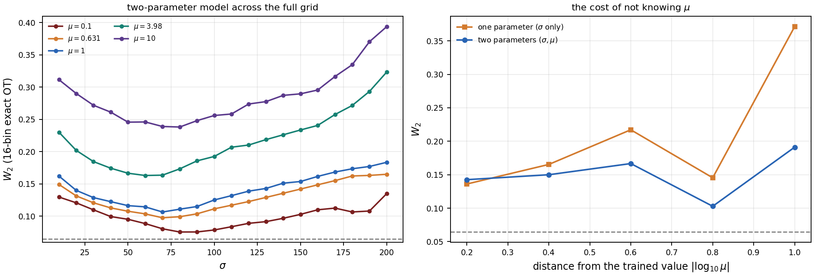
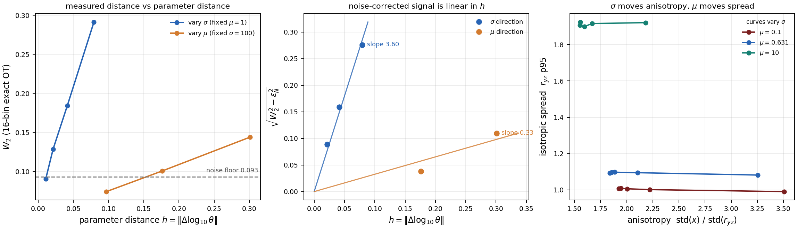
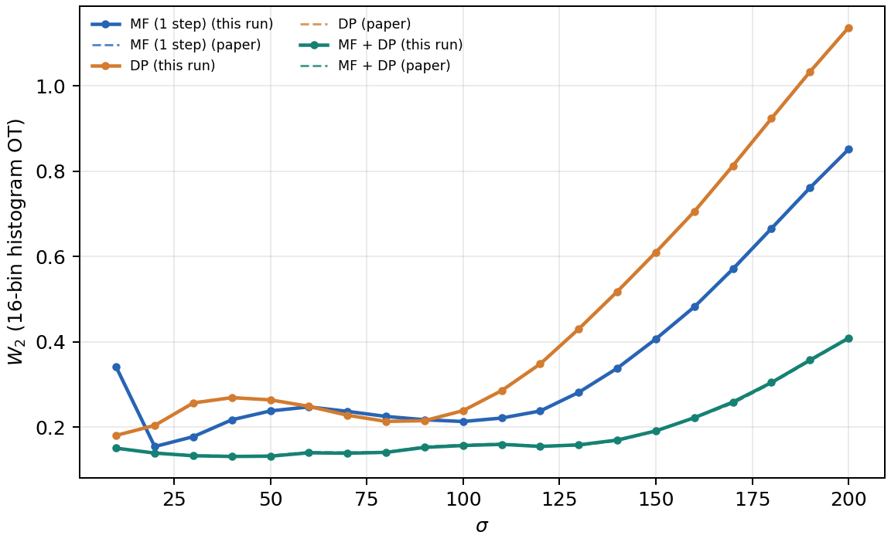

# KS Two-Step Diffusion — KS3D 两步扩散复现

> 复现 Shen et al. (2026) *Two-Step Diffusion* 论文中 **3D Keller–Segel 方程 + 层流剪切** 的两步扩散采样，
> 并归档完整的粒子云指标、训练权重校验与图表。
>
> 上游代码：[fire-lit-band/MF-DeepParticle](https://github.com/fire-lit-band/MF-DeepParticle)（源码快照见 `upstream/`）
> 本仓库：[YangZhenyu23/KS-two-step-diffusion](https://github.com/YangZhenyu23/KS-two-step-diffusion)（private）

---

## 这个仓库做了什么

在 RTX 4060 Laptop 上，从零走完上游 `paper_reproduction` 的 `ks3d` 全流程：
**物理数据生成 → 模型训练 → 100k 粒子精确 OT 评测 → 两步 MF 附加实验 → 计时 → 出图**。

上游源码**一行未改**，所有产物独立落在 `repro_ks3d/`，本仓库收录其中的指标、图与元数据。

### 两部分工作

| 部分 | 内容 | 报告 |
|---|---|---|
| **A. 单参数复现**（v0.1） | 复现上游 KS3D 两步扩散，20 σ × 3 seed，180 条主实验指标 + 60 条两步 MF 指标 | [`docs/REPRODUCTION.md`](docs/REPRODUCTION.md) |
| **B. 双参数 pilot**（v0.2） | 网络输入从 σ 扩到 **(σ, μ)**，LHS-20 抽样，100 格验证 | [`docs/TWO_PARAM_REPORT.md`](docs/TWO_PARAM_REPORT.md) |
| **C. 双参数全量**（v0.3） | **200 格 × 100k 粒子**（论文版），LHS-40，训练至收敛 | [`docs/FULLSCALE_REPORT.md`](docs/FULLSCALE_REPORT.md) |

### 全量实验的核心结论（C 部分）

| 层面 | 结论 |
|---|---|
| 数据规模 | 20σ × 10μ = **200 格 × 100k 粒子**，637 MB，191 分钟 |
| 噪声基底 | 100k 粒子 / 16 箱 = **0.0644**（pilot 20k 是 0.0931） |
| LHS 覆盖率 | 留出 160 格 `0.1547` ≈ 训练 40 格 `0.1532`，**泛化无衰减** |
| **双参数是否更好** | ✅ **改进 27.1%**（0.1560 vs 0.2140，144 双留出格，117/144 胜） |
| **是否学到 μ 耦合** | ✅ 增益随 μ 偏离**单调增长**（`corr=0.660`），μ=10 处改进 **48.5%** |
| 连续性 | ✅ 370 对相邻格点 `W2/h` 全部有限 |



左：双参数模型在 200 格上的误差；右：单参数模型"不知道 μ"的代价随 μ 偏离上升，双参数保持平坦。

### 三步核心结论

| 层面 | 结论 |
|---|---|
| 流程是否跑通 | ✅ 六阶段全绿，`status` 均为 `complete/passed`，34 分 13 秒 |
| 是否复现上游历史数值 | ✅ 180 行最大偏差 `0.0066`、平均 `0.0011`、最大相对 `3.6%` |
| 两步 MF 是否复现 | ✅ 20 行最大偏差 `0.0021`、平均 `0.00045`，18/20 优于一步 |
| 是否复现论文绝对数值 | ❌ 差 4–35 倍，判定为**度量口径不同**（见下） |

### 双参数扩展的核心结论（B 部分）

| 层面 | 结论 |
|---|---|
| 第二个参数选什么 | **μ**（KS 的真正扩散系数）；`kappa` 是 KPP 的，不属于 KS 方程 |
| 参数是否正交 | ✅ σ 只改**各向异性**（+78%），μ 只改**整体展宽**（+91%），互不干扰 |
| LHS 是否够用 | ✅ 20 格训练，80 格留出→留出 W2 `0.2717` ≈ 训练 `0.2800`，泛化无衰减 |
| 双参数是否更好 | ✅ 预算对齐后**全档位胜出**，最佳 **−19.1%**（每格 600 更新） |
| 连续性能否观察 | ✅ `W2_corr/h` ≈ 常数（3.49→3.84→4.18），且 180 对相邻格点全有限 |
| 连续性数学证明 | ✅ Lipschitz（σ 线性、μ 平方根），见 [`docs/CONTINUITY.md`](docs/CONTINUITY.md) |



左：测得 W2 对参数距离，虚线是噪声基底；中：扣除噪声后信号对 `h` 线性（斜率 σ=3.60、μ=0.33）；
右：σ 沿 x 轴移动各向异性、μ 沿 y 轴平移展宽——两个参数作用于不同几何自由度。

**踩过的坑**：第一次对比用固定 1000 步，双参数反而输 67%。原因是 20 格分 1000 步＝每格 50 步，
而单参数 10 格分 1000 步＝每格 100 步。**多参数实验必须按"每格更新数"对齐，不能按总步数对齐**。
详见 [`docs/TWO_PARAM_REPORT.md`](docs/TWO_PARAM_REPORT.md) §4.4。

### ⚠️ 关于"与论文的绝对值差异"

本仓库复现的是「**上游仓库对论文的复现**」，不是「论文本身」。与 Shen et al. 2026 Table 的直接数值对比：

- Meanflow 比值 4.3–35×（均值 17.5），曲线相关系数 `0.94`
- MF+DP 比值 19–30×（均值 **25.4**，几乎恒定），相关系数 `0.99`

**形状对得上，量级对不上。** 决定性判据：把 100k 参考云随机对半切成两个 50k 独立样本，
它们之间的 W2 就有 `0.067–0.081`；而论文报告的 DP 精修值是 `0.0047–0.0214`，
**比"自己和自己比"还小 3–15 倍**。任何经验测度之间的 W2 都不可能低于有限样本自身的涨落，
所以论文的 W2 不是"生成云 vs 参考云在物理坐标下的经验 W2"，正文也未给出归一化/离散化定义。

完整论证与试过的 8 种口径变换见 [`docs/PAPER_COMPARISON.md`](docs/PAPER_COMPARISON.md)。

---

## 目录结构

```
.
├── upstream/MF-DeepParticle/     # 上游源码快照（只读参照，266 文件）
│   ├── paper_reproduction/       #   论文复现管线（ks/kpp/cubic/timing/figures）
│   └── output/                   #   历史指标 JSON/CSV（用于对比，不含 npz/pt）
├── results/ks3d/                 # A. 单参数复现的指标与图（2.76 MB）
│   ├── evaluation/               #   主实验 180 条 W2 + 验证
│   ├── multistep/                #   两步 MF 60 条 W2 + 生成清单
│   ├── data/                     #   48 组粒子云 manifest（含 SHA256）
│   ├── training/                 #   12 个 checkpoint 校验报告
│   ├── timing/                   #   480 条原始计时
│   ├── figures/                  #   ks3d_w2.pdf、d+1 投影
│   └── analysis/                 #   comparison.csv/md、curves.png
├── results/twoparam/             # B. 双参数扩展（0.81 MB）
│   ├── design/                   #   LHS 设计 + 随机抽样对照
│   ├── data/full/                #   100 格物理云 manifest（含 SHA256）
│   ├── train/                    #   双参数 checkpoint + 训练日志
│   ├── evaluate/                 #   100 格 W2 指标（训练/留出分开）
│   ├── compare/                  #   单参数 vs 双参数（预算匹配、收敛扫描）
│   └── continuity/               #   连续性测量 + 三联图
├── twoparam/                     # B 的代码（7 个模块）
├── docs/                         # 复现报告、论文对比、上游审计、连续性证明
├── scripts/                      # sync.ps1 + 11 个分析脚本
├── CHANGELOG.md                  # 变更日志（每次更新必登记）
└── .cursor/rules/                # 约束后续会话的同步纪律
```

### 粒子云去哪了

`*.npz` 粒子云共 371 MB（evaluation 213 MB + multistep 85 MB + data 74 MB），
**未入库**（`.gitignore` 排除）。每个云的路径、形状、SHA256 都完整记录在各 `manifest.json` 里：

- 评测云：`results/ks3d/evaluation/ks/generated/clouds/ks3d/sigma*.npz`
  每个含 `reference` + 9 路生成云（MF / DP / MF+DP × seed 88/89/90），各 100,000 × 3
- 两步 MF 云：`results/ks3d/multistep/clouds/ks3d/sigma*.npz`
  每个含 `reference` + `seed88/89/90_mf_two_step`，各 100,000 × 3

重跑生成见下节。

---

## 复现

前置：Python 3.10+、CUDA、`torch==2.8.0+cu129`，以及上游依赖

```bash
python -m pip install torch==2.8.0 --index-url https://download.pytorch.org/whl/cu129
python -m pip install -r upstream/MF-DeepParticle/paper_reproduction/requirements.txt
```

在 `upstream/MF-DeepParticle/` 下依次执行（与上游 README 一致）：

```powershell
python -m paper_reproduction data       --models ks3d --out ../../repro_ks3d/data
python -m paper_reproduction train      --models ks3d --data-run ../../repro_ks3d/data --out ../../repro_ks3d/training
python -m paper_reproduction evaluate   --models ks3d --model-run ../../repro_ks3d/training --workers 4 --out ../../repro_ks3d/evaluation
python -m paper_reproduction multistep  --model-run ../../repro_ks3d/training --workers 4 --out ../../repro_ks3d/multistep
python -m paper_reproduction timing     --models ks3d --model-run ../../repro_ks3d/training --out ../../repro_ks3d/timing
python -m paper_reproduction figures    --results ../../repro_ks3d/evaluation --out ../../repro_ks3d/figures
```

对比历史值：

```powershell
python results/ks3d/analyze.py --run repro_ks3d --out repro_ks3d/analysis
```

> 脚本会用当前结果覆盖 `results/ks3d/analysis/` 下的三个文件。

### 耗时参考（RTX 4060 Laptop 8GB）

| 阶段 | 耗时 | 说明 |
|---|---:|---|
| 数据生成 | **28.8 min** | 48 组云；**96% 花在 20 个 100k 参考解上**（每个 ~85 s） |
| 训练 | 2 min 46 s | 3 seed × 4 checkpoint |
| 评测 | 61 s | 180 次精确 OT |
| 两步 MF | 25 s | 60 次精确 OT + 生成 |
| 计时 | 5 s | 480 次前向 |
| 出图 | ~2 s | 2 张图 |
| **合计** | **34 min 13 s** | 产物 374 MB |

KS 的相互作用项是 O(N²)：100k 粒子是 10k 的 100 倍计算量。显存峰值 1.92 GiB（chunk=256 分块）。

---

## 关键数值

### 主实验（W2，100k 粒子、16 箱/轴精确直方图 OT，3 seed 均值）

| 方法 | 本次 | 上游历史 | 相对偏差 | 单行最大 \|Δ\| |
|---|---:|---:|---:|---:|
| MF（1 步） | 0.3545 | 0.3545 | **−0.009%** | 0.0022 |
| DP | 0.4564 | 0.4565 | **−0.039%** | 0.0019 |
| MF + DP | 0.1902 | 0.1902 | **−0.002%** | 0.0066 |

### 两步 MF 对比一步（节选）

| σ | 一步 MF | 两步 MF | 两步/一步 |
|---:|---:|---:|---:|
| 10 | 0.3411 | 0.3859 | **1.131** ↑ |
| 20 | 0.1547 | 0.1647 | **1.065** ↑ |
| 40 | 0.2174 | 0.1987 | 0.914 ↓ |
| 100 | 0.2134 | 0.2067 | 0.969 ↓ |
| 200 | 0.8517 | 0.7973 | 0.936 ↓ |

20 行全表见 [`results/ks3d/multistep/summary.csv`](results/ks3d/multistep/summary.csv)。



实线为本次复现，虚线为上游历史值；三条曲线逐点重合。

### 推理/训练时间（4060 vs 论文的 5080）

| 方法 | 本次推理 (ms) | 论文 (ms) | 倍率 |
|---|---:|---:|---:|
| MF | 4.51 | 2.28 | 1.98× |
| DP | 4.30 | 2.10 | 2.05× |
| MF + DP | 7.66 | 3.90 | 1.97× |
| MF（两步） | 7.72 | 3.90 | 1.98× |

严格 ~2.0 倍，正好对应两张卡的算力差；两步 MF 的推理开销 ≈ MF+DP，是一步 MF 的 1.71 倍。

### 数值可靠性

| 检查 | 结果 |
|---|---|
| 精确 OT 求解次数 | 240（主实验 180 + 两步 MF 60） |
| 最大质量残差 | `1.74e-16` |
| 最大原始-对偶间隙 | `1.73e-12` |
| 求解器状态 | 180/180 = 最优（code 1） |
| 粒子质量守恒 | `all_mass_retained: true` |
| checkpoint 校验 | 12/12 通过 |

---

## 工作流：本地改，GitHub 存档

本仓库是**本地为主、GitHub 为版本存档**的单向同步：

```
本地修改 → git commit（写清改了什么）→ git push → GitHub 留痕
```

### 一键同步

```powershell
.\scripts\sync.ps1 -Message "补充 sigma=10 的云图"
```

脚本会：检查是否有改动 → `git add -A` → 提交（提交信息带时间戳）→ 推送。
只提交不推送用 `-NoPush`；先预览用 `-DryRun`。

### 手动等价流程

```powershell
git add -A
git commit -m "变更: 补充 sigma=10 的云图"
git push
```

### 纪律

1. **每次改动都要动 `CHANGELOG.md`**，在 `[Unreleased]` 下按 `新增/变更/修复/移除/复现` 分类登记。
2. 提交信息用中文，前缀标明类型：`新增:` / `变更:` / `修复:` / `复现:` / `文档:`。
3. 结果有数值变化时，必须重跑 `analyze.py` 并更新 `results/ks3d/analysis/`，同时在 CHANGELOG 记下新的最大偏差。
4. **不要提交** `*.npz`、`*.npy`、`.venv*`、`repro_ks3d/`（已在 `.gitignore`）。
5. 发版时把 `[Unreleased]` 内容移到新版本号下，并 `git tag -a vX.Y.Z -m "..."`。

### 版本回溯

```powershell
git log --oneline                   # 看所有变更
git show <commit>                   # 看某次改了什么
git diff v0.1.0..HEAD --stat        # 看两版差异
git checkout <commit> -- <file>     # 取回某个文件的旧版本
```

---

## 文档索引

| 文档 | 内容 |
|---|---|
| [`docs/FULLSCALE_REPORT.md`](docs/FULLSCALE_REPORT.md) | **全量实验完整报告**：200 格协议、LHS-40、训练结果、27.1% 改进、连续性重测 |
| [`docs/TWO_PARAM_REPORT.md`](docs/TWO_PARAM_REPORT.md) | 双参数 pilot 报告：为什么选 μ、LHS 原理、100 格结果 |
| [`docs/CONTINUITY.md`](docs/CONTINUITY.md) | **参数连续性的数学证明**（Lipschitz/Hölder）+ 数值验证三层次 |
| [`docs/REPRODUCTION.md`](docs/REPRODUCTION.md) | 单参数复现报告：命令、逐阶段耗时、逐 σ 数值、偏差来源、局限 |
| [`docs/PAPER_COMPARISON.md`](docs/PAPER_COMPARISON.md) | 与论文逐项对比；统计噪声下限判据；8 种口径变换的尝试记录 |
| [`docs/UPSTREAM_ANALYSIS.md`](docs/UPSTREAM_ANALYSIS.md) | 上游仓库代码审计：结构、调用链、两处实质不一致、可借鉴点 |
| [`docs/KS_physical_parameters.md`](docs/KS_physical_parameters.md) | KS 方程三个位移尺度的量级分析（剪切主导区间） |
| [`docs/KS_equation_and_two_parameter_design.md`](docs/KS_equation_and_two_parameter_design.md) | 单参数 → 两参数条件化：推荐 (σ, χ)，不建议 (σ, T) |

---

## 已知局限

- 只复现了 **3D**（`ks3d`）；上游还有 4D、KPP 2D/3D、cubic，本次未跑。
- 上游没有 KS **2D** 的论文口径实验（`deepparticle` 里的 `ks2d` 是通用管线，指标/协议不同，不能直接对比）。
- 所有 W2 都是"16 箱/轴直方图 OT"，不是经验测度的真 W2；**跨网格比较无意义**。
- 计时受笔记本功耗墙/温度影响，只反映本机状态。
- 无法核验"新训练参数与历史权重逐位相同"——历史 60 个 `.pt` 与 224 个 `.npz`（1.03 GB）不在上游仓库里。
  只能做到指标级一致。

---

## 引用

```bibtex
@article{shen2026twostep,
  title  = {Two-Step Diffusion: Fast Sampling and Reliable Prediction for
            3D Keller--Segel and KPP Equations in Fluid Flows},
  author = {Shen, and Wang, and Xin, and Zhang,},
  year   = {2026},
  note   = {arXiv:2601.20024v1}
}

@article{wang2024deepparticle,
  title  = {A DeepParticle method for learning and generating aggregation
            patterns in multi-dimensional Keller--Segel chemotaxis systems},
  author = {Wang and Hu and Lin and Zhang},
  year   = {2024}
}
```

## 许可

本仓库的**复现产物与文档**可自由引用。`upstream/` 下为上游源码快照，
版权归原作者（上游仓库本身未附 LICENSE，此处仅作复现参照，未做修改）。
