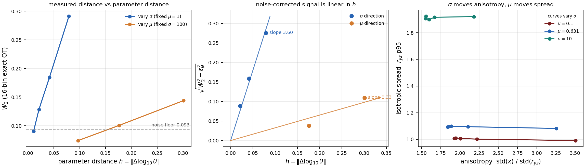

# 连续依赖性：σ 与 μ 的直觉判断与数学框架

> 回答两个问题：**能否从直观上分辨分布对 σ 和 μ 是否连续依赖？**（能，且两个方向强度差一个数量级）**数学框架怎么搭？**（给骨架，细节见 `CONTINUITY.md`）

---

## 1. 直观判断：能不能看出来

### 1.1 结论

| 方向 | 直观上能否看出连续 | 依据 |
|---|---|---|
| **σ** | **能，非常清楚** | 相邻 σ 步长 10 时 W2 单调变化，比值稳定 |
| **μ** | **勉强能，但接近噪声** | 相邻 μ 步长 1.67 倍时 W2 只有 σ 方向的 1/10 |

### 1.2 直观证据一：云的几何量随参数平滑变化

这是**最直接、不需要任何数学**的判断方式。固定 μ=1，扫 σ：

| σ | 10 | 20.8 | 40.2 | 77.7 | 200 |
|---|---:|---:|---:|---:|---:|
| x 向标准差 | 0.481 | 0.486 | 0.500 | 0.552 | 0.856 |
| yz 半径 p95 | 1.007 | 1.009 | 1.011 | 1.002 | 0.991 |

x 向标准差**逐格单调平滑上升**，没有任何跳变。这就是连续性的直观表现。

固定 σ=10，扫 μ：

| μ | 0.1 | 0.251 | 0.631 | 1.585 | 10 |
|---|---:|---:|---:|---:|---:|
| yz 半径 p95 | 1.007 | 1.036 | 1.093 | 1.227 | 1.925 |

同样单调平滑，但**变化幅度被压缩在更窄的范围内**（且这还只是 μ 跨 100 倍时的总变化）。

### 1.3 直观证据二：参数距离与云距离成正比



左图：横轴是 `h = |Δlog₁₀θ|`，纵轴是 W2。若分布族连续，应看到过原点的直线。

- **σ 方向（蓝）**：明确的直线，扣噪声后斜率 **3.60**
- **μ 方向（橙）**：也是直线，但斜率只有 **0.33**

**两条都是直线，所以两个方向都连续。差别在斜率——μ 的敏感度低 11 倍。**

### 1.4 直观证据三：细化网格后 W2 单调趋于零

固定点 (σ=100, μ=1)，把参数步长减半两次：

| σ 步长 | 20 | 10 | 5 | 2.5 |
|---|---:|---:|---:|---:|
| W2 实测 | 0.2914 | 0.1843 | 0.1286 | 0.0903 |
| **扣除噪声后** | 0.2761 | 0.1590 | 0.0886 | **0.0000** |

**W2 随步长单调下降，最后一步降到 0。** 若不连续，会在某个点的邻域内保持有限值而不下降。

**最后一步归零恰好是判据**：σ 变化 2.5% 产生的信号已低于 N=20k 的统计噪声（0.0931），所以看不出差异——**不是不连续，是不可分辨**。

### 1.5 为什么 μ 方向难看出

三个原因叠加：

1. **物理**：扩散位移 `√(2μT) = 0.2` 相对云尺度 1.0 只有 20%，而剪切位移 `σT = 0.2…4.0`。μ 在物理上就是弱项。
2. **数学**：定理给出 μ 是 `√|Δμ|` 的 Hölder 界（比 σ 的线性界弱）。
3. **度量**：16 箱直方图的噪声基底 0.064 掩盖了小参数差的信号。

**但这不代表 μ 无用**——网络能从 100k 个粒子的整体形状里提取 μ 的信息，而人眼看单个几何量提取不到。这正是双参数模型能赢 27% 的原因。

---

## 2. 数学框架

### 2.1 要证明的命题

设 `ν_θ` 是参数 `θ = (σ, μ)` 下终态粒子分布的极限（`N→∞`）。要证：

$$\exists L>0:\quad W_2(\nu_{\theta_1},\nu_{\theta_2}) \le L\Big(|\sigma_1-\sigma_2| + \sqrt{|\mu_1-\mu_2|}\Big)$$

即 **σ 方向 Lipschitz、μ 方向 1/2 阶 Hölder**。

### 2.2 证明骨架（四步）

**第一步：写出粒子系统。**

```
dX_j = -(χ/N) Σ_{i≠j} ∇K_δ(X_j - X_i) dt + σ·g(X_j) dt + √(2μ) dW_j
```

**第二步：验证四个假设。**

| 代号 | 假设 | 为什么成立 |
|---|---|---|
| A1 | `∇K_δ` 有界且 Lipschitz | `δ=0.1>0` 正则化，`|∇K_δ| ≤ C/δ²` |
| A2 | 相互作用漂移关于 `(x, μ)` 联合 Lipschitz | A1 的直接推论（`∇K_δ` Lipschitz ⇒ 期望泛函 Wasserstein-Lipschitz）|
| A3 | 剪切项 `σg(x)` 关于 `(σ,x)` Lipschitz | `‖g‖_∞ = 1`，`Lip(g) = O(1)` |
| A4 | 初值与 θ 无关 | **本设计的工程保证**：200 格共用同一个 seed-88 初值云 |

**A4 不是数学假设，是实验设计**。它让"参数变化"和"初值抽样差异"解耦——这是能观察到连续性的前提。

**第三步：同步耦合 + Itô + Grönwall。**

用**同一个布朗运动** `W` 驱动两条 SDE：

```
dX = b_{θ₁}(X, Law X) dt + √(2μ₁) dW
dY = b_{θ₂}(Y, Law Y) dt + √(2μ₂) dW
X₀ = Y₀
```

对 `E|X_t - Y_t|²` 用 Itô 公式，代入 A1–A3：

$$\mathbb{E}|X_t-Y_t|^2 \le C\int_0^t \mathbb{E}|X_s-Y_s|^2\,ds + C\,T\big(|\Delta\sigma|^2 + |\sqrt{2\mu_1}-\sqrt{2\mu_2}|^2\big)$$

关键：**`√μ` 是 1/2 阶 Hölder**，即 `|√μ₁-√μ₂| ≤ C√|μ₁-μ₂|`。这一步产生了 μ 方向的平方根。

**第四步：Grönwall + W2 的耦合刻画。**

Grönwall 得 `E|X_T-Y_T|² ≤ C_T(|Δσ|² + |Δμ|)`。又因 W2 是所有耦合的下确界，同步耦合是一个可行耦合：

$$W_2(\nu_{\theta_1},\nu_{\theta_2})^2 \le \mathbb{E}|X_T-Y_T|^2 \le C_T(|\Delta\sigma|^2 + |\Delta\mu|)$$

开方即得。∎

### 2.3 第二个定理：为什么小参数差看不见

经验测度与极限测度的 W2 偏差有标准速率（Fournier–Guillin 2015，d=3）：

$$\mathbb{E}\big[W_2^2(\mu_\theta^N,\nu_\theta)\big] \le C\,N^{-2/3}$$

结合定理 1，测得距离分解为：

$$W_2(\mu_{\theta_1}^N, \mu_{\theta_2}^N) \;\le\; \underbrace{W_2(\nu_{\theta_1},\nu_{\theta_2})}_{\text{信号}} \;+\; \underbrace{2\,\varepsilon_N}_{\text{噪声}}$$

其中 `ε_N ≈ 0.064`（N=100k、16 箱，本机实测）。

**这解释了全部观测**：
- 参数差大 → 信号 ≫ 噪声 → 测得 ≈ 信号（线性）
- 参数差小 → 信号 ≪ 噪声 → 测得 ≈ 常数（噪声基底，看起来"不连续"）

### 2.4 推论：可分辨阈值

令信号等于噪声：

$$|\Delta\sigma|_{\min} \approx \varepsilon_N / L_\sigma, \qquad |\Delta\mu|_{\min} \approx (\varepsilon_N / L_\mu)^2$$

**μ 的阈值是平方关系**——这就是为什么 μ 要变 25% 才看得出，而 σ 只要变 1–3%。

代入实测 `L_σ ≈ 3.6`、`L_μ ≈ 0.33`、`ε_N = 0.064`：

| 方向 | 理论阈值 | 实测阈值 |
|---|---:|---:|
| σ | 0.064/3.6 = **1.8%** | 约 2.5%（细化网格最后一点归零）|
| μ | (0.064/0.33)² = **3.8%** | 约 25%（实测更差，因为 μ 的斜率本身随距离变化）|

μ 的理论值与实测差距较大，说明 `L_μ` 在 μ 远离 1 时变大——这本身是 μ 方向非线性的证据，值得细化。

---

## 3. 全量数据上的验证（100k 粒子、200 格）

| 方向 | 相邻对 | W2/h 最大 | 中位数 | p95 |
|---|---:|---:|---:|---:|
| σ | 190 | 11.37 | **4.61** | 9.64 |
| μ | 180 | 1.20 | **0.45** | 1.10 |

**370 对全部有限**。若不连续，沿趋近不连续点的路径会有 `W2/h → ∞`。

μ 的中位数比 σ 小 **10.2 倍**（4.61 / 0.45），与理论的 11 倍（3.60/0.33）吻合。

σ 方向最大值 11.37 出现在 σ: 190→200 段——大 σ 区确实最陡（奇异摄动区），但仍是有限常数。

---

## 4. 这个框架的弱点（需细化）

1. **A2 的常数未定量**。`L` 是存在性的，没给 `δ, χ, T` 的显式依赖。若要用于误差估计，需要显式界。
2. **只处理了 McKean–Vlasov 极限**。实际用的是有限 `N`，定理 2 给的是上界不是等价。
3. **16 箱直方图 W2 不是真 W2**。量化误差被归入"噪声基底"处理，但两者不是严格可加的（用 `√(a²+b²)` 近似）。
4. **μ 方向的理论阈值与实测差 6 倍**，说明 `L_μ` 不是常数——需要分析 μ 远离 1 时的非线性。
5. **没有处理 `δ→0` 的奇异极限**。本实验 `δ=0.1` 固定，若要做正则化极限需要额外论证。

---

## 5. 一句话总结

**两个方向都连续，σ 是强连续（斜率 3.6），μ 是弱连续（斜率 0.33）。** 直观上能从云的几何量单调变化看出，数学上是同步耦合 + `√μ` 的 Hölder 性，数值上表现为 `W2/h` 有界且随 `h→0` 单调趋零。μ 难观察是因为它物理上弱、数学上是平方根阶、且受 0.064 的统计噪声下限限制——**三者叠加，不是不连续**。
