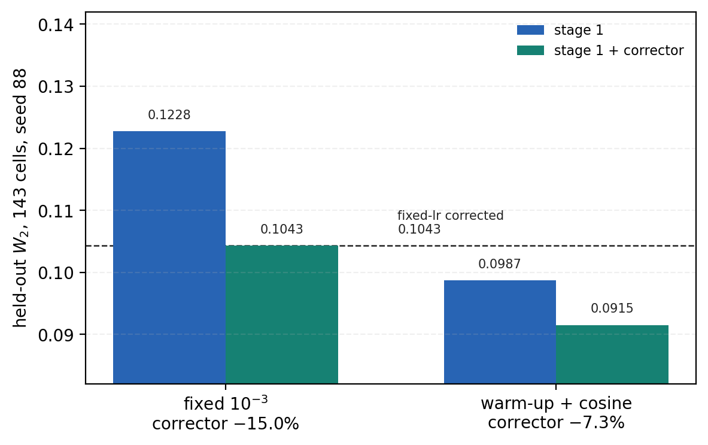
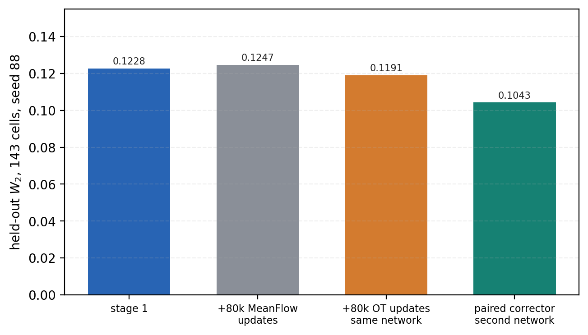
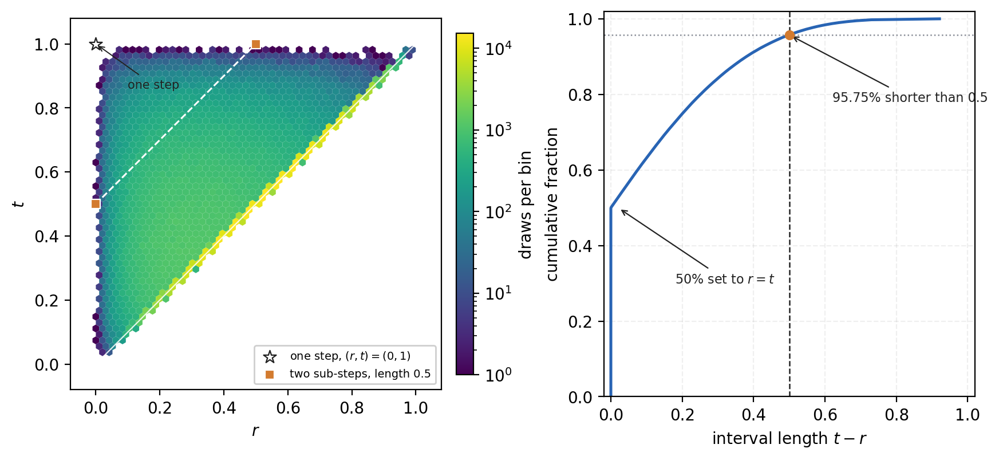
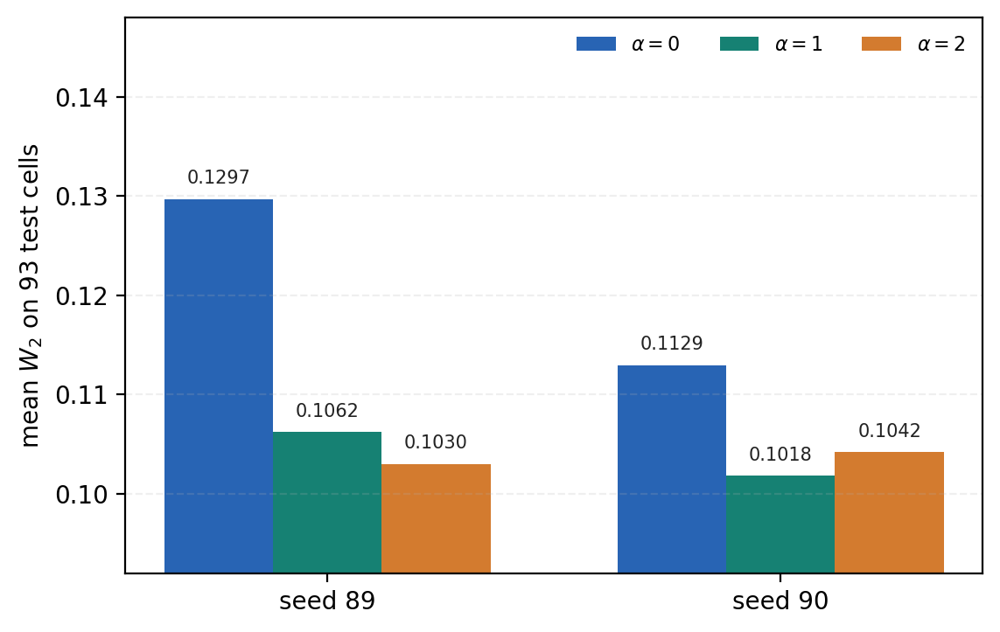

# Follow-up, 20 November

**Stage 1 retrained with a warm-up and a cosine, on the same two-parameter Keller–Segel system**

Zhenyu Yang · 20 November 2026

Numbers are read from `results/fullscale/harry_followup/`. The 18 November note is [`HARRY_NOTE.md`](HARRY_NOTE.md). I did not recompute its fixed-learning-rate result: on 143 held-out cells and three seeds, a corrector paired with its own stage-1 map reduces 16-bin histogram \(W_2\) by 14.4% ± 4.2% (415 of 429 comparisons). This note is the runs that were still open: the learning-rate schedule, two budget checks, the \((r,t)\) sampler, \(\alpha=2\) on the other two seeds, and one corrector trained on three seeds.

The gated corrector is not in this note.

---

## The answer

At fixed learning rate \(10^{-3}\), the corrector removes about 15% of the histogram \(W_2\). I retrained stage 1 on the same 40 cells and the same 32,000 updates per cell, with a 2% linear warm-up and then a cosine from \(10^{-3}\) to \(10^{-5}\). On the 143 held-out cells, seed 88, the corrector now removes **7.3%** (0.09874 to 0.09153, lower on 128 of 143 cells). Stage 1 alone, 0.09874, is already under the old corrected value 0.10429. The corrected value is 0.09153.

On the 112 cells left out by the headline design and by all three width-112 runs:

| | \(W_2\) | vs one step |
|---|---:|---:|
| one step, seed 88 | 0.09859 | — |
| then the corrector | 0.09150 | lower by 7.2% |
| same weights, two sub-steps | 0.08358 | lower by 15.2% |
| width 112, three seeds | 0.10215 ± 0.00133 | higher by 3.6% |

Two sub-steps of the scheduled map, and no second network, give a lower \(W_2\) than the corrector. The width-112 seeds are 0.10287, 0.10062, and 0.10297, all above the one-step map.

In the 18 November note, two sub-steps of the fixed-learning-rate map raised the error by 1.3% on that note's 112 cells. Here the same kind of evaluation lowers it. The corrector is still a reduction against one step of the map it was fitted to. Section 2 puts the corrector's update budget on the stage-1 network. Section 5 is one corrector trained on three seeds: the reductions are 1.8%, 11.2%, and 5.8%.

---

## Setup

The cells are the ones stored in the checkpoint. I did not redraw them with `stratified_subset`. The warm-up run uses the 40 cells in the seed-88 headline checkpoint. Held-out cells are the \(20\times 10\) grid minus those 40, minus the rest of the \(\mu=1\) row: 143 cells. The four-row table uses the 112 cells that the headline design and the three width-112 designs all leave out.

The metric is the exact 16-bin histogram \(W_2\), with \(10^5\) particles. The corrector protocol is unchanged: \(\alpha=1\), 2,000 updates per cell, batch 2,000, an exact assignment every 10 steps, residual penalty \(\lambda=1\). The new fine-tune and the shared corrector build that assignment with SciPy's Hungarian algorithm. On a batch of 2,000 points the optimal cost matches the network simplex used for the earlier corrector.

The schedule is a 2% linear warm-up, then a cosine from \(10^{-3}\) to \(10^{-5}\). Stage 1 is 32,000 updates per cell, replayed from a CUDA graph. The batch is 4,096.

---

## 1. Warm-up schedule — completed

The paired corrector is seed 88. The width-112 row is seeds 88, 89, and 90.

On the 143 held-out cells the warm-up stage 1 has \(W_2=0.09874\). With the corrector it is 0.09153, a 7.3% drop, on 128 of 143 cells. The seed-88 pair from the fixed learning rate was 0.12277, then 0.10429, a 15.0% drop, on 141 of 143 cells. The reduction is about half of what it was.

*Figure 1. Histogram \(W_2\) on the 143 held-out cells, seed 88. The dashed line is the fixed-learning-rate pair after its corrector, 0.10429. Completed.*

Same schedule, 112 common cells:

| row | what is evaluated | \(W_2\) | vs row (a) |
|---|---|---:|---:|
| (a) | warm-up stage 1, one step, seed 88 | 0.09859 | — |
| (b) | (a), then its corrector | 0.09150 | lower by 7.2%, 99 of 112 |
| (c) | width 112, three seeds, same schedule | 0.10215 ± 0.00133 | higher by 3.6% |
| (d) | (a), two sub-steps of the same weights | 0.08358 | lower by 15.2% |

*Figure 2. Left: histogram \(W_2\) on the 112 common held-out cells. The purple bar is the mean of three width-112 seeds; the dots are the seeds. Right: reduction relative to row (a). A negative bar is a higher error. Completed.*

Row (d) is the one that comes out differently from the earlier note. There, a second pass over the same field raised the error. Here (d) is the lowest of the four, below the corrector. Row (b) is still below one step. Every width-112 seed in row (c) is above (a).

The corrector is initialised at the identity and penalised for moving off the stage-1 cloud, so the drop it can make depends on how large that residual is. The fixed-learning-rate map stops at 0.12277. The scheduled map stops at 0.09874. Section 2 keeps the learning rate at \(10^{-3}\) and adds the corrector's update budget on the same network. That does not produce the drop from 0.12277 to 0.09874.

---

## 2. Budget on the same network — completed

Seed 88, fixed learning rate, 143 held-out cells. Each row below adds 80,000 updates, 2,000 per training cell. That is the corrector's update count. No second network.

| control | \(W_2\) | vs stage 1 (0.12277) |
|---|---:|---:|
| stage 1 | 0.12277 | — |
| 80,000 further MeanFlow updates | 0.12465 | higher by 1.5% |
| 80,000 updates on the same minibatch OT targets | 0.11911 | lower by 3.0% |

*Figure 3. Seed 88, fixed learning rate, 143 held-out cells. Green is the paired corrector from the 18 November note, 0.10429. The other bars are the stage-1 network only. Completed.*

Further MeanFlow updates at \(10^{-3}\) go from 0.12277 to 0.12465. The same budget against the minibatch OT targets, still on this network, reaches 0.11911, about 3% under stage 1. The second network on this map reaches 0.10429, about 15% under stage 1. With the schedule, stage 1 itself moves from 0.12277 to 0.09874, and the corrector on that map removes a further 7.3%.

---

## 3. The \((r,t)\) sampler — completed

The sampler is unchanged. Two draws from \(\mathcal N(-0.4,1)\) pass through a sigmoid; \(t\) is the larger and \(r\) the smaller. Half the batch is set to \(r=t\). In one million draws the fraction with \(t-r<0.5\) is 0.9575, and the fraction on the diagonal is 0.5000.

*Figure 4. One million draws from the training sampler. Left: density of \((r,t)\). The dashed line is interval length 0.5. The star is one step, \((r,t)=(0,1)\); the squares are the two sub-steps. Right: cumulative fraction of \(t-r\). Completed.*

One step is \(x-u(x,0,1)\). Two steps are \([1,0.5]\) and then \([0.5,0]\), each multiplied by its interval length. On the 143 held-out cells of the fixed-learning-rate seed-88 map, the two clouds differ. The mean histogram \(W_2\) between them is **0.0814**, and the mean particle distance is **0.0303**. Both numbers compare the two outputs with each other.

The training intervals are mostly short, and half of each batch sits on \(r=t\). The two-step evaluation uses two intervals of length 0.5, which this sampler seldom draws. On the fixed-learning-rate checkpoint the sub-steps raised the error. On the scheduled checkpoint in section 1 they lower it. The earlier increase belongs to that checkpoint.

---

## 4. \(\alpha=2\) on seeds 89 and 90 — completed

\(\alpha=2\) is the value chosen on the seed-88 development split. I did not run the selection again.

Each row is the 93 test cells of that seed's held-out split.

| seed | \(\alpha=0\) | \(\alpha=1\) | \(\alpha=2\) | \(\alpha=2\) vs \(\alpha=0\) |
|---|---:|---:|---:|---:|
| 89 | 0.12967 | 0.10619 | 0.10301 | lower by 20.6% |
| 90 | 0.11294 | 0.10180 | 0.10417 | lower by 7.8% |

*Figure 5. Mean histogram \(W_2\) on 93 test cells. \(\alpha=2\) was chosen on seed 88. Completed.*

On seed 90, \(\alpha=1\) is 0.10180 and \(\alpha=2\) is 0.10417, so \(\alpha=1\) is lower. On both seeds \(\alpha=2\) is below stage 1. The value chosen on seed 88 is the lower of \(\alpha=1\) and \(\alpha=2\) on seed 89, and the higher of the two on seed 90.

Sliced \(W_2\), 64 projections, seed 88, all 143 held-out cells, fixed learning rate, \(\alpha=1\): stage 1 is 0.02226, and stage 1 plus the corrector is 0.01545. This is a lower bound from one-dimensional projections. The histogram \(W_2\) is a different number, and the drop here is larger. The sign is the same. I skipped the energy distance; it scales with the square of the particle count.

Mean absolute relative error of three summaries, same 143 cells:

| summary | stage 1 | stage 1 + corrector |
|---|---:|---:|
| centroid, \(x\) | 0.0275 | 0.0186 |
| rms radius | 0.00756 | 0.00590 |
| anisotropy | 0.0115 | 0.00735 |

*Figure 6. Mean absolute relative error on the same 143 cells. Seed 88, fixed learning rate, \(\alpha=1\). Completed.*

The centroid, the rms radius, and the anisotropy all move down with the corrector, in the same direction as the histogram.

---

## 5. One corrector on three seeds — completed

This run waited on the four above. One corrector, \(\alpha=1\), is trained on the stage-1 residuals of seeds 88, 89, and 90. Each seed keeps its own 40 training cells. The budget is 2,000 updates per seed per cell, so 120 groups and 240,000 steps. Scoring is on each seed's own 143 held-out cells. The stage-1 maps are the fixed-learning-rate checkpoints. The scheduled map from section 1 is a separate run and is not an input here.

| seed | stage 1 | shared corrector | reduction | cells lower |
|---|---:|---:|---:|---:|
| 88 | 0.12277 | 0.12058 | 1.8% | 74 / 143 |
| 89 | 0.12975 | 0.11527 | 11.2% | 143 / 143 |
| 90 | 0.11203 | 0.10551 | 5.8% | 110 / 143 |

*Figure 7. Left: histogram \(W_2\) on each seed's 143 held-out cells. Green is the corrector fitted to that seed in the earlier note. Orange is the one corrector trained on all three seeds. Right: reduction against that seed's stage 1. Completed.*

The mean of the three reductions is 6.3%. The paired correctors in the earlier note, each fitted to its own map, reduce these three stage-1 means by 14.4% and win 415 of 429 comparisons. This corrector wins 327 of 429. Putting the seed-88 corrector, unchanged, on seeds 89 and 90 gave −1.4% and −3.2%. The shared corrector is a reduction on all three seeds.

Seed 89 starts highest, and every one of its 143 cells is lower. Seed 88 drops 1.8%, on 74 of 143 cells; the corrector fitted to seed 88 alone had removed 15.0%. The three residuals differ. On seeds 89 and 90 the shared corrector lowers \(W_2\). The seed-88 corrector, applied to those two seeds unchanged, had raised it.

---

## 6. Left out

Harry asked me to leave iteration alone, so I did not run it. The gated corrector is still open. I did not retrain the paired corrector under the warm-up schedule for seeds 89 and 90. The only warm-up result with three seeds is row (c) in section 1.
