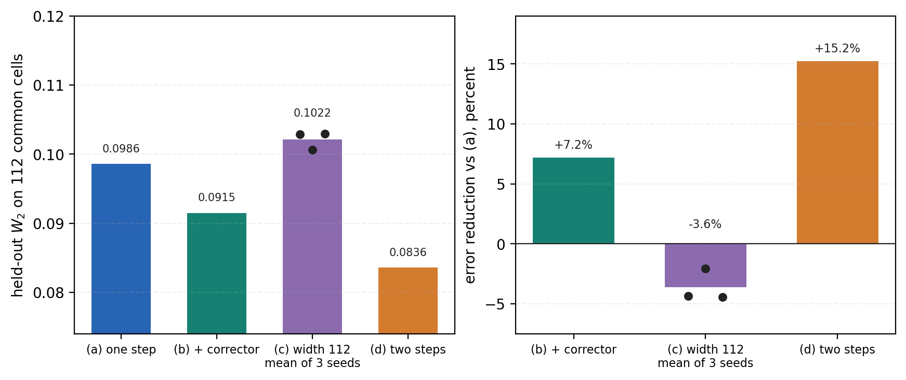
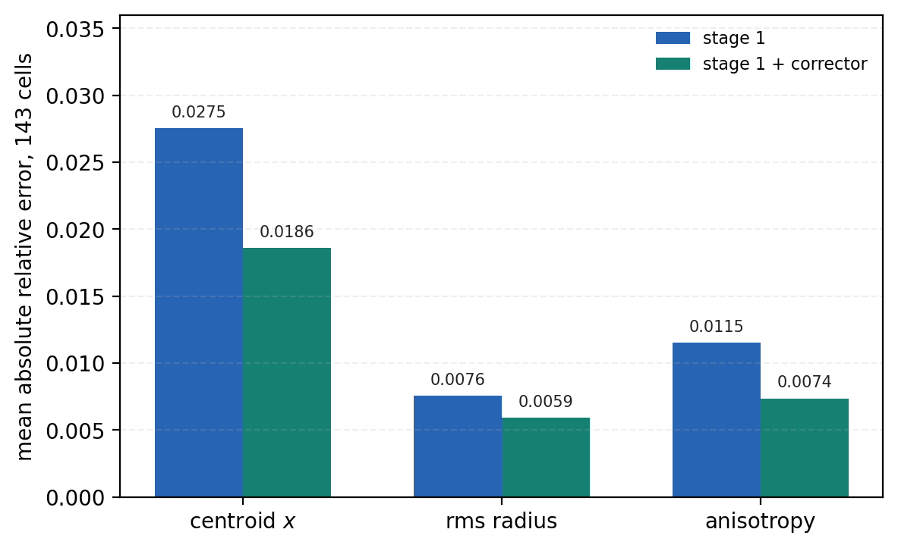
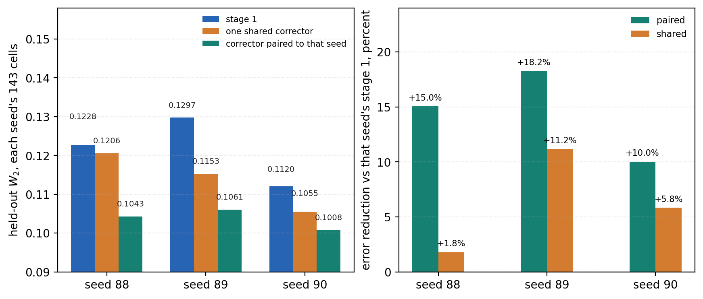

# The corrector after a scheduled stage 1

**Follow-up to the note of 18 November: the four checks, and one corrector for three seeds**

Zhenyu Yang · 20 November 2026

The schedule changes how large the gain is. I retrained stage 1 on the same 40 cells and the same 32,000 updates per cell, with a 2% linear warm-up and then a cosine from \(10^{-3}\) to \(10^{-5}\). On the 143 held-out cells, seed 88, the corrector now lowers histogram \(W_2\) by **7.3%**, from 0.09874 to 0.09153, on 128 of the 143 cells. At a fixed learning rate of \(10^{-3}\) that pair was 15.0%, from 0.12277 to 0.10429. The new stage 1, 0.09874, is already below the old corrected value.

On the 112 cells held out by the headline design and by the three width-112 runs, two sub-steps of the scheduled map reach 0.08358, 15.2% below one step. The corrector reaches 0.09150, 7.2% below. Width 112, three seeds, is 3.6% above the narrow one-step map.

The budget controls are on the fixed-learning-rate network, with the corrector's extra 80,000 updates and no second network. Further MeanFlow updates reach 0.12465. The same updates against the minibatch OT targets reach 0.11911. The second network on that map reaches 0.10429, so the coupling on the stage-1 network is about a 3% drop, and the separate network is about 15%.

Sections 3 to 5 are the \((r,t)\) check, \(\alpha\) on seeds 89 and 90, and the corrector trained on all three seeds. The percentages above are 16-bin histogram \(W_2\).

---

## Setup

The cells are the ones stored in the checkpoint. I did not redraw the design. The warm-up run uses the 40 cells in the seed-88 headline checkpoint. Held-out cells are the \(20\times 10\) grid minus those 40, minus the rest of the \(\mu=1\) row: 143 cells. The four-row table uses the 112 cells that the headline design and the three width-112 designs all leave out.

The corrector is unchanged: \(\alpha=1\), 2,000 updates per cell, batch 2,000, an exact assignment every 10 steps, residual penalty \(\lambda=1\). The new fine-tune and the shared corrector use SciPy's Hungarian algorithm for the assignment. On a batch of 2,000 the optimal cost matches the network simplex used before. Stage 1 is 32,000 updates per cell, replayed from a CUDA graph, batch 4,096.

---

## 1. The learning-rate schedule — completed

The paired corrector is seed 88. Width 112 is seeds 88, 89, and 90.

*Figure 1. Histogram \(W_2\) on the 143 held-out cells, seed 88. The dashed line is the fixed-learning-rate pair after its corrector, 0.10429.*

The warm-up stage 1 is 0.09874, and with the corrector 0.09153. The fixed-learning-rate pair was 0.12277, then 0.10429, lower on 141 of 143 cells. The reduction is about half of what it was.

Same schedule, on the 112 common cells:

| row | what is evaluated | \(W_2\) | vs row (a) |
|---|---|---:|---:|
| (a) | warm-up stage 1, one step, seed 88 | 0.09859 | — |
| (b) | (a), then its corrector | 0.09150 | lower by 7.2%, 99 of 112 |
| (c) | width 112, three seeds, same schedule | 0.10215 ± 0.00133 | higher by 3.6% |
| (d) | (a), two sub-steps of the same weights | 0.08358 | lower by 15.2% |

The width-112 seeds are 0.10287, 0.10062, and 0.10297. All three are above (a).

*Figure 2. Left: histogram \(W_2\) on the 112 common held-out cells. The purple bar is the mean of three width-112 seeds; the dots are the seeds. Right: reduction relative to row (a). A negative bar is a higher error.*

In the 18 November note, two sub-steps of the fixed-learning-rate map raised the error by 1.3% on that note's 112 cells. Here row (d) is the lowest of the four, below the corrector. Row (b) is still below one step.

The corrector starts at the identity and is penalised for leaving the stage-1 cloud, so the drop tracks the size of the residual. The fixed-learning-rate map stops at 0.12277. The scheduled map stops at 0.09874. Section 2 keeps the learning rate at \(10^{-3}\) and spends the same extra updates on that network. It finishes at 0.12465 and 0.11911, not at 0.09874.

---

## 2. Training budget, same network — completed

Seed 88, fixed learning rate, 143 held-out cells. Each extra row is 80,000 updates, 2,000 per training cell.

| control | \(W_2\) | vs stage 1 (0.12277) |
|---|---:|---:|
| stage 1 | 0.12277 | — |
| 80,000 further MeanFlow updates | 0.12465 | higher by 1.5% |
| 80,000 updates on the same minibatch OT targets | 0.11911 | lower by 3.0% |

*Figure 3. Seed 88, fixed learning rate, 143 held-out cells. The axis starts at zero. Green is the paired corrector from the 18 November note.*

Further MeanFlow updates at \(10^{-3}\) go from 0.12277 to 0.12465. OT targets on the same network reach 0.11911. The second network reaches 0.10429. With the schedule, stage 1 itself moves to 0.09874, and the corrector removes a further 7.3%.

---

## 3. Sub-steps, and where \((r,t)\) is sampled — completed

The sampler is unchanged. Two draws from \(\mathcal N(-0.4,1)\) go through a sigmoid; \(t\) is the larger and \(r\) the smaller. Half the batch is set to \(r=t\). In one million draws, the fraction with \(t-r<0.5\) is 0.9575, and the fraction on the diagonal is 0.5000.

*Figure 4. One million draws from the training sampler. Left: density of \((r,t)\). The dashed line is interval length 0.5. The star is one step, \((0,1)\); the squares are the two sub-steps. Right: cumulative fraction of \(t-r\).*

One step is \(x-u(x,0,1)\). Two steps are \([1,0.5]\) and then \([0.5,0]\), each multiplied by its length. On the 143 held-out cells of the fixed-learning-rate seed-88 map, the mean histogram \(W_2\) between these two clouds is **0.0814**, and the mean particle distance is **0.0303**. Both compare the two outputs. They are not distances to the reference.

Most training intervals are shorter than 0.5, and half of each batch sits on the diagonal. The two-step evaluation uses two intervals of that length, which the sampler rarely draws. On the fixed-learning-rate checkpoint the sub-steps raised the error. On the scheduled checkpoint in section 1 they lower it. The earlier increase is tied to that checkpoint.

---

## 4. \(\alpha=2\) on the other seeds — completed

\(\alpha=2\) is still the value chosen on the seed-88 development split. I did not choose it again. Each row is the 93 test cells of that seed.

| seed | \(\alpha=0\) | \(\alpha=1\) | \(\alpha=2\) | \(\alpha=2\) vs \(\alpha=0\) |
|---|---:|---:|---:|---:|
| 89 | 0.12967 | 0.10619 | 0.10301 | lower by 20.6% |
| 90 | 0.11294 | 0.10180 | 0.10417 | lower by 7.8% |

*Figure 5. Mean histogram \(W_2\) on 93 test cells. \(\alpha=2\) was chosen on seed 88.*

On seed 89, \(\alpha=2\) is the lower of \(\alpha=1\) and \(\alpha=2\). On seed 90, \(\alpha=1\) is 0.10180 and \(\alpha=2\) is 0.10417. On both seeds \(\alpha=2\) is below stage 1.

Mean absolute relative error of three summaries, same 143 cells, rather than the six cells in the earlier note:

| summary | stage 1 | stage 1 + corrector |
|---|---:|---:|
| centroid, \(x\) | 0.0275 | 0.0186 |
| rms radius | 0.00756 | 0.00590 |
| anisotropy | 0.0115 | 0.00735 |

*Figure 6. Mean absolute relative error on the same 143 cells. Seed 88, fixed learning rate, \(\alpha=1\).*

The centroid, the rms radius, and the anisotropy all move down with the corrector.

---

## 5. One corrector for three seeds — completed

This is the run you suggested putting first. One corrector, \(\alpha=1\), trained on the stage-1 residuals of seeds 88, 89, and 90. Each seed keeps its own 40 training cells. The budget is 2,000 updates per seed per cell: 120 groups, 240,000 steps. Each seed is scored on its own 143 held-out cells. The stage-1 maps are the fixed-learning-rate checkpoints. The scheduled map from section 1 is not an input.

| seed | stage 1 | shared corrector | reduction | cells lower |
|---|---:|---:|---:|---:|
| 88 | 0.12277 | 0.12058 | 1.8% | 74 / 143 |
| 89 | 0.12975 | 0.11527 | 11.2% | 143 / 143 |
| 90 | 0.11203 | 0.10551 | 5.8% | 110 / 143 |

*Figure 7. Left: histogram \(W_2\) on each seed's 143 held-out cells. Green is the corrector fitted to that seed in the earlier note. Orange is the one corrector trained on all three. Right: reduction against that seed's stage 1.*

The mean of the three reductions is 6.3%. The paired correctors reduce these three stage-1 means by 14.4% and are lower on 415 of 429 comparisons. This corrector is lower on 327 of 429. The seed-88 corrector, applied unchanged to seeds 89 and 90, changed those by −1.4% and −3.2%.

Seed 89 starts highest, and all 143 of its cells are lower. Seed 88 drops 1.8%, on 74 of 143 cells; the corrector fitted to seed 88 alone had removed 15.0%. On seeds 89 and 90 the shared corrector lowers \(W_2\), where the seed-88 corrector had raised it.

---

## 6. Not in this note

I left iteration as it was. The gated corrector is still open. I did not retrain a paired corrector under the warm-up schedule for seeds 89 and 90. Row (c) in section 1 is the only warm-up result with three seeds.
