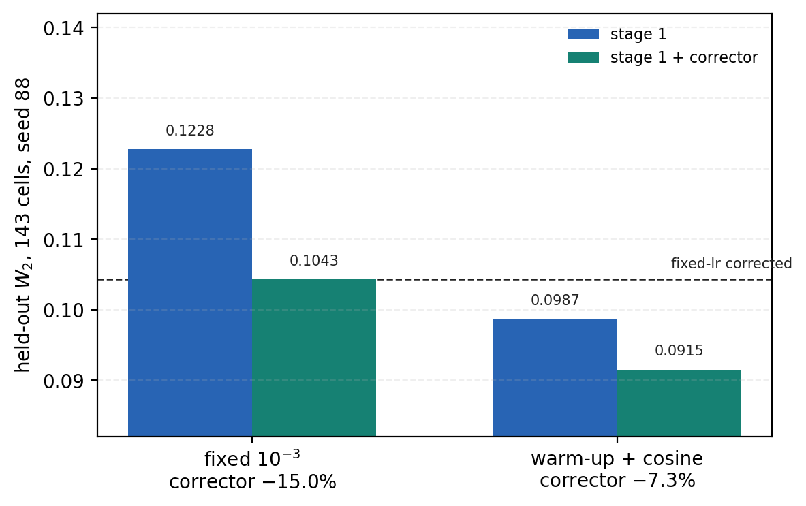
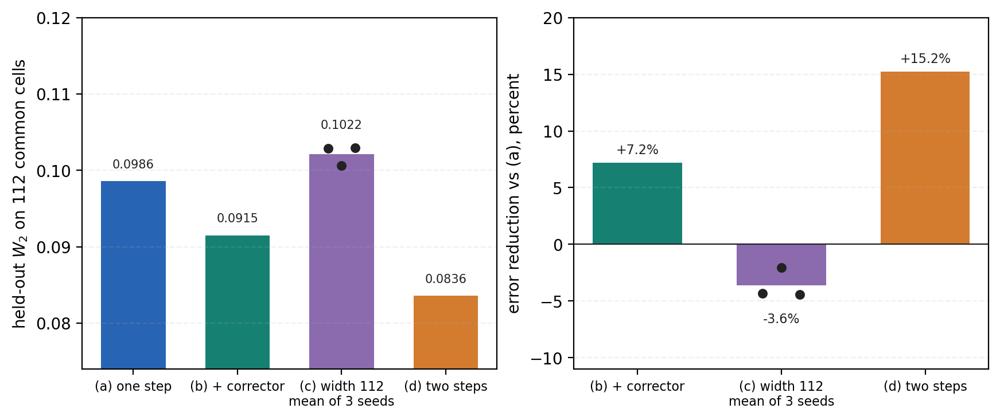
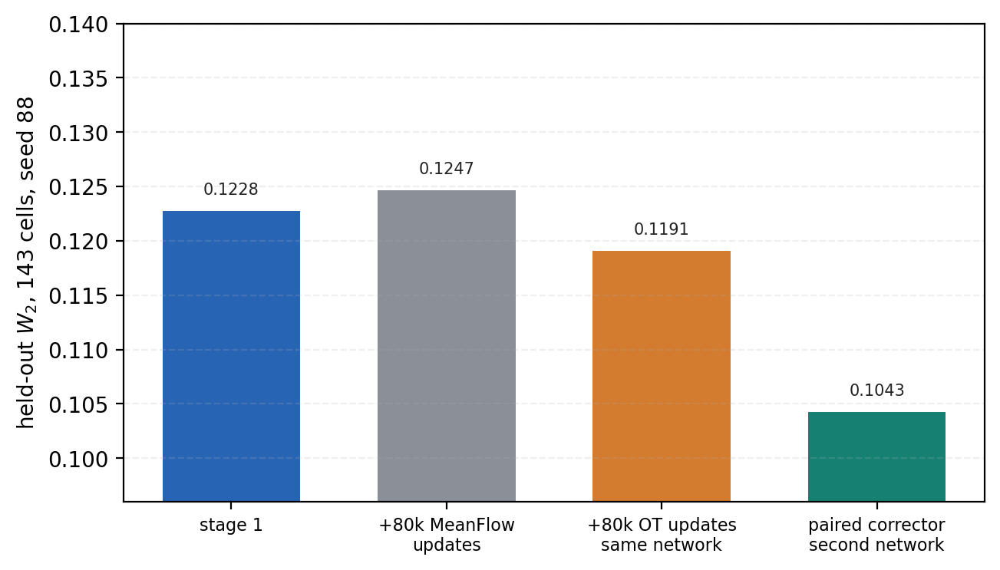
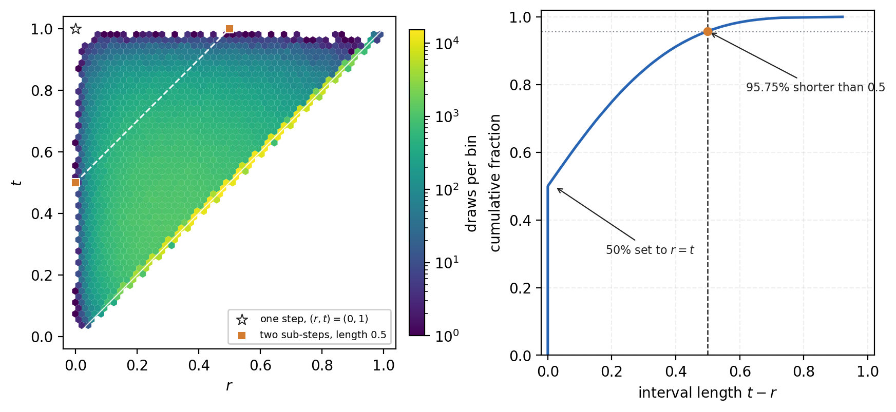
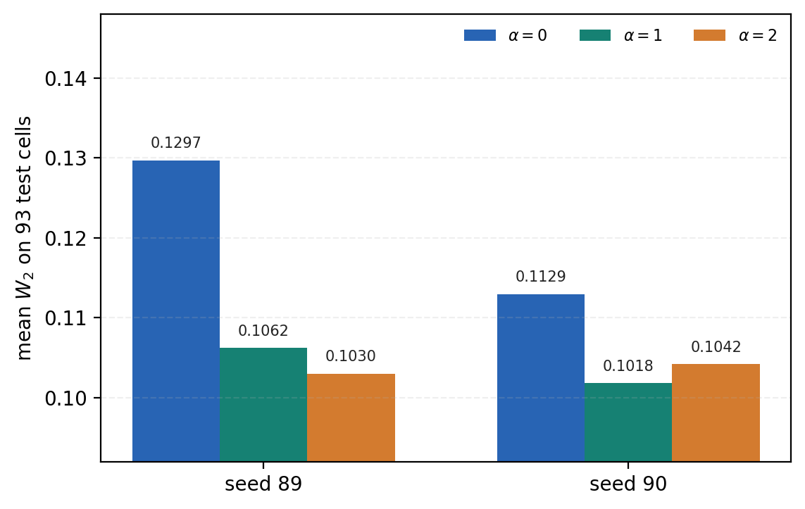
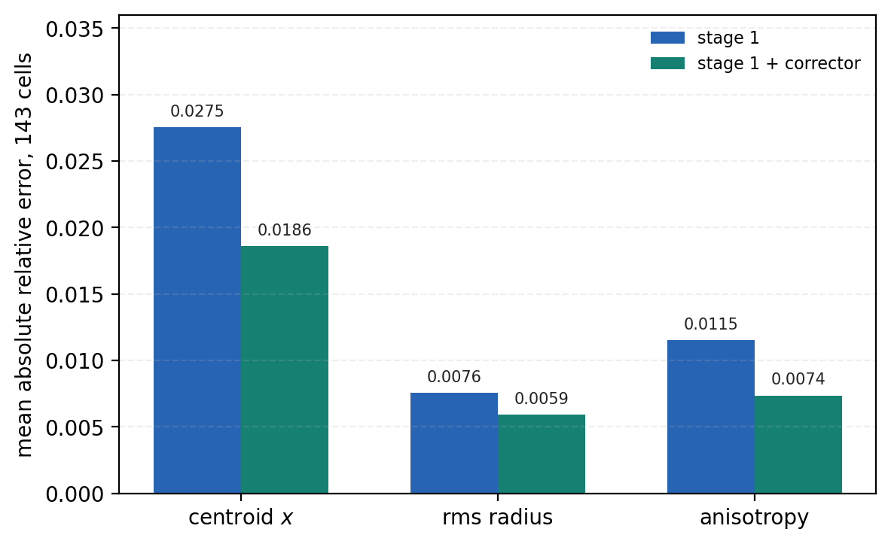
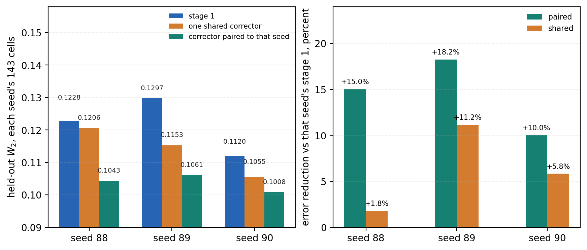

# 第一步训好之后，修正器不再是划算的那一步

**对 11 月 18 日笔记的补充，设定仍是同一个双参数 Keller–Segel 系统**

杨振宇 · 2026 年 11 月 20 日

数字读自 `results/fullscale/harry_followup/`。先前的笔记是 [`HARRY_NOTE.md`](HARRY_NOTE.md)，中文在 [`HARRY_NOTE.zh.md`](HARRY_NOTE.zh.md)。那里的固定学习率结果保持原样：143 个留出格、三个种子上，修正器与它自己的第一步配对，16 箱直方图 \(W_2\) 下降 14.4% ± 4.2%（429 次比较中赢 415 次）。本笔记问的是，这一下降是不是那个划算的对象。

已完成的实验标明为已完成。带门控的修正器没有跑。

---

## 答案

在固定学习率的映射上，修正器把直方图 \(W_2\) 降低大约 15%。用同一批格子、同样的更新次数、再加上 warm-up 与 cosine 之后，下降变成 **7.3%**。这张更好的映射再求值一次，不另接网络，\(W_2\) 下降 **15.2%**。宽度 112、同一套学习率、参数量与两阶段模型对齐的网络，比窄的一步映射 **差 3.6%**。

那 15% 不是分箱造成的，也不是靠多给第一步更新、或把小批量最优传输损失直接加在第一步网络上买来的。它拟合的是一张学习率没有衰减的映射留下的残差。这张映射用该学习率训好之后，残差变小，同一速度场的免费第二次求值比第二张网络更值得当作第二次前向。绝对误差比以前低：种子 88 这一对从 0.10429 变为 **0.09153**。

一个同时在种子 88、89、90 的残差上训练的修正器，恢复不了配对时的结果。三个种子上的下降分别是 1.8%、11.2% 和 5.8%。先前把种子 88 的修正器原样套到另两个种子上，结果是负的。共享修正器是正的，而且更小。

---

## 保持不变的部分

格子从所训练的 checkpoint 读出，不用 `stratified_subset` 重算。warm-up 这一次用的是种子 88 主 checkpoint 里记下的 40 格。留出格是 \(20\times 10\) 网格减去这些格子、再减去剩下的 \(\mu=1\) 行，共 143 格。四行表用主设计与三个宽度 112 设计都留出的 112 格。度量是精确的 16 箱直方图 \(W_2\)，\(10^5\) 个粒子。修正器协议不变：\(\alpha=1\)，每格 2,000 次更新，批量 2,000，精确指派每 10 步刷新一次，残差惩罚 \(\lambda=1\)。新的微调和共享修正器用 SciPy 的 Hungarian 算法做指派。在 2,000 点的批量上，它与先前修正器所用网络单纯形的最优代价相同。

学习率是 2% 的线性 warm-up，然后从 \(10^{-3}\) cosine 到 \(10^{-5}\)。第一步每格 32,000 次更新。这一步用 CUDA graph 重放。批量仍是 4,096。

---

## 1. 学习率：主格子与四行表

**已完成。** 配对修正器只有种子 88。宽度 112 那一行是三个种子。

在 143 个留出格上，warm-up 的第一步 \(W_2=0.09874\)。修正器把它降到 \(0.09153\)，下降 7.3%，143 格中 128 格更低。先前固定学习率 \(10^{-3}\) 的种子 88 一对是 0.12277 然后 0.10429，下降 15.0%，143 格中 141 格更低。新的第一步已经低于旧的校正后数值。新的校正后数值更低。修正器削掉的比例大约是以前的一半。

*图 1. 种子 88、143 个留出格上的直方图 \(W_2\)。虚线是固定学习率那一对校正之后的数值。按学习率衰减训的第一步已经在这条线下面。修正器在左边去掉 15.0%，在右边去掉 7.3%。已完成。*

四行表，112 格，同一套学习率：

| 行 | 求值内容 | \(W_2\) | 相对 (a) |
|---|---|---:|---:|
| (a) | warm-up 第一步，一步，种子 88 | 0.09859 | — |
| (b) | (a) 再接它的修正器 | 0.09150 | 低 7.2%，112 格中 99 格 |
| (c) | 宽度 112，三种子，同一套学习率 | 0.10215 ± 0.00133 | 高 3.6% |
| (d) | (a) 的同一组权重，分成两段 | 0.08358 | 低 15.2% |

宽度 112 的三个种子是 0.10287、0.10062 和 0.10297。三个都高于 (a)。

*图 2. 左：112 个共同留出格上的直方图 \(W_2\)。紫色柱是宽度 112 三个种子的均值，点是各种子。右：相对 (a) 的误差下降，正值表示更低。两步求值的下降最大。宽度 112 的三个种子都是负的。已完成。*

改变先前结论的是 (d)。在固定学习率的笔记里，同一速度场再求值一次会抬高误差。这里它把误差降得比修正器更多。修正器相对它自己那张映射的一步仍然是下降。它不是第二次前向的最好用法，对齐的参数量也复现不了它。

原因是残差的大小。修正器从恒等映射开始，并被惩罚离开第一步的云。它能去掉的是又大又整齐的残差。固定学习率的映射停在 0.12277，其中 15% 还在。按学习率衰减训的映射停在 0.09874，其中 7% 还在。固定学习率下多更新若干步产生不了这个下降。第 2 节是这项对照。

---

## 2. 两个预算对照：同一张网络，没有第二阶段

**已完成。** 种子 88，固定学习率，143 个留出格。两项对照都加 80,000 次更新，即每个训练格 2,000 次，与修正器的更新次数相同。

| 对照 | \(W_2\) | 相对主第一步（0.12277） |
|---|---:|---:|
| 主第一步 | 0.12277 | — |
| 再做 80,000 次 MeanFlow 更新 | 0.12465 | 高 1.5% |
| 80,000 次更新对着同一套小批量 OT 目标，不另接网络 | 0.11911 | 低 3.0% |

*图 3. 种子 88，固定学习率，143 个留出格。前三根柱没有第二张网络。绿色柱是先前笔记里配在这同一张映射上的修正器，是这两项对照没有达到的参照。已完成。*

在 \(10^{-3}\) 下继续做 MeanFlow 更新没有帮助。把修正器的耦合加在第一步网络上，大约去掉 3%，而第二张网络在这同一张映射上去掉 15%。耦合有作用，它解释不了修正器。在按学习率衰减训的映射上，修正器自己也只降 7%，所以第二张网络买到的，大部分是一张步长没有衰减的第一步。

---

## 3. \((r,t)\) 抽在哪里，以及一步是否等于两步

**已完成。** 抽样器没有改。两个 \(\mathcal N(-0.4,1)\) 经过 sigmoid 后，较大的是 \(t\)，较小的是 \(r\)。半个批量设成 \(r=t\)。一百万次抽取中，\(t-r<0.5\) 的比例是 0.9575，落在对角线上的比例是 0.5000。

*图 4. 训练抽样器的一百万次抽取。左：\((r,t)\) 的密度。亮的对角线是被设成 \(r=t\) 的那一半批量。虚线是所有长度为 0.5 的区间。一步求值和两个子步标在图上，都落在抽样稀少的地方。右：区间长度的累积比例。短于 0.5 的占 95.75%。已完成。*

一步求值是 \(x-u(x,0,1)\)。两步求值是 \([1,0.5]\) 再 \([0.5,0]\)，各乘以区间长度。在固定学习率、种子 88 的 143 个留出格上，两种做法得不到同一朵云。它们之间的平均直方图 \(W_2\) 是 **0.0814**。粒子平均距离是 **0.0303**。这是两个输出之间的差距，不是其中任何一个到参考云的距离。

抽样事实与训练代码一致：大多数区间很短，半个批量从不离开对角线。两步时间表用的是两段长度为 0.5 的区间，抽样器很少超过这个长度，也不会集中在这种区间上。这与「复合求值和一步求值不一致」相符。它本身并不说子步一定抬高误差。在固定学习率的映射上，子步抬高了误差。在第 1 节那张按学习率衰减训的映射上，子步降低了误差。变差是那一个 checkpoint 的性质，不是双参数族的性质。

---

## 4. 另两个种子上的 \(\alpha=2\)，以及粒子级核对

**已完成。** \(\alpha=2\) 仍是种子 88 开发集上选定的值。没有重新选。

各种子留出划分中的 93 个测试格：

| 种子 | \(\alpha=0\) | \(\alpha=1\) | \(\alpha=2\) | \(\alpha=2\) 相对 \(\alpha=0\) |
|---|---:|---:|---:|---:|
| 89 | 0.12967 | 0.10619 | 0.10301 | 低 20.6% |
| 90 | 0.11294 | 0.10180 | 0.10417 | 低 7.8% |

*图 5. 各种子留出划分中 93 个测试格上的平均直方图 \(W_2\)。\(\alpha=2\) 是在种子 88 上选定的，没有重选。在种子 90 上它高于 \(\alpha=1\)。已完成。*

在种子 90 上，\(\alpha=2\) 高于 \(\alpha=1\)。选定的强度相对「不用修正器」能够转移。它不是每个种子上两个正值里更好的那个。

切片 \(W_2\)，64 个投影，种子 88，全部 143 个留出格，固定学习率，\(\alpha=1\)：第一步 0.02226，第一步加修正器 0.01545。这个估计是一维投影给出的 \(W_2\) 下界。它不是直方图数字，其上的下降更大。方向与直方图一致。能量距离没有计算。它对粒子数是二次的。

三个物理量的平均绝对相对误差，同一批 143 格：

| 量 | 第一步 | 第一步 + 修正器 |
|---|---:|---:|
| 质心，\(x\) | 0.0275 | 0.0186 |
| 均方半径 | 0.00756 | 0.00590 |
| 各向异性 | 0.0115 | 0.00735 |

*图 6. 同一批 143 个留出格上三个物理量的平均绝对相对误差。种子 88，固定学习率，\(\alpha=1\)。已完成。*

直方图上的下降不是 16 箱网格的假象，物理量上也看得到。

---

## 5. 三个第一步种子共用一个修正器

**已完成。** 这是上面四项有了答案之后才跑的那一项。一个修正器，\(\alpha=1\)，在种子 88、89、90 的第一步残差上训练。每个种子保留自己的 40 个训练格。预算是每个种子每个格子 2,000 次更新，120 组，240,000 步。然后每个种子在自己的 143 个留出格上计分。第一步是固定学习率的 checkpoint。第 1 节那张按学习率衰减训的映射是另一次实验，不是这里的输入。

| 种子 | 第一步 | 共享修正器 | 下降 | 更低的格子 |
|---|---:|---:|---:|---:|
| 88 | 0.12277 | 0.12058 | 1.8% | 74 / 143 |
| 89 | 0.12975 | 0.11527 | 11.2% | 143 / 143 |
| 90 | 0.11203 | 0.10551 | 5.8% | 110 / 143 |

*图 7. 左：每个种子在自己的 143 个留出格上的直方图 \(W_2\)。配对修正器是先前笔记里拟合该种子的那一个。共享修正器是本节训练的这一张网络。右：相对该种子第一步的误差下降。共享修正器在每个种子上都是正的，并且小于配对修正器，种子 88 上最明显。已完成。*

三次下降的平均是 6.3%。先前笔记里各自配对的修正器，把同样三个第一步均值降低 14.4%，429 次比较中赢 415 次。这里赢 327 次。把种子 88 的修正器原样用到种子 89 和 90 上，变化是 −1.4% 和 −3.2%。共享修正器没有重复那个负面结果。

表内部的格局就是原因。种子 89 的第一步最差，得到的下降最大，而且每一格都更低。种子 88 自己的修正器曾去掉 15.0%，共享之后只剩 1.8%，接近一半的格子没有赢。三个 checkpoint 的残差场不是同一个方向。在三个残差上一起训练的修正器学到的是折中。它不再把另一个种子的云推向错误的方向。它也不再像配对修正器那样贴近其中任何一张映射的残差。

---

## 6. 没有跑的

Harry 要求不再做迭代。没有做。带门控的修正器留到以后。warm-up 没有在种子 89 和 90 上重做配对修正器。第 1 节的 (c) 行是唯一有三个种子的 warm-up 结果。
