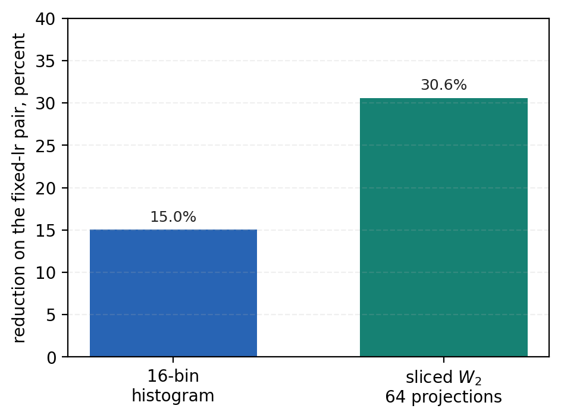

# 学习率改过之后的修正器

**11 月 18 日笔记的后续：那四项核对，以及三个种子共用的一个修正器**

杨振宇 · 2026 年 11 月 20 日

学习率一改，降幅就不一样了。第一步仍用原来的 40 格、每格 32,000 次更新，学习率换成 2% 的线性 warm-up，再从 \(10^{-3}\) cosine 到 \(10^{-5}\)。143 个留出格、种子 88 上，修正器现在把直方图 \(W_2\) 降低 **7.3%**，从 0.09874 到 0.09153，143 格里 128 格更低。固定学习率 \(10^{-3}\) 时，这一对是 15.0%，从 0.12277 到 0.10429。新的第一步 0.09874，已经低于上次校正后的值。

主设计和三个宽度 112 的设计都留出的 112 格上，这组权重分成两段求值是 0.08358，比一步低 15.2%。修正器是 0.09150，低 7.2%。宽度 112 三种子比窄网络的一步高 3.6%。

预算对照做在固定学习率的那张网络上，多出来的 80,000 次更新和修正器一样多，没有第二张网络。继续做 MeanFlow 更新到 0.12465。同样的次数对着小批量 OT 的目标，到 0.11911。第二张网络在这张映射上到 0.10429。耦合加在第一步网络上大约是 3% 的下降，单独的第二张网络大约是 15%。

第 3 到第 5 节是 \((r,t)\)、种子 89 和 90 上的 \(\alpha\)，以及三个种子放在一起训的修正器。上面的百分比都是 16 箱直方图 \(W_2\)。同一对固定学习率的结果上，用粒子坐标算的切片 \(W_2\) 下降 30.6%，直方图是 15.0%。两种算法差在哪里，写在第 4 节。

---

## 设置

格子用 checkpoint 里存的那一套，没有重抽设计。warm-up 用的是种子 88 主 checkpoint 里的 40 格。留出格是 \(20\times 10\) 网格去掉这 40 格、再去掉 \(\mu=1\) 剩下的一行，143 格。四行表的 112 格，是主设计和三个宽度 112 设计都留出的。

修正器没改：\(\alpha=1\)，每格 2,000 次更新，批量 2,000，精确指派每 10 步一次，残差惩罚 \(\lambda=1\)。新的微调和共享修正器用 SciPy 的 Hungarian 算法做指派。2,000 点的批量上，最优代价和以前用的网络单纯形一样。第一步每格 32,000 次更新，用 CUDA graph 重放，批量 4,096。

---

## 1. 学习率 — 已完成

配对的修正器只有种子 88。宽度 112 是种子 88、89、90。

*图 1. 种子 88、143 个留出格上的直方图 \(W_2\)。虚线是固定学习率那一对接上修正器之后的值，0.10429。*

warm-up 的第一步是 0.09874，接上修正器是 0.09153。固定学习率那一对是 0.12277，然后 0.10429，143 格里 141 格更低。降幅大约是上次的一半。

同一套学习率，112 个共同留出格：

| 行 | 求值内容 | \(W_2\) | 相对 (a) |
|---|---|---:|---:|
| (a) | warm-up 第一步，一步，种子 88 | 0.09859 | — |
| (b) | (a) 再接它的修正器 | 0.09150 | 低 7.2%，112 格里 99 格 |
| (c) | 宽度 112，三种子，同一套学习率 | 0.10215 ± 0.00133 | 高 3.6% |
| (d) | (a) 的同一组权重，分成两段 | 0.08358 | 低 15.2% |

宽度 112 的三个种子是 0.10287、0.10062、0.10297，都高于 (a)。

*图 2. 左：112 个共同留出格上的直方图 \(W_2\)。紫色柱是三个宽度 112 种子的均值，点是这些种子。右：相对 (a) 的下降。负的柱表示误差更高。*

11 月 18 日的笔记里，固定学习率的映射再走一段，在那份笔记的 112 格上误差高 1.3%。这里 (d) 是四行里最低的，低于修正器。(b) 仍低于一步。

修正器从恒等映射起步，离开第一步的云要受惩罚，能降多少跟着残差的大小走。固定学习率停在 0.12277。这套学习率停在 0.09874。第 2 节把学习率留在 \(10^{-3}\)，同样多的更新加在那张网络上，结果是 0.12465 和 0.11911，不是 0.09874。

---

## 2. 同一张网络上的训练预算 — 已完成

种子 88，固定学习率，143 个留出格。多出来的每一行是 80,000 次更新，每个训练格 2,000 次。

| 对照 | \(W_2\) | 相对第一步（0.12277） |
|---|---:|---:|
| 第一步 | 0.12277 | — |
| 再做 80,000 次 MeanFlow 更新 | 0.12465 | 高 1.5% |
| 80,000 次更新，目标是同一套小批量 OT | 0.11911 | 低 3.0% |

*图 3. 种子 88，固定学习率，143 个留出格。纵轴从 0 起。绿色是 11 月 18 日笔记里配对的修正器。*

在 \(10^{-3}\) 下继续做 MeanFlow 更新，从 0.12277 到 0.12465。OT 目标加在同一张网络上，到 0.11911。第二张网络到 0.10429。换上这套学习率之后，第一步自己到 0.09874，修正器再降 7.3%。

---

## 3. 子步，以及 \((r,t)\) 抽在哪里 — 已完成

抽样器没有改。两个 \(\mathcal N(-0.4,1)\) 的样本过 sigmoid，较大的是 \(t\)，较小的是 \(r\)。半个批量设成 \(r=t\)。一百万次抽取里，\(t-r<0.5\) 的比例是 0.9575，落在对角线上的比例是 0.5000。

*图 4. 训练抽样器的一百万次抽取。左：\((r,t)\) 的密度。虚线是区间长度 0.5。星号是一步，\((0,1)\)；方块是两个子步。右：\(t-r\) 的累积比例。*

一步是 \(x-u(x,0,1)\)。两步是先 \([1,0.5]\)，再 \([0.5,0]\)，各乘自己的长度。固定学习率、种子 88 的 143 个留出格上，这两朵云之间的平均直方图 \(W_2\) 是 **0.0814**，粒子平均距离是 **0.0303**。两个数都是两个输出之间的距离，不是到参考云的距离。

训练区间大多短于 0.5，每个批量有一半在对角线上。两步求值用的就是两段这个长度的区间，抽样器很少抽到。固定学习率的那个 checkpoint 上，子步让误差升高。第 1 节这张按学习率训的 checkpoint 上，子步让误差降低。上次的升高绑在那个 checkpoint 上。

---

## 4. 另两个种子上的 \(\alpha=2\)，以及这个度量 — 已完成

\(\alpha=2\) 仍是种子 88 的开发集上选定的值。这次没有重选。每一行是该种子的 93 个测试格。

| 种子 | \(\alpha=0\) | \(\alpha=1\) | \(\alpha=2\) | \(\alpha=2\) 相对 \(\alpha=0\) |
|---|---:|---:|---:|---:|
| 89 | 0.12967 | 0.10619 | 0.10301 | 低 20.6% |
| 90 | 0.11294 | 0.10180 | 0.10417 | 低 7.8% |

*图 5. 93 个测试格上的平均直方图 \(W_2\)。\(\alpha=2\) 是在种子 88 上选定的。*

种子 89 上，\(\alpha=2\) 比 \(\alpha=1\) 低。种子 90 上，\(\alpha=1\) 是 0.10180，\(\alpha=2\) 是 0.10417。两个种子上 \(\alpha=2\) 都低于第一步。

这份笔记里的表都是 16 箱直方图 \(W_2\)。两朵云倒进同一张网格，每个轴 16 格。占了粒子的格子收成格子中心上的一个带权重的点，距离是这些点之间的传输代价。粒子动了、但还留在原来的格子里，代价不变，所以比较小的修正会被网格抹平。粒子级的 \(W_2\) 保留每个粒子，再一个一个去配对。表没有改成这种算法：配对是 \(10^5\times 10^5\)。能量距离也没有算，它同样随粒子数的平方涨。

实际算过的、仍然用到每个粒子坐标的，是切片 \(W_2\)。64 个方向，种子 88，全部 143 个留出格，固定学习率，\(\alpha=1\)：第一步 0.02226，加上修正器 0.01545，下降 30.6%。同一对上直方图的下降是 15.0%。切片 \(W_2\) 是一维投影给出的下界，所以这两个百分比不是同一个距离，也不能拿去替换直方图。直方图是两个下降里更小的那个。第 1 节按学习率训的那些结果，没有用切片 \(W_2\) 重算。

*图 6. 固定学习率、种子 88、143 个留出格上的下降比例。两种算法的尺度不一样，图里只画下降的百分比。*

三个量的平均绝对相对误差，同一批 143 格，不再是上次笔记里的六格：

| 量 | 第一步 | 第一步 + 修正器 |
|---|---:|---:|
| 质心，\(x\) | 0.0275 | 0.0186 |
| 均方半径 | 0.00756 | 0.00590 |
| 各向异性 | 0.0115 | 0.00735 |

*图 7. 同一批 143 格上的平均绝对相对误差。种子 88，固定学习率，\(\alpha=1\)。*

质心、均方半径、各向异性都随修正器下降。

---

## 5. 三个种子共用一个修正器 — 已完成

这是你建议先做的那一项。一个修正器，\(\alpha=1\)，在种子 88、89、90 的第一步残差上训练。每个种子用自己的 40 个训练格。预算是每个种子每个格子 2,000 次更新，120 组，240,000 步。每个种子在自己的 143 个留出格上计分。第一步是固定学习率的 checkpoint。第 1 节那张按学习率训的映射不是这里的输入。

| 种子 | 第一步 | 共享修正器 | 下降 | 更低的格子 |
|---|---:|---:|---:|---:|
| 88 | 0.12277 | 0.12058 | 1.8% | 74 / 143 |
| 89 | 0.12975 | 0.11527 | 11.2% | 143 / 143 |
| 90 | 0.11203 | 0.10551 | 5.8% | 110 / 143 |

*图 8. 左：每个种子自己的 143 个留出格上的直方图 \(W_2\)。绿色是上次笔记里拟合该种子的修正器。橙色是这一次在三个种子上一起训的。右：相对该种子第一步的下降。*

三次下降的平均是 6.3%。各自配对的修正器把这三个第一步均值降低 14.4%，429 次比较里 415 次更低。这一次是 327 次。种子 88 的修正器原样用到种子 89 和 90 上，变化是 −1.4% 和 −3.2%。

种子 89 的第一步最高，143 格全部更低。种子 88 下降 1.8%，143 格里 74 格更低；只拟合种子 88 的那个修正器去掉过 15.0%。种子 89 和 90 上，共享修正器把 \(W_2\) 降了下去；种子 88 的修正器原样用过去时，误差是升高的。

---

## 6. 这份笔记里没有的

迭代保持原样，没有再做。带门控的修正器还空着。warm-up 下的配对修正器，种子 89 和 90 没有重训。有三个种子的 warm-up 结果，只有第 1 节的 (c) 行。
