# When does a learned local correction pay for itself?

**A short technical note on a two-parameter 3D Keller–Segel particle system**

Zhenyu Yang · November 2026

Numbers below are read from the JSON artifacts in this repository. Each experiment is marked **completed** or **proposed**. The Autel summary in §10 is the one section I cannot fill from this repository.

---

## The answer

On this PDE problem, the corrector pays inside the parameter box it was trained on, and only for the stage-1 map it was fitted to.

On 143 held-out parameter cells, three seeds, a near-identity corrector after a one-step parametric MeanFlow map reduces histogram \(W_2\) by **14.4% ± 4.2%** (415 of 429 cell-level comparisons). The extra inference cost is **2.97×** the FLOPs of the one-step map, because the corrector pass itself is 1.97× a stage-1 pass. Training the corrector adds **8,000 exact minibatch optimal-transport solves**; deployment adds **none**.

Two controls, scored on the same 112 cells, separate that gain from the two trivial explanations:

| control | what it spends | error change vs the one-step map |
|---|---|---:|
| same map, second evaluation | another forward of the same field | **−1.3%** (worse) |
| one network with the same parameter count, three seeds | 26,547 vs 26,502 parameters | **−0.2% ± 4.6%** |
| map + corrector, the pair it was fitted to | 2.97× FLOPs | **+15.1%** |

The gain stops in two places, and both are reported in full below. A model trained only inside \(\sigma\le 150\), \(\mu\le 3.98\) keeps a **14.2%** gain on held-out interior cells and a **1.8%** gain outside that box, while the stage-1 error grows by **2.32×**. Taking the trained corrector and applying it to a stage-1 network that differs only by random seed turns the **+15.0%** into a **−1.4%** or **−3.2%** change. The corrector is a local fit to one map's residual.

Repeated application is a separate question, and the answer is that this map is not a time stepper. One application sits near the reproducibility floor. Eight applications are **10⁴–10⁵** times that floor. The corrector does not create that divergence, and it does not remove it.

---

## 1. Positioning

MeanFlow (Geng et al., arXiv:2505.13447) learns an average-velocity field. One evaluation of that field transports a sample across a finite time interval, and the same field can be evaluated on sub-intervals. Conditional flow matching with minibatch optimal transport (Tong et al., arXiv:2302.00482) shows that the coupling used to build the regression target changes both the learned map and the cost of constructing it.

The object here is narrower than either paper. The terminal law of a particle system depends on a physical parameter \(\theta=(\sigma,\mu)\). Stage 1 is a MeanFlow map conditioned on \(\theta\). Stage 2 is a second network, trained against a minibatch OT coupling between the stage-1 cloud and the reference cloud. The question is when that second network improves the first by enough to pay for its training solves and its extra inference FLOPs.

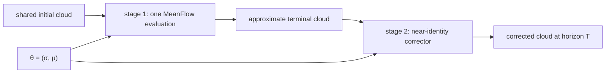

The comparison that can answer the question has four rows, all on two-parameter networks (7-dimensional input, read from the checkpoints):

| row | configuration |
|---|---|
| (a) | the global map alone, one evaluation |
| (b) | that map, then the corrector |
| (c) | one network whose parameter count matches (a)+(b) |
| (d) | the same stage-1 weights, evaluated on two sub-intervals |

---

## 2. Equations, as implemented

### 2.1 The particle system

For \(N\) particles, with the operating point used throughout (\(\chi=16\pi\), \(\delta=0.1\), horizon \(T=0.02\), four Euler–Maruyama steps):

\[
dX_j
= -\frac{\chi}{N}\sum_{i\neq j}\nabla K_\delta(X_j-X_i)\,dt
+ \sigma\, g(X_j)\,dt
+ \sqrt{2\mu}\,dW_j,
\qquad
g(x)=\big(e^{-y^2-z^2},\,0,\,0\big),
\]

\[
K_\delta(z)=\frac{|z|}{4\pi(|z|^2+\delta^2)},
\qquad \theta=(\sigma,\mu).
\]

The initial cloud is uniform in the unit ball and is **shared by every parameter cell**. Differences between cells come from \((\sigma,\mu)\).

### 2.2 Stage 1 — parametric MeanFlow

\(x_{\mathrm{src}}\) is a particle from the initial cloud and \(x_{\mathrm{tgt}}\) is a particle from the simulated terminal cloud. The regression target points from the terminal cloud back toward the initial cloud:

\[
v = x_{\mathrm{src}}-x_{\mathrm{tgt}},
\qquad
z=(1-t)\,x_{\mathrm{tgt}}+t\,x_{\mathrm{src}}.
\]

The network \(u_\phi\) takes \((z,\,t,\,r,\,\log_{10}\sigma,\,\log_{10}\mu)\) and outputs a velocity in \(\mathbb{R}^3\). Training minimises the MeanFlow identity, with the time derivative obtained by a Jacobian–vector product whose tangent on \((z,r,t)\) is \((v,0,1)\):

\[
\mathcal{L}_{\mathrm{MF}}
=\mathbb{E}\Big\|
u_\phi(z,r,t,\log_{10}\sigma,\log_{10}\mu)
-\mathrm{sg}\big[v-(t-r)\,\partial_t u_\phi\big]
\Big\|^2.
\]

One-step generation from the initial cloud is one evaluation,

\[
\hat x = x_{\mathrm{src}}-u_\phi(x_{\mathrm{src}},\, r{=}0,\, t{=}1,\, \log_{10}\sigma,\,\log_{10}\mu).
\]

The \(N\)-step baseline uses the same weights. The interval \([0,1]\) is split into \(N\) equal pieces and each piece is subtracted with its own length. For \(N=2\) the pieces are \([0.5,1]\) then \([0,0.5]\). Architecture: Linear\((7\to 64)\), two Linear\((64\to 64)\) layers, Linear\((64\to 3)\), SELU. **9,027 parameters.**

### 2.3 Stage 2 — the corrector

Stage 1 is frozen. The corrector is a residual MLP with a zero-initialised output layer, so training starts at the identity:

\[
T_\psi(x)=x+\alpha\,\mathrm{MLP}_\psi(x,\log_{10}\sigma,\log_{10}\mu).
\]

Each of the two blocks is LayerNorm, Linear, SiLU, Linear, added back with scale \(0.2\). Width 64. **17,475 parameters.** The two stages together have **26,502 parameters.**

The regression target is an exact OT permutation \(\pi\) between the current corrector output and the reference cloud, on a minibatch of 2,000 particles drawn from the 100,000-particle cell. The permutation indexes positions inside that batch, so the batch is held fixed until the coupling is refreshed. Refresh is every 10 updates. The solver is POT `ot.emd` (network simplex on the squared-Euclidean cost). It is exact, it is not Sinkhorn, and it is not warm-started. A solve is kept only when the solver reports optimality and the plan is a permutation.

With residual weight \(\lambda=1\), the training loss is

\[
\mathcal{L}_{\mathrm{DP}}
=\mathbb{E}\,\|T_\psi(x)-y_{\pi(x)}\|^2
+\lambda\,\mathbb{E}\,\|T_\psi(x)-x\|^2.
\]

The second term is in the runs that produce the headline table. One ablation in §7.3 drops it; that ablation is not mixed into the headline percentage.

At the population limit, with an exact coupling, the transport term is minimised by the Brenier map from the stage-1 law to the target law, whereas stage 1 regresses a conditional mean displacement. That is a reason a second stage can change the push-forward at all. Section 7 measures how much of that structure is actually learned.

The headline corrector is trained at \(\alpha=1\). Section 5.3 then scales \(\alpha\) at inference. That sweep is a deployment knob for a zero-initialised head. It is not a re-training sweep.

---

## 3. What this note covers

The same implementation is used throughout:

- the MeanFlow identity, Jacobian–vector-product training, one-step and multi-step sampling, the Keller–Segel integrator, and histogram \(W_2\);
- conditioning on \((\sigma,\mu)\), and the \(20\times 10\) grid;
- the corrector, its optimal-transport targets, and the alignment of each batch with its coupling;
- the four-row comparison, the interior-only retraining, the seed-transfer test, and the cost account.

### 3.1 One parameter, \(\mu=1\)

With the diffusion coefficient fixed at \(\mu=1\), the map and the corrector are trained at each shear \(\sigma\) from 10 to 200. The metric is the same 16-bin histogram \(W_2\). Error bars are the standard deviation across three seeds.

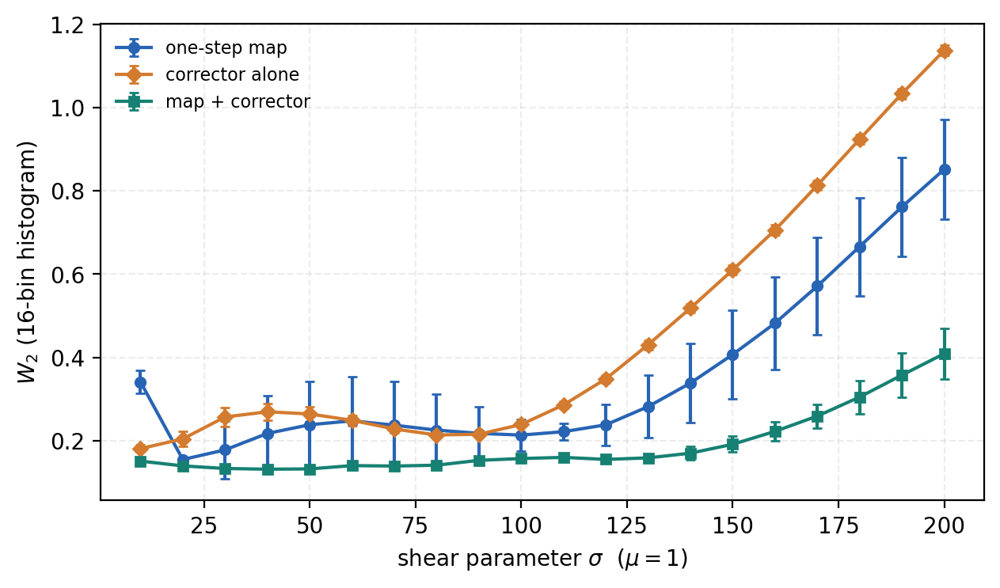

*Figure 1. Single-parameter sweep at \(\mu=1\). The map-plus-corrector curve is below the one-step map at every \(\sigma\). The corrector used on its own is not. Completed.*

The sections below ask when that second stage still pays once both \(\sigma\) and \(\mu\) are inputs.

---

## 4. What was held fixed

The prespecified distributional metric is the exact Wasserstein-2 distance between 16-bin-per-axis histograms, solved by the same network simplex, with the dual certificate checked. It was fixed before the comparison. All \(W_2\) numbers in one table share that metric.

| axis | headline comparison | where a row differs, it is named |
|---|---|---|
| stage-1 training cells | 40, stratified maximin LHS on the full \(20\sigma\times 10\mu\) grid | the extrapolation run uses a different 45-cell design, drawn only from the interior |
| stage-1 updates | 32,000 per cell, Adam, fixed learning rate | |
| corrector updates | 2,000 per cell | |
| particles | \(10^5\) per cell for the headline clouds | the \(T'=4T\) retrain uses \(2\times 10^4\) |
| initial cloud | one shared cloud | |
| headline held-out set | **143 cells**: the 200-cell grid, minus the 40 training cells, minus the remaining \(\mu=1\) cells | \(\mu=1\) is the one-parameter training row, so the headline never scores that row |
| four-row table | **112 cells** held out by both the headline design and the width-112 design | the two 40-cell designs share only 6 cells, so each model's own held-out set is not a legal common test |
| seeds | 88, 89, 90 where a three-seed number is quoted | the capacity row is three seeds; several ablations are seed 88 |

An earlier draft recomputed the 40-cell design at runtime after the design function had changed, and 32 of a reported 144 "held-out" cells were training cells. Every headline number here is taken from a held-out set stored with the checkpoint. Repairing that overlap moved the affected means by about half a percent.

---

## 5. The bounded comparison

### 5.1 Three-seed headline — completed

143 held-out cells, corrector trained at \(\alpha=1\) and paired with its own stage-1 seed.

| | stage 1 | stage 1 + corrector |
|---|---:|---:|
| mean \(W_2\) | \(0.12152\pm 0.00892\) | \(\mathbf{0.10373\pm 0.00267}\) |
| relative reduction | | **14.4% ± 4.2%** |
| cell-level wins | | **415 / 429** |

Paired \(t=6.02\) on 3 seeds. The corrector also cuts the across-seed standard deviation by 70% (0.00892 to 0.00267). That variance reduction appears in the one-parameter system as well (0.0811 to 0.0163, an 80% drop) and is reported separately from the accuracy gain.

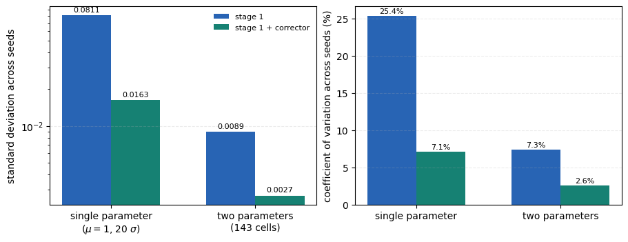

*Figure 2. Across-seed scatter of the mean error. Left: standard deviation. Right: coefficient of variation, so the one-parameter and two-parameter systems can be compared after their different error levels. Completed.*

### 5.2 Four configurations at matched cost — completed

All four rows are two-parameter networks. They are scored on the **same 112 cells**. Row (c) is a width-112 MeanFlow network: 26,547 parameters against 26,502 for the two-stage model, a difference of 45 parameters (0.17%), trained for the same 32,000 updates per cell. Its three seeds are three initialisations. The purple bar is their mean; the dots are the seeds. Row (b) on this cell set is the seed-88 pair. The three-seed corrector result is §5.1, not a second copy of the green bar.

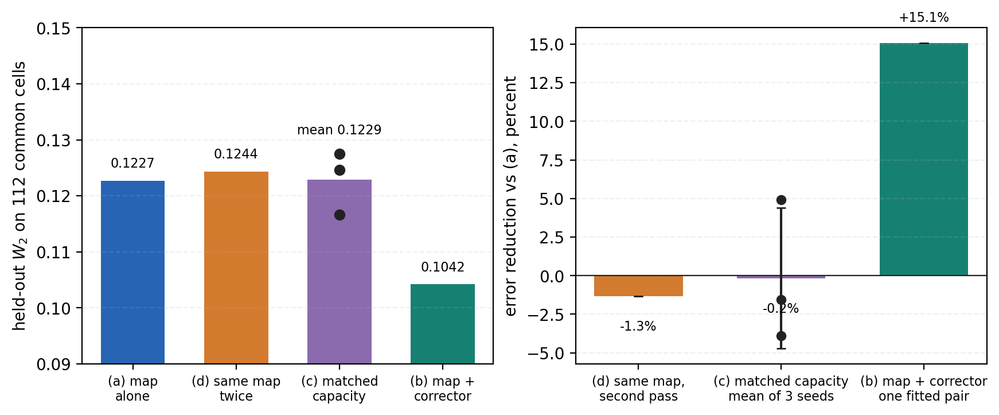

*Figure 3. Left: histogram \(W_2\) on the 112 common held-out cells. The purple bar is the mean of three width-112 seeds; the dots are those seeds. Right: error reduction relative to the one-step map. The error bar on (c) is the standard deviation of the three seeds. The green bar is one fitted pair, so it has no seed bar. Completed.*

| configuration | parameters | stage-1 passes | corrector passes | \(W_2\) | vs (a) |
|---|---:|---:|---:|---:|---:|
| (a) global map, one evaluation | 9,027 | 1 | 0 | 0.12271 | — |
| (d) same weights, two sub-intervals | 9,027 | 2 | 0 | 0.12435 | **−1.3%** |
| (c) width 112, seed 88 / 89 / 90 | 26,547 | 1 | 0 | 0.11667 / 0.12747 / 0.12461 | +4.9% / −3.9% / −1.5% |
| (c) mean of those three seeds | 26,547 | 1 | 0 | 0.12292 | **−0.2% ± 4.6%** |
| (b) map + corrector, seed-88 pair | 26,502 | 1 | 1 | **0.10422** | **+15.1%** |

Row (d) spends a second evaluation of the same average-velocity field and the error rises. Row (c) matches the parameter count and, across seeds, does not reproduce the reduction. The favourable seed (88, +4.9%) is visible; it is one of the three dots.

A wider one-parameter network, 9,027 to 134,403 parameters, was tried earlier on the single-parameter task and also failed to move the error (0.1486 to 0.1456). That run is a different task. It is cited only as a second place where width was not the binding constraint.

On the 143-cell headline set, the same stage-1 weights are evaluated on \(N\in\{1,2,4,8\}\) equal sub-intervals of \([0,1]\). The corrector, trained on one-step outputs, is then applied **once** to each of those clouds.

| stage-1 steps \(N\) | stage 1 | vs \(N=1\) | stage 1, then corrector | vs one-step stage 1 |
|---:|---:|---:|---:|---:|
| 1 | 0.12277 | — | **0.10429** | **+15.0%** |
| 2 | 0.12418 | −1.1% | 0.10883 | +11.4% |
| 4 | 0.12707 | −3.5% | 0.11243 | +8.4% |
| 8 | 0.12736 | −3.7% | 0.11183 | +8.9% |

More stage-1 steps raise the error through \(N=8\). One corrector pass after two, four, or eight steps still lowers it relative to the one-step map, by less than the corrector does after a single step. From \(N=4\) to \(N=8\) the stage-1 error is almost flat, and the corrected error moves from 0.11243 to 0.11183. These 143 cells are not the 112 cells of Figure 3; the one-step corrector differs by 0.00007 (0.10429 against 0.10422).

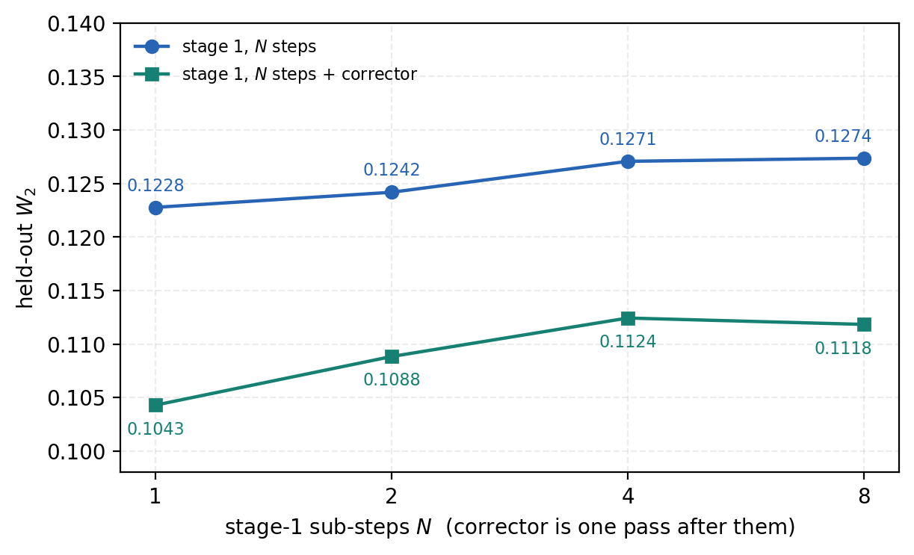

*Figure 4. Same stage-1 weights at every \(N\). The corrector is one pass after those sub-steps, still at horizon \(T\). Completed, 143 cells.*

### 5.3 Correction strength, chosen on a development split — completed

The 143 held-out cells of the seed-88 checkpoint were split once, with the split written to disk: **50 development cells, 93 test cells**. \(\alpha\) was chosen on the development cells. The test cells were then scored at the chosen value and at the training value \(\alpha=1\).

| \(\alpha\) | development \(W_2\) |
|---:|---:|
| 0 (stage 1 only) | 0.12134 |
| 1 (training value) | 0.10340 |
| 1.5 | 0.09736 |
| **2 (selected)** | **0.09580** |
| 2.5 | 0.09988 |
| 4 | 0.12837 |

| | test \(W_2\) | vs stage 1 |
|---|---:|---:|
| stage 1 | 0.12353 | — |
| \(\alpha=1\) | 0.10477 | +15.2% |
| \(\alpha=2\) | **0.09558** | **+22.6%** |

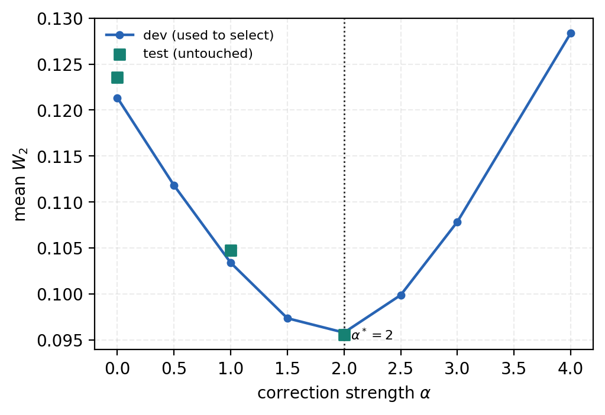

*Figure 5. \(\alpha\) scaled at inference. The development curve is flat between 1.5 and 2.0, so the selected value is a point on a plateau. The claim this supports is that the training value \(\alpha=1\) is conservative on this split. Completed.*

This sweep does not retrain the head at each \(\alpha\). A re-training sweep is listed as proposed.

### 5.4 Inference cost of the four rows — completed

One corrector evaluation is 34,816 FLOPs per particle against 17,664 for one stage-1 evaluation (each residual block contains two \(64\times 64\) maps and a LayerNorm). At \(10^5\) particles:

| configuration | GFLOP | vs one stage-1 pass | held-out error |
|---|---:|---:|---|
| (a) one stage-1 pass | 1.77 | 1.00× | 0.12271 on 112 cells |
| (d) two stage-1 passes | 3.53 | 2.00× | worse, §5.2 |
| (d) extended to 4 passes | 7.07 | 4.00× | worse, Figure 4 |
| (d) extended to 8 passes | 14.13 | 8.00× | worse, Figure 4 |
| (b) stage 1 + corrector | **5.25** | **2.97×** | 0.10422 on 112 cells |

The deployment cost that belongs next to the 15% reduction is 2.97× FLOPs. Calling it "two passes" understates the second pass.

---

## 6. One-step error and long-horizon behaviour

These are different experiments. Section 5 is one application, compared with the terminal cloud at \(T\). This section is either repeated application, or a model trained at a longer horizon.

### 6.1 Physical quantities at the operating horizon — completed

Mean absolute relative error on six cells spanning the box. The anisotropy \(\lambda_1/\lambda_2\) is the geometric quantity controlled by the shear \(\sigma\).

| quantity | stage 1 | + corrector |
|---|---:|---:|
| centroid drift along the shear, \(x\) | 3.94% | **3.02%** |
| rms radius | **0.82%** | 0.87% |
| anisotropy \(\lambda_1/\lambda_2\) | 1.04% | **0.88%** |
| principal standard deviation \(\lambda_1\) | 1.15% | **1.04%** |
| principal standard deviation \(\lambda_2\) | 0.94% | **0.65%** |

The rms radius is the entry the corrector makes slightly worse. It is left in the table.

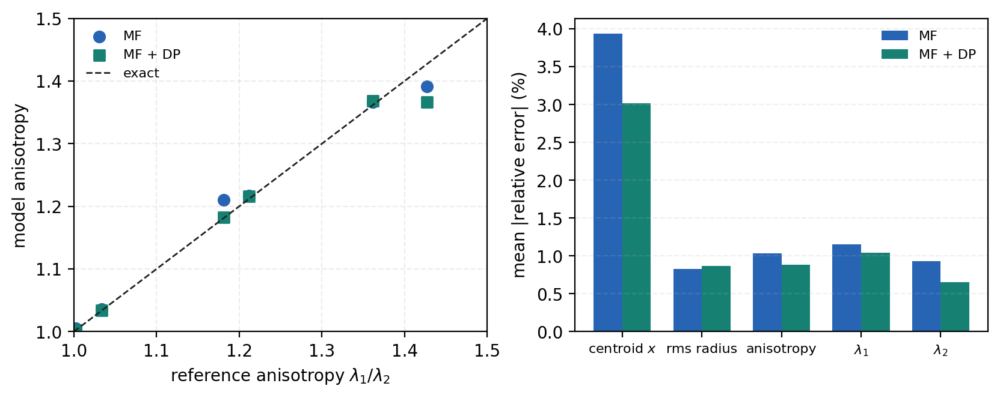

*Figure 6. Left: predicted against reference anisotropy on the six cells. Right: mean absolute relative error. Completed.*

### 6.2 Repeated application — completed, and this is a failure

The map is trained on pairs \((x_{\mathrm{src}}, x_{\mathrm{tgt}})\) at one horizon. Nothing in the training set is an intermediate time. Applying the map \(k\) times and comparing with a fresh physical simulation at time \(kT\):

| \(k\) | \(W_2\) against the physical cloud | over the reproducibility floor |
|---:|---|---|
| 1 | 0.092 – 0.241 | **0.59× – 1.55×** |
| 2 | 0.201 – 4.62 | 1.3× – 30× |
| 4 | 4.53 – 82.5 | 29× – 529× |
| 8 | **1,968 – 41,678** | **12,610× – 267,049×** |

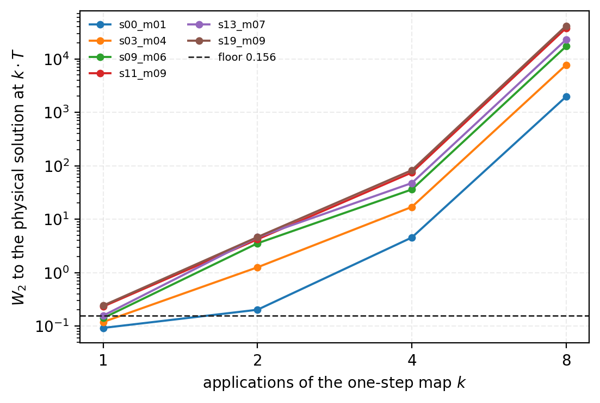

*Figure 7. Six cells. The dashed line is the reproducibility floor of that particle count. Every cell leaves the floor by the second application. The worst cell is kept. Completed.*

The mechanism is visible in the state, not only in the metric. One application moves the centroid by about 1.3–2.3 and the rms radius into the range 0.84–1.57, so the second application receives a cloud outside the training input. The same divergence appears at seeds 89 and 90 (at \(k=4\), each seed is between about 100× and 500× the floor) and on the one-parameter model (at \(k=8\), 3,745×–4,015× its own floor). Non-iterability belongs to a fixed-horizon transport, and the two-parameter map diverges further.

The corrector does not introduce a new unstable minority. On the six cells, the ratio of corrector error to stage-1 error after repeated application has mean 0.95, and all six ratios are below 1. At \(k=4\) that is 268× the floor against 287× the floor. A 5% change on a two-order failure is reported as "does not add instability", and is not reported as repaired stability.

Spending the second forward pass on another MeanFlow sub-step, at the same two-pass budget, is worse than spending it on the corrector:

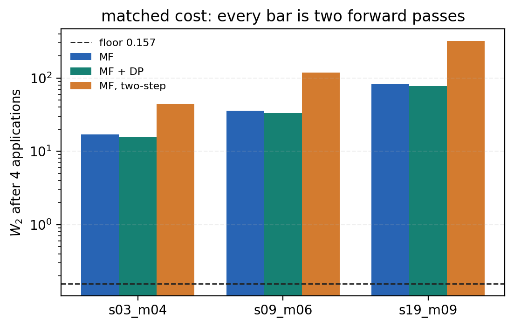

*Figure 8. After four applications. Each bar is two forward passes. The orange bars are a second stage-1 sub-step. The worst cell shown, `s19_m09`, goes from 82.5 (stage 1) to 77.2 (corrector) to 318 (two-step stage 1). Completed.*

Eight applications cost tens of milliseconds. One physical simulation of \(10^5\) particles at this horizon costs about 83 seconds on the same laptop GPU. Cost is not why iteration is out of scope. The map has no step-to-step meaning to iterate.

### 6.3 A model trained at a longer horizon — completed

Retraining at \(T'=4T=0.08\), same 40-cell budget, \(2\times 10^4\) particles, is the long-horizon question that iteration cannot answer.

| quantity | \(T=0.02\) | \(T'=0.08\) | ratio |
|---|---:|---:|---:|
| rms radius of the true cloud | 0.941 | 1.918 | 2.04× |
| raw held-out \(W_2\) | 0.12277 | 0.33766 | 2.75× |
| \(W_2\) divided by rms radius | 0.1304 | 0.1760 | **1.35×** |
| two sub-steps of stage 1 | −1.1% | **+5.5%** | |

Most of the raw growth is the cloud getting larger. Relative to its own radius, the error grows by 1.35×. The floor at \(T'\) was scaled with the radius rather than re-measured, so the "times floor" figure at \(T'\) is an estimate.

The sign change on two sub-steps is real on this run: at the longer horizon the path has accumulated more shear (centroid displacement from about 1.3 to about 4.8), and splitting the time interval helps. That is curvature in time. It is a different fact from the parameter-box result in §7, where splitting the parameter response does not carry the corrector outside the box.

---

## 7. Repair of the stage-1 map, or a fit to its training distribution?

### 7.1 Leaving the parameter box — completed, separate training run

This is not an evaluation of the 40-cell headline model. The headline design draws cells from the full grid, including \(\sigma=200\) and \(\mu=10\), so some boundary cells are training cells. To test extrapolation, both stages were retrained on **45 cells drawn only from** \(\sigma\le 150\), \(\mu\le 3.98\), at the same per-cell budget, and scored on the full 200-cell grid.

| region | cells | stage 1 | + corrector | gain |
|---|---:|---:|---:|---:|
| training cells inside the box | 45 | 0.09388 | 0.08014 | +14.6% |
| held-out cells inside the box | 90 | 0.09404 | 0.08070 | **+14.2%** |
| outside the box | 65 | 0.21805 | 0.21407 | **+1.8%** |

Training cells and held-out interior cells agree to 0.2% in stage-1 error, so the interior result is interpolation. Outside the box the stage-1 error is 2.32× the interior value, and the corrector's relative gain falls by about a factor of eight.

| direction | cells | stage 1 | gain |
|---|---:|---:|---:|
| \(\sigma\) leaves the box, \(\mu\) stays inside | 45 | 0.15463 | +1.3% |
| \(\mu\) leaves the box, \(\sigma\) stays inside | 15 | 0.35296 | +2.4% |
| both leave | 5 | 0.38412 | +2.7% |

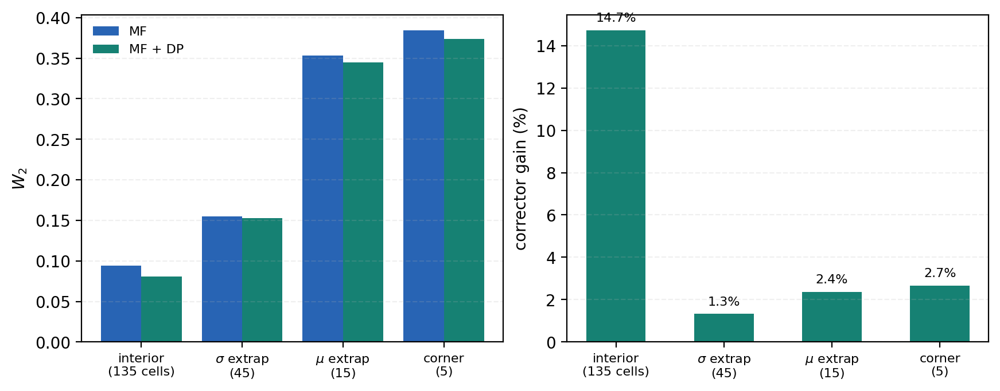

*Figure 9. The left-hand "interior" bar pools the 45 training cells with the 90 held-out interior cells (135 cells, gain 14.7%). The table above splits them. The three right-hand bars are the outside zones. Completed, on the 45-cell interior-only run.*

A one-parameter control, trained on \(\sigma\in[15,150]\) at fixed \(\mu=1\), still has a **+13.3%** corrector gain on \(\sigma\in[160,200]\), against **+15.7%** inside, while stage-1 error grows only **1.19×**. The single lower endpoint \(\sigma=10\) retains +8.4%. A one-dimensional family keeps more of the gain than the two-dimensional one. Both numbers are from their own training runs.

### 7.2 Changing only the random seed — completed, and this is the sharpest failure

The seed-88 corrector, applied unchanged to other stage-1 networks. Architecture, data, parameter range, and metric stay fixed.

| base model | cells | without | with the seed-88 corrector | gain | cells improved |
|---|---:|---:|---:|---:|---:|
| seed 88, the map it was fitted to | 143 | 0.12277 | 0.10429 | **+15.0%** | 141 / 143 |
| seed 89 | 143 | 0.12975 | 0.13162 | **−1.4%** | 57 / 143 |
| seed 90 | 143 | 0.11203 | 0.11560 | **−3.2%** | 33 / 143 |
| width-112 seed 88 | 112 | 0.11667 | 0.11407 | +2.2% | 68 / 112 |

The two losses are small, and they are the result. The corrector has learned the residual of one trained map.

### 7.3 Three further measurements — completed

**It moves a cloud that is already the reference.** On 60 cells, applying the corrector to the reference cloud itself displaces particles by 0.0165 on average and leaves a \(W_2\) of **0.0717**. The 16-bin reproducibility floor on the \(10^5\)-particle clouds is 0.0644, so this is about 1.1× that floor. A gate that recognised "already correct" would leave the cloud still.

**The gain has not saturated, and four cells are harmful.** Correctors trained on 4, 10, 20, and 40 cells, every one scored on the same 143 held-out cells:

| training cells | held-out \(W_2\) | vs stage 1 (0.12277) | cells improved |
|---:|---:|---:|---:|
| 4 | 0.14681 | **−19.6%** | 57 / 143 |
| 10 | 0.11423 | +7.0% | 106 / 143 |
| 20 | 0.10404 | +15.3% | 127 / 143 |
| 40 | 0.09527 | +22.4% | 136 / 143 |

This sweep omits the residual penalty \(\lambda\|T(x)-x\|^2\) used in the headline loss, so the 40-cell level is not comparable with the +15.0% headline. The shape is the result: the gain is still rising at 40 cells, and the smallest design makes the cloud worse.

**The learned field is only partly a gradient.** A Brenier map is a gradient, so its Jacobian is symmetric. Central differences at 12 probes on each of 2 cells, step \(10^{-3}\), give

\[
\frac{\|J-J^\top\|_F}{\|J\|_F}
= 0.51
\text{ for the corrector, and }
0.68
\text{ for the stage-1 displacement.}
\]

The corrector is closer to a gradient field than stage 1, on this sample, and 0.51 is far from 0. The sample is two cells. I treat it as a qualitative check.

Read together: inside the box, on the map it was fitted to, the corrector reduces one-step error by about 15% at 2.97× inference FLOPs. Outside that map — another seed, or a parameter outside the training box — the reduction disappears. The Jacobian test is consistent with a partial Brenier structure and too small to claim that the structure was recovered.

---

## 8. Cost of building transport targets, and cost at deployment

Avoiding a global OT between full clouds at deployment is a real property of the trained map. It is not the same statement as "the method does not use OT".

| role | solves | who pays | removed by deploying the trained map? |
|---|---:|---|---|
| corrector training targets | **8,000** exact minibatch solves, 2,000 of 100,000 particles, refreshed every 10 of 80,000 updates | training, once | only by changing the objective |
| deployment | **0** | — | yes |
| the \(W_2\) numbers in this note | **2,793** exact histogram solves | the evaluation, not a user of the map | no, because the metric is an OT problem |

By the leading-order FLOP account used in the repository, those 8,000 solves are **0.064 PFLOP** against **0.011 PFLOP** of corrector-network arithmetic, about **85%** of the corrector's training arithmetic. The network simplex runs on CPU and the network on GPU, so the wall-clock share is smaller than the FLOP share. I do not treat the two percentages as interchangeable. A 2,000-particle minibatch is an approximation to the coupling on the full cloud. The memory of one cost matrix at batch 2,000 is 31 MB; at batch 30,000 it is 6.9 GB, which is why the exact solve stays on the minibatch.

Stage-1 training on this budget does not solve OT. Its arithmetic account is 0.278 PFLOP for 1,280,000 updates at batch 4,096.

Measured wall-clock on the RTX 4060 Laptop, for orientation rather than as the matched-cost unit: one \(10^5\)-particle simulation at \(T=0.02\) is about 83 seconds; the full \(20\times 10\) grid of reference clouds is about 191 minutes. The matched-cost unit in §5 is FLOPs per generated particle, because that is what changes between rows (a)–(d).

---

## 9. Completed and proposed

**Completed, and used above.**

- The single-parameter sweep of \(W_2\) against \(\sigma\), at \(\mu=1\).
- Two-parameter stage 1 and the paired corrector, three seeds, 143 held-out cells.
- Rows (a)–(d) on one 112-cell intersection, with three seeds on the capacity-matched row.
- Stage 1 at 1, 2, 4, and 8 sub-steps, with one corrector pass after each.
- \(\alpha\) chosen on 50 development cells and reported on 93 test cells.
- Physical summaries, repeated application, and the longer-horizon retrain.
- The interior-only retraining, the seed-transfer test, the reference-cloud probe, the few-cell sweep, and the two-cell Jacobian check.
- The training-target, deployment, and evaluation OT counts.

**Proposed, not run.** Each one is a response to a negative result above. None of them is required for the conclusion in the opening paragraph.

| proposal | what it would decide | rough cost on the same laptop |
|---|---|---|
| retrain the corrector at each \(\alpha\), selection still on the development split | whether §5.3 survives training the head, rather than scaling it | ~3 h |
| train one corrector on stage-1 residuals from several seeds | whether the seed-specificity in §7.2 can be removed by that augmentation | ~6 h |
| a corrector with an explicit gate that can output zero | whether the reference-cloud displacement in §7.3 can be removed without giving up the in-box gain | ~5 h |
| the same longer-horizon protocol at \(T'=8T\) | whether the 1.35× relative degradation keeps growing | ~4 h |

A negative on any of these would be a usable result. The seed-transfer result already says that a corrector tied to one checkpoint is the wrong object if the next question is a corrector that transfers across maps.

---

## 10. The Autel work

Harry asked for a non-confidential summary of three items: the bottleneck, the intervention, and the measured latency–quality trade-off for the flow-matching acceleration of action chunks.

I am not putting numbers into this section from memory. The paragraph below is the slot for that summary, and it should stay short.

> **Bottleneck.** *[to be written: what was slow, in which part of the action-chunk pipeline, and why a full flow integration was the expensive piece.]*
>
> **Intervention.** *[to be written: what was changed, and what was left unchanged. One paragraph, no internal model names that are confidential.]*
>
> **Measured trade-off.** *[to be written: latency before and after, the quality metric that was held, and the setting in which it was measured.]*

---

## Appendix A. What one cloud looks like

The figure is a density picture, not the metric. It is the cell \((\sigma,\mu)=(120,10)\), chosen because it is the largest corrector gain on the grid, so it is a favourable cell rather than a typical one. \(\mu=10\) sits on the edge of the parameter grid. The \(L^1\) density residual on the \(x\)–\(z\) view moves from 0.304 to 0.292. The distributional claim in this note is the \(W_2\) table, and this picture is here so the object is visible: a sheared, anisotropic terminal cloud, and a residual that is still spatially structured after the corrector.

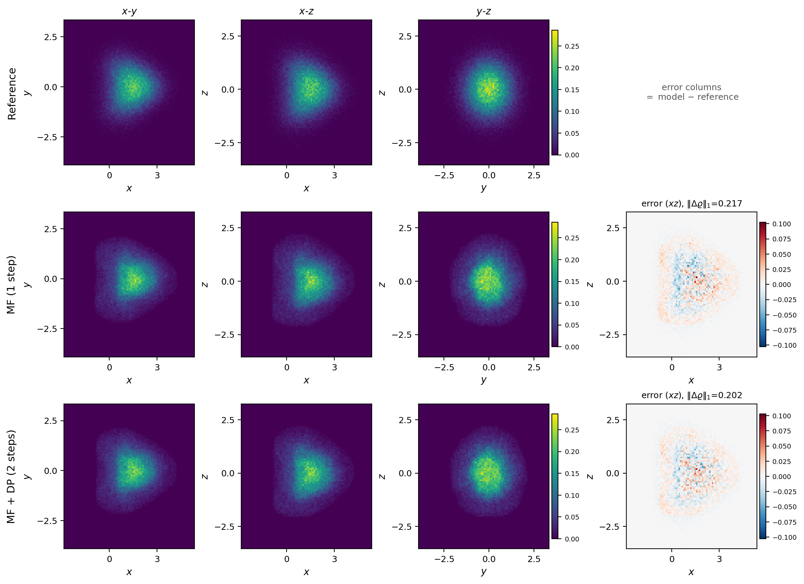

*Figure 10. Rows: reference, one-step map, map plus corrector. Columns: \(x\)–\(y\), \(x\)–\(z\), \(y\)–\(z\), and the signed \(x\)–\(z\) density error. Completed as a visualisation of one selected cell.*

## Appendix B. Two caveats that apply to every table

The headline runs use a fixed learning rate. A separate schedule study in the same repository found a warm-up plus cosine schedule about 14% lower in \(W_2\) at the same update budget. The tables above are therefore on the conservative side of that choice, and they were not re-run with the schedule.

The 16-bin histogram \(W_2\) is coarser than the particle-level coupling used to train the corrector. Comparisons are valid inside one binning. They are not comparable with a number computed at a different resolution or a different particle count.
