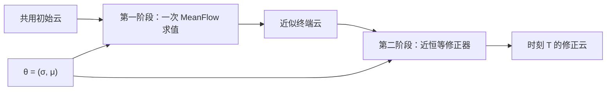
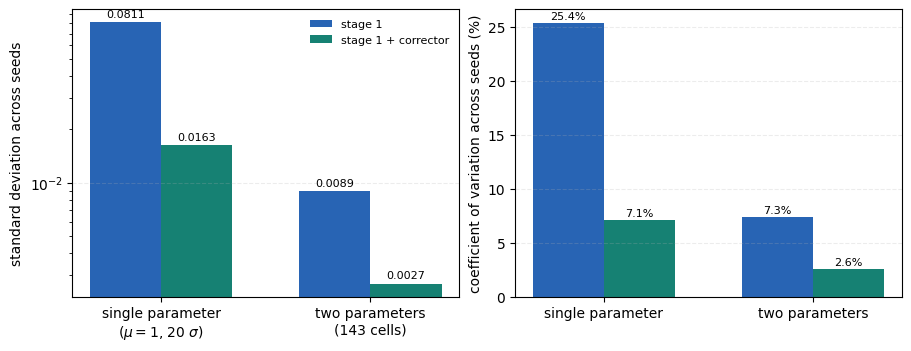
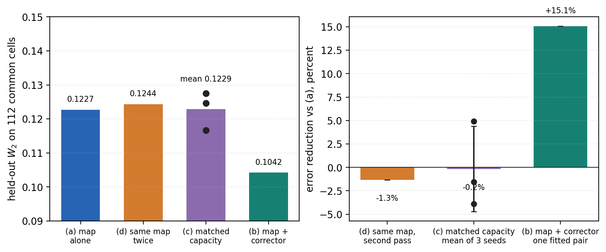
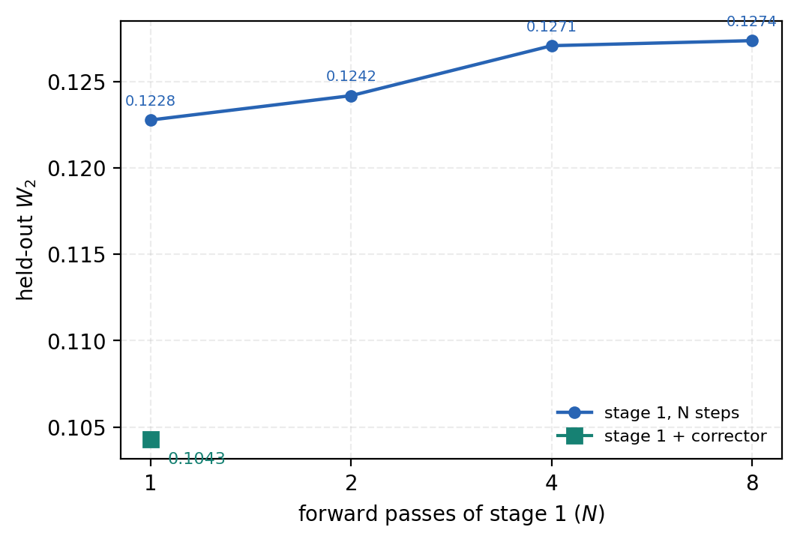
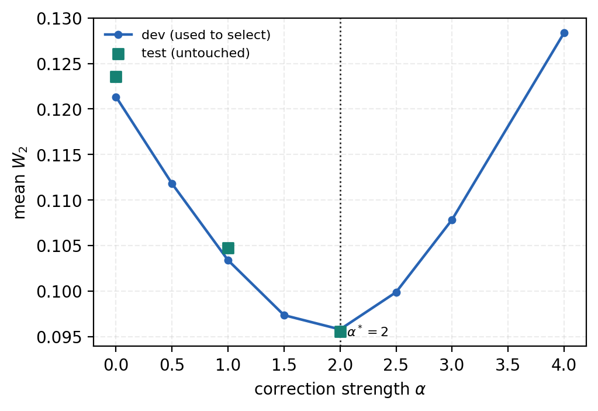
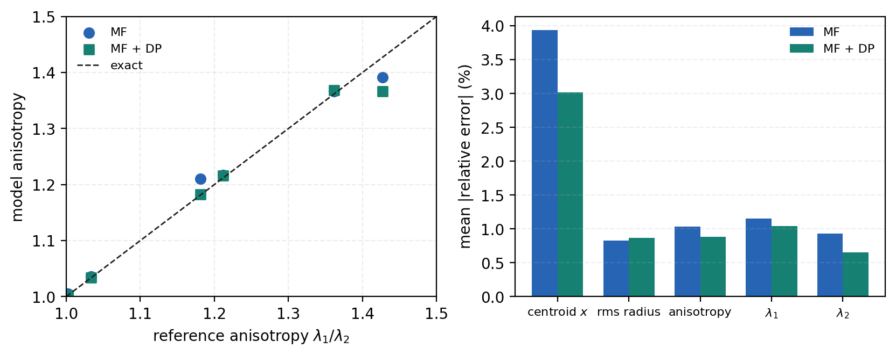
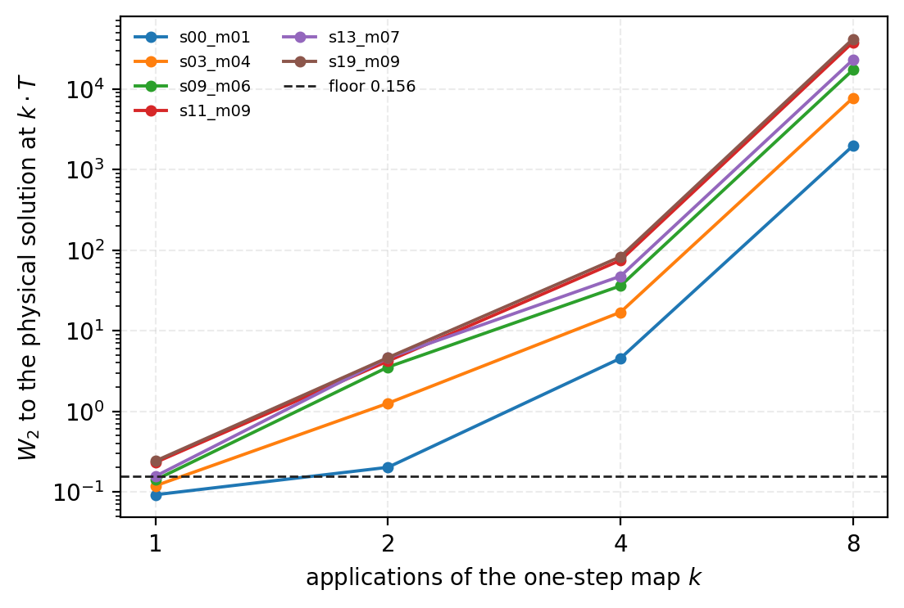
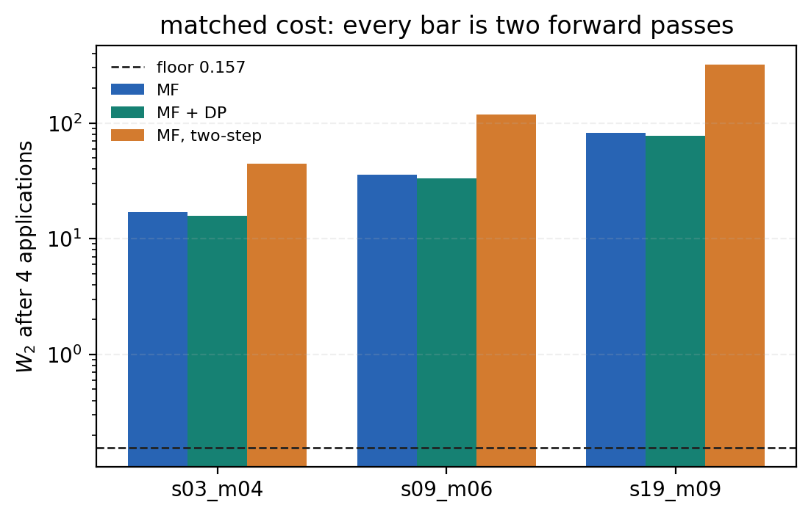
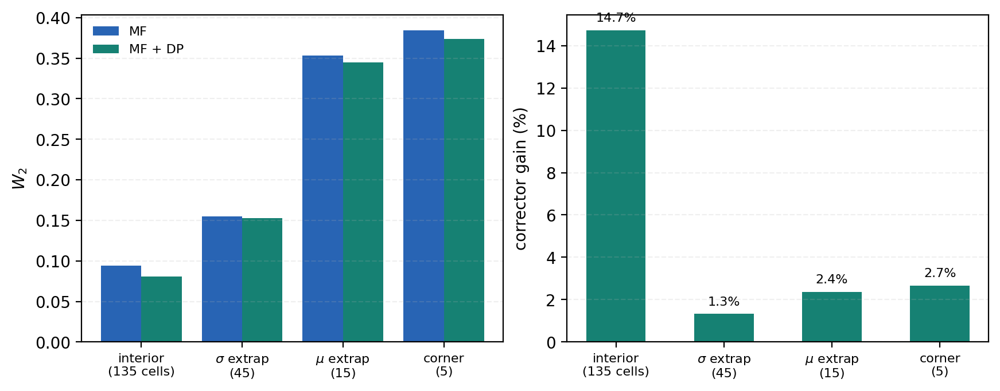
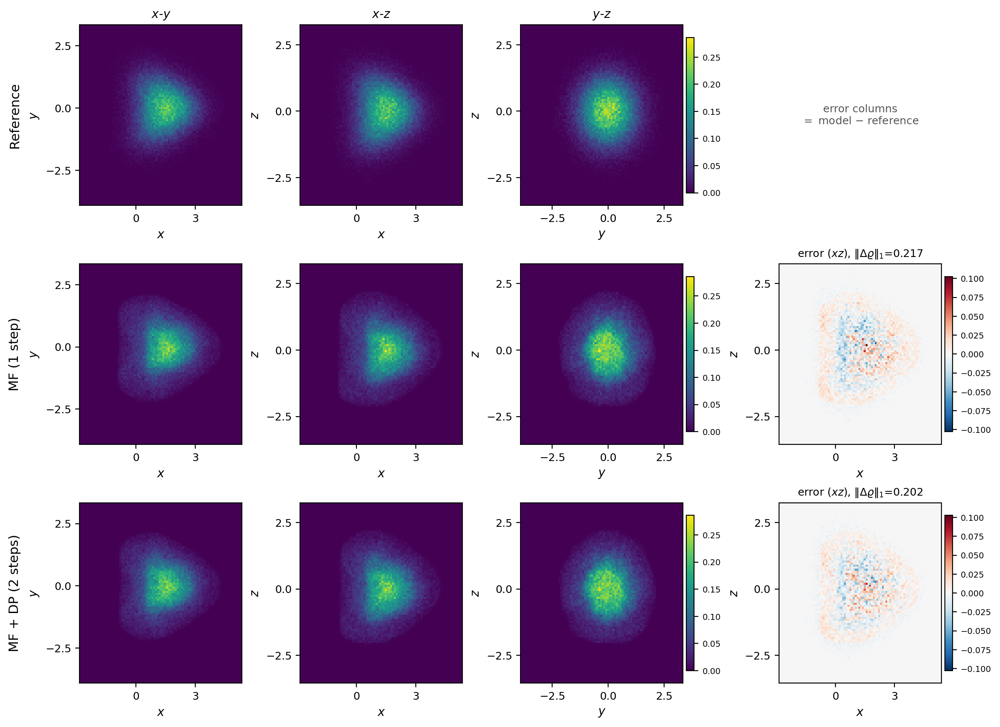

# 学到的局部修正什么时候才划算？

**关于双参数三维 Keller–Segel 粒子系统的一份短技术笔记**

杨振宇 · 2026 年 11 月

下文数字均从本仓库的 JSON 产物读出。每项实验标明 **已完成** 或 **提议、未跑**。第 10 节的 Autel 摘要是唯一无法从本仓库填写的部分。

英文原文见 [`HARRY_NOTE.md`](HARRY_NOTE.md)。本文是它的译文，数字、公式与图片未改。

---

## 答案

在这个 PDE 问题上，修正器只在它训练过的参数盒子内部划算，并且只对它拟合的那一个第一阶段映射划算。

在 143 个留出参数格、三个种子上，一步参数化 MeanFlow 映射之后接一个近恒等修正器，直方图 \(W_2\) 下降 **14.4% ± 4.2%**（429 次格子比较中赢 415 次）。额外推理代价是一步映射的 **2.97 倍** FLOPs，因为修正器本身一次前向就是第一阶段的 1.97 倍。训练修正器额外做了 **8,000 次精确小批量最优传输求解**；部署时一次都不做。

两个对照在同一批 112 个格子上计分，用来把上述收益和两种平凡解释分开：

| 对照 | 多花了什么 | 相对一步映射的误差变化 |
|---|---|---:|
| 同一映射，再评一次 | 同一速度场的另一次前向 | **−1.3%**（更差） |
| 参数量相同的单个网络，三种子 | 26,547 对 26,502 个参数 | **−0.2% ± 4.6%** |
| 映射 + 修正器，它所拟合的那一对 | 2.97 倍 FLOPs | **+15.1%** |

收益在两处停下，下面都完整报告。只在 \(\sigma\le 150\)、\(\mu\le 3.98\) 内训练的模型，在盒子内的留出格上保留 **14.2%** 的收益，盒子外只剩 **1.8%**，同时第一阶段误差增长 **2.32 倍**。把训练好的修正器套到一个只差随机种子的第一阶段网络上，**+15.0%** 变成 **−1.4%** 或 **−3.2%**。修正器是对一个映射残差的局部拟合。

重复应用是另一个问题。这个映射不能当作时间步进器。用一次，误差靠近可复现底噪；用八次，是该底噪的 **10⁴–10⁵** 倍。修正器没有制造这个发散，也没有把它去掉。

---

## 1. 定位

MeanFlow（Geng 等，arXiv:2505.13447）学习一个平均速度场。对该场做一次求值，就把样本输运过一段有限时间；同一速度场也可以在子区间上求值。带小批量最优传输的条件流匹配（Tong 等，arXiv:2302.00482）表明：用来构造回归目标的耦合，既改变学到的映射，也改变构造这个目标的成本。

这里的对象比这两篇都窄。粒子系统的终端分布依赖于物理参数 \(\theta=(\sigma,\mu)\)。第一阶段是以 \(\theta\) 为条件的 MeanFlow 映射。第二阶段是另一个网络，用第一阶段云与参考云之间的小批量 OT 耦合来训练。问题是：这第二个网络在什么条件下对第一个的改善，足以支付它的训练求解次数和额外推理 FLOPs。

能回答这个问题的对照有四行，全部是双参数网络（7 维输入，从 checkpoint 读出）：

| 行 | 配置 |
|---|---|
| (a) | 单独的全局映射，一次求值 |
| (b) | 该映射，再接修正器 |
| (c) | 参数量与 (a)+(b) 相同的单个网络 |
| (d) | 同一套第一阶段权重，在两个子区间上求值 |

---

## 2. 方程，按实现书写

### 2.1 粒子系统

\(N\) 个粒子，全文使用的工作点是 \(\chi=16\pi\)、\(\delta=0.1\)、时域 \(T=0.02\)、四步 Euler–Maruyama：

\[
dX_j
= -\frac{\chi}{N}\sum_{i\neq j}\nabla K_\delta(X_j-X_i)\,dt
+ \sigma\, g(X_j)\,dt
+ \sqrt{2\mu}\,dW_j,
\qquad
g(x)=\big(e^{-y^2-z^2},\,0,\,0\big),
\]

\[
K_\delta(z)=\frac{|z|}{4\pi(|z|^2+\delta^2)},
\qquad \theta=(\sigma,\mu).
\]

初始云在单位球内均匀，并且 **每个参数格共用同一朵云**。格与格之间的差别只来自 \((\sigma,\mu)\)。

### 2.2 第一阶段 — 参数化 MeanFlow

代码沿用上游的端点约定。\(x_{\mathrm{src}}\) 是初始云中的一个粒子，\(x_{\mathrm{tgt}}\) 是模拟得到的终端云中的一个粒子。回归目标从终端云指回初始云：

\[
v = x_{\mathrm{src}}-x_{\mathrm{tgt}},
\qquad
z=(1-t)\,x_{\mathrm{tgt}}+t\,x_{\mathrm{src}}.
\]

网络 \(u_\phi\) 的输入是 \((z,\,t,\,r,\,\log_{10}\sigma,\,\log_{10}\mu)\)，输出 \(\mathbb{R}^3\) 中的速度。训练最小化 MeanFlow 恒等式。时间导数由 Jacobian–向量积给出，\((z,r,t)\) 上的切向量是 \((v,0,1)\)：

\[
\mathcal{L}_{\mathrm{MF}}
=\mathbb{E}\Big\|
u_\phi(z,r,t,\log_{10}\sigma,\log_{10}\mu)
-\mathrm{sg}\big[v-(t-r)\,\partial_t u_\phi\big]
\Big\|^2.
\]

从初始云做一步生成，就是一次求值：

\[
\hat x = x_{\mathrm{src}}-u_\phi(x_{\mathrm{src}},\, r{=}0,\, t{=}1,\, \log_{10}\sigma,\,\log_{10}\mu).
\]

\(N\) 步基线使用同一套权重。区间 \([0,1]\) 切成 \(N\) 等份，每一份按其长度做一次减法。\(N=2\) 时两段是 \([0.5,1]\) 然后 \([0,0.5]\)。结构：Linear\((7\to 64)\)，两层 Linear\((64\to 64)\)，Linear\((64\to 3)\)，SELU。**9,027 个参数。**

### 2.3 第二阶段 — 修正器

第一阶段冻结。修正器是一个残差 MLP，输出层零初始化，因此训练从恒等映射开始：

\[
T_\psi(x)=x+\alpha\,\mathrm{MLP}_\psi(x,\log_{10}\sigma,\log_{10}\mu).
\]

两个块各自是 LayerNorm、Linear、SiLU、Linear，以尺度 \(0.2\) 加回。宽度 64。**17,475 个参数。** 两个阶段合计 **26,502 个参数。**

回归目标是当前修正器输出与参考云之间的精确 OT 排列 \(\pi\)，小批量从该格的 100,000 个粒子中抽 2,000 个。排列索引的是这个批次内部的位置，所以在刷新耦合之前，批次保持不动。每 10 次更新刷新一次。求解器是 POT 的 `ot.emd`（平方欧氏代价上的网络单纯形）。它是精确的，不用 Sinkhorn，也不做热启动。只有求解器报告最优、并且计划是一个排列时，这次求解才保留。

残差权重 \(\lambda=1\) 时，训练损失为

\[
\mathcal{L}_{\mathrm{DP}}
=\mathbb{E}\,\|T_\psi(x)-y_{\pi(x)}\|^2
+\lambda\,\mathbb{E}\,\|T_\psi(x)-x\|^2.
\]

第二项出现在产生主表的那些运行里。§7.3 有一项消融去掉了它；那一项不混入主结果的百分比。

在总体极限、耦合精确时，传输项的最小化解是把第一阶段分布送到目标分布的 Brenier 映射；第一阶段回归的则是条件平均位移。这是第二阶段能够改变推前分布的一个原因。第 7 节测量实际学到了多少这种结构。

主结果的修正器在 \(\alpha=1\) 下训练。§5.3 再在推理时缩放 \(\alpha\)。这次扫描是零初始化输出头的一个部署旋钮，不是按每个 \(\alpha\) 重新训练。

---

## 3. 我做了什么

| 部分 | 来源 |
|---|---|
| MeanFlow 恒等式、JVP 训练、一步与两步采样器、KS 积分器、直方图 \(W_2\) | 上游快照，未改 |
| 把同一结构条件化到 \((\sigma,\mu)\)，以及 \(20\times 10\) 网格 | 本项目 |
| 修正器的双参数扩展、OT 目标循环，以及批次与耦合的对齐 | 本项目 |
| 四行对照、仅内点的重训练、跨种子迁移测试，以及成本核算 | 本项目 |

上游的单参数 KS3D 复现是基线，不是这里的主张。该基线上，重跑与上游历史值在 180 条指标上的最大绝对偏差是 0.0066。本笔记的问题问在双参数系统上。

---

## 4. 哪些量保持对齐

预先指定的分布度量是每轴 16 箱直方图之间的精确 Wasserstein-2 距离，用同一个网络单纯形求解，并检查对偶证书。它在对照之前就定下了。同一张表里的 \(W_2\) 共用这个度量。绝对值并不声称与 Shen 等（2026）发表的表一致：单参数曲线的形状与该表相符，尺度不相符，本笔记不依赖那个绝对尺度。

| 轴 | 主对照 | 某一行不同时，会点名 |
|---|---|---|
| 第一阶段训练格 | 40 格，在完整 \(20\sigma\times 10\mu\) 网格上的分层 maximin 拉丁超立方 | 外推实验用另一套 45 格设计，只从内点抽取 |
| 第一阶段更新数 | 每格 32,000，Adam，固定学习率 | |
| 修正器更新数 | 每格 2,000 | |
| 粒子数 | 主结果云每格 \(10^5\) | \(T'=4T\) 的重训练用 \(2\times 10^4\) |
| 初始云 | 一朵共用云 | |
| 主结果留出集 | **143 格**：200 格减去 40 个训练格，再减去剩下的 \(\mu=1\) 格 | \(\mu=1\) 是单参数的训练行，所以主结果从不在这一行上计分 |
| 四行表 | **112 格**，同时被主设计与宽度 112 的设计留出 | 两套 40 格设计只重叠 6 格，因此各自的留出集不能当作共同测试集 |
| 种子 | 引用三种子数字时为 88、89、90 | 容量那一行是三种子；若干消融是种子 88 |

早先有一稿在运行时重新计算 40 格设计，而设计函数在开发中改过，于是报告的 144 个“留出”格里有 32 个其实是训练格。这里的每个主结果数字都来自与 checkpoint 一起保存的留出集。修好这次重叠后，受影响的均值大约移动了半个百分点。

---

## 5. 有界对照

### 5.1 三种子主结果 — 已完成

143 个留出格。修正器在 \(\alpha=1\) 下训练，并与它自己的第一阶段种子配对。

| | 第一阶段 | 第一阶段 + 修正器 |
|---|---:|---:|
| 平均 \(W_2\) | \(0.12152\pm 0.00892\) | \(\mathbf{0.10373\pm 0.00267}\) |
| 相对下降 | | **14.4% ± 4.2%** |
| 格子级胜出 | | **415 / 429** |

3 个种子上的配对 \(t=6.02\)。修正器还把跨种子标准差削掉 70%（0.00892 到 0.00267）。单参数系统里也有这种方差下降（0.0811 到 0.0163，降 80%），它与精度收益分开报告。

*图 1. 平均误差的跨种子散度。左：标准差。右：变异系数，以便在误差水平不同之后比较单参数与双参数系统。已完成。*

### 5.2 成本对齐的四个配置 — 已完成

四行都是双参数网络，在 **同一批 112 个格子** 上计分。(c) 是宽度 112 的 MeanFlow 网络：26,547 个参数，两阶段模型是 26,502 个，差 45 个（0.17%），每格同样训练 32,000 次更新。它的三个种子是三种初始化。紫色柱是它们的均值，点是各种子。这一格集上的 (b) 是种子 88 的那一对。三种子的修正器结果在 §5.1，不是绿色柱的另一份拷贝。

*图 2. 左：112 个共同留出格上的直方图 \(W_2\)。紫色柱是三个宽度 112 种子的均值，点是这些种子。右：相对一步映射的误差下降。(c) 的误差棒是三种子的标准差。绿色柱是一对已拟合的模型，所以没有种子误差棒。已完成。*

| 配置 | 参数量 | 第一阶段次数 | 修正器次数 | \(W_2\) | 相对 (a) |
|---|---:|---:|---:|---:|---:|
| (a) 全局映射，一次求值 | 9,027 | 1 | 0 | 0.12271 | — |
| (d) 同一权重，两个子区间 | 9,027 | 2 | 0 | 0.12435 | **−1.3%** |
| (c) 宽度 112，种子 88 / 89 / 90 | 26,547 | 1 | 0 | 0.11667 / 0.12747 / 0.12461 | +4.9% / −3.9% / −1.5% |
| (c) 这三种子的均值 | 26,547 | 1 | 0 | 0.12292 | **−0.2% ± 4.6%** |
| (b) 映射 + 修正器，种子 88 的一对 | 26,502 | 1 | 1 | **0.10422** | **+15.1%** |

(d) 把同一次平均速度场再求值一次，误差上升。(c) 对齐了参数量，跨种子之后没有复现那次下降。偏有利的种子（88，+4.9%）是看得见的，它是三个点之一。

更早在单参数任务上试过把单参数网络从 9,027 加宽到 134,403 个参数，误差同样几乎不动（0.1486 到 0.1456）。那是另一个任务。这里引用它，只是因为宽度在第二处也不是卡住误差的那一项约束。

把 (d) 从 2 步延伸到 8 步，在主结果的 143 格上，方向继续走错：

| 第一阶段步数 \(N\) | 第一阶段 \(W_2\) | 相对 \(N=1\) |
|---:|---:|---:|
| 1 | 0.12277 | — |
| 2 | 0.12418 | −1.1% |
| 4 | 0.12707 | −3.5% |
| 8 | 0.12736 | −3.7% |

同一 143 格上，第一阶段一次之后再接修正器一次，是 0.10429。这 143 格不是图 2 的 112 格；两个修正器数字相差 0.00007。

*图 3. 第一阶段求值更多次，时域仍是 \(T\)。绿色方块是修正器。这是 143 格的主结果集。已完成。*

### 5.3 修正强度，在开发集上选定 — 已完成

种子 88 的 143 个留出格划分过一次，划分写在磁盘上：**50 个开发格，93 个测试格**。\(\alpha\) 在开发格上选定，然后在测试格上同时报告选定值和训练值 \(\alpha=1\)。

| \(\alpha\) | 开发集 \(W_2\) |
|---:|---:|
| 0（只有第一阶段） | 0.12134 |
| 1（训练值） | 0.10340 |
| 1.5 | 0.09736 |
| **2（选定）** | **0.09580** |
| 2.5 | 0.09988 |
| 4 | 0.12837 |

| | 测试集 \(W_2\) | 相对第一阶段 |
|---|---:|---:|
| 第一阶段 | 0.12353 | — |
| \(\alpha=1\) | 0.10477 | +15.2% |
| \(\alpha=2\) | **0.09558** | **+22.6%** |

*图 4. \(\alpha\) 在推理时缩放。开发集曲线在 1.5 与 2.0 之间是平的，所以选定值是平台上的一个点。它支持的说法是：在这个划分上，训练值 \(\alpha=1\) 偏保守。已完成。*

这次扫描没有对每个 \(\alpha\) 重新训练输出头。按值重训的扫描列在提议里。

### 5.4 四行的推理成本 — 已完成

每个粒子上，一次修正器求值是 34,816 FLOPs，一次第一阶段求值是 17,664 FLOPs（每个残差块含两个 \(64\times 64\) 映射和一个 LayerNorm）。在 \(10^5\) 个粒子上：

| 配置 | GFLOP | 相对一次第一阶段 | 留出误差 |
|---|---:|---:|---|
| (a) 一次第一阶段 | 1.77 | 1.00× | 112 格上 0.12271 |
| (d) 两次第一阶段 | 3.53 | 2.00× | 更差，见 §5.2 |
| (d) 延伸到 8 次 | 14.13 | 8.00× | 更差，见图 3 |
| (b) 第一阶段 + 修正器 | **5.25** | **2.97×** | 112 格上 0.10422 |

和 15% 下降放在一起的部署成本是 2.97 倍 FLOPs。把它说成“两次前向”会把第二次前向说轻。

---

## 6. 一步误差与长时程行为

这是不同的实验。第 5 节是用一次，与时刻 \(T\) 的终端云比较。本节要么是重复应用，要么是在更长时域上重新训练的模型。

### 6.1 工作时域上的物理量 — 已完成

横跨参数盒的六个格子上的平均绝对相对误差。各向异性 \(\lambda_1/\lambda_2\) 是由剪切 \(\sigma\) 控制的几何量。

| 量 | 第一阶段 | + 修正器 |
|---|---:|---:|
| 沿剪切方向的质心漂移，\(x\) | 3.94% | **3.02%** |
| 均方根半径 | **0.82%** | 0.87% |
| 各向异性 \(\lambda_1/\lambda_2\) | 1.04% | **0.88%** |
| 主标准差 \(\lambda_1\) | 1.15% | **1.04%** |
| 主标准差 \(\lambda_2\) | 0.94% | **0.65%** |

均方根半径是修正器略微变差的那一项，留在表里。

*图 5. 左：六个格子上，预测各向异性对参考各向异性。右：平均绝对相对误差。已完成。*

### 6.2 重复应用 — 已完成，并且这是一次失败

映射在单一时域的配对 \((x_{\mathrm{src}}, x_{\mathrm{tgt}})\) 上训练。训练集里没有中间时刻。把映射用 \(k\) 次，再与时刻 \(kT\) 的一次新物理模拟比较：

| \(k\) | 相对物理云的 \(W_2\) | 相对可复现底噪 |
|---:|---|---|
| 1 | 0.092 – 0.241 | **0.59× – 1.55×** |
| 2 | 0.201 – 4.62 | 1.3× – 30× |
| 4 | 4.53 – 82.5 | 29× – 529× |
| 8 | **1,968 – 41,678** | **12,610× – 267,049×** |

*图 6. 六个格子。虚线是该粒子数下的可复现底噪。每个格子在第二次应用时都离开底噪。最差的格子保留着。已完成。*

机制在状态里就看得见，不只在度量里。一次应用把质心移动大约 1.3–2.3，并把均方根半径送到 0.84–1.57，于是第二次应用拿到的云落在训练输入之外。同样的发散出现在种子 89 和 90（\(k=4\) 时，每个种子大约在底噪的 100 倍到 500 倍之间），也出现在单参数模型上（\(k=8\) 时，是它自己底噪的 3,745–4,015 倍）。不可迭代属于固定时域的输运；双参数映射发散得更远。

修正器没有引入新的、少数的不稳定情形。六个格子上，重复应用后修正器误差与第一阶段误差之比的均值是 0.95，六个比都小于 1。在 \(k=4\) 时，这是底噪的 268 倍对 287 倍。一次差两个数量级的失败上的 5% 变化，报告为“没有额外引入不稳定”，不报告为稳定性已被修好。

在同样两次前向的预算下，把第二次前向花在 MeanFlow 的另一个子步上，比花在修正器上更差：

*图 7. 四次应用之后。每根柱都是两次前向。橙色柱是第一阶段的第二个子步。图中最差的格子 `s19_m09` 从 82.5（第一阶段）到 77.2（修正器）再到 318（两步第一阶段）。已完成。*

八次应用只要几十毫秒。同一台笔记本 GPU 上，这个时域的一次 \(10^5\) 粒子物理模拟大约 83 秒。迭代超出范围，原因不是成本。这个映射没有可以迭代的逐步含义。

### 6.3 在更长时域上训练的模型 — 已完成

在 \(T'=4T=0.08\) 上重训练，同样的 40 格预算，\(2\times 10^4\) 个粒子。这是迭代回答不了的那个长时程问题。

| 量 | \(T=0.02\) | \(T'=0.08\) | 比值 |
|---|---:|---:|---:|
| 真实云的均方根半径 | 0.941 | 1.918 | 2.04× |
| 原始留出 \(W_2\) | 0.12277 | 0.33766 | 2.75× |
| \(W_2\) 除以均方根半径 | 0.1304 | 0.1760 | **1.35×** |
| 第一阶段的两个子步 | −1.1% | **+5.5%** | |

原始增长里的大部分是云变大了。相对它自己的半径，误差增长 1.35 倍。\(T'\) 的底噪是按半径缩放的，没有重新测量，所以 \(T'\) 上的“底噪倍数”是估计。

两个子步的符号变化在这次运行里是真的：时域更长时，路径积累了更多剪切（质心位移从大约 1.3 到大约 4.8），把时间区间拆开就有帮助。这是时间方向上的曲率。它和 §7 的参数盒结果是两件事：在参数方向上把响应拆开，并不能把修正器的收益带到盒子外面。

---

## 7. 是在修补第一阶段映射，还是在拟合它的训练分布？

### 7.1 离开参数盒 — 已完成，单独的一次训练

这不是对 40 格主模型的评测。主设计从整张网格抽格，包括 \(\sigma=200\) 和 \(\mu=10\)，所以有些边界格是训练格。为了检验外推，两个阶段都在 **只从** \(\sigma\le 150\)、\(\mu\le 3.98\) **抽出的 45 格** 上重训，每格预算相同，再在全部 200 格上计分。

| 区域 | 格数 | 第一阶段 | + 修正器 | 收益 |
|---|---:|---:|---:|---:|
| 盒子内的训练格 | 45 | 0.09388 | 0.08014 | +14.6% |
| 盒子内的留出格 | 90 | 0.09404 | 0.08070 | **+14.2%** |
| 盒子外 | 65 | 0.21805 | 0.21407 | **+1.8%** |

训练格与留出内点的第一阶段误差相差 0.2%，所以内部结果是内插。盒子外，第一阶段误差是内部值的 2.32 倍，修正器的相对收益大约掉到八分之一。

| 方向 | 格数 | 第一阶段 | 收益 |
|---|---:|---:|---:|
| \(\sigma\) 离开盒子，\(\mu\) 留在内部 | 45 | 0.15463 | +1.3% |
| \(\mu\) 离开盒子，\(\sigma\) 留在内部 | 15 | 0.35296 | +2.4% |
| 两个都离开 | 5 | 0.38412 | +2.7% |

*图 8. 左边的“内部”柱把 45 个训练格和 90 个留出内点合在一起（135 格，收益 14.7%）。上表把它们拆开。右边三根柱是外部区域。已完成，来自只在内点训练的 45 格那一次。*

一个单参数对照，在固定 \(\mu=1\)、\(\sigma\in[15,150]\) 上训练，到 \(\sigma\in[160,200]\) 上仍有 **+13.3%** 的修正器收益，内部是 **+15.7%**，第一阶段误差只增长 **1.19 倍**。单独的下端点 \(\sigma=10\) 保留 +8.4%。一维参数族比二维保留更多收益。两组数字各自来自自己的训练。

### 7.2 只改随机种子 — 已完成，这是最尖锐的失败

种子 88 的修正器原样用到其他第一阶段网络上。结构、数据、参数范围和度量都不变。

| 基础模型 | 格数 | 不用修正器 | 用种子 88 的修正器 | 收益 | 改善的格数 |
|---|---:|---:|---:|---:|---:|
| 种子 88，它所拟合的映射 | 143 | 0.12277 | 0.10429 | **+15.0%** | 141 / 143 |
| 种子 89 | 143 | 0.12975 | 0.13162 | **−1.4%** | 57 / 143 |
| 种子 90 | 143 | 0.11203 | 0.11560 | **−3.2%** | 33 / 143 |
| 宽度 112，种子 88 | 112 | 0.11667 | 0.11407 | +2.2% | 68 / 112 |

两次变差的幅度不大，而这就是结果。修正器学到的是一个已训练映射的残差。

### 7.3 另外三项测量 — 已完成

**它会推动一朵已经是参考的云。** 在 60 个格子上，把修正器用到参考云本身，粒子平均位移 0.0165，留下的 \(W_2\) 是 **0.0717**。\(10^5\) 粒子云上的 16 箱可复现底噪是 0.0644，所以这大约是该底噪的 1.1 倍。一个认得“已经正确”的门，会让这朵云停在原地。

**收益还没饱和，四格是有害的。** 在 4、10、20、40 个格子上训练修正器，全部在同一批 143 个留出格上计分：

| 训练格数 | 留出 \(W_2\) | 相对第一阶段（0.12277） | 改善的格数 |
|---:|---:|---:|---:|
| 4 | 0.14681 | **−19.6%** | 57 / 143 |
| 10 | 0.11423 | +7.0% | 106 / 143 |
| 20 | 0.10404 | +15.3% | 127 / 143 |
| 40 | 0.09527 | +22.4% | 136 / 143 |

这次扫描去掉了主损失里的残差惩罚 \(\lambda\|T(x)-x\|^2\)，所以 40 格的水平不能和主结果的 +15.0% 比较。形状才是结果：收益到 40 格还在上升，最小的设计让云变差。

**学到的场只是部分的梯度场。** Brenier 映射是一个梯度，所以它的 Jacobian 对称。在 2 个格子、每格 12 个探针上做中心差分，步长 \(10^{-3}\)，得到

\[
\frac{\|J-J^\top\|_F}{\|J\|_F}
= 0.51
\quad\text{（修正器）},
\qquad
0.68
\quad\text{（第一阶段位移）}.
\]

在这个样本上，修正器比第一阶段更接近梯度场，而 0.51 离 0 很远。样本是两个格子。我把它当作定性检查。

合在一起看：在盒子内、在它所拟合的映射上，修正器用 2.97 倍推理 FLOPs 把一步误差降低大约 15%。离开这个映射——换一个种子，或参数落到训练盒外——下降就没有了。Jacobian 检验与“部分 Brenier 结构”相符，但样本太小，不能据此说这个结构已经被恢复。

---

## 8. 构造传输目标的成本，以及部署成本

部署时避免在整朵云之间做一次全局 OT，是训练好的映射的一个真实性质。它和“这个方法不用 OT”不是同一句话。

| 角色 | 求解次数 | 谁承担 | 部署训练好的映射之后是否消失 |
|---|---:|---|---|
| 修正器的训练目标 | **8,000** 次精确小批量求解；80,000 次更新里每 10 次刷新；每次 2,000 / 100,000 个粒子 | 训练，一次 | 只有改目标函数才会消失 |
| 部署 | **0** | — | 是 |
| 本笔记里的 \(W_2\) 数字 | **2,793** 次精确直方图求解 | 评测者，不是映射的使用者 | 否，因为度量本身就是一个 OT 问题 |

按仓库里使用的首阶 FLOP 核算，这 8,000 次求解是 **0.064 PFLOP**，修正器网络的算术是 **0.011 PFLOP**，约占修正器训练算术的 **85%**。网络单纯形在 CPU 上跑，网络在 GPU 上跑，所以墙钟占比小于 FLOP 占比。这两个百分比不能互换。2,000 粒子的小批量是整朵云上那次耦合的近似。批次 2,000 时一张代价矩阵占 31 MB；批次 30,000 时占 6.9 GB，所以精确求解留在小批量上。

这个预算下的第一阶段训练不解 OT。它的算术核算是 1,280,000 次更新、批次 4,096，共 0.278 PFLOP。

RTX 4060 Laptop 上的实测墙钟，只作参照，不是 §5 的对齐单位：\(T=0.02\) 的一次 \(10^5\) 粒子模拟约 83 秒；整张 \(20\times 10\) 参考云网格约 191 分钟。§5 的对齐单位是每个生成粒子的 FLOPs，因为 (a)–(d) 之间变的是这个量。

---

## 9. 已完成与提议

**已完成，并已用在上文。**

- 上游单参数复现，作为基线。
- 双参数第一阶段及其配对修正器，三种子，143 个留出格。
- (a)–(d) 四行，在一个 112 格的交集上；容量匹配那一行有三种子。
- 第一阶段的 1、2、4、8 步扫描。
- \(\alpha\) 在 50 个开发格上选定，在 93 个测试格上报告。
- 物理摘要、重复应用，以及更长时域的重训练。
- 仅内点的重训练、跨种子迁移、参考云探针、少格扫描，以及两格 Jacobian 检查。
- 训练目标、部署、评测三类 OT 次数。

**提议，未跑。** 每一项都对着上面的一个负面结果。开篇的结论不依赖它们。

| 提议 | 它要判定什么 | 同一台笔记本上的粗略成本 |
|---|---|---|
| 对每个 \(\alpha\) 重训修正器，选择仍在开发集上 | §5.3 在“训练输出头”而不是“缩放输出头”时是否还成立 | 约 3 小时 |
| 用多个种子的第一阶段残差训练一个修正器 | §7.2 的种子特异性能否被这种增广去掉 | 约 6 小时 |
| 带一个可以输出零的显式门的修正器 | §7.3 里对参考云的位移能否去掉，同时保留盒子内的收益 | 约 5 小时 |
| 同一套长时程协议，做到 \(T'=8T\) | 1.35 倍的相对变差是否继续增大 | 约 4 小时 |

其中任何一项的负面结果都可用。跨种子的结果已经说明：如果下一个问题是一个能跨映射迁移的修正器，那么绑在一个 checkpoint 上的修正器是错误的对象。

---

## 10. Autel 的工作

Harry 要求一段非保密摘要，三项：瓶颈、所做的改动，以及用 flow matching 加速 action chunk 时测到的延迟–质量权衡。

这一节不凭记忆填数字。下面是这段摘要的空位，应当保持简短。

> **瓶颈。** *[待写：慢在 action-chunk 流程的哪一段，以及为什么完整的 flow 积分是贵的那一块。]*
>
> **改动。** *[待写：改了什么，什么没改。一段话，不写保密的内部模型名。]*
>
> **测到的权衡。** *[待写：改前改后的延迟、保持不变的质量指标，以及测量时的设定。]*

---

## 附录 A. 一朵云长什么样

这张图是密度图，不是度量。格子是 \((\sigma,\mu)=(120,10)\)，选它是因为修正器在整张网格上的收益在这里最大，所以它是有利的格子，不是典型格子。\(\mu=10\) 在参数网格的边上。\(x\)–\(z\) 视图上的 \(L^1\) 密度残差从 0.304 变到 0.292。本笔记的分布主张是 \(W_2\) 表；这张图是为了让对象看得见：一朵被剪切过的、各向异性的终端云，以及修正之后仍然有空间结构的残差。

*图 9. 行：参考、一步映射、映射加修正器。列：\(x\)–\(y\)、\(x\)–\(z\)、\(y\)–\(z\)，以及带符号的 \(x\)–\(z\) 密度误差。已完成，是一个选定格子的可视化。*

## 附录 B. 每张表都适用的两条限制

主结果使用固定学习率。同一仓库里另有一次学习率日程研究：在相同更新预算下，预热加余弦日程的 \(W_2\) 大约低 14%。因此上表落在这个选择偏保守的一侧，并且没有用该日程重跑。

16 箱直方图 \(W_2\) 比训练修正器时用的粒子级耦合更粗。比较只在同一种分箱内有效。它不能和另一种分辨率或另一种粒子数下算出的数字比较。
