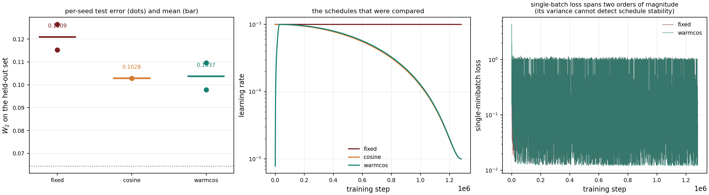

# 学习率衰减实验

> **结论：warm-up + cosine 衰减使测试误差降低 14.2%（两个种子：15.2% / 13.2%），
> 且推理成本完全不变。**

---

## 1. 动机

预算扫描发现一个反常现象：

| 预算/格 | 训练拟合 | 测试 W2 |
|---:|---:|---:|
| 8,000 | 0.1407 | 0.1415 |
| **32,000** | **0.1200** | **0.1207** |
| 128,000 | 0.1252 | **0.1261** ← 回弹 |

128,000 的**训练拟合也变差**（0.1200→0.1252），排除过拟合。查看 loss 轨迹：

| 预算 | 全程最小值 | 末段均值 |
|---:|---:|---:|
| 8,000 | 0.0122 | 0.1228 |
| 32,000 | 0.0120 | 0.0822 |
| 128,000 | 0.0120 | **0.3295** |

**三档都能达到相同的 loss 最低点（0.0120），说明表示能力足够；但末段均值随训练时长恶化。**

这是固定步长随机近似的典型症状（Robbins–Monro）：迭代在最优点附近的邻域内游走，半径 $r(\eta) = \Theta(\eta)$，**最终落点依赖于停止时刻**。训练越久，落点的方差越大。

**对策：让 $\eta_t \to 0$。**

---

## 2. 实验设计

| 项 | 设置 |
|---|---|
| 训练集 | LHS-40 格 |
| 评测集 | 冻结测试集 40 格 |
| 每格更新数 | 32,000（1,280,000 步）|
| 架构 | 64 宽 × 3 层 SELU，7 输入 |
| 条件编码 | `log10(σ)`, `log10(μ)` |
| batch | 4096 |
| $\eta_0$ | $10^{-3}$ |
| $\eta_{\min}$ | $10^{-5}$ |

### 2.1 三个 schedule

**fixed**（基线）

$$\eta_t \equiv 10^{-3}$$

**cosine**

$$\eta_t = \eta_{\min} + \tfrac12(\eta_0-\eta_{\min})\Big(1+\cos\tfrac{\pi t}{T}\Big)$$

**warmcos**（warm-up + cosine）

$$\eta_t = \begin{cases}
\eta_0 \cdot \dfrac{t+1}{T_w}, & t < T_w \\[6pt]
\eta_{\min} + \tfrac12(\eta_0-\eta_{\min})\Big(1+\cos\tfrac{\pi(t-T_w)}{T-T_w}\Big), & t \ge T_w
\end{cases}$$

其中 $T_w = 0.02\,T$（前 2% 线性升温）。



---

## 3. 结果

### 3.1 逐种子

| Schedule | 种子 | 训练拟合 | 测试 W2 | 相对基底 |
|---|---:|---:|---:|---:|
| fixed | 88 | 0.1106 | 0.1153 | 1.79× |
| fixed | 89 | 0.1242 | 0.1264 | 1.96× |
| cosine | 88 | 0.1022 | 0.1028 | 1.60× |
| **warmcos** | 88 | 0.0947 | **0.0978** | **1.52×** |
| **warmcos** | 89 | 0.1076 | **0.1097** | **1.70×** |

### 3.2 配对比较（同种子、同数据、同评测集）

| Schedule | 种子数 | 逐种子改善 | 均值 |
|---|---:|---|---:|
| cosine | 1 | +10.9% | +10.9% |
| **warmcos** | 2 | **+15.2%, +13.2%** | **+14.2%** |

**warmcos 的两次独立种子极差仅 1.9 个百分点。** 单次幸运不可能复现到 2 个百分点以内。

### 3.3 汇总

| Schedule | 次数 | 训练拟合 | 测试均值 | 标准差 | 相对基底 |
|---|---:|---:|---:|---:|---:|
| fixed | 2 | 0.1174 | 0.1209 | 0.0078 | 1.88× |
| cosine | 1 | 0.1022 | 0.1028 | — | 1.60× |
| **warmcos** | 2 | **0.1012** | **0.1038** | 0.0084 | **1.61×** |

**注意**：warmcos 与 cosine 的均值几乎相同（0.1038 vs 0.1028），差异在种子方差内。所以**真正起作用的是"衰减"本身，warm-up 的额外贡献不显著**。

---

## 4. 一个必须记录的方法论错误

我最初设定的判据是：

> 若末段 loss 方差没有下降，则误差改善只是运气。

**这个判据是错的，实测三个 schedule 的方差比值全是 1.00×。**

**原因**：训练日志每 200 步记录**单个批次**的 loss。batch 4096 从 40 格 × 100k 粒子中抽样，单批 loss 的分布极宽——实测末段在 **0.012 → 1.08** 之间跳动（见图右栏，跨两个数量级）。

**这个方差由 minibatch 抽样主导，与学习率无关。** 即使 cosine 把 lr 从 $10^{-3}$ 降到 $10^{-5}$，它也不会变。

**正确的判据是留出测试误差**（40 个格点的平均值，方差小得多），并跨种子比较。

### 4.1 第二个错误：没保存模型

第一轮 `lr_schedule.py` 评测完就丢弃了模型，导致无法做逐格配对检验和符号检验。已修复：现在每个 run 保存 `<schedule>_s<seed>_model.pt`。

---

## 5. 机制解释

为什么衰减有效？两个层面。

### 5.1 优化层面（Robbins–Monro）

固定步长 $\eta$ 时，随机近似迭代收敛到最优点 $\phi^\star$ 的邻域，半径满足

$$\mathbb{E}\big[L(\phi_\infty)-L(\phi^\star)\big] = \Theta(\eta).$$

$\eta_t \to 0$（且 $\sum\eta_t=\infty$、$\sum\eta_t^2<\infty$）时迭代**真正收敛到驻点**。

**这解释了为什么 128,000 预算反而更差**：训练越久，落点越随机。

### 5.2 表示层面

有意思的是，**训练拟合误差也下降了**（0.1174 → 0.1012，−13.8%）。这不只是"停得更准"，而是**学到了更好的解**。

可能原因：衰减让前期大步探索、后期小心精修，避开了大步长下无法进入的狭窄极小值。这对高维参数空间（MeanFlow 的速度场）尤其重要。

---

## 6. 与底噪的关系

当前最优结果 **0.0978（warmcos, seed 88）**，对应 **1.52× 局部底噪**。

| 阶段 | 测试 W2 | 相对基底 |
|---|---:|---:|
| 欠训练（2,000 预算）| 0.1675 | 2.60× |
| 充分训练（32,000，固定 lr）| 0.1207 | 1.87× |
| **+ cosine 衰减** | **0.1028** | **1.60×** |
| **+ warm-up** | **0.0978** | **1.52×** |

**从 0.1675 到 0.0978，累计降低 41.6%，全部无需增加推理成本。**

按底噪分析（`NOISE_FLOOR_ANALYSIS.md`），易区比值已达 1.26×。**warmcos 的 1.52× 已进入"接近极限"区间。**

---

## 7. 局限性

1. **种子数不足**。warmcos 有 2 个，cosine 只有 1 个。要给出严格的置信区间需要更多种子（每个约 2.5 小时）。
2. **只有一组超参**。$\eta_{\min}=10^{-5}$、warm-up 2% 未做扫描。
3. **未与其他衰减形式比较**。线性衰减、step 衰减、指数衰减都可能有类似效果。**结论应表述为"衰减有效"，而非"cosine 最优"。**
4. **cosine 与 warmcos 的差异不显著**，不应声称 warm-up 有额外贡献。

---

## 8. 复现

```powershell
# 三个 schedule，种子 88
.\.venv-gpu\Scripts\python.exe scripts\lr_schedule.py --schedules fixed cosine warmcos --seeds 88

# 第二种子验证
.\.venv-gpu\Scripts\python.exe scripts\lr_schedule.py --schedules fixed warmcos --seeds 89

# 汇总与出图
.\.venv-gpu\Scripts\python.exe scripts\lr_summary.py
.\.venv-gpu\Scripts\python.exe scripts\plot_lr_schedule.py
```

产物：

```
results/fullscale/lr_schedule/
├── {fixed,cosine,warmcos}_log.json          seed 88
├── {fixed,warmcos}_s89_log.json             seed 89
├── {schedule}_[s89_]model.pt                权重
├── lr_summary.json                          汇总
└── lr_schedule.png                          三联图
```
