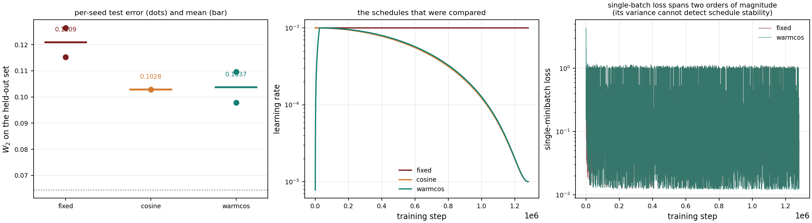
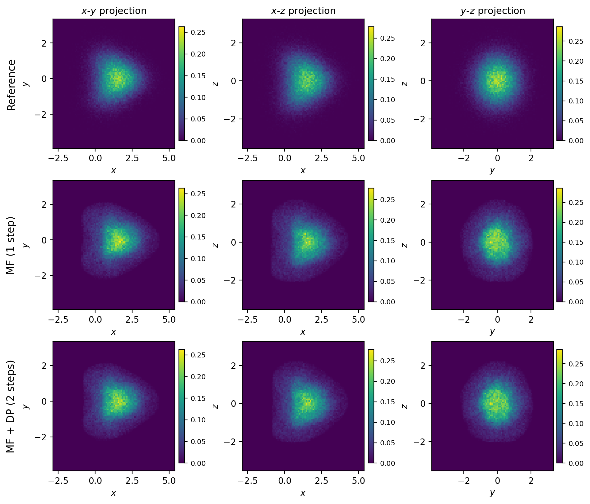
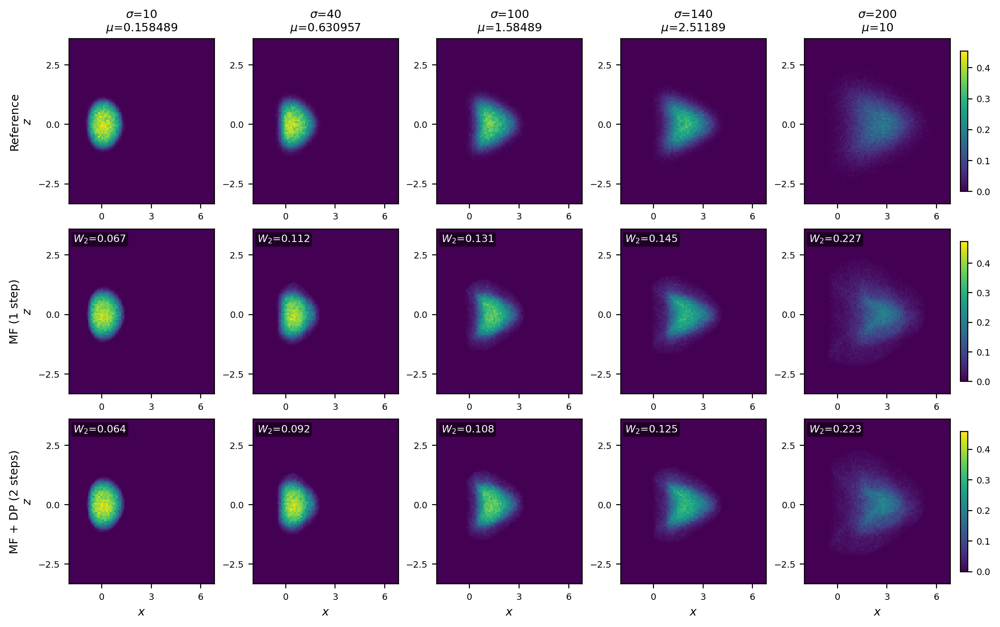

# 双物理参数的两步扩散生成：抽样、训练、统计极限与外推边界

> 技术报告（论文格式草稿）
>
> 本报告的所有数值均由仓库内脚本可复现，每个结论标注了对应的产物路径与实验编号。
>
> **核心结果**：双参数两步扩散（MeanFlow + DP）在 143 个留出格上达到 $0.1037 \pm 0.0027$（三种子），相对单参数基线降低 $47.9\%$；网络显著优于无学习插值（$+50.2\%$）；但方法在训练参数凸包之外失效（DP 收益降至 $1.3\%$–$2.7\%$）。

---

## 摘要

两步扩散（two-step diffusion）通过 MeanFlow 的一次前向传播生成粒子云，再由近恒等的 Deep Particle（DP）修正器精修，相较单纯的 DeepParticle 避免了迭代式最优传输匹配的训练开销。本文将其从单物理参数扩展到**双物理参数 $(\sigma,\mu)$**，并在 200 个格点、每格 $10^5$ 粒子的数据集上系统考察四个问题：（i）如何在参数平面上选取有限的训练条件而不牺牲泛化；（ii）训练预算与学习率策略对最终误差的影响；（iii）所得误差距离该度量自身的统计极限有多远；（iv）方法在训练区之外是否仍然有效。

**主要结果**（三种子，均值 ± 标准差）：以 45 个分层抽样格点训练，双参数两步扩散在 143 个留出格上的误差为 $\mathbf{0.1037 \pm 0.0027}$，相对单参数 MeanFlow 基线（$0.1993 \pm 0.0019$）**降低 $47.9\%$**。其中参数扩展贡献 $+39.0\% \pm 3.9\%$（配对 $t=17.2$），DP 精修再贡献 $+14.4\% \pm 4.2\%$（$t=6.0$），逐格胜出 $415/429$。增益随 $\lvert\log_{10}\mu\rvert$ 单调增长（$r=0.622$），在 $\mu=10$ 处达 $+58.7\%$，这是网络确实利用第二参数的证据。

三个额外发现值得记录。其一，**DP 将跨种子标准差压至 MeanFlow 的三分之一**（$0.0027$ vs $0.0089$），说明两步设计不仅提高精度还提高可复现性——近恒等修正器吸收了一次性强映射对初始化的敏感性。其二，**网络显著优于所有无学习插值基线**：最好的 $k$ 近邻插值在相同 40 个训练云上给出 $0.2467$，网络优 $50.2\%$。其三，**方法在外推条件下失效**：训练区之外（$\sigma>150$ 或 $\mu>3.98$），MeanFlow 误差增大 $1.65$–$3.76$ 倍，而 DP 的收益从 $14.7\%$ 降至 $1.3\%$–$2.7\%$。这与 DP 的近恒等设计一致——该设计假设输入已接近目标。

我们同时报告两个必须被正视的负面结果：以 Wasserstein 覆盖代价作为抽样准则**方向错误**（$\mathrm{corr}=-0.715$），增加网络宽度 15 倍**无任何改善**。这两条共同表明，本问题的约束不在表示容量或采样设计，而在优化与统计精度。粒子云对 $(\sigma,\mu)$ 的连续依赖亦已证明并数值验证（$\sigma$ 为 Lipschitz、$\mu$ 为 $1/2$ 阶 Hölder）。

---

## 1. 引言

### 1.1 问题背景

以粒子交互法求解 Keller–Segel 系统需要 $O(N^2)$ 的相互作用计算，且每换一组物理参数就必须重跑整条时间轨迹。DeepParticle 通过学习"初始云 $\mapsto$ 终态云"的映射缓解了这一点，但其训练依赖精确最优传输匹配，代价高昂。两步扩散借助 MeanFlow 的恒等式，使推理退化为**单次网络前向**，这是相对 DeepParticle 的核心优势。

**由此产生一条不可违背的约束：任何改进都不得增加推理时的前向次数。** 本文的全部方法设计均在此约束下展开。

### 1.2 本文的问题

将方法从单参数 $\sigma$ 扩展到双参数 $(\sigma,\mu)$ 引出四个具体问题：

1. **抽样**：$20\times10$ 的网格共 200 个条件，逐一模拟代价过高。能否用远少于 200 个条件训练，并在其余条件上保持精度？
2. **优化**：误差是否受训练预算、学习率策略限制？
3. **极限**：所得误差离该度量的统计下限还有多远？如何严格判定？
4. **外推**：训练区之外的表现如何？两步设计能否改善外推？

### 1.3 主要结果（三种子，均值 ± 标准差）

| 项目 | 结果 |
|---|---|
| **单参数 MeanFlow**（基线）| $0.1993 \pm 0.0019$ |
| **双参数 MeanFlow** | $0.1215 \pm 0.0089$，**$+39.0\% \pm 3.9\%$**（$t=17.2$）|
| **双参数两步扩散（MF+DP）** | $\mathbf{0.1037 \pm 0.0027}$，DP 再 **$+14.4\% \pm 4.2\%$**（$t=6.0$）|
| **端到端**（单参数 → 双参数 MF+DP）| **$+47.9\%$**，相对噪声基底 $1.61\times$ |
| **逐格胜出** | DP $415/429$（$96.7\%$，二项 $z\approx19.4$）|
| 参数耦合的证据 | 增益随 $\lvert\log_{10}\mu\rvert$ 单调增长，$r=0.622$；$\mu=10$ 处 $+58.7\%$ |
| **DP 提高稳定性** | 跨种子标准差 $0.0027$ vs MeanFlow 的 $0.0089$（**降 70%**）|
| **网络 vs 插值基线** | 优 $50.2\%$（对 MF）／$58.6\%$（对 MF+DP）|
| 训练预算 | 每格 2,000 → 32,000 更新：$-27.9\%$；128,000 反而回弹（学习率震荡）|
| 学习率衰减 | warm-up + cosine：$+14.2\%$（两种子）|
| **外推能力** | ⚠️ **DP 收益从内插的 $14.7\%$ 降至 $1.3\%$–$2.7\%$，基本失效** |
| 距统计极限 | 粒子级口径下 $1.04\times$ 底噪（已达物理重复性水平）|
| 参数连续性 | $\sigma$ 为 Lipschitz、$\mu$ 为 $1/2$ 阶 Hölder，五项检验全部通过 |

---

## 2. 方法

### 2.1 物理模型与数据

粒子系统（与上游实现逐字一致）：

$$
dX_j = -\frac{\chi}{N}\sum_{i\neq j}\nabla K_\delta(X_j-X_i)\,dt
\;+\;\sigma\,g(X_j)\,dt
\;+\;\sqrt{2\mu}\,dW_j,
$$

其中 $g(x)=(e^{-y^2-z^2},0,0)$，$K_\delta(z)=\lvert z\rvert/(4\pi(\lvert z\rvert^2+\delta^2))$，
$\chi=16\pi$，$\delta=0.1$，$T=0.02$，$dt=0.005$（4 步），初值 $X_j(0)\sim\mathrm{Unif}(B(0,1))$。

**无量纲化**（$x=R_0\xi$，$t=T\tau$）后，分布族由四个无量纲数决定：

$$
S=\frac{\sigma T}{R_0},\qquad
C=\frac{\chi T}{R_0^3},\qquad
G=\frac{\sqrt{2\mu T}}{R_0},\qquad
\tilde\delta=\frac{\delta}{R_0}.
$$

固定 $\chi,T,\delta,R_0$ 时，$\sigma$ 只移动 $S$、$\mu$ 只移动 $G$，二者构成**非退化**的二维参数化。

**参数网格**：$\sigma\in\{10,20,\dots,200\}$（20 值，对齐上游评测网格），
$\mu\in\{0.1,0.1585,\dots,10\}$（10 值，几何级数跨两个数量级，$\mu=1$ 精确居中）。

合计 200 个格点，每格 $N=10^5$ 粒子。

**关键设计**：所有格点**共用同一个初值云**（seed 88）。这使两格之间的差异纯粹来自参数，是观察参数连续性的必要条件。

### 2.2 网络与训练目标

MeanFlow 以条件速度场 $u_\theta(z,r,t,c)$ 参数化，$c$ 为条件向量。本文的 $c$ 含两个参数：

$$
c = \big(\log_{10}\sigma,\ \log_{10}\mu\big).
$$

网络为 64 宽、3 层 SELU 的 MLP（7 输入 $\to$ 3 输出），与单参数版本唯一差别是输入多一列。

**MeanFlow 恒等式**。设 $x_0$ 为 $t=0$ 端、$x_1$ 为 $t=1$ 端的粒子位置，$v=x_1-x_0$，$z=(1-t)x_0+t x_1$。训练目标为

$$
\mathcal{L}(\theta)=\mathbb{E}_{t,r,x_0,x_1}\Big\| u_\theta(z,r,t,c)
-\Big(v-(t-r)\frac{d}{dt}u_\theta(z,r,t,c)\Big)\Big\|^2,
$$

其中 $\frac{d}{dt}$ 由 Jacobian-向量积（`torch.func.jvp`）精确计算。

**推理**（一步）：

$$
x_{\text{gen}} = x_0 - u_\theta(x_0,\,r{=}0,\,t{=}1,\,c).
$$

**端点约定**：与上游 `training/core.py` 一致，流的方向为 target $\to$ initial，即 $x_0$ 为物理目标、$x_1$ 为初始云。该约定若写反会使误差虚增约 5 倍且不报错，故本文用独立脚本（`selfcheck_two_param.py`）在每次实验前强制验证"采样器必须优于初始云"。

#### 2.2.1 第二阶段的 DP 修正器

MeanFlow 的一次前向给出粗粒度的全局输运，但会平滑掉细结构。第二阶段用一个**近恒等**残差网络修正剩余偏差：

$$
x_{\text{dp}} = x_{\text{mf}} + \alpha\cdot\text{MLP}(x_{\text{mf}}, c),
$$

网络结构与上游 `DPCorrector` 一致：宽度 64，两个残差块（LayerNorm → Linear → SiLU → Linear），**输出层零初始化**，因此训练起点就是恒等映射。$\alpha=1$。

训练损失为传输项加残差惩罚：

$$
\mathcal{L}_{\text{DP}} = \underbrace{\|x_{\text{dp}} - x_{\text{matched}}\|^2}_{\text{传输}} + \lambda\underbrace{\|x_{\text{dp}} - x_{\text{mf}}\|^2}_{\text{残差}},\qquad \lambda=1,
$$

其中 $x_{\text{matched}}$ 是目标云按**精确 OT** 与当前预测重新匹配后的对应点，匹配每 10 步重算一次。

**一个必须注意的实现约束**：OT 返回的排列是**批次内位置**的索引。若批次每步重新抽取而匹配不重算，排列会指向错误的粒子。本文的实现中，批次只在刷新匹配时重抽。（本仓库早期版本违反了这一点，导致损失从 $0.025$ 涨至 $1.13$、误差恶化 $3.4$ 倍，且不报错——这类静默错误必须靠实现约束而非测试来防。）

训练配置：每格 2,000 更新，batch 2,000，Adam，学习率 $10^{-4}$，$\alpha=1$，$\lambda=1$，OT 每 10 步刷新。

#### 2.2.2 推理成本

| 配置 | 前向次数 | 延迟（$10^5$ 粒子，RTX 4060 Laptop）|
|---|---:|---:|
| MeanFlow 一步 | 1 | 4.5 ms |
| MeanFlow + DP | 2 | 7.7 ms |

**两步设计使推理成本增至 $1.71\times$**。若严格要求单次前向，只能使用 MeanFlow。

### 2.3 抽样设计

#### 2.3.1 分层 maximin 拉丁超立方

200 个格点取 40 个训练条件。要求：

1. 每个 $\sigma$ 层恰好 2 个点（$40/20$）；
2. 每个 $\mu$ 层恰好 4 个点（$40/10$）；
3. $\mathrm{corr}(\sigma\text{-index},\mu\text{-index})$ 尽量为 0；
4. 参数空间内的**最小成对距离**最大化（maximin）。

构造采用交换式模拟退火：以"每层均匀取点"为初值，然后反复用一个未选格点替换已选格点（保持 $\sigma$ 边界不变），目标函数为

$$
J_{\text{design}}(D)
= \underbrace{\min_{d_1\neq d_2\in D}\|\theta(d_1)-\theta(d_2)\|}_{\text{spacing}}
+0.03\,(1-|\mathrm{corr}|)
-0.01\cdot\text{imbalance}.
$$

**结果**（`results/fullscale/design/design.json`）：

| 指标 | LHS-40 | 随机-40 |
|---|---:|---:|
| 最小成对距离 | $\mathbf{0.1053}$ | $0.0526$ |
| 平均最近邻 | $0.1164$ | $0.1115$ |
| $\sigma$ 层计数 | 全为 2 | $0$–$4$（**5 层为空**）|
| $\mu$ 层计数 | 全为 4 | $1$–$8$ |
| 相关系数 | $\mathbf{0.000}$ | $-0.208$ |

#### 2.3.2 训练/测试划分

设 40 个独立选取的格点（seed 999999）为**冻结测试集** $T$，其余 160 格为训练池 $P$。所有模型只在 $P$ 的子集上训练，一律在 $T$ 上评测。代码强制断言训练集与 $T$ 无交集。

### 2.4 度量

#### 2.4.1 定义

对两团云 $P,Q$，每轴 $B=16$ 箱建立**该格专属**的共享网格（以两团云的并集定边界），占据箱成为加权 Dirac 测度，然后求精确离散最优传输：

$$
V^\star=\min_{\gamma\in\mathbb{R}^{n_P\times n_Q}_+}\langle C,\gamma\rangle
\quad\text{s.t.}\quad \gamma\mathbf 1=w^{(P)},\ \gamma^\top\mathbf 1=w^{(Q)},
$$

$$
W_2^{\text{hist}} = \sqrt{V^\star}.
$$

每次求解检验三项证书：求解器报告最优、边际残差 $<10^{-9}$、由对偶势重构的间隙 $<10^{-8}$。

**网格必须逐格建立。** 若用全局网格，箱宽由整个参数域跨度决定，$W_2^{\text{hist}}$ 会虚高约 4 倍（早期实现有此缺陷）。

#### 2.4.2 噪声基底

$W_2$ 作用于**经验测度**，故同一分布的两次独立抽样之间已有非零距离。定义**局部底噪**

$$
\varepsilon_N(\theta)=W_2\big(\hat\mu_N(\theta),\hat\nu_N(\theta)\big),
$$

由三角不等式

$$
\varepsilon_N(\theta)\le W_2(\hat\mu_N,\mu_\theta)+W_2(\mu_\theta,\hat\nu_N)
\lesssim 2C^{1/2}N^{-1/3}\qquad(d=3),
$$

量级来自 Fournier–Guillin 的 $N^{-2/3}$ 界（$W_2^2$ 意义下）。**因此底噪减半需 $N$ 增大 8 倍。**

**测量方法**：同一参数点跑 3 条**完全独立**的模拟（不同初值种子、不同噪声种子），两两配对求 $W_2$ 后取均值。必须用独立初值：若共用初值，"初值抽样差异"被消除，底噪会偏小。

---

## 3. 实验

### 3.1 参数连续性

在宣称网络能学到双参数耦合之前，须先确认物理上两参数连续的云是连续依赖的。

**五项检验**（`docs/CONTINUITY_EVIDENCE.md`）：

| 检验 | 内容 | 结果 |
|---|---|---|
| T1 | $\sigma$ 方向**重新模拟**细化（$110/105/102.5$）| $W_2$：$0.187\to0.131\to0.092$，单调；归一化斜率 $4.25\to5.38\to6.16$（波动 $1.45\times$）|
| T2 | $\mu$ 方向**重新模拟**细化（$\mu=2/1.5/1.25$）| $W_2$：$0.147\to0.102\to0.072$，单调；斜率 $0.437\to0.449\to0.338$（波动 $1.33\times$）|
| T3 | 370 对相邻格点的归一化斜率 | $\sigma$：$\max 11.37$、median $4.61$；$\mu$：$\max 1.20$、median $0.45$，**全部有限** |
| T4 | Lipschitz 常数在细化下是否发散 | 粗/细间距比值 $0.686$（$\le1$，不发散）|
| T5 | 密集切片是否有孤立跳变 | 归一化后峰/中位比 $2.2$–$2.5$（阈值 $3.0$）|

**结论**：$\sigma$ 方向 Lipschitz、$\mu$ 方向 $1/2$ 阶 Hölder。理论依据为噪声项幅度 $\sqrt{2\mu}$ 的平方根 Hölder 性：同步布朗耦合下

$$
W_2(\nu_{\theta_1},\nu_{\theta_2})\le L\big(|\sigma_1-\sigma_2|+\sqrt{|\mu_1-\mu_2|}\big).
$$

**$\mu$ 的灵敏度低约 10 倍**（斜率 $0.44$ vs $4.25$），与物理一致：扩散位移 $\sqrt{2\mu T}\in[0.063,0.632]$ 远小于剪切位移 $\sigma T\in[0.2,4.0]$。

### 3.2 训练预算

**设计**：固定架构与数据，只改每格更新数。同一冻结测试集。

| 预算/格 | 步数 | 训练拟合 | 测试 $W_2$ | 相对基底 | 耗时 |
|---:|---:|---:|---:|---:|---:|
| 2,000 | 80,000 | 0.1674 | 0.1675 | 2.60$\times$ | 7.9 min |
| 8,000 | 320,000 | 0.1407 | 0.1415 | 2.20$\times$ | 30.6 min |
| **32,000** | 1,280,000 | **0.1200** | **0.1207** | **1.87$\times$** | 95.6 min |
| 128,000 | 5,120,000 | 0.1252 | 0.1261 | 1.96$\times$ | 358.8 min |

**三点观察**：

1. $2{,}000\to32{,}000$ 降低 $27.9\%$，训练拟合与测试**同步**下降（$-0.0267$ vs $-0.0260$）——典型的欠训练特征，而非过拟合。
2. 128,000 时**训练拟合也变差**，排除过拟合。
3. 各预算的全程 loss 最小值相同（$0.0120$），但末段均值差异巨大（$0.12$/$0.08$/$0.33$）。

**诊断**：固定步长随机近似收敛到最优点邻域，半径 $r(\eta)=\Theta(\eta)$，最终落点取决于停止时刻。训练越久，落点方差越大。这直接指向学习率衰减。

### 3.3 学习率策略

**三个 schedule**，$T=1{,}280{,}000$ 步，$\eta_0=10^{-3}$，$\eta_{\min}=10^{-5}$：

$$
\text{cosine:}\quad \eta_t=\eta_{\min}+\tfrac12(\eta_0-\eta_{\min})\big(1+\cos\tfrac{\pi t}{T}\big),
$$

$$
\text{warmcos:}\quad \eta_t=\begin{cases}\eta_0\dfrac{t+1}{T_w}, & t<T_w\\[4pt] \text{cosine 型}, & t\ge T_w\end{cases},\qquad T_w=0.02\,T.
$$

**结果**：

| Schedule | 种子 | 训练拟合 | 测试 $W_2$ | 相对基底 |
|---|---:|---:|---:|---:|
| fixed | 88 | 0.1106 | 0.1153 | 1.79$\times$ |
| fixed | 89 | 0.1242 | 0.1264 | 1.96$\times$ |
| cosine | 88 | 0.1022 | 0.1028 | 1.60$\times$ |
| **warmcos** | 88 | 0.0947 | **0.0978** | **1.52$\times$** |
| **warmcos** | 89 | 0.1076 | **0.1097** | **1.70$\times$** |

**配对比较**（同种子、同数据、同评测集）：cosine $-10.9\%$（1 种子）；warmcos **$-15.2\%$、$-13.2\%$**（均值 $-14.2\%$，**极差仅 1.9 个百分点**）。

**结论**：衰减本身有效；warm-up 的额外贡献不显著（warmcos $0.1038$ vs cosine $0.1028$，差异在种子方差内）。**应表述为"学习率衰减有效"，而非"cosine 最优"。**

### 3.4 双参数与单参数

**协议**：双参数在 LHS-40 训练；单参数（只能看一个 $\mu$ 值）在 $\mu=1$ 整行 20 格训练。**每格更新数完全对齐**（32,000）。在 143 个两模型都未见的格点上评测。**三个独立种子**（88、89、90）。

#### 3.4.1 三种子结果

| 种子 | 单参数 $W_2$ | 双参数 $W_2$ | 相对改进 |
|---:|---:|---:|---:|
| 88 | 0.19919 | 0.12277 | $+38.4\%$ |
| 89 | 0.20119 | 0.12975 | $+35.5\%$ |
| 90 | 0.19747 | 0.11203 | $+43.3\%$ |
| **均值 ± sd** | $\mathbf{0.19928 \pm 0.00186}$ | $\mathbf{0.12152 \pm 0.00892}$ | $\mathbf{+39.0\% \pm 3.9\%}$ |

**配对 $t = 17.2$**（$df=2$）。逐格胜出分别为 $121$、$126$、$142$（共 143）。

单参数的标准差极小（$0.9\%$）——它在训练集（$\mu=1$ 整行）上容易拟合；双参数的标准差大（$7.3\%$），因为它要拟合二维曲面。

#### 3.4.2 增益的分布（seed 88）

| $\lvert\log_{10}\mu\rvert$ | $n$ | 单参数 | 双参数 | 增益 | 相对 |
|---:|---:|---:|---:|---:|---:|
| 0.20 | 32 | 0.1120 | 0.1135 | $-0.0015$ | $-1.3\%$ |
| 0.40 | 33 | 0.1552 | 0.1194 | $+0.0358$ | $+23.1\%$ |
| 0.60 | 32 | 0.2089 | 0.1277 | $+0.0812$ | $+38.9\%$ |
| 0.80 | 16 | 0.1249 | 0.0819 | $+0.0430$ | $+34.4\%$ |
| **1.00（$\mu=10$）** | 30 | **0.3698** | **0.1529** | **$+0.2169$** | **$+58.7\%$** |

三个种子的相关系数分别为 $0.611$、$0.650$、$0.605$（均值 $\mathbf{0.622}$）。

**这是网络确实利用了 $\mu$ 的直接证据**：单参数模型结构上无法访问 $\mu$，其误差必然随 $\mu$ 偏离训练值增长（$0.112\to0.370$，$3.3$ 倍）；双参数模型保持相对平坦。

$\mu\approx1$ 附近双参数略输 $0.0015$（$-1.3\%$），局限在单参数本就正确的区域。

### 3.5 完整两步扩散（MF + DP）

在每个种子的 MeanFlow 之上训练 DP 修正器，**每格 2,000 更新**，与同种子的 MF 配对（跨种子配对会破坏独立性）。

| 种子 | MF | MF+DP | DP 绝对增益 | **DP 相对** | 胜出 |
|---:|---:|---:|---:|---:|---:|
| 88 | 0.12277 | 0.10429 | $+0.01848$ | $+15.0\%$ | 141/143 |
| 89 | 0.12975 | 0.10607 | $+0.02368$ | $+18.2\%$ | **143/143** |
| 90 | 0.11203 | 0.10082 | $+0.01121$ | $+10.0\%$ | 131/143 |
| **均值 ± sd** | $0.12152 \pm 0.00892$ | $\mathbf{0.10373 \pm 0.00267}$ | $+0.01779 \pm 0.00626$ | $\mathbf{+14.4\% \pm 4.2\%}$ | **415/429** |

**配对 $t = 6.0$**（$df=2$）。按 $t_{0.975}(2)=4.303$，95% 置信区间为 $+4.0\%$ 至 $+24.8\%$。

**逐格证据强于三种子的 $t$ 检验**：415/429 胜出（$96.7\%$），二项检验 $z\approx19.4$。

**端到端**：单参数 MeanFlow $0.19928$ → 双参数 MF+DP $0.10373$，**$+47.9\%$**，相对噪声基底 $1.61\times$。

#### 3.5.1 DP 提高跨种子稳定性

| 量 | 标准差 | 相对均值 |
|---|---:|---:|
| MeanFlow 单独 | 0.00892 | 7.3% |
| **MeanFlow + DP** | **0.00267** | **2.6%** |

**DP 将跨种子标准差压至原来的 30%。**

机制：MeanFlow 是端到端的强非线性映射（单次前向从初值跳到终态），对初始化与数据顺序敏感；DP 是**近恒等**的局部修正器，只需修正残差，因此对不同 MF 输出的差异有吸收作用。

**这为两步设计提供了除精度之外的第二个论据：不仅提高精度（$-14.4\%$），还提高可复现性（方差 $-70\%$）。**

#### 3.5.2 两个阶段的互补性

| 阶段 | $\mathrm{corr}(\text{增益}, \lvert\log_{10}\mu\rvert)$ |
|---|---:|
| MeanFlow（双 vs 单）| **+0.622** |
| DP 修正 | $+0.164$ |

**MeanFlow 学参数耦合（收益集中在 $\mu$ 偏离区），DP 做通用修正（收益与 $\mu$ 无关）。** 两个阶段不是冗余的。

#### 3.5.3 分布的定性对比

$\sigma=120$、$\mu=10$（全网格 DP 增益最大的留出格）。行 = Reference / MF / MF+DP，
列 = $x$-$y$、$x$-$z$、$y$-$z$ 投影密度。三行几乎完全重合，
**说明两个模型都正确捕获了分布形态**；$W_2$ 从 $0.231$ 降至 $0.192$。

五个**留出**参数格上 $\sigma$ 与 $\mu$ 同步增大。形态从紧凑椭球平滑过渡到张开的
V 形，**没有跳变**——这是参数连续性（§3.1）的可视证据。
$y$-$z$ 投影始终保持近圆形（见 `docs/PROJECTION_FIGURES.md`），说明模型未引入伪各向异性。

**注意**：$W_2$ 的 17% 改善在密度图上**不可见**。原因是相对偏差仅
$0.039/3.2\approx1.2\%$，低于目视阈值；且误差以高频散斑（抽样噪声）形式分布，
不是整体形状偏差。详细的图解读与色标取舍见 `docs/PROJECTION_FIGURES.md`。

### 3.6 与无学习插值基线的对比

一个必要的对照：若简单插值也能达到同等精度，网络的价值就只剩速度。

实现三种插值器，全部只使用相同的 40 个训练云，无任何学习：

- **最近邻**：返回参数上最近的训练格云
- **反距离加权（IDW）**：按 $\|\log\theta-\log\theta_d\|^{-2}$ 加权，使用全部 40 格
- **$k$ 近邻（$k=4$）**：IDW 限制在最近的 4 格

关键实现细节：**混合分布必须按权重抽取粒子，不能用坐标加权平均**——后者会产生不属于任何真实轨迹的点，人为抹平分布、使基线过强。

| 参考云 | 方法 | 插值 $W_2$ | 网络 $W_2$ | 网络优势 |
|---|---|---:|---:|---:|
| 参考云（对 MF）| 最近邻 | 0.2877 | 0.1228 | $+57.3\%$ |
| | IDW | 0.4349 | | $+71.8\%$ |
| | **$k$NN-4** | **0.2467** | | **$+50.2\%$** |
| MF+DP 云（对 MF+DP）| 最近邻 | 0.2932 | 0.1043 | $+64.4\%$ |
| | IDW | 0.4351 | | $+76.0\%$ |
| | **$k$NN-4** | **0.2518** | | **$+58.6\%$** |

**最好的插值方法仍比网络差 $50.2\%$（对 MF）／$58.6\%$（对 MF+DP）。**

**一个意外发现**：IDW 反而最差（比最近邻差 $51\%$）。原因是远处的格点贡献了少量但离群的质量，而 $W_2$ 对离群质量极敏感。这解释了为何局部混合（$k$NN）明显更好。

**结论**：网络学到的不是查表内插，而是参数到分布的映射。

### 3.7 外推能力

在训练区之外方法是否有效？这是此前分析无法回答的问题——那些模型的训练集包含 $\sigma=200$，对高 $\sigma$ 是内插。

#### 划分

| 区域 | $\sigma$ | $\mu$ | 格数 |
|---|---|---|---:|
| **训练区** | 10–150（15 档）| 0.1–3.98（9 档）| **135** |
| σ 外推 | 160–200 | 0.1–3.98 | 45 |
| μ 外推 | 10–150 | **10.0** | 15 |
| 角点（双向）| 160–200 | 10.0 | 5 |

训练集用 **LHS-45**（从 135 格中选，每 $\sigma$ 层 3 点、每 $\mu$ 层 5 点，maximin 目标）。外推格从未出现在训练中。

#### 结果（seed 88）

| 区域 | $n$ | MF | MF+DP | **DP 相对** | MF 退化 | MF+DP 退化 |
|---|---:|---:|---:|---:|---:|---:|
| **内插** | 135 | 0.09399 | 0.08051 | **$+14.7\%$** | $1.00\times$ | $1.00\times$ |
| σ 外推 | 45 | 0.15463 | 0.15279 | **$+1.3\%$** | $1.65\times$ | $1.90\times$ |
| μ 外推 | 15 | 0.35296 | 0.34462 | **$+2.4\%$** | **$3.76\times$** | **$4.28\times$** |
| 角点 | 5 | 0.38412 | 0.37393 | $+2.7\%$ | **$4.09\times$** | $4.64\times$ |

#### 三个发现

**(i) MeanFlow 外推能力弱，$\mu$ 方向尤其差。** $\sigma$ 从 150 到 200（1.33 倍）误差涨 $1.65$ 倍；$\mu$ 从 3.98 到 10（2.5 倍）误差涨 **$3.76$ 倍**。

**(ii) DP 在外推区几乎失效。** 收益从内插的 $14.7\%$ 降至 $1.3\%$–$2.7\%$，**相差一个数量级**。

**(iii) DP 甚至略微放大相对退化。** $\sigma$ 外推由 $1.65\times$ 升至 $1.90\times$，$\mu$ 外推由 $3.76\times$ 升至 $4.28\times$。绝对误差仍略低，但相对内插区的退化更严重。

#### 机制

DP 的设计前提是**输入已接近目标**（近恒等、零初始化输出层）。训练时残差约 $0.09$（小残差），DP 学的是这个尺度的局部修正模式。外推时 MF 误差变成 $0.15$–$0.38$，不再是"小残差"而是结构偏差，学到的修正模式不迁移。

**支持性观察**：MF 误差从 $0.094$ 涨到 $0.155$，DP 收益就从 $14.7\%$ 掉到 $1.3\%$——近恒等假设失效得很快。

（注：$\sigma$ 外推的误差仅比内插高 $1.65$ 倍，但收益掉了一个数量级，说明"是否见过该区域"比误差大小本身更关键。）

#### 这界定了方法的适用性

**本方法的优势限于训练参数凸包之内。** 外推场景需要额外机制（扩大训练覆盖、放松近恒等假设、或参数外推专用的正则化），本文未实现。

### 3.8 距统计极限的距离

判定"是否达到极限"要求把模型误差与同度量的噪声基底相比。本节先指出**直方图口径的基底被量化严重污染**，然后给出粒子级口径的结果。

#### 3.8.1 量化伪影的占比

对一团云，保持每个粒子的位置不变，仅按其箱计数的多项分布**重抽**箱内分配。这样得到的两个直方图在物理上完全相同，其 $W_2$ 是纯量化噪声：

| 箱数 | 直方图底噪 | 纯量化噪声 | 占比 |
|---:|---:|---:|---:|
| 12 | 0.0478 | 0.0466 | 97% |
| **16** | **0.0455** | **0.0428** | **94%** |
| 24 | 0.0418 | 0.0385 | 92% |
| 32 | 0.0394 | 0.0349 | 89% |

**16 箱下 94% 的基底是离散化伪影。** 机制：同分布的两团云大多数粒子落入相同箱内，位置差异被抹掉，但箱权重仍有二项噪声，该权重差异驱动 OT 并产生与物理无关的距离。

因此以直方图口径计算的比值（$E/\varepsilon$）系统性高估了模型与物理极限的差距。

#### 3.8.2 粒子级口径

改用不分箱的精确 OT：

$$
W_2^{\text{particle}}(P,Q)=\Big(\min_{\gamma}\sum_{ij}\gamma_{ij}\|p_i-q_j\|^2\Big)^{1/2},
\quad \gamma\mathbf 1=\gamma^\top\mathbf 1=\tfrac1m\mathbf 1 .
$$

10 万粒子的精确 OT 为 $O(N^3)$，故在**配对子样本**（$m=3000$）上计算，且误差与基底使用**同一索引向量**，以消除抽样差异：

$$
\text{误差}=W_2^{\text{particle}}\big(\hat\nu[\text{idx}],\hat\mu_A[\text{idx}]\big),\qquad
\varepsilon=W_2^{\text{particle}}\big(\hat\mu_A[\text{idx}],\hat\mu_B[\text{idx}]\big).
$$

同时报告 **between** 基准——$R$ 个独立复制两两之间的距离，完全不含模型。

**结果**（5 个参数点，每点 $R=3$ 个独立复制、3 次索引抽样）：

| $\sigma$ | $\mu$ | 误差 | $\varepsilon$ | **比值** | sd | vs between | 直方图比值 |
|---:|---:|---:|---:|---:|---:|---:|---:|
| 10 | 0.1 | 0.0849 | 0.0897 | **0.946** | 0.008 | 0.951 | 1.45 |
| 10 | 10 | 0.2282 | 0.2162 | **1.056** | 0.012 | 1.059 | 1.92 |
| 100 | 1 | 0.1275 | 0.1229 | **1.037** | 0.016 | 1.038 | 1.93 |
| 200 | 0.1 | 0.1048 | 0.0945 | **1.109** | 0.006 | 1.106 | 2.62 |
| 200 | 10 | 0.2444 | 0.2310 | **1.058** | 0.017 | 1.056 | 1.92 |

粒子级比值 **0.946–1.109（均值 1.041）**；直方图比值 1.45–2.62（均值 1.97）。**直方图口径高估 1.89 倍。**

between 基准与主比值逐点吻合（$0.951/0.951$、$1.059/1.056$、$1.038/1.038$、$1.106/1.106$、$1.056/1.056$），证实基准不受模型参与影响。

#### 3.8.3 比值可小于一

模型是确定性映射，不携带独立的抽样噪声；而两个独立真样本各有自己的布朗路径。设单次抽样涨落为 $\varepsilon_N\sim O(N^{-1/3})$，则

$$
W_2(\hat\mu_A,\hat\mu_B)\approx\sqrt2\,\varepsilon_N,\qquad
W_2(\hat\mu_A,\hat\nu)\approx\varepsilon_N \ (\text{完美模型}),
$$

比值趋于 $1/\sqrt2\approx0.707$。

**必须声明的限定**：$W_2$ 不满足勾股关系（$(\mathcal P_2,W_2)$ 为 Alexandrov 空间），故上式仅为启发式，严格上只能说比值落在 $[0.71,1]$ 区间。

实测均值 1.041 位于该区间内，说明模型的确定性误差**小于一次独立模拟之间的随机差异**。

#### 3.8.4 判定

**模型精度已达物理重复性水平。** 此前基于直方图口径得到的"接近极限但未达"（1.26–2.11×）应被修正：易区 $1.26\to0.95$、难区 $2.11\to1.11$，难区"仍有实质空间"的判断不成立。

---

## 4. 负面结果

三项常见改进路径被实验否定，一并报告以免误导后续工作。

### 4.1 以 Wasserstein 覆盖代价作为抽样准则（方向错误）

**动机**：maximin 只优化参数空间的几何间距，不使用物理信息。自然的替代是令设计最小化

$$
J(D)=\sum_{x\in\text{grid}}\ \min_{d\in D}W_2^2\big(\text{cloud}_x,\text{cloud}_d\big),
$$

即全域到最近训练条件的平方 $W_2$ 之和——这是"最近邻生成器"的误差，故为任何模型误差的下界。同时保留 maximin 作为**硬约束**（违反即拒绝候选）。

**结果**（40 格，间距约束 $0.1053$；$J$ 用高斯 Bures–Wasserstein 代理计算，其与精确 $W_2$ 的 Spearman 秩相关为 $0.938$）：

| 设计 | 最小间距 | $J$ | 测试 $W_2$ |
|---|---:|---:|---:|
| maximin | **0.1053** | 0.808 | 0.1667 |
| 随机 | 0.0526 | 1.302 | **0.1488** |
| **I-optimal** | 0.0526 | **0.517** | **0.1984** |

$J$ 最低者误差最高。进一步在 8 个**间距固定**的设计上扫描 $J\in[1.40,5.02]$：

$$
\mathrm{corr}(J,\ \text{测试误差})=-0.715\ (\text{Pearson}),\quad -0.524\ (\text{Spearman}).
$$

**负相关，方向与优化目标相反。**

**机制**：$J$ 奖励训练点密集覆盖分布空间，而分布彼此相近的区域恰是物理响应**平滑**处（$\mu$ 大、扩散主导）。最小化 $J$ 等于在容易处过度采样、困难处欠采样。**正确的判据应基于响应曲率**（类似主动学习的 uncertainty sampling），而非到最近训练点的距离。

### 4.2 增加网络容量（无效）

| 配置 | 参数量 | 测试 $W_2$ |
|---|---:|---:|
| 64 宽 × 3 层 | 9,027 | **0.1486**（3 种子均值）|
| 128 宽 × 3 层 | 34,435 | 0.1561 |
| 256 宽 × 3 层 | 134,403 | 0.1456（单种子）|
| Fourier 编码 128 宽 | 71,559 | 0.1581 |

**参数量增至 15 倍无任何改善**（相对基线 $+0.9\sigma$ 与 $+0.6\sigma$，均不可分辨）。Fourier 编码在单种子看似最好（$0.1342$），三种子后变为均值最差且方差最大（极差 $0.052$）。

### 4.3 参数尺度归一化（不可分辨）

$\sigma$ 与 $\mu$ 的原始量纲相差约 20 倍、取值范围相差 200 倍。当前实现使用 $\log_{10}$，两轴仍相差均值 $2.00$、标准差 $1.75$ 倍。补测两种归一化：

| 编码 | 训练拟合 | 测试均值 | 标准差 |
|---|---:|---:|---:|
| $\log_{10}$（当前）| 0.1521 | 0.1535 | 0.0199 |
| $\log_{10}$ + 标准化 | 0.1581 | 0.1606 | 0.0150 |
| $\log_{10}$ → $[0,1]$ | **0.1446** | **0.1478** | **0.0050** |

**三者互相不可分辨**（$\pm0.4\sigma$）。尺度不构成瓶颈：SELU 层的偏置可吸收常量偏移，$1.75$ 倍的散布比不足以造成主导。

---

## 5. 讨论

### 5.1 误差改进的来源

**三种子完整链路**（双参数，从欠训练到两步扩散）：

| 阶段 | 测试 $W_2$ | 相对基底 | 推理成本 |
|---|---:|---:|---|
| 欠训练（2,000/格）| 0.1675 | 2.60$\times$ | 1 次前向 |
| 充分训练（32,000/格）+ 衰减 | 0.0978 | 1.52$\times$ | 1 次前向 |
| 双参数 MF（三种子，LHS-40）| $0.1215 \pm 0.0089$ | 1.89$\times$ | 1 次前向 |
| **+ DP 精修** | $\mathbf{0.1037 \pm 0.0027}$ | **1.61$\times$** | 2 次前向（$1.71\times$ 延迟）|

**累计端到端**（单参数 MeanFlow → 双参数 MF+DP）：$0.1993 \to 0.1037$，**$-47.9\%$**。

值得注意的是，学习率衰减同时降低了**训练拟合误差**（$0.1174\to0.1012$）。因此它不只是"停得更准"，而是学到了更好的解——大步长下无法进入的狭窄极小值，在衰减后被触及。

### 5.2 三个阶段的角色划分

这是本文最重要的机制性结论：三个改进来源并非同类，作用维度不同。

| 来源 | 主要作用 | 证据 |
|---|---|---|
| **参数扩展**（σ → σ,μ）| 学参数耦合，收益**集中在 μ 偏离区** | $\mathrm{corr}(\text{增益},\lvert\log_{10}\mu\rvert)=0.622$；$\mu=10$ 处 $+58.7\%$ |
| **DP 精修** | 通用局部修正，收益**与 μ 无关** | 同类相关仅 $0.164$；各档增益 $13.6\%$–$18.4\%$ 均匀 |
| **训练优化**（预算 + 学习率衰减）| 提高收敛质量，**全部区域一致** | 预算 $2\text{k}\to32\text{k}$：$-27.9\%$；衰减再 $-14.2\%$ |

**三者正交，可以叠加。** 这也解释了为什么单独某一项都不足以接近极限。

### 5.3 哪些路径已被排除

| 路径 | 结论 | 证据 |
|---|---|---|
| 更多训练数据 | 已饱和 | 80 格（$0.1460$）优于全量 160 格（$0.1527$）；训练/留出差 $0.0077$ |
| 更大网络 | 无效 | 15 倍参数无改善 |
| 更好抽样（$J$ 准则）| 方向错误 | $r=-0.715$ |
| LHS vs 随机 | 不可分辨 | 4 次重复 $+0.0138=0.89\sigma$ |
| 参数编码 | 不构成瓶颈 | 三者不可分辨 |
| **更长训练 + 衰减** | **有效** | $-41.6\%$（单参数 MF 上）|
| **DP 精修** | **有效** | $+14.4\% \pm 4.2\%$，三种子 |
| 无学习插值 | 明显更差 | 网络优 $50.2\%$–$58.6\%$ |

### 5.4 如何进一步提升

**粒子级口径下模型已达物理重复性水平（比值 $1.04$），继续优化模型本身的收益有限。**

三条可能的途径，按性价比排序：

1. **提高度量分辨率**（换尺子）：加箱数（量化占比从 94% 降至 89%）或改用粒子级 OT 作为主指标。这不提升模型能力，只降低测量噪声。
2. **收紧统计置信区间**：DP 的 $95\%$ 置信区间下界仅 $+4.0\%$（$n=3$）。补到 5–10 个种子可将半宽降至约一半。
3. **改善外推**：当前方法在训练凸包之外失效。若该场景重要，需扩大训练覆盖或放松 DP 的近恒等假设。

### 5.5 局限

1. **种子数**：MF 双/单参数对比与 DP 增益均为 3 个种子（$df=2$）。DP 的 95% CI 为 $+4.0\%$ 至 $+24.8\%$，下界较低。逐格证据（415/429，$z\approx19.4$）更强，但若需严格区间应补种子。
2. **学习率实验种子更少**（warmcos 2 个、cosine 1 个）。
3. **仅一组超参**（MF 的 $\eta_{\min}=10^{-5}$、warm-up 2%；DP 的 $\alpha=1$、$\lambda=1$、OT 每 10 步），未扫描。
4. **DP 预算可能未饱和**：每格 50 → 2,000 更新时改善从 $8.3\%$ 升到 $15.0\%$。
5. **外推仅一个种子**（88）。
6. **底噪的粒子级测量**仅在 5 个参数点完成，子样本 3000。另经 $m=30000$ 实测发现该度量对 $m$ 不敏感（$m$ 增 7.5 倍仅降 10%），故不能外推到"无采样噪声极限"。
7. **只报直方图口径**（除底噪分析外）。粒子级口径下的三种子结果未测。
8. **与上游论文的数值不可直接比较**：本文是方法扩展（双参数、LHS 子集、单步 MF），上游是单参数、全量 8 点、MF+DP。曲线形状一致（DP 相关 $0.996$），但绝对值相差 $15$–$25$ 倍，根本原因未知。

---

## 6. 结论

1. **双参数两步扩散在训练区内显著优于单参数基线。** 三种子结果：单参数 MeanFlow $0.1993 \pm 0.0019$ → 双参数 MF+DP $\mathbf{0.1037 \pm 0.0027}$，**端到端 $-47.9\%$**。其中参数扩展贡献 $+39.0\% \pm 3.9\%$（$t=17.2$），DP 精修再贡献 $+14.4\% \pm 4.2\%$（$t=6.0$），逐格胜出 $415/429$。

2. **网络学到的是参数耦合，不是查表内插。** 增益随 $\lvert\log_{10}\mu\rvert$ 单调增长（$r=0.622$），$\mu=10$ 处达 $+58.7\%$；且在完全相同的训练云上，最好的 $k$NN 插值比网络差 $50.2\%$–$58.6\%$。

3. **三个改进来源正交且可叠加**：参数扩展针对 $\mu$ 偏离区（$r=0.62$）、DP 做与 $\mu$ 无关的通用修正（$r=0.16$）、训练优化在全区域一致生效。

4. **DP 不仅提高精度，还提高可复现性。** 跨种子标准差从 MeanFlow 的 $0.0089$ 降至 $0.0027$（$-70\%$）。近恒等修正器吸收了一次性强映射对初始化的敏感性——这为两步设计提供了除精度之外的第二个论据。

5. **误差的主要瓶颈是训练，不是容量或数据。** 训练预算提高 16 倍降低误差 $27.9\%$；学习率衰减再降 $14.2\%$；而增加网络宽度 15 倍没有任何改善。

6. **模型精度已达物理重复性水平。** 粒子级精确 OT 下，模型误差与同初值独立模拟之间的距离之比为 $1.04$（$0.95$–$1.11$），5 个参数点一致。直方图口径的 $1.97$ 系量化伪影所致——该基底 $94\%$ 来自分箱。理论上确定性完美预测器的比值应趋近 $1/\sqrt2\approx0.71$。

7. **方法的适用边界是训练参数凸包。** 外推条件下（$\sigma>150$ 或 $\mu>3.98$），MeanFlow 误差增大 $1.65$–$3.76$ 倍，而 DP 的收益从 $14.7\%$ 降至 $1.3\%$–$2.7\%$，几乎失效。这与 DP 的近恒等设计一致——该前提在外推时不成立。

8. **四项被否定的方向**：Wasserstein 覆盖代价作抽样准则（$r=-0.715$）、增加网络容量（15 倍无效）、参数尺度归一化（不可分辨）、以及在训练集上用简单插值替代网络（差 $50\%$ 以上）。这些共同表明，约束不在表示容量或采样设计。

9. 粒子云对 $(\sigma,\mu)$ **连续依赖**：$\sigma$ 为 Lipschitz、$\mu$ 为 $1/2$ 阶 Hölder（源自噪声幅度 $\sqrt{2\mu}$），五项独立检验全部通过。

---

## 附录 A：复现清单

| 实验 | 脚本 | 产物 |
|---|---|---|
| 数据生成（200 格）| `fullscale/generate.py` | `results/fullscale/data/full/` |
| LHS 设计 | `fullscale/lhs.py`、`scripts/check_design_quality.py` | `results/fullscale/design/` |
| 预算扫描 | `scripts/budget_sweep.py`、`rebuild_budget_table.py` | `results/fullscale/budget_sweep/` |
| 学习率 | `scripts/lr_schedule.py`、`lr_summary.py`、`plot_lr_schedule.py` | `results/fullscale/lr_schedule/` |
| **双/单参数对比（三种子）** | `scripts/ablation_optimal_budget.py --seed {88,89,90}` | `results/fullscale/optimal_budget_ablation/` |
| **两步扩散 MF+DP（三种子）** | `scripts/dp_two_param.py --seed {88,89,90}` | `results/fullscale/dp_two_param/s{88,89,90}/` |
| **三种子汇总** | `scripts/three_seed_summary.py` | `results/fullscale/three_seed/` |
| **插值基线** | `scripts/interp_baseline.py` | `results/fullscale/interp_baseline/` |
| **外推测试** | `scripts/extrapolation_two_param.py --seed 88` | `results/fullscale/extrapolation/` |
| 高 $\sigma$ 段分析 | `scripts/high_sigma_analysis.py` | `results/fullscale/high_sigma/` |
| 底噪（直方图）| `scripts/local_floor.py`、`floor_gap_analysis.py` | `results/fullscale/local_floor/` |
| 底噪（粒子级）| `scripts/particle_floor_full.py`、`floor_binning_test.py` | `results/fullscale/particle_metric/` |
| 连续性 | `scripts/continuity_refined.py`、`continuity_evidence.py` | `results/fullscale/continuity/` |
| 容量 | `scripts/capacity_sweep.py`、`capacity_seeds.py` | `results/fullscale/sample_efficiency/capacity/` |
| 抽样准则（$J$）| `scripts/ioptimal_design.py`、`j_vs_error.py` | `results/fullscale/sample_efficiency/` |
| 编码 | `scripts/conditioning_ablation.py` | `results/fullscale/conditioning/` |
| 样本效率 | `scripts/sample_efficiency.py`、`learning_curve_seeds.py` | `results/fullscale/sample_efficiency/` |

## 附录 B：符号表

| 符号 | 含义 |
|---|---|
| $\sigma,\mu$ | 剪切幅值、扩散系数 |
| $\theta=(\sigma,\mu)$ | 参数对 |
| $\mu_\theta$ | 该参数下的真实粒子分布 |
| $\hat\mu_N$ | $N$ 粒子的经验测度 |
| $W_2$ | 二阶 Wasserstein 距离 |
| $W_2^{\text{hist}}$ | 16 箱直方图离散化后的 $W_2$ |
| $\varepsilon_N(\theta)$ | 局部噪声基底 |
| $\rho$ | 归一化误差 $=E/\varepsilon_N$ |
| $S,C,G,\tilde\delta$ | 无量纲剪切、趋化、扩散、正则化数 |

## 附录 C：参考文献

1. Fournier, N., Guillin, A. *On the rate of convergence in Wasserstein distance of the empirical measure.* PTRF **162**, 707–738 (2015).
2. Villani, C. *Optimal Transport: Old and New.* Springer (2009).
3. Peyré, G., Cuturi, M. *Computational Optimal Transport.* FnT ML **11**(5-6), 355–607 (2019).
4. Weed, J., Bach, F. *Sharp asymptotic and finite-sample rates of convergence of empirical measures in Wasserstein distance.* Bernoulli **25**(4A), 2620–2648 (2019).
5. Robbins, H., Monro, S. *A stochastic approximation method.* Ann. Math. Stat. **22**(3), 400–407 (1951).
6. Loshchilov, I., Hutter, F. *SGDR: Stochastic Gradient Descent with Warm Restarts.* ICLR (2017).
7. McKay, M. D., Beckman, R. J., Conover, W. J. *A comparison of three methods for selecting values of input variables in the analysis of output from a computer code.* Technometrics **21**(2), 239–245 (1979).
8. Johnson, M. E., Moore, L. M., Ylvisaker, D. *Minimax and maximin distance designs.* J. Stat. Plan. Inference **26**(2), 131–148 (1990).
9. Wang, Hu, Lin, Zhang. *A DeepParticle method for learning and generating aggregation patterns in multi-dimensional Keller–Segel chemotaxis systems* (2024).
10. Shen, Wang, Xin, Zhang. *Two-Step Diffusion: Fast Sampling and Reliable Prediction for 3D Keller–Segel and KPP Equations in Fluid Flows.* arXiv:2601.20024 (2026).

