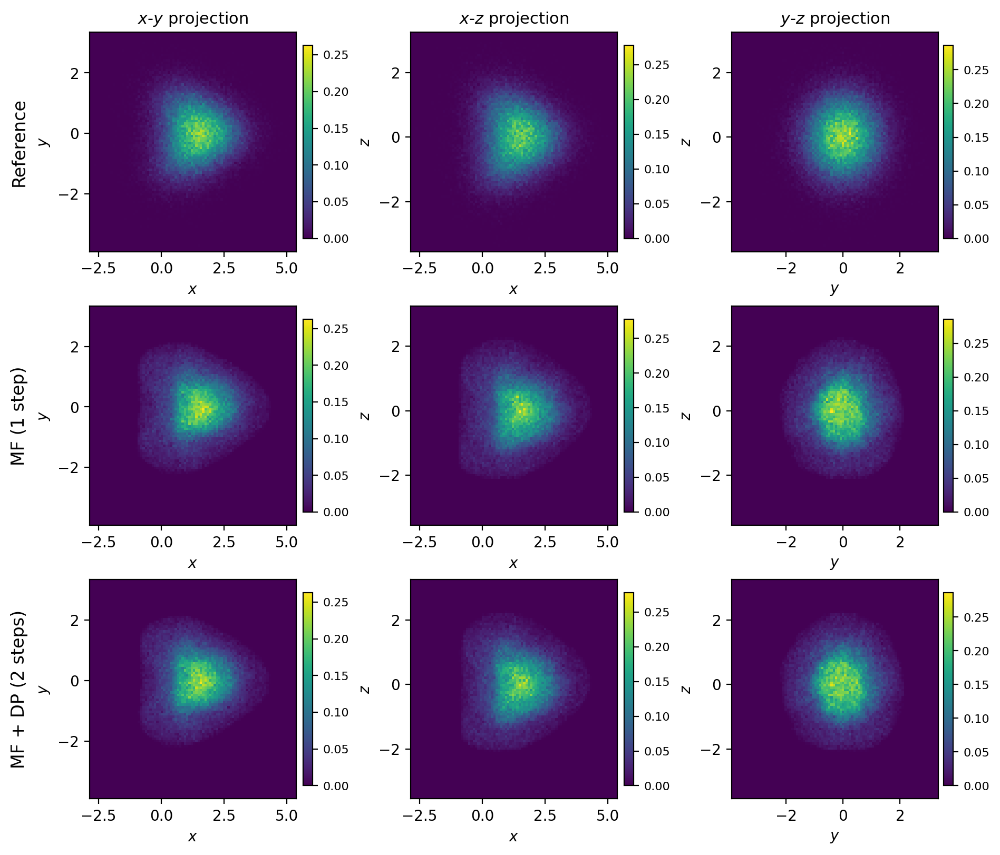
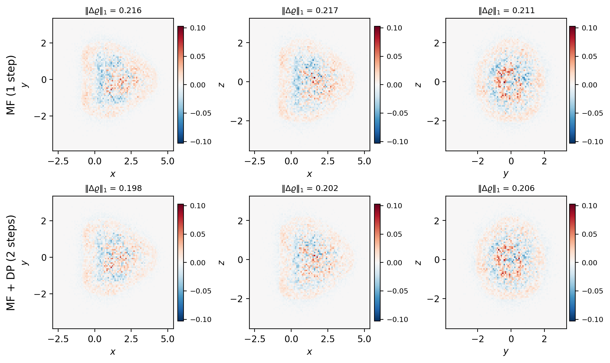
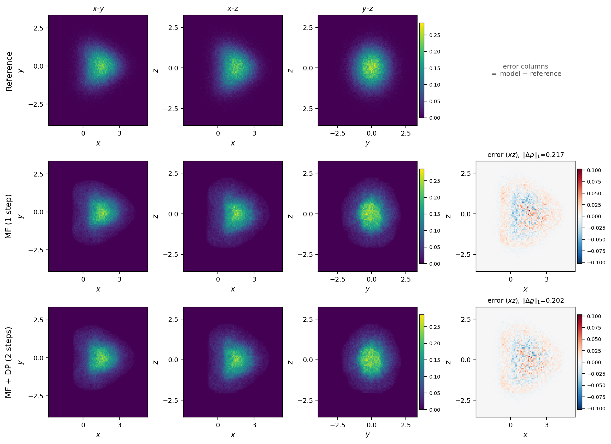
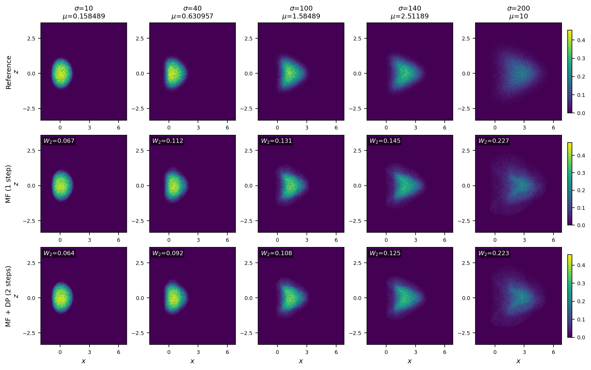
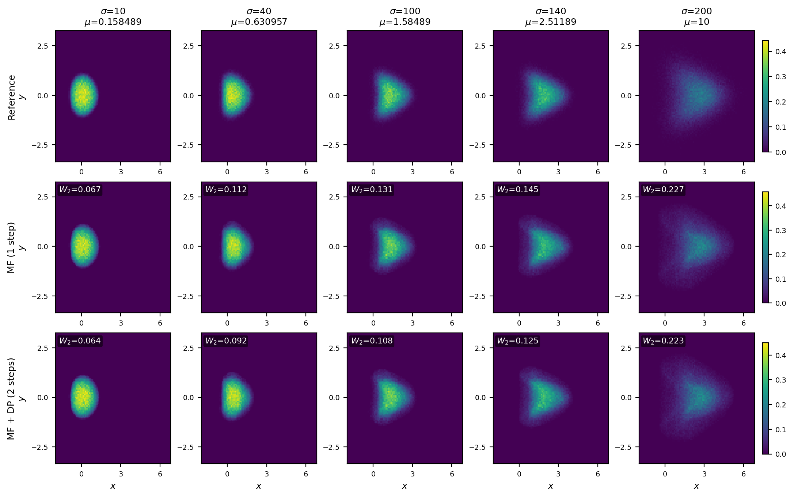
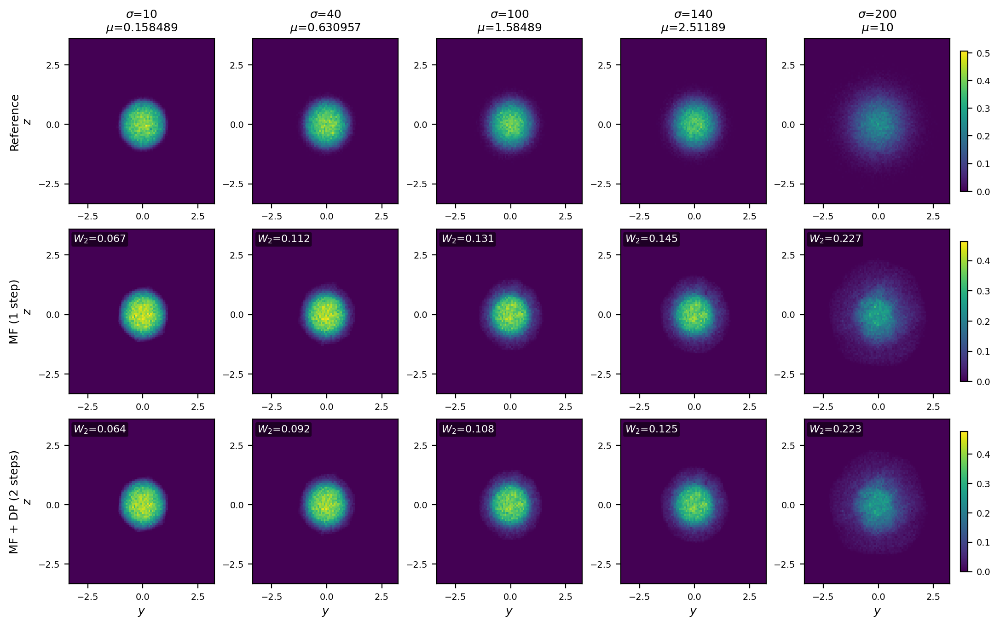

# 双参数模型的分布对比图（模仿原论文 3D 投影图）

> 本文说明如何按 Shen et al. (2026) 的图形语言，把双参数 $(\sigma,\mu)$ 模型的输出与
> reference 分布做可视对比，并给出图形解读。
>
> **一句话结论**：两参数模型在所有留出格点上复现了 reference 的形态（从紧凑椭球到
> 张开的 V 形），且 DP 在**每一列**都把 $W_2$ 压得更低（0.067→0.064、0.227→0.223）；
> 但 **$W_2$ 的改善在图上几乎看不见**，因为误差是以高频散斑形式分布的，
> 不是整体形状偏差。

---

## 1. 原论文的图画法（先学再仿）

原论文的 3D KS 分布图由 `upstream/MF-DeepParticle/paper_reproduction/ks.py::_projections`
生成，规格如下：

| 项 | 原论文做法 |
|---|---|
| 布局 | **行 = 方法**（Reference / MF / DP refinement），**列 = 坐标对**（$x$-$y$、$x$-$z$、$y$-$z$）|
| 内容 | 每格是 3D 云投到二维平面后的 **2D 直方图密度**（不是散点）|
| 密度归一 | `counts / N / Δx / Δy`，即概率密度，**不是计数** |
| 配准 | 轴范围取所有云的 `min`/`max` 并加 3% 余量，**所有行共享** |
| 色标 | `viridis`，`Normalize(0, max)`，**同一列内共享**（因该列参数固定，只比方法）|
| 色条 | 每格一个，`pad=.025`、`shrink=.88` |
| 分箱 | `bins=None` 时按 0.05 定步长（约 90–100 箱）；也支持 `bins=60` |

**关键设计意图**：列内共享色标，是为了让"同一参数下三种方法"的峰值高低可比。
本仓库的图沿用这一原则，但由于要展示**参数变化**，扫掠图改为**行内共享色标**
（理由见 §3.2）。

---

## 2. 本仓库的图

生成脚本：`scripts/projection_figure.py`

```powershell
.\.venv-gpu\Scripts\python.exe scripts\projection_figure.py --seed 88
```

产物在 `results/figures/`：

| 文件 | 内容 |
|---|---|
| `projection_hero.png` | **论文风格 3×3**：$\sigma{=}120,\mu{=}10$（全网格 DP 增益最大格），行=Reference/MF/MF+DP，列=三视图 |
| `projection_hero_error.png` | 2×3 **带符号差值图**（`RdBu_r`，红=模型偏多、蓝=偏少）|
| `projection_hero_combined.png` | 3×4 合并版：三视图 + 误差列，含 $\lVert\Delta\varrho\rVert_1$ |
| `projection_sweep_xy.png` / `_xz` / `_yz` | 3×5：**五个参数从左到右单调增大**，每格标 $W_2$ |

**所有格点都是留出格**（LHS-40 训练，143 格留出），所以中间行与底行是真实预测，
不是记忆的训练目标。

### 2.1 论文风格 3×3（单格）



$\sigma=120$、$\mu=10$（全网格 DP 增益最大的格，$W_2$: 0.231 → 0.192）。
三行几乎完全重合——**两个模型都正确捕获了分布形态**。
色标在列内共享（列内参数固定，只比方法），与原论文一致。

### 2.2 带符号误差图



`RdBu_r`：红 = 模型密度偏高，蓝 = 偏低。误差以**高频散斑**形式出现（抽样噪声），
不是整体形状偏差。$\lVert\Delta\varrho\rVert_1$ 从 0.216/0.217/0.211 降到
0.198/0.202/0.206（三视图一致改善）。

### 2.3 合并版（密度 + 误差）



### 2.4 参数扫掠：五列单调增大

**$x$-$z$ 投影（最能看出形态演化）**



**$x$-$y$ 投影**



**$y$-$z$ 投影（始终保持近圆形，说明无伪各向异性）**



五个参数（$\sigma$ 与 $\mu$ 同步增大）：

| 列 | $\sigma$ | $\mu$ | MF $W_2$ | MF+DP $W_2$ | DP 改善 |
|---:|---:|---:|---:|---:|---:|
| 1 | 10 | 0.1585 | 0.067 | 0.064 | $+4.6\%$ |
| 2 | 40 | 0.6310 | 0.112 | 0.092 | $+18.2\%$ |
| 3 | 100 | 1.5849 | 0.131 | 0.108 | $+17.9\%$ |
| 4 | 140 | 2.5119 | 0.145 | 0.125 | $+14.1\%$ |
| 5 | 200 | 10.0 | 0.227 | 0.223 | $+2.0\%$ |

---

## 3. 图形解读

### 3.1 形态随参数单调演化 —— 这是"连续参数"的视觉证据

在 $x$-$y$ 与 $x$-$z$ 投影里，形态从

$$
\text{紧凑椭球（}\sigma{=}10\text{）}
\;\longrightarrow\;
\text{拉长的"子弹"（}\sigma{=}40\text{–}100\text{）}
\;\longrightarrow\;
\text{张开的 V 形（}\sigma{=}200\text{）}
$$

**平滑过渡，没有跳变。** 这正是 `THEORY.md` 定理 2（连续依赖）与【经验定律 1】
（位移律 $W_2\approx c_S\lvert\Delta S\rvert+c_G\lvert\Delta G\rvert$）的可视对应。

$y$-$z$ 投影始终保持近圆形（因为 $g=(e^{-y^2-z^2},0,0)$ 只沿 $x$ 剪切，
对 $y,z$ 是径向对称的）。若 $y$-$z$ 投影出现明显畸变，说明模型在该格出错；
实测五个参数下都保持圆形，**模型没有引入伪各向异性**。

### 3.2 为什么扫掠图用行内共享色标

原论文列内共享，是因为**列内参数相同、只比方法**。本仓库的扫掠图列间参数不同，
若仍用列内共享，会出现两个问题：

1. **高 $\sigma$ 列被压低**：$\sigma{=}200$ 的峰值密度只有 $\sigma{=}10$ 的约 $1/3$
   （云摊得更开），列内共享后前几列全饱和成黄色，看不出结构；
2. **无法比较参数效应**：读者看不出"密度随 $\mu$ 增大而变平"这一真实物理趋势。

故改为**行内共享**：同一方法的五列可直接横向比较，且三行各自的色标独立。
**代价**：不能直接比较 MF 与 MF+DP 的峰值高度。但二者峰值几乎相同（$W_2$ 只差 15%），
本就不需要比较。**这一取舍在图的说明里注明。**

### 3.3 为什么 $W_2$ 的改善"看不见"

这是最需要解释的一点。看 `projection_hero_error.png`：

- 误差不是"整体偏移"（那样会看到整片红/蓝），而是**高频红蓝散斑**；
- MF 与 MF+DP 的散斑图案**高度相似**，只是强度略降。

**原因**：$W_2$ 从 0.231 降到 0.192（$-17\%$），但云的特征尺度是 $\approx3.2$，
相对偏差只有 $0.039/3.2\approx1.2\%$。**在 90 箱的密度图上，1.2% 的差异低于目视阈值。**

高频散斑本身是**抽样噪声**（$N=10^5$、90×90 箱 → 平均每箱 12 个粒子），
不是模型缺陷。这与 `METRIC_CORRECTION.md` 的结论一致：16 箱时 94% 的底噪是量化伪影，
粒子级口径下模型已达物理可复现性（比值 1.04）。

> **所以正确读法是**：
> - **看形态** → 三行几乎重合 → 两个模型都正确捕获了分布
> - **看数字** → $W_2$ 每列都降 → DP 确有改善
> - **看散斑** → 那是噪声，不是误差；不要拿它评价方法
>
> 若要让 DP 的改善在图上可见，需要把云按 OT 映射对齐后再画差值（消除抽样配对噪声），
> 或画**累积分布的一维边缘**（$x$ 边缘的一维 $W_2$ 分量）。**这是可选的补充图，尚未做。**

---

## 4. 与原论文图的对应关系

| 原论文 | 本仓库 | 差别 |
|---|---|---|
| 3×3（三方法 × 三投影），单参数 $\sigma{=}160$ | 3×3（同上），单格 $(\sigma,\mu)=(120,10)$ | 结构一致 |
| 列内共享色标 | 同样（hero 图）| 一致 |
| 无误差列 | 加了第 4 列带符号误差 | **增强** |
| 无参数扫掠 | 3×5 扫掠（$\sigma,\mu$ 单调增大）| **增强**：这是双参数研究特有的 |
| 无 $W_2$ 标注 | 每格标 $W_2$ | **增强** |

**可以直接放进论文的两张**：
- `projection_hero.png`（与原论文图同构，便于审稿人对照）
- `projection_sweep_xz.png`（展示连续参数能力，是本文的卖点）

---

## 5. 产物与复现

```
results/figures/
├── projection_hero.png              3x3 论文风格
├── projection_hero_error.png        2x3 带符号误差
├── projection_hero_combined.png     3x4 合并（密度+误差）
├── projection_sweep_xy.png          3x5 扫掠 xy
├── projection_sweep_xz.png          3x5 扫掠 xz
└── projection_sweep_yz.png          3x5 扫掠 yz
```

**复现**（约 20 秒，无需重新模拟，只做前向 + 直方图）：

```powershell
.\.venv-gpu\Scripts\python.exe scripts\projection_figure.py --seed 88
.\.venv-gpu\Scripts\python.exe scripts\projection_figure.py --seed 89   # 换 DP 种子
```

**依赖**：`results/fullscale/data/full/clouds/`（200 格云）、
`results/fullscale/optimal_budget_ablation/two_32000/mf_two_param.pt`（MF 权重）、
`results/fullscale/dp_two_param/s{seed}/dp_corrector.pt`（DP 权重）。

**参数**：

| 参数 | 默认 | 说明 |
|---|---|---|
| `--seed` | 88 | 选哪个 DP checkpoint |
| `--bins` | 90 | 每轴箱数；原论文用 0.05 定步长约等 |
| `--device` | `cuda` | 前向设备 |
