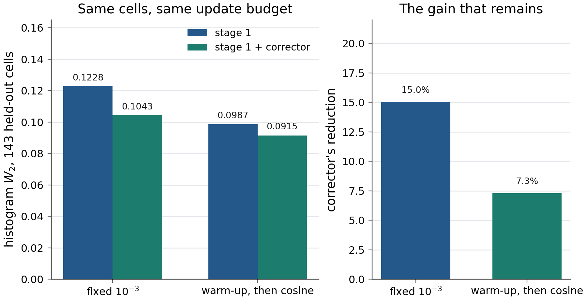
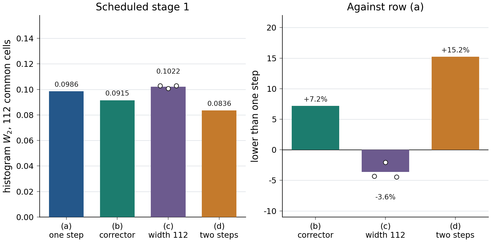
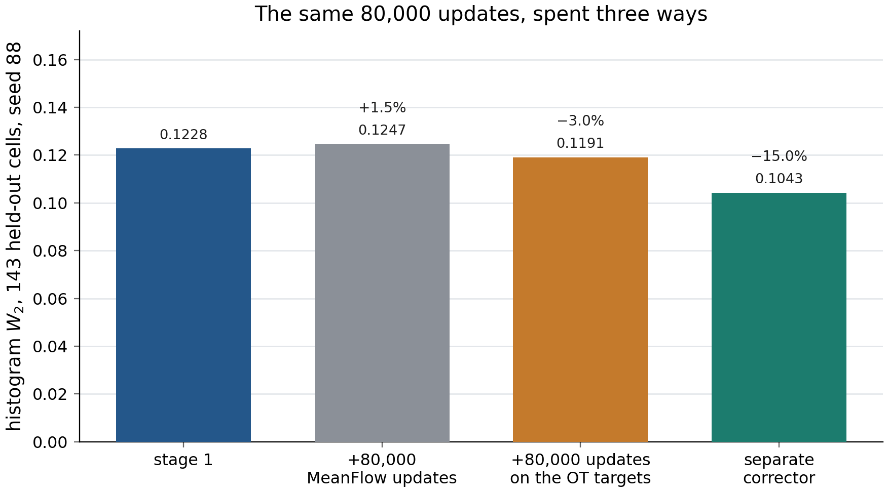
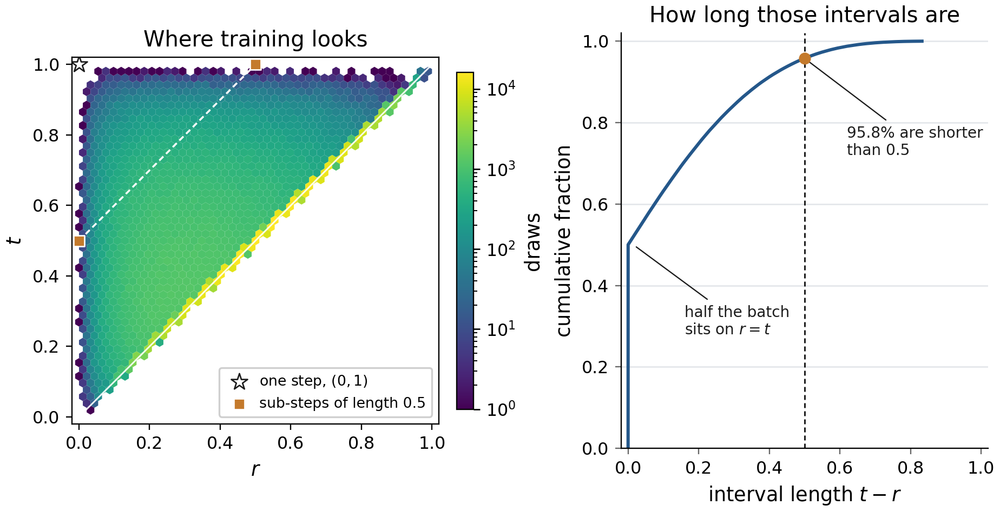
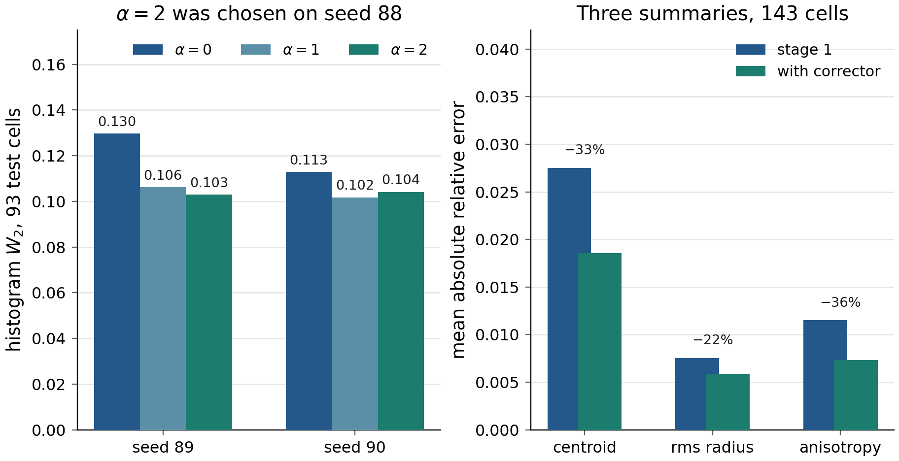
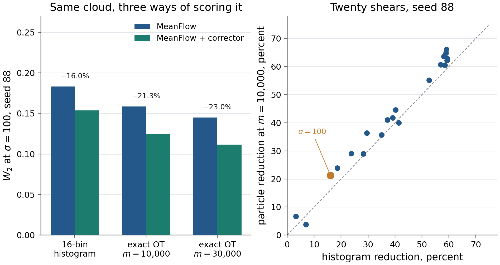
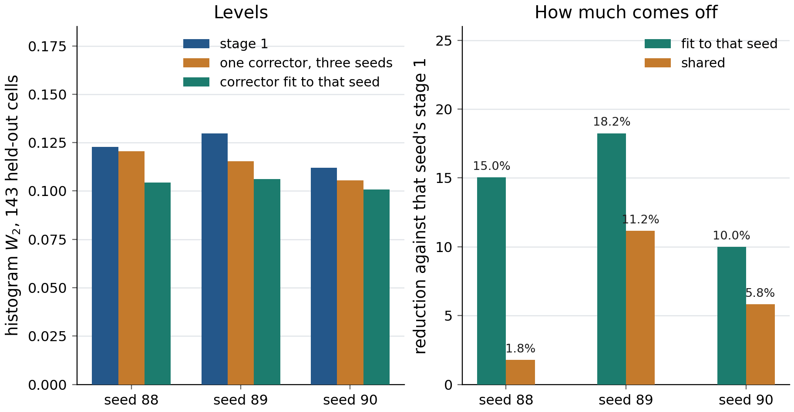

# What is left once stage 1 is trained properly

**Reply to the four questions on the 18 November note**

Zhenyu Yang · 20 November 2026

中文见 [`REPLY_TO_HARRY.zh.md`](REPLY_TO_HARRY.zh.md)。图上的数字取到四位，表里保留五位。

You asked me not to treat the 15% as the answer until four things were settled. A learning-rate schedule that costs nothing when the map is used. Two ways of spending the corrector's extra updates on the same network. A direct look at whether the sub-steps were ever trained. And the chosen \(\alpha\), on the seeds that did not choose it, together with a check that the gain is not an artefact of the bins. You also asked for one corrector trained on all three seeds, ahead of any gated version. I ran that as well. I left iteration alone.

The schedule is the result that changes the earlier note. On the same 40 cells and the same 32,000 updates per cell, a short warm-up and then a cosine take stage 1 from 0.12277 down to 0.09874 on the 143 held-out cells, a 19.6% drop before any corrector is applied. The corrector, unchanged, then reaches 0.09153. That is a 7.3% reduction, on 128 of the 143 cells. At a fixed learning rate of \(10^{-3}\) the same corrector had taken 0.12277 to 0.10429, a 15.0% reduction, on 141 of the 143 cells. The new stage 1 is already lower than the old corrected map.

The percentages in the tables are 16-bin histogram distances. A particle can move and, if it stays inside its bin, leave the cost unchanged, so a small correction is partly invisible. I come back to how large that hiding is after the four answers. The answers themselves use the same distance as the 18 November note. The only exact coupling I have at 30,000 particles is one cell of an earlier run, and I have not rescaled these tables by it.

---

## 1. The schedule

The 40 training cells are the ones stored in the seed-88 checkpoint. I did not redraw them. Stage 1 is still 32,000 updates per cell. Over the first 2% of those updates the learning rate rises linearly to \(10^{-3}\), and from there a cosine takes it down to \(10^{-5}\). The corrector is the one from the earlier note: \(\alpha=1\), 2,000 updates per cell, a batch of 2,000, an exact assignment every tenth step, and a penalty that keeps the correction near the identity.

*Figure 1. Histogram \(W_2\) on the 143 held-out cells, seed 88. Left: stage 1, and the same map after its corrector. Right: the corrector's reduction on each map. Bar labels are rounded to four digits.*

Read the left panel from the fixed-rate pair across to the scheduled pair. The scheduled stage 1, 0.09874, sits below 0.10429, which is where the old corrector stopped. The right panel is what the corrector itself still removes: 15.0% on the map that was trained at \(10^{-3}\), and 7.3% on the map that was trained with the schedule. The schedule adds nothing at inference, and the drop it produces in stage 1 is already larger than the drop the old corrector produced.

You also asked for the four-row table on this scheduled map. Those rows are scored on the 112 cells left out by the headline design and by all three width-112 designs, so the wider network is not being marked on cells it trained on. Width 112 was retrained with the same warm-up and the same cosine, on each seed's own 40 cells.

| row | what is evaluated | \(W_2\) | against (a) |
|---|---|---:|---:|
| (a) | scheduled stage 1, one step, seed 88 | 0.09859 | — |
| (b) | (a), then its corrector | 0.09150 | lower by 7.2%, 99 of 112 |
| (c) | width 112, same schedule, seeds 88, 89, 90 | 0.10215 ± 0.00133 | higher by 3.6% |
| (d) | the weights in (a), evaluated in two sub-steps | 0.08358 | lower by 15.2% |

The three width-112 seeds are 0.10287, 0.10062 and 0.10297. Each of them is above (a).

*Figure 2. The 112 common held-out cells. Left: the four rows. The open circles on (c) are the three seeds. Right: change against one step. A negative bar is a higher error. Bar labels are rounded to four digits.*

On the 18 November note, two sub-steps of the fixed-rate map raised the error. Here they are the lowest row, below the corrector. Row (d) is two passes of the scheduled network. The corrector path, on the accounting in that note, costs 2.97 times one pass. A wider network, given the same schedule and the same number of updates, finishes above the narrow one-step map. The corrector still lowers the one-step error. On this map, using the weights twice lowers it further.

## 2. Where the extra updates went

The corrector is a second network, and it is also 2,000 further updates on each of the 40 cells, 80,000 updates, together with 8,000 exact minibatch couplings. You asked for two controls that keep the network fixed and spend those updates anyway. Both are on the fixed-rate stage 1, which is the map whose 15% I was trying to account for.

| where the 80,000 updates went | \(W_2\) | against stage 1 |
|---|---:|---:|
| stage 1, no extra updates | 0.12277 | — |
| further MeanFlow updates | 0.12465 | higher by 1.5% |
| the same updates, on the minibatch OT targets | 0.11911 | lower by 3.0% |
| a separate corrector | 0.10429 | lower by 15.0% |

*Figure 3. Seed 88, fixed learning rate, 143 held-out cells. The signed percentages are against stage 1. A positive sign is a higher error.*

Continuing the original MeanFlow loss at \(10^{-3}\) moves 0.12277 to 0.12465. Aiming the same updates at the transport targets the corrector sees moves it to 0.11911. The separate network moves it to 0.10429. Of the drop the corrector achieves, about a fifth shows up when those targets are used to keep training stage 1. The larger share shows up when the correction is its own map, started at the identity and penalised for leaving the cloud it is correcting.

I did not repeat the two controls under the cosine schedule. On that map the corrector's remaining reduction is 7.3%, and two passes of the same weights already reach a lower error than the corrector.

## 3. The sub-steps

The sampler is the one used in training. Two draws from a normal with mean \(-0.4\) and unit variance pass through a sigmoid. The larger becomes \(t\) and the smaller becomes \(r\). Half of each batch is then set to \(r=t\), so the network also sees the diagonal, where the MeanFlow identity reduces to a velocity.

*Figure 4. One million draws from the training sampler. Left: where \((r,t)\) falls. The white dashed line marks intervals of length 0.5, and the squares are the two sub-steps used at evaluation. Right: the cumulative share of interval length.*

In that million draws, 95.8% of the intervals are shorter than 0.5, and half of them lie on the diagonal. An interval as long as the sub-steps used at evaluation is 4.2% of the draws.

On the fixed-rate seed-88 map I then compared the two procedures over the 143 held-out cells. One step is a single evaluation from 1 to 0. Two steps are \([1,0.5]\) and then \([0.5,0]\). The mean histogram distance between the two output clouds is 0.0814. Particles that start from the same source move 0.030 on average between the two outputs. Both numbers compare the outputs with each other. They are not distances to the reference.

The sub-steps sit where training hardly looks, and on the fixed-rate checkpoint the two procedures disagree by a histogram distance of 0.0814. That is the sort of gap that makes the earlier rise in error unsurprising, and it is a fact about that checkpoint and that sampler. On the scheduled checkpoint the same two sub-steps lower the error, and they are the best of the four rows in Section 1.

## 4. \(\alpha=2\) on the other seeds

\(\alpha=2\) was selected on the seed-88 development split. I did not select it again. Each row is the 93 test cells of that seed.

| seed | \(\alpha=0\) | \(\alpha=1\) | \(\alpha=2\) | \(\alpha=2\) against \(\alpha=0\) |
|---|---:|---:|---:|---:|
| 89 | 0.12967 | 0.10619 | 0.10301 | lower by 20.6% |
| 90 | 0.11294 | 0.10180 | 0.10417 | lower by 7.8% |

On seed 89, \(\alpha=2\) is the lower of the two corrections, and most of the drop is already present at \(\alpha=1\). On seed 90, \(\alpha=1\) reaches 0.10180 and \(\alpha=2\) reaches 0.10417. The value chosen on seed 88 still beats stage 1 on both seeds. On seed 90 it is the worse of the two corrections I evaluated.

The three physical summaries use the 143 held-out cells of the fixed-rate seed-88 pair, the paired corrector at \(\alpha=1\).

| summary | stage 1 | with the corrector |
|---|---:|---:|
| centroid, \(x\) | 0.0275 | 0.0186 |
| rms radius | 0.00756 | 0.00590 |
| anisotropy | 0.0115 | 0.00735 |

*Figure 5. Left: mean histogram \(W_2\) on 93 test cells. \(\alpha=2\) was chosen on seed 88. Right: mean absolute relative error on the 143 held-out cells of the fixed-rate pair. The percentages are the relative drop.*

The centroid falls by 33%, the rms radius by 22%, and the anisotropy by 36%. I did not recompute these summaries on the scheduled map.

## 5. What the bins leave out

An occupied bin is replaced by one weighted point at its centre, and the distance is the transport cost between those points. Motion inside a bin does not change the cost. That is why the tables above were computable. The coupling is between a few hundred occupied bins. A coupling of the full cloud is \(10^5\times 10^5\).

On the fixed-rate pair, which is the pair in the 18 November headline, I did use every particle's coordinate, by another estimator. Sliced \(W_2\) along 64 directions, all 143 held-out cells, gives 0.02226 for stage 1 and 0.01545 after the corrector. That is a 30.6% drop, against 15.0% for the histogram on the same cells. Sliced \(W_2\) averages one-dimensional distances. The histogram number is the one that stays in the tables. Of the two readings, it is the smaller.

The exact coupling in the original dimension, at \(m=30{,}000\), I have for one cell of the earlier one-parameter run: shear \(\sigma=100\), seed 88, MeanFlow against MeanFlow followed by the DP refinement. The same 30,000 particles are used for both methods. The cost matrix at that size is about 6.7 GB. The two solves took 437 and 331 seconds. Repeating the pair over the 143 cells of this note would take about a day and a night. The full cloud of \(10^5\) particles would ask for about 75 GB. This cell is not one of the two-parameter cells in the tables above. It is the place where both scorings exist, so it is the place I can use to estimate the gap.

| scoring of the same cell | MeanFlow | with the refinement | reduction |
|---|---:|---:|---:|
| 16-bin histogram | 0.18311 | 0.15374 | 16.0% |
| exact OT, \(m=10{,}000\) | 0.15849 | 0.12470 | 21.3% |
| exact OT, \(m=30{,}000\) | 0.14503 | 0.11164 | 23.0% |

*Figure 6. Left: \(\sigma=100\), seed 88, one cell of the earlier one-parameter clouds, scored three ways. Right: twenty shears at \(m=10{,}000\). A point above the dashed line is a shear whose particle reduction exceeds its histogram reduction. \(\sigma=100\) is marked. This figure does not rescore the tables in Sections 1 to 4.*

On this cell, leaving the bins raises the reduction from 16.0% to 23.0%. Almost all of that rise is present at \(m=10{,}000\), where the reduction is 21.3%. The step from 10,000 particles to 30,000 moves it by a further 1.7 points.

Over the twenty shears at \(m=10{,}000\), the average reduction goes from 39.1% on the histogram to 42.5% on the particles. Where the cloud is far from the reference, particles cross many bins and the histogram already records the transport, so the two readings stay close. Five shears have a histogram reduction below 25%, which is the range this note is in. Their average goes from 13.7% to 17.0%. Four of them rise by about five points. One, \(\sigma=20\), moves the other way, from 7.0% to 3.8%. The bins do hide part of a modest gain. They do not hide a fixed fraction of it.

I have left the scheduled 7.3% as a histogram number. If it grew in the ratio measured at \(\sigma=100\), 23.0 against 16.0, it would read near 10%. If it grew by the seven points measured there, it would read near 14%. Those are the two ends of the guess, and neither of them is a new table. The coupling I actually solved says something smaller and firmer. At 30,000 particles the gain on that cell is seven points above the histogram, and about five of those seven points are already there at 10,000 particles.

## 6. One corrector for three seeds

This is the run you asked to put first. One corrector, \(\alpha=1\), trained on the residuals of seeds 88, 89 and 90 together. Each seed keeps its own 40 cells. The budget is 2,000 updates per cell per seed. Each seed is scored on its own 143 held-out cells. The stage-1 maps are the fixed-rate checkpoints. The scheduled map from Section 1 is not an input.

| seed | stage 1 | shared corrector | reduction | cells lower |
|---|---:|---:|---:|---:|
| 88 | 0.12277 | 0.12058 | 1.8% | 74 / 143 |
| 89 | 0.12975 | 0.11527 | 11.2% | 143 / 143 |
| 90 | 0.11203 | 0.10551 | 5.8% | 110 / 143 |

The mean of the three reductions is 6.3%. The shared corrector is lower on 327 of the 429 cells. Three separate correctors, each fit to its own seed, reduce these stage-1 values by 15.0%, 18.2% and 10.0%. The mean of those three is 14.4%, and they are lower on 415 of the 429 cells.

*Figure 7. Fixed learning rate. Left: histogram \(W_2\) on each seed's 143 held-out cells. Right: the reduction against that seed's own stage 1.*

In the 18 November note, the seed-88 corrector applied unchanged to seeds 89 and 90 changed those errors by −1.4% and −3.2%. The shared corrector lowers both. Seed 89, the worst of the three stage-1 maps, is lower on all 143 of its cells. The cost of sharing is seed 88. The corrector fit to that seed alone removed 15.0%, on 141 of 143 cells. The shared corrector removes 1.8%, on 74 of 143.

## What I left as it was

I did not iterate the map. The earlier note already treats it as a map over a fixed horizon, and conditioning the corrector on time would be a different piece of work. I did not train a gated corrector. I did not retrain paired correctors for seeds 89 and 90 under the cosine schedule, so the width-112 row is the only scheduled result with three seeds. The budget controls, the sliced distance, the physical summaries, and the disagreement between one step and two steps were all measured on the fixed-rate map.

I would put the scheduled numbers in front of the old 15%. The warm-up and the cosine, free when the map is used, bring stage 1 to 0.09874. That is already lower than the old corrected value, and the corrector then removes a further 7.3%. Two passes of that same map remove more than the corrector does. Spent on one network, the transport targets recover about a fifth of the corrector's drop; the rest of the drop arrives with the second network. A corrector trained on three seeds repairs the two seeds that the seed-88 corrector used to make worse, and on seed 88 the reduction falls from 15.0% to 1.8%. The histogram is a low reading of a modest gain. On the one cell solved with 30,000 particles, 16% became 23%, and most of that difference was already visible at 10,000.
