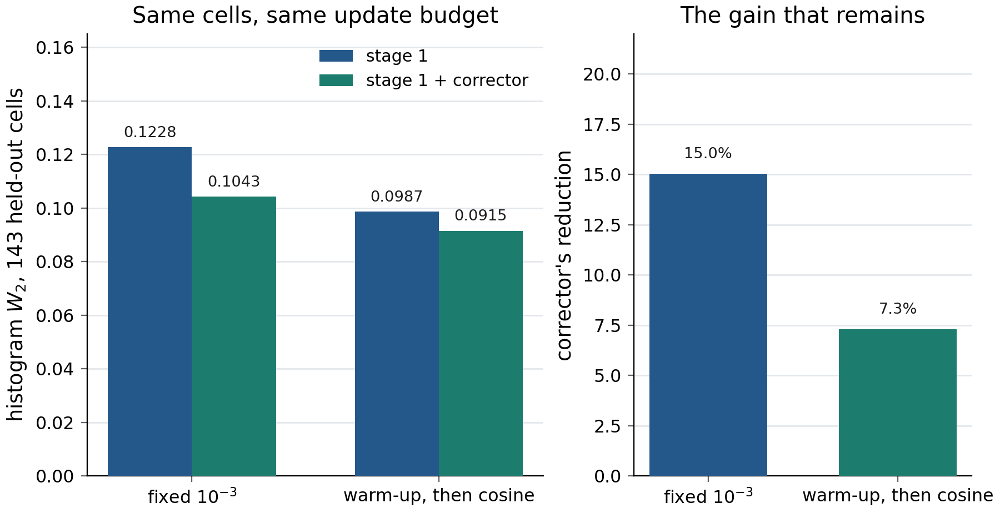
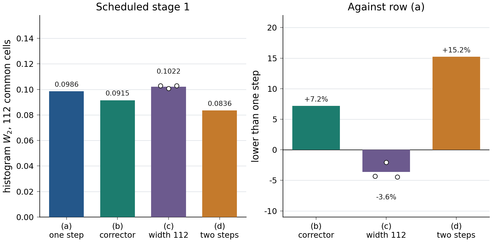
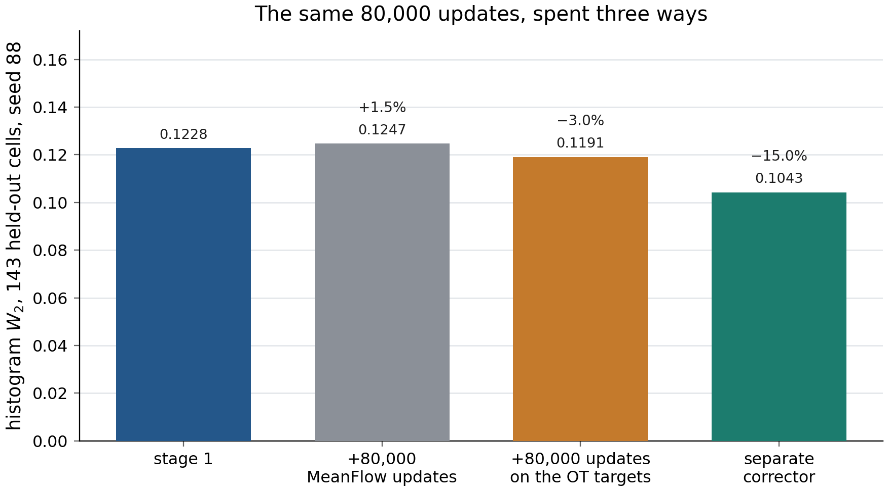
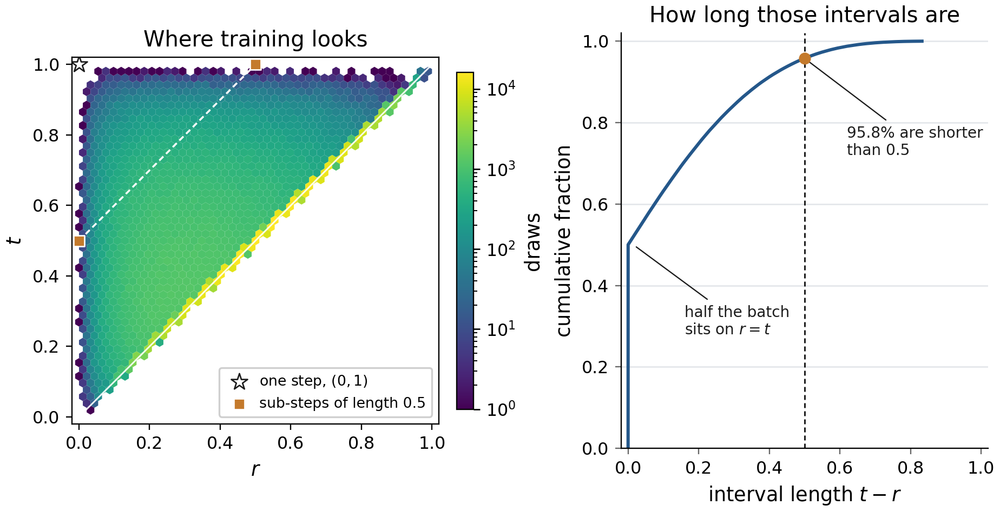
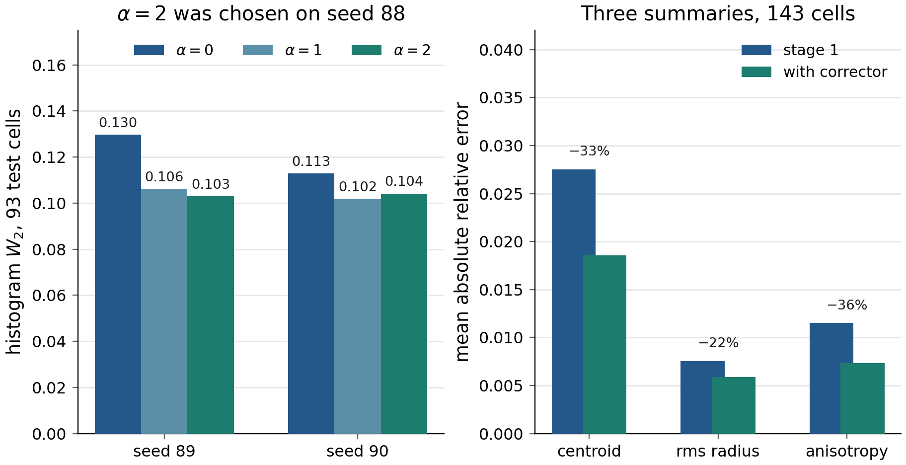
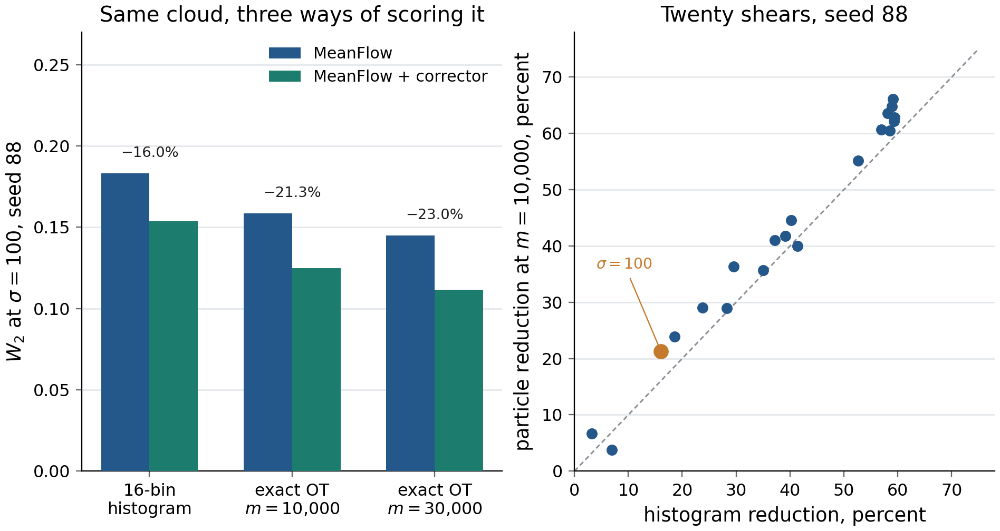
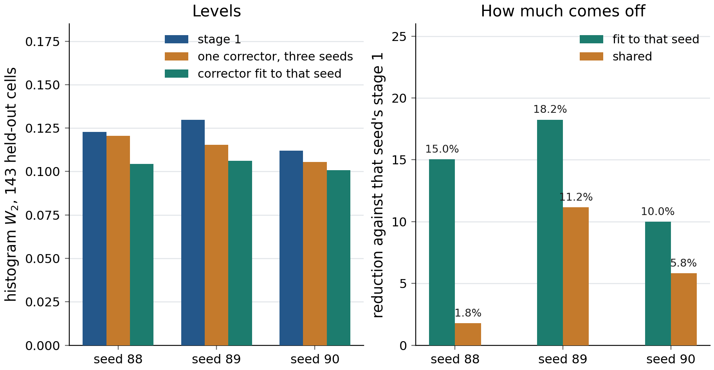

# 第一步真正训好之后，还剩下多少

**对 11 月 18 日笔记里那四个问题的回复**

杨振宇 · 2026 年 11 月 20 日

英文原文见 [`REPLY_TO_HARRY.md`](REPLY_TO_HARRY.md)。图上的数字取到四位，表里保留五位。

你说先别把 15% 当成答案，有四件事要补。一套在使用时不增加计算的学习率。两种把修正器多出来的更新花在同一张网络上的对照。直接看子步在训练里有没有被抽到。以及那个选定的 \(\alpha\)，放到没有参与选择的种子上，再用一个不是分箱的度量确认增益不是箱子造成的。你还让我先做一个三个种子共用的修正器，门控的可以等。这个我也跑了。迭代没有再做。

真正改掉上一份笔记的，是学习率。还是那 40 个格子，每格还是 32,000 次更新。先做一小段热身，再接余弦，143 个留出格上的第一步从 0.12277 降到 0.09874，修正器还没接上，误差已经少了 19.6%。修正器本身没有改，接上之后到 0.09153。降幅是 7.3%，143 格里 128 格更低。学习率固定在 \(10^{-3}\) 时，同一个修正器把 0.12277 收到 0.10429，降幅 15.0%，143 格里 141 格更低。新的第一步，已经低于上一次校正之后的值。

下面表里的百分比都是 16 箱直方图距离。粒子可以移动，只要还停在原来的箱子里，代价就不变，所以小的修正有一部分看不见。这有多严重，我放在四个答案之后。这些答案用的距离和 11 月 18 日的笔记相同。三万个粒子的精确配对，我只有更早一次实验里的一个格子，没有拿它去改这些表。

---

## 1. 学习率

40 个训练格用的是种子 88 的 checkpoint 里存的那一套，没有重抽。第一步仍是每格 32,000 次更新。前 2% 的更新里，学习率线性升到 \(10^{-3}\)，然后按余弦降到 \(10^{-5}\)。修正器和上次一样：\(\alpha=1\)，每格 2,000 次更新，批量 2,000，每十步做一次精确指派，并有一项惩罚，让它离恒等映射不要太远。

*图 1. 种子 88、143 个留出格上的直方图 \(W_2\)。左：第一步，以及接上它自己的修正器。右：修正器在两套学习率上的降幅。柱上的数字四舍五入到四位。*

从左边那一对看到右边那一对。热身之后的第一步是 0.09874，低于 0.10429，而上一次的修正器就是停在 0.10429。右边是修正器自己还拿得掉的部分：固定在 \(10^{-3}\) 的那张映射上是 15.0%，换了学习率之后是 7.3%。这套学习率在求值时不增加计算，它让第一步下降的幅度，已经大于旧修正器带来的下降。

你还要这张新映射上的四行表。这四行记在 112 个格子上，主设计和三个宽度 112 的设计都把它们留在了训练之外，所以宽网络不是在自己的训练格上计分。宽度 112 用同一套热身和同一条余弦重新训练，每个种子用它自己的 40 格。

| 行 | 求值内容 | \(W_2\) | 相对 (a) |
|---|---|---:|---:|
| (a) | 热身后的第一步，一步求值，种子 88 | 0.09859 | — |
| (b) | (a) 再接它的修正器 | 0.09150 | 低 7.2%，112 格里 99 格 |
| (c) | 宽度 112，同一套学习率，种子 88、89、90 | 0.10215 ± 0.00133 | 高 3.6% |
| (d) | (a) 的同一组权重，分成两段求值 | 0.08358 | 低 15.2% |

宽度 112 的三个种子是 0.10287、0.10062、0.10297，都高于 (a)。

*图 2. 112 个共同留出格。左：四行。 (c) 上的空心点是三个种子。右：相对一步的变化。负的柱表示误差更高。柱上的数字四舍五入到四位。*

11 月 18 日的笔记里，固定学习率的映射再走一段，误差是上升的。这里两段求值是四行里最低的一行，低于修正器。(d) 是这组权重求值两次。按那份笔记里的记账，修正器那条路径是一次前向的 2.97 倍。宽度加到 112，学习率和更新次数都一样，结果高于窄网络的一步。修正器仍然把一步的误差降下来。在这张映射上，把同一组权重用两次，降得更多。

## 2. 多出来的更新花到了哪里

修正器是第二张网络，同时也是 40 格上每格再更新 2,000 次，一共 80,000 次，外加 8,000 次精确的小批量配对。你要的两种对照，网络不动，只把这些更新花掉。两份对照都做在固定学习率的第一步上，因为要解释的那个 15% 来自这张映射。

| 80,000 次更新花在哪里 | \(W_2\) | 相对第一步 |
|---|---:|---:|
| 第一步，不再更新 | 0.12277 | — |
| 继续做 MeanFlow 更新 | 0.12465 | 高 1.5% |
| 同样的次数，对准小批量 OT 的目标 | 0.11911 | 低 3.0% |
| 单独的修正器 | 0.10429 | 低 15.0% |

*图 3. 种子 88，固定学习率，143 个留出格。百分数相对第一步。正号表示误差更高。*

原来的 MeanFlow 损失在 \(10^{-3}\) 上再训，0.12277 变成 0.12465。同样的次数对准修正器看见的那些传输目标，收到 0.11911。单独的网络收到 0.10429。修正器拿下来的那一段里，大约五分之一在“用这些目标继续训第一步”时就已经出现。更大的那一份，出现在修正本身是另一张映射的时候：它从恒等映射出发，并且因为离开所修正的那团粒子而受罚。

余弦学习率下，这两份对照我没有重做。那张映射上，修正器剩下的降幅是 7.3%，而同一组权重求值两次，误差已经低于修正器。

## 3. 子步

抽样器和训练时用的是同一个。从均值 \(-0.4\)、方差为 1 的正态里抽两个数，过 sigmoid。大的做 \(t\)，小的做 \(r\)。每个批量有一半被改成 \(r=t\)，这样网络也能看见对角线上的情形。在那里，MeanFlow 的恒等式退化为速度。

*图 4. 从训练抽样器里抽一百万次。左：\((r,t)\) 落在哪里。白色虚线是长度为 0.5 的区间，方块是求值时用的两个子步。右：区间长度的累积比例。*

这一百万次里，95.8% 的区间短于 0.5，一半落在对角线上。和求值时那两个子步一样长的区间，只占 4.2%。

然后我在固定学习率、种子 88 的映射上，对 143 个留出格比较了两种算法。一步是从 1 到 0 求值一次。两步是先 \([1,0.5]\)，再 \([0.5,0]\)。两团输出之间的平均直方图距离是 0.0814。从同一个源粒子出发，两种输出之间平均移动 0.030。这两个数比较的是两种输出。它们不是到参考云的距离。

子步落在训练几乎不看的地方。在固定学习率的 checkpoint 上，两种算法之间的直方图距离是 0.0814。上一份笔记里误差上升，和这样一个空隙是对得上的。这说的是那一个 checkpoint 和这一个抽样器。换到热身之后的 checkpoint，同样的两个子步把误差降下来，而且是第 1 节四行里最好的一行。

## 4. \(\alpha=2\) 放到另外的种子上

\(\alpha=2\) 是在种子 88 的开发划分上选定的。我没有再选一次。每一行是该种子自己的 93 个测试格。

| 种子 | \(\alpha=0\) | \(\alpha=1\) | \(\alpha=2\) | \(\alpha=2\) 相对 \(\alpha=0\) |
|---|---:|---:|---:|---:|
| 89 | 0.12967 | 0.10619 | 0.10301 | 低 20.6% |
| 90 | 0.11294 | 0.10180 | 0.10417 | 低 7.8% |

种子 89 上，\(\alpha=2\) 比 \(\alpha=1\) 略低，下降的大部分在 \(\alpha=1\) 时已经出现。种子 90 上，\(\alpha=1\) 到 0.10180，\(\alpha=2\) 到 0.10417。在种子 88 上选定的这个值，两个种子上都低于第一步。种子 90 上，它是我试过的两个修正里较差的一个。

三个物理量用的是固定学习率、种子 88 那一对的 143 个留出格，配对修正器取 \(\alpha=1\)。

| 量 | 第一步 | 接上修正器 |
|---|---:|---:|
| 质心，\(x\) | 0.0275 | 0.0186 |
| 均方根半径 | 0.00756 | 0.00590 |
| 各向异性 | 0.0115 | 0.00735 |

*图 5. 左：93 个测试格上的平均直方图 \(W_2\)。\(\alpha=2\) 在种子 88 上选定。右：固定学习率那一对的 143 个留出格上，平均绝对相对误差。百分数是相对下降。*

质心下降 33%，均方根半径下降 22%，各向异性下降 36%。热身之后的映射上，这三个量我没有重算。

## 5. 箱子盖住了什么

占了粒子的箱子，被换成箱子中心的一个带权点，距离是这些点之间的传输代价。箱子内部的移动不改变代价。所以上面那些表算得动：配对发生在几百个被占据的箱子之间。整团粒子的配对是 \(10^5\times 10^5\)。

固定学习率那一对，也就是 11 月 18 日主结果的那一对，我用另一种估计用上了每个粒子的坐标。沿 64 个方向的切片 \(W_2\)，143 个留出格全部计入，第一步是 0.02226，接上修正器是 0.01545。下降 30.6%。同一批格子上的直方图是 15.0%。切片 \(W_2\) 是一维距离的平均。留在表里的仍是直方图。两种读数里，直方图是较小的一个。

原来维度上的精确配对，\(m=30{,}000\)，我有更早那次单参数实验的一个格子：剪切 \(\sigma=100\)，种子 88，MeanFlow 对 MeanFlow 再接 DP 修正。两种方法用同一批 30,000 个粒子。这个规模的代价矩阵大约 6.7 GB。两次求解用了 437 秒和 331 秒。若把这一对重做到本笔记的 143 个格子上，大约要一天一夜。满云的 \(10^5\) 个粒子大约要 75 GB。这个格子不属于上面那些表里的双参数格子。它是两种算法都算过的地方，所以我用它来估计差距。

| 同一个格子的算法 | MeanFlow | 接上修正 | 降幅 |
|---|---:|---:|---:|
| 16 箱直方图 | 0.18311 | 0.15374 | 16.0% |
| 精确 OT，\(m=10{,}000\) | 0.15849 | 0.12470 | 21.3% |
| 精确 OT，\(m=30{,}000\) | 0.14503 | 0.11164 | 23.0% |

*图 6. 左：更早的单参数云，\(\sigma=100\)、种子 88 的一个格子，三种算法。右：二十个剪切，\(m=10{,}000\)。虚线以上的点，粒子级降幅大于直方图降幅。标出的是 \(\sigma=100\)。这张图没有重算第 1 到第 4 节的表。*

在这个格子上，离开箱子之后，降幅从 16.0% 升到 23.0%。升幅的绝大部分在 \(m=10{,}000\) 时已经出现，那里是 21.3%。从一万个粒子再到三万，只再动 1.7 个点。

二十个剪切、\(m=10{,}000\) 上，平均降幅从直方图的 39.1% 到粒子的 42.5%。云离参考很远时，粒子会跨过许多箱子，直方图已经记下了这次传输，两种读数就很接近。直方图降幅低于 25% 的剪切有五个，和本笔记所处的范围相同。它们的平均从 13.7% 到 17.0%。其中四个大约上升五个点。有一个，\(\sigma=20\)，走向相反，从 7.0% 到 3.8%。箱子确实盖住了一部分不大的增益。盖住的比例并不是一个固定的数。

热身之后的 7.3% 我仍写成直方图的数。若它按 \(\sigma=100\) 上测到的比例放大，23.0 对 16.0，会读成大约 10%。若它加上在那里测到的七个点，会读成大约 14%。这是估计的两端，都不是一张新表。我真正解过的那一次配对，说的事情更小，也更稳。三万个粒子上，那个格子的增益比直方图高七个点，其中大约五个点在一万个粒子时就已经在了。

## 6. 三个种子共用一个修正器

这是你让我放在前面的那一次。一个修正器，\(\alpha=1\)，同时在种子 88、89、90 的残差上训练。每个种子保留自己的 40 格。预算是每个种子、每格 2,000 次更新。每个种子在自己的 143 个留出格上计分。第一步用的是固定学习率的 checkpoint。第 1 节里热身之后的映射没有送进去。

| 种子 | 第一步 | 共用修正器 | 降幅 | 更低的格子 |
|---|---:|---:|---:|---:|
| 88 | 0.12277 | 0.12058 | 1.8% | 74 / 143 |
| 89 | 0.12975 | 0.11527 | 11.2% | 143 / 143 |
| 90 | 0.11203 | 0.10551 | 5.8% | 110 / 143 |

三个降幅的平均是 6.3%。共用修正器在 429 格里有 327 格更低。三个各自拟合的修正器，把这些第一步分别降低 15.0%、18.2% 和 10.0%。三者平均 14.4%，429 格里 415 格更低。

*图 7. 固定学习率。左：每个种子自己的 143 个留出格上的直方图 \(W_2\)。右：相对该种子自己的第一步的降幅。*

11 月 18 日的笔记里，种子 88 的修正器原样套到种子 89 和 90 上，误差变化是 −1.4% 和 −3.2%。共用的这一个把两个都降下来了。种子 89 的第一步是三个里最差的，143 格全部更低。共用的代价在种子 88。只拟合这一个种子的修正器降了 15.0%，143 格里 141 格更低。共用的降 1.8%，143 格里 74 格更低。

## 这次没有做的

映射没有再迭代。上一份笔记已经把它看成固定时间跨度上的一张映射，若让修正器依赖于时间，那是另一项工作。门控修正器没有训练。种子 89 和 90 没有在余弦学习率下重做各自的修正器，所以带三个种子的热身结果只有宽度 112 那一行。预算对照、切片距离、物理量，以及一步和两步之间的分歧，都测在固定学习率的映射上。

我会把热身之后的数字放在旧的 15% 前面。热身和余弦在使用时不增加计算，把第一步带到 0.09874。这已经低于上一次校正后的值，修正器再拿走 7.3%。同一张映射求值两次，比修正器降得更多。传输目标若花在同一张网络上，大约收回修正器降幅的五分之一；其余的降幅随着第二张网络到来。三个种子一起训练的修正器，修好了种子 88 的修正器曾经弄差的那两个种子；在种子 88 上，降幅从 15.0% 落到 1.8%。直方图把一份不大的增益读低了。在解过的那一个三万粒子的格子上，16% 变成 23%，其中大部分在一万个粒子时就已经看得见。
