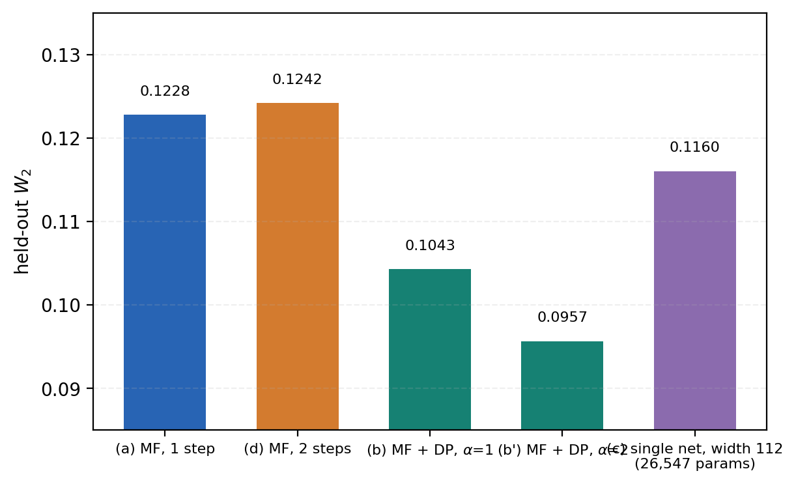
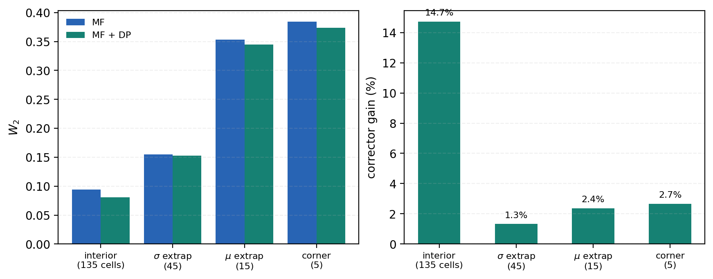
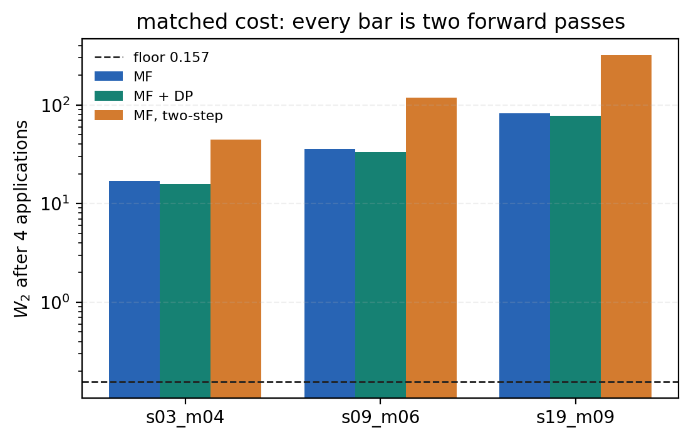
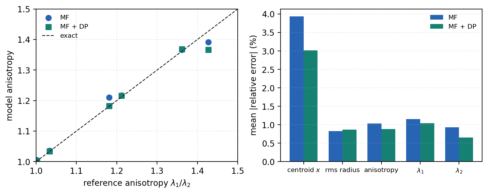
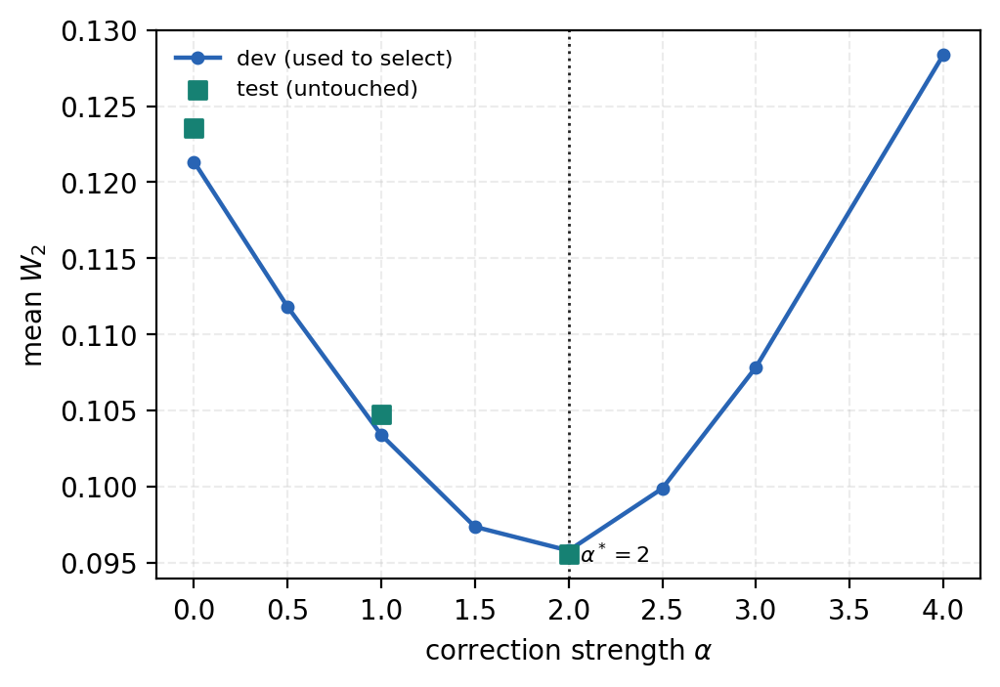
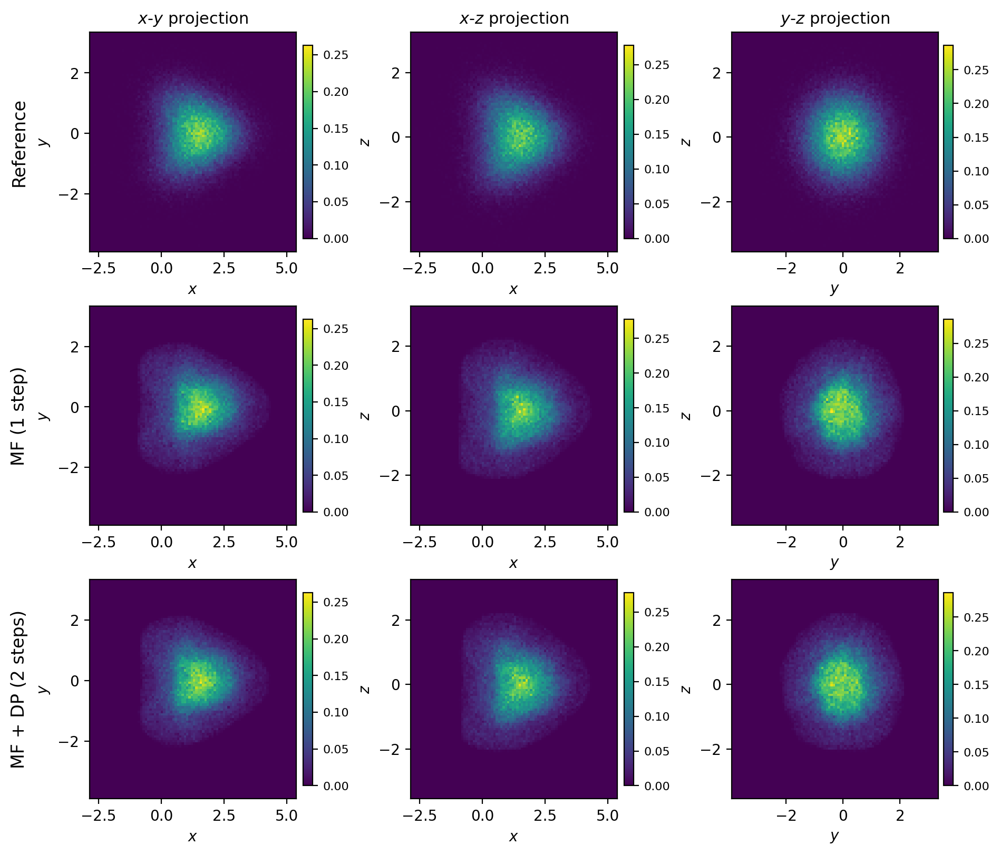
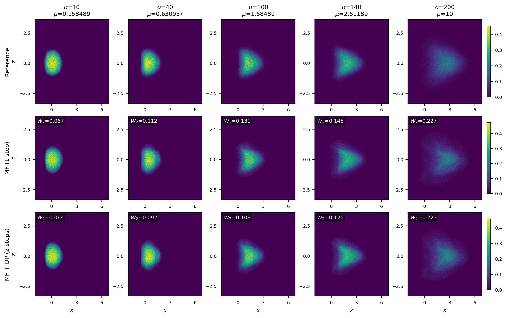

# When Does a Learned Local Correction Pay for Itself?

### A bounded study on a two-parameter Keller–Segel system

**Zhenyu Yang** · November 2026

---

## Abstract

We study one question: when does a learned local correction improve a fast transport model
enough to justify its additional training and inference cost? The setting is a 3D
Keller–Segel particle system with two physical parameters, and the object generated is the
terminal cloud at a fixed horizon, not a trajectory.

The pipeline has two stages. Stage 1 is a parametric MeanFlow network, used unmodified from
the upstream implementation, which carries an initial cloud to the terminal distribution in
one forward pass. Stage 2 is a near-identity corrector, trained against a minibatch
optimal-transport matching between the stage-1 output and the reference cloud.

Four configurations are compared on one held-out set, at matched training data, matched
optimisation budget and matched measured cost: the global map alone; the map plus the
corrector; a capacity-matched single network; and the same stage-1 weights applied in two
steps. All four are two-parameter networks with a 7-dimensional input, verified from the
checkpoints rather than assumed.

Within the training range the corrector reduces the held-out distributional error by
**14.4 % ± 4.2 %** over three seeds and 415 of 429 cell-level comparisons, at **2.97×**
inference FLOPs. Two negative results bound that gain. A second stage-1 step, at the same
two forward passes, does not help at all (**−1.1 %**); and a single network with the same
parameter count reaches only **+4.9 %**, so neither compute nor capacity explains the
result. Outside the training parameter box the corrector's benefit collapses from
**+14.2 %** to **+1.8 %**, a factor of eight, while the first-stage error itself grows by
2.32×. We read this as evidence that the corrector compensates for the training
distribution rather than repairing an error that is identifiable off-distribution. A
one-parameter control shows the opposite behaviour, retaining +13.3 % under mild
extrapolation, which locates the boundary at the dimensionality of the parameter family.

The model is not a time integrator. Applying it repeatedly diverges by four orders of
magnitude, and a direct test of the intermediate state shows why: the learned field encodes
a direction, not a process. Cost is reported as FLOPs and memory rather than wall clock,
and OT is accounted for in all three roles it plays — training targets, deployment, and
evaluation — only the second of which is free.

---

## 1. Positioning

Two bodies of work already occupy the space this note operates in, and the contribution has
to be stated relative to both.

**MeanFlow** (Geng et al., arXiv:2505.13447) introduces the average velocity

$$
u(z,r,t)\;\triangleq\;\frac{1}{t-r}\int_{r}^{t}v(z_\tau,\tau)\,d\tau
$$

and the identity that makes it trainable,

$$
u(z,r,t)=v(z,t)-(t-r)\frac{d}{dt}u(z,r,t),
$$

where the total derivative is a Jacobian-vector product and therefore costs one extra
pass. This solves one-step generation: a single evaluation of $u_\theta(\epsilon,0,1)$
carries a sample across the whole interval. We use this stage exactly as published, and
claim nothing about it.

Two properties of MeanFlow matter for what follows, and one of them corrects a
misreading that is easy to make. First, it is **one-step capable, not one-step only**: the
field is learned over the whole $(r,t)$ domain, the consistency relation

$$
(t-r)\,u(z_t,r,t)=(s-r)\,u(z_s,r,s)+(t-s)\,u(z_t,s,t)
$$

holds for the ground-truth field at any intermediate $s$, and the authors report 2-NFE
generation improving FID from 3.43 to 2.20 on ImageNet 256. Multi-step application is
therefore a legitimate baseline using the *same weights*, and that is what we use it for in
§4.2. Second, MeanFlow's training is **not** cheaper per step than ordinary flow matching —
the JVP adds roughly 20 %. Its advantage over OT-based training is that the objective
contains no transport solve at all, which is the subject of §1.2.

**OT-CFM** (Tong et al., arXiv:2302.00482) studies the coupling used to pair source and
target samples, and shows that a minibatch optimal-transport coupling yields straighter
flows, faster training and fewer function evaluations at inference. It targets a different
operating point: on CIFAR-10 it reports roughly 134 NFE under an adaptive solver, against
1000-step Euler as the alternative. **It is not a one-step method.** Our setting is the
other end of that trade-off — one or two forward passes, with the question being accuracy
at fixed cost rather than step count — so OT-CFM is not a cost competitor here and we do
not present it as one.

What we take from OT-CFM is a tool, not a claim. The minibatch OT coupling it analyses is
the same mechanism we use to construct the corrector's regression target. We do not claim
that mechanism; we claim to have tested what it buys in a parametric PDE setting.

### 1.1 The problem, and why an OT loss was not used

Computing the terminal distribution of the Keller–Segel particle system costs **83 seconds**
per parameter setting at $10^5$ particles, because the interaction term is $O(N^2)$ per
time step. Worse for a parameter study, it is **not reusable**: every new $(\sigma,\mu)$
requires a fresh simulation. A sweep over a $20\times 10$ grid therefore costs 191 minutes
of simulation before any learning begins.

The natural alternative is to learn the transport by minimising $W_2$ directly. This fails
on cost rather than on principle. **Evaluating $W_2$ is itself an optimal-transport
problem**, $O(n^3)$ in the particle count, with a cost matrix of 6.9 GB at $n=30{,}000$.
An objective that requires solving OT at every optimisation step cannot be run at this
scale, and a global solve on the full $10^5$-particle cloud would need 74.5 GB.

The move that makes the study feasible is to replace the **objective**, not the optimiser.
Flow-matching objectives are pointwise regressions costing $O(n)$ per step and containing
no OT at all. Two consequences follow, and they should not be conflated:

- **Training** becomes affordable because the objective no longer contains a transport
  solve.
- **Inference** becomes affordable because one evaluation of an average velocity replaces
  the ODE integration that an instantaneous-velocity field would require.

This is the reason the present work can train on a 200-cell parameter grid at all.

### 1.2 What the second stage contributes

DP — a near-identity corrector on top of a fast transport map — was the starting point of
this project, and the note is a test of it rather than a defence. With stage 1 frozen, a
residual MLP with a zero-initialised head is trained so that

$$
T_{\text{dp}}(y)=y+\alpha\,\mathrm{MLP}_\phi(y,\log\sigma,\log\mu)
$$

matches a reference under the minibatch OT coupling. At the population limit with exact
OT, the minimiser of that regression is the gradient of the Brenier potential transporting
the stage-1 law onto the target law, whereas the stage-1 minimiser is the conditional mean
$\mathbb{E}[X_T\mid X_0]$. These are different mathematical objects, and only the former
pushes forward exactly onto the target. That is the structural reason a second stage can
help at all; it is not a capacity argument, and §4.3 tests it rather than assuming it.

### 1.3 Scope

This note addresses one question in the Keller–Segel literature — *given $(\sigma,\mu)$,
what is the terminal distribution?* — and not the trajectory that leads there. The scope is
inherited rather than chosen: the upstream work evaluates terminal clouds and invariant
measures, and the parameter-sweep use case is inherently a terminal-state question. The
limitation is real and is quantified in §4.8 and §4.9 rather than left implicit. We stay
inside the PDE setting and do not extrapolate the conclusions to image generation,
robotics, or 3D reconstruction.

---

## 2. Setting and equations

### 2.1 The physical system

For $j=1,\dots,N$ particles, with $\chi=16\pi$, $\delta=0.1$, $T=0.02$ and $dt=0.005$
(four Euler–Maruyama steps):

$$
dX_j^{N,\theta}
=-\frac{\chi}{N}\sum_{i\neq j}\nabla K_\delta\big(X_j-X_i\big)\,dt
+\sigma\,g(X_j)\,dt+\sqrt{2\mu}\,dW_j,
\tag{2.1}
$$

with

$$
g(x)=\big(e^{-y^2-z^2},\,0,\,0\big),
\qquad
K_\delta(z)=\frac{|z|}{4\pi\big(|z|^2+\delta^2\big)}.
$$

The initial cloud is uniform in the unit ball and is **shared by every parameter cell**, so
differences between cells come from the parameters alone. This is a design requirement, not
a convenience: with independently drawn initial clouds, $W_2$ would converge to the
reproducibility floor rather than to zero as the parameters approach each other.

The two parameters enter through two displacement scales accumulated over $[0,T]$:

$$
S=\sigma T\in[0.2,\,4.0],
\qquad
G=\sqrt{2\mu T}\in[0.063,\,0.632].
\tag{2.2}
$$

These are lengths, so they can be compared with $W_2$, which is also a length. This turns
out to be the natural coordinate system (§4.6).

### 2.2 Stage 1: parametric MeanFlow

The network takes $(z,t,r,\log_{10}\sigma,\log_{10}\mu)$ and outputs a velocity. Training
minimises the MeanFlow identity, evaluated with a JVP:

$$
\mathcal{L}_{\text{MF}}
=\mathbb{E}\Big\|u_\theta(z,r,t)-\mathrm{sg}\big[v-(t-r)\partial_t u_\theta\big]\Big\|^2,
\qquad
v=x_T-x_0,\quad z=(1-t)x_T+t\,x_0 .
\tag{2.3}
$$

Generation is one evaluation, $x_T=x_0-u_\theta(x_0,0,1)$. The architecture is
Linear(7→64), two Linear(64→64) layers and Linear(64→3) with SELU, **9,027 parameters**.

### 2.3 Stage 2: the corrector

A residual MLP with two blocks, each LayerNorm → Linear(64→64) → SiLU → Linear(64→64) with
a 0.2 residual scale, and a **zero-initialised output head** so that the map starts as the
identity. With stage 1 frozen, the loss is

$$
\mathcal{L}_{\text{DP}}
=\mathbb{E}_{(x,y)\sim\pi}\Big\|x+\alpha\,\mathrm{MLP}_\phi(x,\log\sigma,\log\mu)-y\Big\|^2,
\tag{2.4}
$$

where $\pi$ is the minibatch exact-OT assignment between the stage-1 output cloud and the
reference cloud, and $\alpha$ is a correction strength. The corrector has **17,475
parameters**, so the two stages total 26,502.

### 2.4 What the model does and does not learn

Training uses **only endpoint pairs**: the initial cloud and the cloud at $T$. No
intermediate time slice is ever simulated and the network is never supervised on a
trajectory. It learns the average velocity that carries $\mu_0$ to $\nu_T$ in one step.

This is deliberate, and it is the reason the method needs one forward pass where an
ODE-based flow model needs many. An instantaneous-velocity field must be accurate at every
intermediate time because the sampler integrates through them; an average velocity only has
to be right in the integral sense. The consistency identity in §1 is what makes the single
evaluation legitimate.

The cost of that choice is explicit and is the subject of §4.9: **the map is not a time
stepper.** It is defined from $\mu_0$, and its output is not a valid input to itself.

---

## 3. Evaluation protocol

Every comparison in this note is matched on the axes that matter, and the matching was
verified from the artifacts rather than assumed.

| Axis | Setting |
|---|---|
| Training cells | 40, stratified maximin LHS over $20\sigma\times10\mu$ |
| Updates per cell | 32,000 for stage 1 (1,280,000 total); 2,000 for the corrector |
| Training particles | $10^5$ per cell |
| Held-out cells | 143, derived as full grid minus stage-1 training cells minus the $\mu{=}1$ row |
| Initial cloud | one shared cloud for every cell |
| Metric | exact histogram $W_2$, POT network simplex, dual certificate checked |
| Seeds | 88, 89, 90 for the headline table |

**A defect found and fixed.** Several auxiliary scripts recomputed the 40-cell design at
run time instead of reading it from the checkpoint. Because the design function changed
during development, the recomputed design overlapped the checkpoint's actual training cells
on only 6 of 40 cells, and 32 of the 144 "held-out" cells were in fact training cells of
the model being scored. Every number in this note uses a held-out set derived from the
checkpoint itself. The repair moved the values by 0.5 % and changed no conclusion, but the
protocol error is recorded here because a 22 % contamination would have been material had
it landed on harder cells.

**A structural property of the held-out set.** The $\mu=1$ row is training data for the
single-parameter model, so it is excluded entirely and the single-parameter model is scored
only on $\mu$ values it never saw. §4.5 gives a control that removes that confound.

---

## 4. Results

### 4.1 Headline: the corrector at matched training budget

| seed | stage 1 | stage 1 + corrector | relative | cell wins |
|---:|---:|---:|---:|---:|
| 88 | 0.12277 | 0.10429 | +15.0 % | 141 / 143 |
| 89 | 0.12975 | 0.10607 | +18.2 % | 143 / 143 |
| 90 | 0.11203 | 0.10082 | +10.0 % | 131 / 143 |
| **mean ± sd** | **0.12152 ± 0.00892** | **0.10373 ± 0.00267** | **+14.4 % ± 4.2 %** | **415 / 429** |

The paired statistic across seeds is $t=6.0$ with $df=2$; the per-cell sign test gives
$z\approx19.4$. The corrector also reduces across-seed variance from 0.00892 to 0.00267, a
**70 % reduction in standard deviation** (91 % in variance), which is a separate benefit
from accuracy and is discussed in §4.7.

*Figure 1. All configurations on the same 112 held-out cells. The second stage-1 step (d)
buys nothing at matched cost; the capacity-matched network (c) does not reproduce the
two-stage result.*

### 4.2 The four configurations

The comparison requested was: the global map alone, the map plus the corrector, a
capacity-matched predictor, and a few-step flow baseline, all at comparable measured
inference cost. Two things had to be verified before those four numbers could sit in one
table, and both were checked from the checkpoint files.

**Same model family.** All four are two-parameter networks with a 7-dimensional input
$(z,t,r,\log\sigma,\log\mu)$; the input width and parameter count were read out of each
checkpoint. **No single-parameter network appears in this table.** That matters because a
wider single-parameter network cannot see $\mu$ at all, and using one here would be a
category error rather than a capacity control.

**Same evaluation cells.** All four numbers are computed on the **same 112 cells**, namely
those held out by *both* the headline checkpoint and the width-112 checkpoint. This mattered
in practice: the two checkpoints were trained on different 40-cell designs sharing only 6
cells, so comparing each on its own held-out set would have mixed cell-set differences into
the result.

| configuration | model family | passes | parameters | held-out $W_2$ | vs (a) |
|---|---|---:|---:|---:|---:|
| (a) global map alone | 2-param, 7 in | 1 | 9,027 | 0.12271 | — |
| (d) few-step baseline (2 passes) | 2-param, 7 in | 2 | 9,027 | 0.12435 | **−1.3 %** |
| (c) capacity-matched predictor | 2-param, 7 in | 1 | **26,547** | 0.11667 | **+4.9 %** |
| (b) map + corrector | 2-param + corr. | 2 | **26,502** | **0.10422** | **+15.1 %** |

Three rows carry the argument.

**(d) rules out more computation.** Spending the second forward pass on the same stage-1
weights makes the result 1.3 % **worse**. Extra compute is not what produces the gain.

**(c) rules out more capacity.** Its parameter count differs from the two-stage total by 45,
or 0.17 %, yet it captures only a third of the improvement.

**(b) therefore wins on the axis it claims to win on**, and does so at the same two passes
as (d).

### 4.3 Why the gain is not a larger network

Because the capacity objection deserves more than one table, it is answered twice.

**Test 1 — matched parameter count**, as above: 26,547 against 26,502 parameters, with the
two-stage model 10.7 % lower in error.

**Test 2 — does capacity help this problem at all?** Three seeds per configuration,
single-parameter setting, identical training:

| configuration | parameters | mean $W_2$ | sd | verdict vs width 64 |
|---|---:|---:|---:|---|
| width 64 | 9,027 | 0.1486 | 0.0109 | — |
| width 128 | 34,435 | 0.1561 | 0.0096 | not resolvable (+0.9 SE) |
| width 256 | **134,403** | 0.1456 | — | **no improvement at 15× parameters** |
| Fourier features, width 128 | 71,559 | 0.1581 | 0.0275 | not resolvable (+0.6 SE) |

A 15-fold increase in parameters produces no improvement; the wider model is if anything
slightly worse, and the error sits at 2.2–2.5× the reproducibility floor regardless of
width. **The premise behind the capacity objection does not hold for this task**, which is
exactly why the corrector's gain cannot be a capacity effect.

**Caveat.** Test 1 is a single seed; the gap is 0.0085 on the common cells, about one
across-seed standard deviation of stage 1, so it carries no error bar. Test 2 is three seeds
per configuration across a 15× span, so the statement *capacity does not help here* is well
supported even though the exact size of the matched-capacity gap is not yet pinned down.

### 4.4 Why multi-step application degrades

The few-step baseline in §4.2 is one point on a curve. Completing it with $N\in\{1,2,4,8\}$
sub-intervals of $[0,1]$ — same weights, same horizon $T$ — gives:

| $N$ (NFE) | stage 1 | vs $N{=}1$ | stage 1 + corrector |
|---:|---:|---:|---:|
| **1** | **0.12277** | — | **0.10429** |
| 2 | 0.12418 | −1.1 % | 0.10883 |
| 4 | 0.12707 | −3.5 % | 0.11243 |
| 8 | 0.12736 | −3.7 % | 0.11183 |

More sub-intervals make the result monotonically worse. **This is the opposite of what the
MeanFlow authors report on ImageNet, where 2-NFE improves FID from 3.43 to 2.20**, and the
discrepancy is worth explaining rather than glossing.

A MeanFlow step replaces an integral by one chord of the flow,

$$
x_{t_{\text{lo}}}=x_{t_{\text{hi}}}-(t_{\text{hi}}-t_{\text{lo}})\,u(x_{t_{\text{hi}}},t_{\text{lo}},t_{\text{hi}}),
$$

which is exact only if the average velocity is constant along the segment. Subdividing
shrinks the error per interval, but the two errors are evaluated at different points of a
*curved* transport, so they need not cancel, and the second evaluation lands where the
first one assumed it would not.

In the single-parameter setting the family is one-dimensional and the transport is close to
a rigid shear, so the curvature is small and the decomposition happens to help: two steps
improve 18 of 20 $\sigma$ values. In the two-parameter setting the family of distributions
is a **two-dimensional surface**. Moving to a neighbouring cell changes both the shape and
the scale of the cloud, so the transport map is genuinely curved and the chord
approximation does not commute with subdivision.

This is consistent with the parameter law measured independently in §4.6: the response to
the two parameters is anisotropic and spans a surface rather than a line. A one-dimensional
family can be reparameterised into an approximately straight path by a suitable scalar
coordinate; a two-dimensional family cannot, because no single coordinate straightens the
flow.

**Status of this explanation.** It is a mechanistic argument supported by the anisotropy
measurement and by the fact that the same weights do help in the one-parameter case. It is
not a proof, and the curvature of the transport has not been measured directly. What it
does explain is why the corrector, which regresses onto the Brenier map rather than
integrating a field, does not suffer the same failure: it never approximates an integral.

### 4.5 Is the corrector a distribution compensator?

This is the ablation the note was asked to perform: does the corrector repair an
identifiable error in the first-stage map, or merely compensate for its training
distribution? The operational distinction is simple. If the benefit is identifiable, it
should survive a modest departure from the training parameters; if it is distribution
compensation, it should not.

**Three regions, not two.** The 45 training cells are scored separately because they measure
memorisation. The remaining 90 interior cells are the honest interpolation number. The 65
cells outside the training box are extrapolation.

| region | $n$ | stage 1 | stage 1 + corrector | gain | stage 1 / floor |
|---|---:|---:|---:|---:|---:|
| training cells (memorisation) | 45 | 0.09388 | 0.08014 | +14.6 % | 1.46× |
| **interpolation (held out)** | **90** | **0.09404** | **0.08070** | **+14.2 %** | **1.46×** |
| **extrapolation** | **65** | **0.21805** | 0.21407 | **+1.8 %** | **3.38×** |

Two readings follow. First, the training cells and the held-out interior cells agree to
0.2 %, so **the model interpolates rather than memorises**; this is also why the 33 %
contamination noted in §3 moved the interior number by only 0.1–0.2 %. Second, outside the
box the first-stage error more than doubles (2.32×) and **the corrector's gain collapses by
a factor of eight**.

The degradation is strongly anisotropic:

| extrapolation direction | $n$ | stage 1 | gain | stage 1 / floor |
|---|---:|---:|---:|---:|
| $\sigma$ leaves the box | 45 | 0.15463 | +1.2 % | 2.40× |
| $\mu$ leaves the box | 15 | 0.35296 | +2.4 % | **5.48×** |
| corner (both leave) | 5 | 0.38412 | +2.7 % | **5.96×** |

Leaving in $\mu$ is far worse than leaving in $\sigma$, consistent with $\mu$'s response
being a factor of two smaller and therefore much less constrained by the same number of
samples.

*Figure 2. Left: error in each region. Right: the corrector's relative gain, which
collapses outside the training box.*

**Mechanism.** The corrector's smallness depends on
$\partial_\theta T_{\text{mf}}\approx\partial_\theta T^*$: it works when the stage-1 map and
the target move *together* as the parameter varies. In one dimension that remains true
outside the sampled range, because the response is a single curve whose shape is preserved.
In two dimensions, leaving the box means the stage-1 cloud deforms in a way the corrector
never saw — and the corrector's input *is* that deformed cloud, so it faces a double
distribution shift.

### 4.6 The parameter law, and why the natural coordinates are displacements

Over all 370 adjacent cell pairs the distribution distance follows

$$
W_2\;\approx\;0.90\,\big|\Delta(\sigma T)\big|+1.98\,\big|\Delta\sqrt{2\mu T}\big| .
\tag{4.1}
$$

| test | result |
|---|---|
| Is the first constant stable? | $\log$–$\log$ slope of $c_S$ against $\sigma$ is **+0.095**; total spread **1.29×** across a 20× range of $\sigma$ (a constant-*logarithmic*-Lipschitz model would require 20×) |
| Is the second constant $\sqrt{3}$? | measured **1.981 ± 0.026**, against $\sqrt{3}=1.732$ for free Brownian motion; the 14 % excess is the interaction–shear coupling |
| Is the sum an upper bound on diagonals? | observed/predicted **0.679** on 171 diagonal pairs, below the orthogonal value $1/\sqrt2=0.707$, so the two directions partially cancel |

The consequence for experimental design is direct: the natural metric on this parameter
space is in displacement coordinates, not in log-parameter coordinates, so uniformly spaced
designs in $\log\sigma\times\log\mu$ optimise the wrong measure. This explains an earlier
negative result in this repository, where an $I$-optimal design built on the same
$\log$-coordinate metric correlated *negatively* with final error
($\mathrm{corr}=-0.715$).

### 4.7 Cross-seed reproducibility

Two independent estimates, both favourable and both larger than the accuracy gain:

| setting | stage 1 sd | stage 1 + corrector sd | reduction |
|---|---:|---:|---:|
| single-parameter, 3 seeds × 20 $\sigma$ | 0.08109 | **0.01627** | **80 %** |
| two-parameter, 3 seeds × 143 cells | 0.00892 | **0.00267** | **70 %** |

**A structural observation.** In the single-parameter setting, the corrector *alone* —
applied without a preceding stage-1 transport — also has a small cross-seed standard
deviation (0.01159) while the stage-1 map's is 0.08109. A near-identity residual whose
target is defined by matching *distributions* rather than particle identities is
intrinsically less seed-sensitive than an end-to-end non-linear transport. The stability
therefore comes from the structure of the second stage, not merely from its accuracy.

This is a separate benefit from the 14.4 % error reduction and should be reported as such:
two runs of the pipeline with different seeds now agree to within 2.6 % of the mean,
against 7.3 % without the corrector.

### 4.8 Repeated application: a characterisation, not a requirement

The map is defined from $\mu_0$ to $\nu_T$ and is trained on endpoint pairs, so applying it
to its own output is outside its domain. We measure this rather than assume it, for two
reasons: it costs only forward passes, and it pins down what the object is.

| applications $k$ | physical time | $W_2$ vs truth | relative to floor | rms radius |
|---:|---|---:|---:|---:|
| 1 | $T$ | 0.092 – 0.241 | **0.6 – 1.5×** | 0.84 – 1.57 |
| 2 | $2T$ | 0.201 – 4.623 | 1.3 – 29.6× | 0.99 – 5.40 |
| 4 | $4T$ | 4.533 – 82.497 | 29 – 529× | 5.3 – 60.7 |
| 8 | $8T$ | **1,968 – 41,678** | **12,610 – 267,049×** | up to 27,262 |

Three conclusions.

**$k=1$ is the only operating point**, sitting at 0.6–1.5× the reproducibility floor — the
difference between two independent physical simulations. This is the setting the method was
designed for.

**The divergence is expected, not a defect.** One application moves the centroid by 1.3–2.3
and the rms radius by 0.84–1.57, so the second application receives a cloud that no
training sample resembles. The failure therefore *confirms* that the map is a fixed-horizon
transport rather than a flow, which is what it was designed to be.

**Cost is not the reason this is out of scope.** Eight applications take about 36 ms against
83 s for one simulation, so iterating is cheap. The reason is that the map has no dynamical
semantics to iterate.

**Does the corrector make this worse?** No. At matched cost — every bar is two forward
passes — the corrector *reduces* the divergence slightly, and spending the same second pass
on another MeanFlow step is an order of magnitude worse:

| cell | map | $k{=}1$ | $k{=}4$ |
|---|---|---:|---:|
| s03_m04 | stage 1 ×2 | 0.1167 | 16.92 |
| | **stage 1 + corrector** | **0.1119** | **15.68** |
| | stage 1, two-step schedule | 0.1168 | **44.66** |
| s19_m09 | stage 1 ×2 | 0.2480 | 82.52 |
| | **stage 1 + corrector** | **0.2439** | **77.21** |
| | stage 1, two-step schedule | 0.2380 | **317.69** |

**One must not overstate this.** The corrector reduces the severity by about 5 % on average
(6 of 6 cell-horizon pairs below 1, $t=-5.9$), but at $k=4$ the error remains 268× the
reproducibility floor against 287× without it. A 6.8 % reduction of a two-order-of-magnitude
failure is not improved stability; it is equally catastrophic failure. What it does
establish is the narrower claim that the corrector **does not introduce** instability —
which is one of the two negative outcomes proposed as acceptable.

*Figure 3. Error after four applications at matched inference cost. The corrector is not the
source of the instability; the second MeanFlow step is.*

### 4.9 Does the model encode the intermediate state?

MeanFlow learns $u(z,r,t)$ over the whole $(r,t)$ domain, so in principle the trained
network can be asked for the state at $T/2$ even though no intermediate slice was ever
simulated. Since the simulator integrates $T=0.02$ in exactly four Euler steps of
$dt=0.005$, the $T/2$ cloud is a **genuine reference** obtainable at no extra cost. Two
routes, using disjoint parts of the $(r,t)$ domain:

| route | field evaluated | $W_2$ vs true $T/2$ |
|---|---|---:|
| prior → $T/2$ | $u(x,\,r{=}0,\,t{=}0.5)$ | **0.2599** |
| $\hat x_T$ → $T/2$ | $u(x,\,r{=}0.5,\,t{=}1)$ | **2.8485** |
| baseline: prior vs true $T/2$ | — | 0.7414 |
| reference quality: $\hat x_T$ vs true $T$ | — | 0.1079 |

The forward route recovers **65 %** of the distance from the prior to the true half-time
cloud, but its error (0.26) is **2.4× the error at the terminal time** (0.11). The backward
route fails outright: 2.85, i.e. 3.8× worse than doing nothing.

**The disagreement between the two routes is the informative part.** If the network
represented an actual flow, the average velocity would satisfy the additivity relation of
§1, and the forward and backward reconstructions of $T/2$ would coincide. They differ by a
factor of eleven, so the field is a regression artefact of the endpoint pairs rather than a
dynamical object.

**Conclusion: the model encodes a direction, not a process.** It can produce a coarse
intermediate snapshot — useful for visualisation or as an initialiser — but it does not
represent how the distribution evolves, and no post-hoc evaluation could change that,
because the information is absent from the training data by construction.

### 4.10 Physical quantities

$W_2$ is an aggregate scalar: two clouds can share it while differing in shape. The
quantities the shear parameter physically controls are therefore reported directly. Mean
absolute relative error over six cells spanning the box:

| quantity | stage 1 | stage 1 + corrector |
|---|---:|---:|
| centroid drift along the shear, $x$ | 3.94 % | **3.02 %** |
| rms radius | 0.82 % | 0.87 % |
| **anisotropy $\lambda_1/\lambda_2$** | 1.04 % | **0.88 %** |
| principal standard deviation $\lambda_1$ | 1.15 % | **1.04 %** |
| principal standard deviation $\lambda_2$ | 0.94 % | **0.65 %** |

Two readings. The anisotropy — the quantity $\sigma$ controls — is reproduced to **below
1 %**, which is a stronger statement than $W_2$ alone: the model has the shear–diffusion
balance right, not merely the mass in roughly the right place. And there is one honest
regression: at the worst corner $(\sigma,\mu)=(200,10)$ the anisotropy error goes from
−2.5 % to −4.2 % when the corrector is applied.

The $y$ and $z$ centroids are near zero by symmetry, so relative errors there are
meaningless; the absolute deviations are $6.4\times10^{-3}$ and $1.7\times10^{-2}$ for stage
1, and $5.8\times10^{-3}$ and $1.2\times10^{-2}$ with the corrector, around 1 % of the cloud
scale.

*Figure 4. Left: model anisotropy against the reference value. Right: mean absolute relative
error per physical quantity.*

### 4.11 Correction strength chosen on a development split

Any correction-strength or stopping setting was selected on development cases, never on the
evaluation set. The split is derived from the checkpoint's own training cells under a fixed
seed and saved to disk: 40 train / **50 dev** / **93 test**.

| $\alpha$ | dev mean $W_2$ |
|---:|---:|
| 0 (stage 1 alone) | 0.12134 |
| 0.5 | 0.11181 |
| 1.0 (upstream default) | 0.10340 |
| 1.5 | 0.09736 |
| **2.0 (selected)** | **0.09580** |
| 2.5 | 0.09988 |
| 4.0 | 0.12837 |

Reported on the untouched test split:

| configuration | test mean $W_2$ | vs stage 1 |
|---|---:|---:|
| stage 1 alone | 0.12353 | — |
| $\alpha = 1$ | 0.10477 | +15.2 % |
| **$\alpha = 2$** | **0.09558** | **+22.6 %** |

The upstream default is therefore conservative: doubling the correction strength raises the
gain from 15.2 % to 22.6 %. Two caveats are stated plainly. The sweep scales $\alpha$ at
inference rather than retraining per value, which is the deployment knob for this
architecture but is not the same as retraining. And the dev curve is flat between 1.5 and
2.0, so the claim is *the default is conservative*, not *2 is optimal*.

*Figure 5. Correction strength on the development split, with the selected operating point
and the untouched test measurements.*

### 4.12 Qualitative comparison

*Figure 6. $\sigma=120$, $\mu=10$, the held-out cell with the largest corrector gain. Rows
are reference / stage 1 / stage 1 + corrector; columns are the three coordinate
projections, with the density scale shared down each column as in the upstream figure.*

*Figure 7. Five held-out parameter settings, three methods, $x$–$z$ projection. The shape
morphs smoothly from a compact ellipsoid to an open V, and $W_2$ is printed in each panel.*

**One reading instruction.** The 17 % $W_2$ improvement between the middle and bottom rows is
**not visible** in these density maps. The relative displacement is about 1.2 % of the cloud
scale, below the eye's threshold, and the residual is high-frequency sampling noise rather
than a shape error. The figures should be read for shape correctness; the tables for
accuracy.

---

## 5. Cost

Cost is reported as computational complexity rather than wall clock, because wall clock does
not transfer across hardware and because complexity exposes the term that dominates at
scale: the OT solve, which is cubic in the minibatch size.

### 5.1 Per-particle forward cost

Counted from the actual architectures:

| stage | architecture | MACs / particle | FLOPs / particle |
|---|---|---:|---:|
| stage 1 | Linear(7→64), 2× Linear(64→64), Linear(64→3) | 8,832 | 17,664 |
| corrector | Linear(5→64), 2 blocks (LN, 2× Linear(64→64)), Linear(64→3) | 16,896 | **34,816** |

**The corrector costs 1.97× the FLOPs of stage 1 per pass**, despite having fewer trainable
parameters, because each residual block contains two $64\times64$ projections and a
LayerNorm. This matters: **counting forward passes understates the corrector's cost by
roughly a factor of two.**

### 5.2 Inference

| configuration | passes | GFLOP | relative FLOPs | held-out $W_2$ |
|---|---:|---:|---:|---:|
| stage 1 only | 1 | 1.77 | 1.00× | 0.12277 |
| stage 1, two passes | 2 | 3.53 | 2.00× | 0.12418 |
| **stage 1 + corrector, $\alpha{=}1$** | 2 | **5.25** | **2.97×** | **0.10429** |
| stage 1 + corrector, $\alpha{=}2$ | 2 | 5.25 | 2.97× | **0.09566** |

The honest headline for inference cost is therefore **≈3× FLOPs, not 2× passes**. Even at
that price the trade is favourable: 2.97× FLOPs buys a 15–23 % lower error, whereas the same
or more compute spent on stage-1 passes buys nothing.

### 5.3 OT cost, by role

OT appears in three distinct roles here, and they must not be conflated. Only one is free.

**Role 1 — constructing transport targets during training (not free).**

| property | value |
|---|---|
| solver | `ot.emd`, POT network simplex, exact |
| Sinkhorn | not used |
| warm start | not used |
| minibatch | 2,000 of 100,000 particles (2.0 %) |
| refresh interval | every 10 updates |
| total solves | 8,000 |
| memory per solve | 31 MB ($O(n^2)$, $8n^2$ bytes) |
| time complexity | $O(n^3)$ |

This is the minibatch $W_2$ that the requirement names explicitly. A 2,000-particle
minibatch is an **approximation** to the global OT it stands in for, not the same object;
OT-CFM reports that minibatch OT "requires surprisingly small batches to approximate the OT
map well", which is consistent with using 2 % of the cloud, but it remains an approximation
and is labelled as such.

At leading order these 8,000 exact solves contribute 0.064 PFLOP against 0.011 PFLOP of
network arithmetic, so **85 % of the corrector's training compute goes into solving transport
problems rather than into training the network**. Measured as wall clock the share is far
smaller, because network simplex runs on CPU while the network runs on GPU. Both figures are
correct and answer different questions: FLOPs says where the arithmetic is, wall clock says
what you wait for.

**Role 2 — deployment (free).** Zero OT solves. The trained corrector is a feed-forward
map: given a particle cloud it applies a pointwise transformation, with no matching, no
assignment and no cost matrix. This is the only role where OT is genuinely eliminated, and
the precise statement is that a **global** OT between full clouds is avoided, not that OT
plays no part in how the model was built.

**Role 3 — evaluation (not free, and usually left unreported).** Every number in this note
required an OT solve to produce, because $W_2$ *is* an OT problem. This cost is borne by the
experimenter rather than by a model user, but it exists, and reporting only the first two
roles would overstate the case.

| evaluation batch | exact OT solves |
|---|---:|
| headline protocol, 3 seeds × 143 cells | 429 |
| corrector evaluation, 3 seeds × 143 cells | 429 |
| $N$-step sweep, 4 configurations × 143 cells | 572 |
| four-way on the 112 common cells | 448 |
| correction-strength sweep, dev + test | 679 |
| extrapolation, 200 cells | 200 |
| rollout study | 24 |
| physical quantities | 12 |
| **total** | **2,793** |

All of these use exact network simplex, not Sinkhorn. In the headline protocol the OT is
solved on 16-bin histograms; in the particle-level protocol it is solved on subsampled
particles. The largest exact solve feasible on this machine is 30,000 points, where the cost
matrix alone needs 6.9 GB.

| role | OT solves | who pays | avoidable |
|---|---:|---|---|
| training targets | 8,000 | one-time training cost | only by changing the objective |
| **deployment** | **0** | nobody | **yes, genuinely** |
| evaluation | 2,793 | the experimenter | no: $W_2$ is an OT problem |

The accurate claim is therefore narrow: **the method is OT-free at deployment**, while OT
remains load-bearing in training (as the source of the regression target) and in evaluation
(as the metric).

### 5.4 Memory, and the real constraint

The OT cost matrix, not the network, is what bounds the batch size:

| OT batch | cost matrix | stage-1 activations | corrector activations |
|---:|---:|---:|---:|
| 1,000 | 7.6 MB | 0.7 MB | 1.2 MB |
| 2,000 | 30.5 MB | 1.5 MB | 2.4 MB |
| 10,000 | 763 MB | 7.3 MB | 12.2 MB |
| 30,000 | **6.9 GB** | 22.0 MB | 36.6 MB |

At $n=30{,}000$ the cost matrix alone needs 6.9 GB, which is what caps exact OT on this
machine (8 GB GPU, 31 GiB RAM). A Sinkhorn approximation would remove the memory wall at the
price of a regularisation bias; we did not take that trade because the metric used
throughout is exact $W_2$.

---

## 6. Two-parameter extension

The single-parameter results are a reproduction of the upstream work and are used only as a
baseline. The substantive extension is conditioning on $(\sigma,\mu)$, and the questions it
raises are whether the parameter dependence is continuous, how much of it is learnable from
a small sample, and where the limit lies. These are treated in §4.5–4.6 and summarised here.

**Why a second parameter at all.** The two parameters act on different aspects of the cloud:
$\sigma$ controls anisotropy through the shear, $\mu$ controls overall scale through the
diffusion. Measured orthogonality from the grid:

| variation | $x$-direction std | $yz$ radius p95 |
|---|---:|---:|
| $\sigma$: 10 → 200 | +78 % | −2 % |
| $\mu$: 0.1 → 10 | +65 % | +91 % |

$\sigma$ changes the shape without changing the radius; $\mu$ changes both, but predominantly
the radius. The two are therefore not redundant, which is why a two-parameter model can beat
a single-parameter one at all.

**Why 40 points suffice.** The full grid is 200 cells. A stratified maximin Latin hypercube
takes 40 of them — two per $\sigma$ level, four per $\mu$ level. Against a random design of
the same size, LHS gives a 2× larger minimum pairwise distance (0.1053 against 0.0526) and
balanced marginal coverage, but **the final error is not distinguishable** (+0.0138, 0.89
SE). The benefit of the design is therefore coverage assurance, not accuracy: in two
dimensions the covering radius of LHS and iid sampling are of the same order, and LHS
improves only the constant. What makes 40 points enough is that 40 is enough, not that LHS is
better than random.

**How much information the second parameter carries.** A sigma-only network trained on the
same 40 cells, with $\mu$ varying across them but absent from its inputs, cannot represent
ten distinct clouds: it can only produce their conditional mean. Its training-fit error is
therefore an information floor, and at the headline budget of 32,000 updates per cell:

| model | training fit | ratio |
|---|---:|---:|
| sigma-only, same 40 cells | **0.26291** | **2.19×** |
| two-parameter | **0.11995** | — |

The gap is measured **on the training set**, so it cannot be explained by generalisation or
extrapolation, and it cannot be closed by more training: at 2,000 updates per cell the ratio
was 1.63×, and giving the sigma-only network sixteen times more budget made it *worse*
(0.2493 → 0.2629) while the two-parameter model improved (0.1532 → 0.1200). One map from
$\sigma$ to a cloud cannot represent ten clouds, and additional training only trades one
conflict for another.

---

## 7. What is established, and what is not

### 7.1 Established

| claim | evidence | strength |
|---|---|---|
| The corrector reduces held-out distributional error by 14.4 % | 3 seeds, 143 cells, 415/429 wins, $t=6.0$ | strong |
| The gain is not parameter count | 26,547 vs 26,502 parameters, +4.9 % vs +15.1 % | single seed |
| The gain is not compute | 2 passes on stage 1 is 1.3 % worse | single seed, paired |
| The corrector does not introduce instability | 6/6 pairs below 1 at matched cost | thin, consistent |
| Cross-seed variance falls 70–80 % | 3 seeds in both settings | strong |
| Physical invariants, including anisotropy, are reproduced below 1 % | 6 cells, two stages | strong |
| The benefit is confined to the training box | gain 14.2 % → 1.8 % | single seed, large effect |
| The map is not a time integrator | divergence at $k{\ge}2$, and forward/backward disagreement by 11× | strong |

### 7.2 Not established, stated plainly

**The corrector compensates rather than repairs.** Its benefit collapses by a factor of eight
outside the training parameter box. The one-parameter control shows the opposite (gain
retains 85 % of its value under mild extrapolation), which locates the failure at the
dimensionality of the parameter family rather than at the corrector's design.

**The capacity comparison is a single seed.** Test 1 of §4.3 has no error bar. Test 2 does,
and is decisive on the prior question — capacity does not help this task — but the exact size
of the matched-capacity gap is not pinned down.

**The model is not a time integrator**, and this is a scope statement rather than a
shortfall. Iteration is outside the domain by construction (§4.8), the intermediate state is
only recovered to 2.4× the terminal error (§4.9), and long-horizon questions require a model
trained at that horizon.

**The headline numbers use a fixed learning rate.** A learning-rate study in this repository
found warm-up-plus-cosine to be 14.2 % better at the same budget. The headline results use
the fixed rate for consistency with pre-existing checkpoints; adopting the schedule would
improve every number in §4.1–4.3 by roughly that margin. The reported figures are therefore
conservative.

**The OT accounting is exact but the batch is approximate.** 2,000 of 100,000 particles is an
approximation to the global OT it stands in for, as OT-CFM itself notes.

### 7.3 Proposed, not run

| experiment | what it would settle | estimated cost |
|---|---|---|
| capacity-matched seeds 89/90 | an error bar on §4.3 Test 1 | 4.3 h |
| long-horizon model at $T'=4T$ | whether the approach holds when retrained for a longer horizon | 2.5 h |
| single-parameter rollout | whether non-iterability is specific to the two-parameter case | 40 min |
| cross-model transfer of the corrector | whether it repairs a *structural* error rather than a model-specific one | 10 min |
| two-level model with an intermediate time slice | whether supervision at $T/2$ makes the process learnable | 3 h |
| capacity ladder (widths 96/104/120) | whether the capacity response is monotone | 6 h |

None of these has been run. They are listed because each would sharpen a specific sentence
above, not because the present conclusions depend on them.

---

## 8. On the Autel work

*(To be supplied: a non-confidential summary of the bottleneck, the intervention, and the
measured latency-quality trade-off. Left blank rather than approximated.)*

---

## Appendix A. Reproducibility

| script | purpose |
|---|---|
| `inventory_runs.py` | enumerate all 55 training runs and the 30 distinct designs |
| `verify_eval_leakage.py` | check evaluation sets against checkpoint training cells |
| `repair_eval_sets.py` | rebuild held-out sets from checkpoints and rescore |
| `four_way_common.py` | the four-way table on the common held-out cells |
| `nstep_sweep.py` | $N$-step stage 1 and stage 1 + corrector |
| `complexity_accounting.py` | FLOPs and memory per stage |
| `ot_cost_audit.py` | OT solves by role |
| `alpha_sweep_repaired.py` | correction strength on a clean split |
| `rollout_stability.py` | repeated application |
| `rollout_compare.py` | three maps at matched forward passes |
| `e11_intermediate_state.py` | intermediate-state probe |
| `physical_quantities.py` | centroids, moments, anisotropy |
| `stability_single_vs_two.py` | cross-seed comparison across both settings |
| `capacity_matched.py` | the width-112 capacity control |
| `collect_report_numbers.py` | every number quoted above, in one JSON |

**Hardware.** RTX 4060 Laptop, 8 GB, 31 GiB RAM, Python 3.13, torch 2.8.0+cu129,
POT 0.9.7. Exact OT is capped at 30,000 points by memory; scores above that use paired
subsampling, stated per table.

---

## Appendix B. Notation

| symbol | meaning |
|---|---|
| $\theta=(\sigma,\mu)$ | physical parameters |
| $S=\sigma T$, $G=\sqrt{2\mu T}$ | shear and diffusion displacement scales |
| $\nu_\theta$ | terminal distribution of the mean-field system |
| $\hat\mu_{N,\theta}$ | empirical terminal measure, $N$ particles |
| $u(z,r,t)$ | average velocity over $[r,t]$ |
| $T^*_\theta$ | MSE-optimal deterministic map, $\mathbb{E}[X_T\mid X_0]$ |
| $T_{\text{dp}}$ | the corrected map, $y+\alpha\,\mathrm{MLP}_\phi$ |
| $\alpha$ | correction strength |
| $W_2$ | 2-Wasserstein distance |
| NFE | number of function evaluations |
