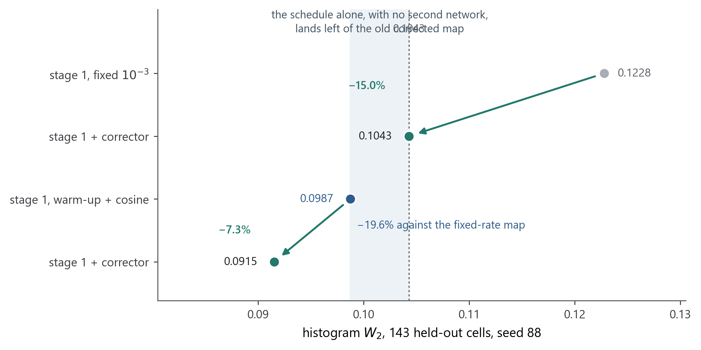
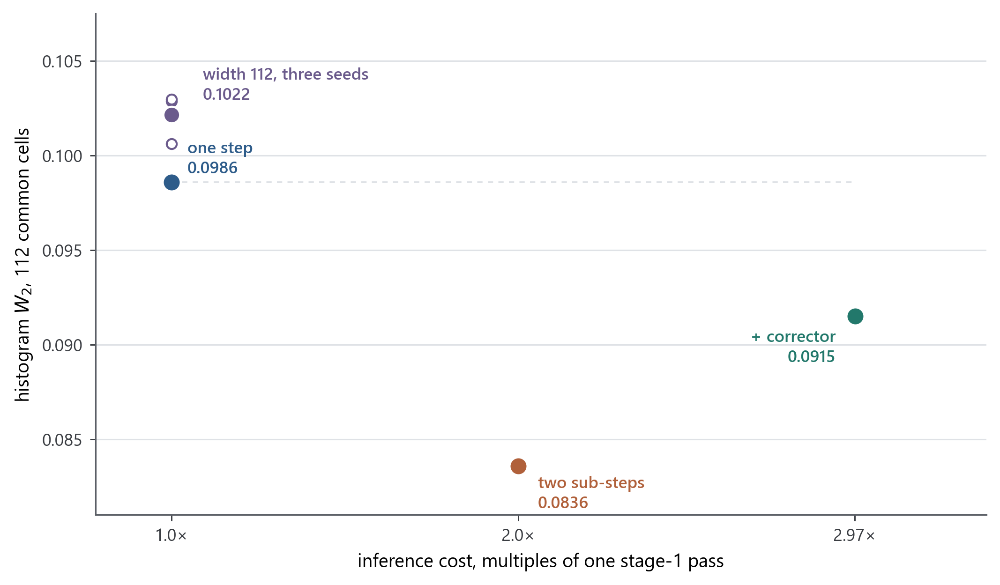
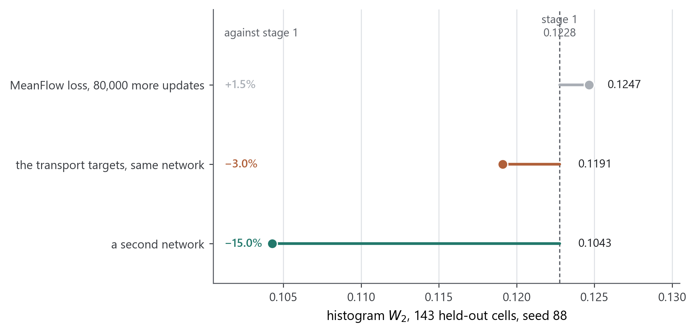
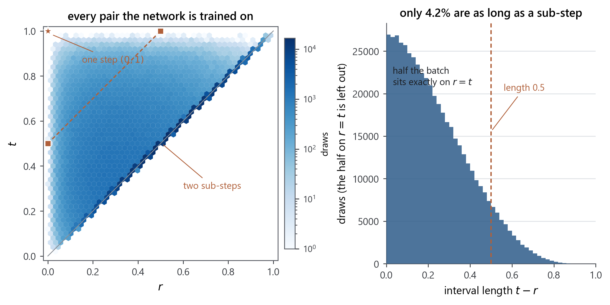
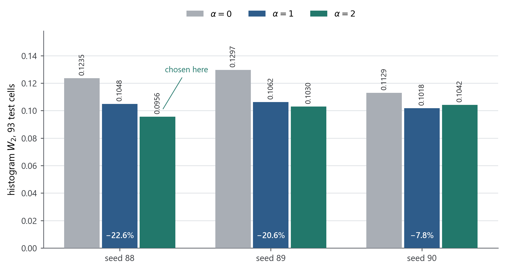
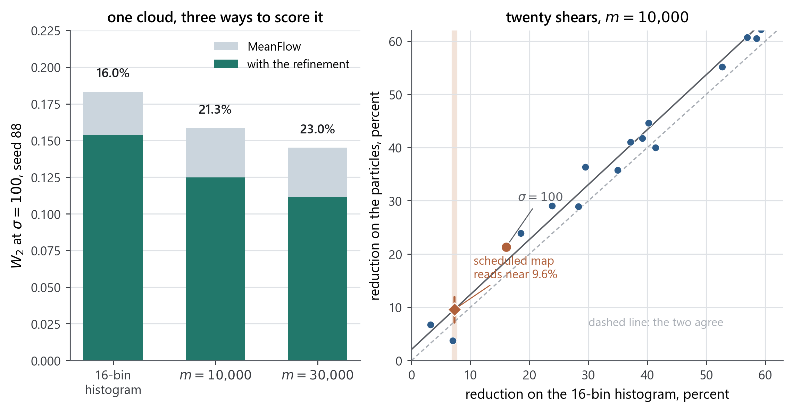
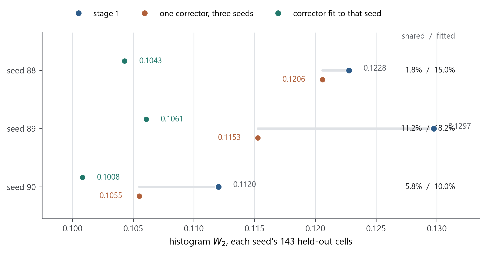

# The corrector after the schedule

**Answers to the four questions in your 18 November letter**

Zhenyu Yang · 20 November 2026

Chinese version: [`REPORT_TO_HARRY.zh.md`](REPORT_TO_HARRY.zh.md).

The headline number is now 7.3%, not 15.0%. It changed because of your first point: with stage 1 trained under a warm-up and cosine schedule, on the same 40 cells and the same update budget, the corrector's reduction roughly halves. The scheduled stage 1 also lands below where the old corrected map had stopped, so a change that costs nothing at inference bought slightly more than the second network had bought.

That result sets the tone for the rest. The extra updates are not the explanation, and the transport objective accounts for about a fifth of the drop. The sub-steps are evaluated in a region the sampler rarely visits. The selected \(\alpha\) keeps its sign on the other two seeds and loses some of its size. A single corrector trained on all three seeds repairs the two seeds that the seed-88 corrector used to make worse, and gives up most of its benefit on seed 88. All percentages below are the same 16-bin histogram distance used before, so they are comparable with the earlier note. Section 4 ends with what that metric leaves out, since you asked whether the bins are doing the work.

| your question | what I did | what came back |
|---|---|---|
| 1. Re-run with scheduled stage 1 | retrained stage 1, same 40 cells and budget, warm-up then cosine; re-scored the headline pair and the four rows | corrector gain 15.0% → **7.3%**; scheduled stage 1 alone is 5.3% below the old corrected map |
| 2. Separate the second network from the OT objective | kept the network fixed, spent the same 80,000 updates on MeanFlow and then on the transport targets | +1.5% worse, then −3.0%; about a fifth of the drop, the rest needs a second map |
| 3. Measure why sub-steps hurt | recorded the \((r,t)\) draws and compared one evaluation with two on all 143 cells | 4.2% of draws are that long; the two procedures differ by 0.0814, and on the scheduled map the sub-steps win |
| 4. \(\alpha\) on the other seeds, and the metric | scored \(\alpha=0,1,2\) on seeds 89 and 90; exact couplings at \(m=10^4\) and \(3\times10^4\) | −20.6% and −7.8%; on one cell 16.0% becomes 23.0%, about five points of it already at \(m=10^4\) |
| the run you put first | one corrector, three seeds, each keeping its own 40 cells | all three improve, 6.3% on average; seed 88 drops from 15.0% to 1.8% |

---

## 1. The schedule absorbed a large part of the gain

You asked for the headline and the four-row table to be re-run with scheduled stage 1. The 40 cells are the same ones, and so is the budget of 32,000 updates per cell. Only the learning rate changed: a linear warm-up over the first 2% of the updates to \(10^{-3}\), then cosine down to \(10^{-5}\). The corrector is unchanged, \(\alpha=1\), 2,000 updates per cell.

*Figure 1. Histogram \(W_2\) on the 143 held-out cells, seed 88. The two upper points are the pair from the 18 November note. The two lower points repeat it with the warm-up and cosine. Arrows are the corrector applied to its own stage 1.*

Two numbers matter here. The scheduled stage 1 reaches **0.09874**, which is 19.6% below the fixed-rate stage 1 and, more to the point, 5.3% below **0.10429**, the value the old corrector stopped at. So the schedule bought, for nothing at inference, a slightly larger drop than the second network had bought: 0.0240 against 0.0185. The corrector still helps on top of it, taking 0.09874 to **0.09153**, lower on 128 of the 143 cells, but the reduction is **7.3%** rather than 15.0%.

The four-row table on the 112 cells that both the headline design and all three width-112 designs leave out:

| row | what is scored | \(W_2\) | against (a) |
|---|---|---:|---:|
| (a) | scheduled stage 1, one step, seed 88 | 0.09859 | — |
| (b) | (a) plus its corrector | 0.09150 | −7.2%, lower on 99 of 112 |
| (c) | width 112, same schedule, seeds 88/89/90 | 0.10215 ± 0.00133 | +3.6% |
| (d) | the weights of (a), two sub-steps | 0.08358 | −15.2% |

*Figure 2. The 112 common held-out cells, plotted against inference cost in units of one stage-1 pass. Open circles at 1.0× are the three width-112 seeds; the filled point is their mean.*

Row (d) is the one I did not expect. On the fixed-rate map, two sub-steps raised the error by 1.3%, and I reported that as a limitation. On the scheduled map the same two sub-steps are the best row in the table, at 2.0× cost against the corrector's 2.97×. If the question is what to buy with a second pass, a second pass of stage 1 buys more than the corrector does on this map. Row (c) also repeats the earlier finding with the schedule in place: a wider single network is worse than the narrow one, so the corrector's gain is still not a capacity effect.

I would now report 7.3% as the headline and label 15.0% as what the corrector achieved against a stage 1 that had been trained with a fixed learning rate. The difference between those two numbers is the size of the artefact.

## 2. The extra updates were not the explanation, but the objective was part of it

The extra updates do not explain the drop. Spending the same 80,000 updates on the same network, aimed at the transport targets the corrector trains against, recovers about a fifth of it. The rest needs the correction to be a separate map.

Row (c) in the old table matched parameters and per-pass FLOPs, but the two-stage model also received 2,000 extra updates per cell and 8,000 exact OT solves. Your two controls keep the network fixed and spend the updates anyway. Both are on the fixed-rate stage 1, since that is the map whose 15% I was trying to explain.

| where the same 80,000 updates went | \(W_2\) | against stage 1 |
|---|---:|---:|
| nothing further | 0.12277 | — |
| further MeanFlow updates | 0.12465 | +1.5%, worse |
| further updates on the minibatch OT targets | 0.11911 | −3.0% |
| a separate corrector | 0.10429 | −15.0% |

*Figure 3. Seed 88, fixed learning rate, 143 held-out cells. The vertical line is stage 1. Signs are read against it, so a point to the right is a higher error.*

Continuing the MeanFlow loss at \(10^{-3}\) makes it slightly worse, which is consistent with a model that had already flattened out. Aiming the same updates at the transport targets recovers 3.0% of the 15.0%, about a fifth. Your reading was that if control (ii) recovered most of the gain, the contribution would be the coupling rather than the second stage. It does not. Roughly four fifths of the drop needs the correction to be its own map, starting from the identity and penalised for leaving the cloud it is correcting. The coupling contributes, and it is the smaller part.

I did not repeat these two controls under the cosine schedule. On that map the corrector's remaining reduction is 7.3%. Row (d) shows that two passes of the same weights already go lower than the corrector does, so the question there is no longer why the corrector helps, but why a second pass helps more.

## 3. Sub-steps are evaluated where the model was hardly trained

The sampler is the one used in training and was not changed for the test: two draws from a normal with mean \(-0.4\) and unit variance, squashed through a sigmoid, larger becomes \(t\), smaller becomes \(r\), and then half of each batch is set to \(r=t\).

*Figure 4. One million draws from the training sampler. Left: the joint density. The star is the one-step evaluation \((0,1)\); the squares are the two sub-steps of length 0.5. Right: interval length, with the half that sits exactly on \(r=t\) left out of the histogram.*

In one million draws, 50.0% sit exactly on the diagonal and 95.8% of the intervals are shorter than 0.5, which leaves 4.2% of the draws as long as each sub-step. The one-step evaluation at \((0,1)\) is also in a low-density corner, but at least it is a single interval the network sees the endpoints of. The sub-steps are not.

For the consistency check I evaluated both procedures on all 143 held-out cells of the fixed-rate map. One step is a single evaluation from 1 to 0. Two steps are \([1,0.5]\) and then \([0.5,0]\), each multiplied by its length. The two output clouds differ by a mean histogram \(W_2\) of **0.0814**, and particles that start from the same source end up **0.0303** apart on average. Both numbers compare the two procedures with each other, not with the reference.

That is a large disagreement, and it is measured on the map where the sub-steps also raised the error against the reference. So the earlier degradation sits exactly where your reading predicted: the composition is being evaluated in a region the sampler rarely visits, and the sign of its effect is not a property of the parametric family. The scheduled map makes this sharper. There the same two sub-steps lower the error and are the best row in Section 1. I can measure the disagreement on both maps; I cannot yet tell you why its sign flips, and I would not claim the sub-step behaviour as a general property of one-step parametric maps until that is understood.

## 4. \(\alpha\) away from its home seed, and what the bins hide

\(\alpha=2\) was selected on the seed-88 development split and I did not reselect it. Scoring the same three values on each seed's 93 test cells:

| seed | \(\alpha=0\) | \(\alpha=1\) | \(\alpha=2\) | \(\alpha=2\) vs \(\alpha=0\) |
|---|---:|---:|---:|---:|
| 88 (selected here) | 0.12353 | 0.10477 | 0.09558 | −22.6% |
| 89 | 0.12967 | 0.10619 | 0.10301 | −20.6% |
| 90 | 0.11294 | 0.10180 | 0.10417 | −7.8% |

*Figure 5. Mean histogram \(W_2\) on 93 test cells per seed. Percentages at the base of each group are \(\alpha=2\) against \(\alpha=0\). \(\alpha=2\) was chosen on seed 88 only.*

The selected value still beats stage 1 on both held-out seeds, so it is not a seed-88 curiosity in sign. In size it is. On seed 89 most of the drop is already there at \(\alpha=1\), and on seed 90 \(\alpha=1\) is the better of the two. I would describe \(\alpha=2\) as selected on one seed and mildly optimistic on the others, not as a transferred setting.

The physical summaries, on the 143 held-out cells of the fixed-rate pair rather than six cells:

| summary | stage 1 | with the corrector | change |
|---|---:|---:|---:|
| centroid, \(x\) | 0.0275 | 0.0186 | −33% |
| rms radius | 0.00756 | 0.00590 | −22% |
| anisotropy | 0.0115 | 0.00735 | −36% |

All three move the same way, and the centroid improves most, which is what a residual correction that transports particles towards the reference should do.

On the metric itself, I have three pieces of evidence and they agree in direction. On this same fixed-rate pair, sliced \(W_2\) along 64 directions over all 143 cells falls from 0.02226 to 0.01545, a **30.6%** reduction against the histogram's 15.0%. Sliced \(W_2\) is a different estimator, so only the relative reduction is comparable.

The exact particle-level coupling in the original dimension I have at \(m=30{,}000\) for one cell of the earlier single-parameter run at \(\sigma=100\), seed 88, with the same 30,000 particles used for both methods.

| scoring of that one cell | MeanFlow | with the refinement | reduction |
|---|---:|---:|---:|
| 16-bin histogram | 0.18311 | 0.15374 | 16.0% |
| exact OT, \(m=10{,}000\) | 0.15849 | 0.12470 | 21.3% |
| exact OT, \(m=30{,}000\) | 0.14503 | 0.11164 | 23.0% |

*Figure 6. Left: \(\sigma=100\), seed 88, one cell of the earlier single-parameter clouds, scored as a histogram and as exact couplings at two subsample sizes. Right: twenty shears at \(m=10{,}000\). A point above the dashed line has a larger reduction on the particles than on the histogram. The diamond is where the scheduled 7.3% would land under the fitted line.*

Leaving the bins raises the reduction from 16.0% to 23.0%, and most of that is already present at 10,000 particles. From 10,000 to 30,000 adds 1.7 points. So the bins hide roughly seven points here, and the subsample size is not the binding constraint.

That cell is a single-parameter cloud with the single-parameter corrector, not a rescoring of the tables above, and I have been careful not to use it as one. What it does give is a way to say how much the histogram understates a gain of a given size. Across the twenty shears at \(m=10{,}000\), the mean goes from 39.1% on the histogram to 42.5% on the particles, and 18 of the 20 shears move the same way. A straight line through them has slope 1.03 and intercept 2.1, with a residual scatter of 2.5 points. Read at the scheduled reduction, 7.3%, it predicts **9.6%**, and a bootstrap over the shears gives a 90% interval of **7.1 to 11.9**.

I want to be plain about the status of that number. It is a projection from a different parameterisation, made through a panel of twenty shears, and I have not measured the scheduled pair at the particle level. If I rescaled by the ratio at \(\sigma=100\) instead, 23.0 over 16.0, I would get about 10%, and if I added the seven points directly I would get about 14%. The three routes bracket the same range, and the honest statement is that the scheduled gain is larger than 7.3% by a few points, with the size of the correction not yet pinned down.

## 5. One corrector for three seeds

This was the run you put first. One corrector, \(\alpha=1\), trained on the residuals of all three stage-1 maps together, each seed keeping its own 40 cells, 2,000 updates per cell per seed. The maps are the fixed-rate checkpoints; the scheduled map from Section 1 is not an input.

| seed | stage 1 | shared corrector | fitted to that seed | reduction, shared / fitted |
|---|---:|---:|---:|---:|
| 88 | 0.12277 | 0.12058 | 0.10429 | 1.8% / 15.0% |
| 89 | 0.12975 | 0.11527 | 0.10607 | 11.2% / 18.2% |
| 90 | 0.11203 | 0.10551 | 0.10082 | 5.8% / 10.0% |

*Figure 7. Fixed learning rate, each seed scored on its own 143 held-out cells. Percentages on the right are the reduction against that seed's own stage 1.*

The shared corrector lowers all three, on 327 of 429 cell-level comparisons, and the average reduction is 6.3% against 14.4% for the three fitted correctors. The failure you called the sharpest one is repaired in the direction that matters: the seed-88 corrector applied unchanged to seeds 89 and 90 made them worse by −1.4% and −3.2%, and the shared one improves both, all 143 cells on seed 89.

The price is paid on seed 88, where the reduction collapses from 15.0% to 1.8%. My reading is that the corrector learns the residual of the map it is fitted to, and when it is asked to serve three maps at once it can only capture the part of the residual they share. That part is largest on the worst-trained map, seed 89, and smallest on the best, seed 88. This is exactly the sort of negative result that decides the next design question, so I would keep it in view rather than average it away.

## What I would claim now

Inside the training box, on the map it was fitted to, and with stage 1 trained the way it should have been, the corrector reduces one-step histogram \(W_2\) by **7.3%** at 2.97× inference FLOPs. On the same cells a second pass of the same stage-1 network reduces it by 15.2% at 2.0×. The old figure of 15.0% was measured against a stage 1 trained with a fixed learning rate, and the schedule alone recovers more than the corrector was adding.

The gain does not survive leaving the box, and it does not survive a change of seed, which is unchanged from the earlier note. One corrector trained on three seeds improves all three, at the cost of most of its benefit on the seed where it was largest. The histogram understates the gain by a few points; on the one cell where I solved the exact coupling at 30,000 particles, 16.0% became 23.0%, and about five of those seven points were already there at 10,000 particles.

Two things I did not do. I did not retrain the paired correctors for seeds 89 and 90 under the schedule, so the three-seed result in Section 5 is on fixed-rate maps. And I did not iterate the map: Section 6.2 of the earlier note already shows it is a fixed-horizon map rather than a time stepper, and conditioning on \(t\) would be a different project. The budget controls, the sliced distance, the physical summaries and the consistency diagnostic are all on the fixed-rate map as well. If the scheduled numbers are to become the headline, those four should be repeated on the scheduled map, and the particle-level rescoring is the one I would do next.
