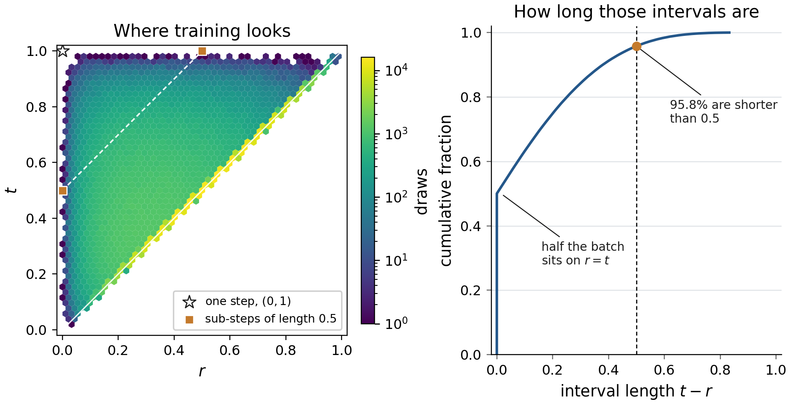

# After the schedule, the corrector's gain falls from 15% to 7.3%

**The four checks on the note of 18 November**

Zhenyu Yang · 20 November 2026

The 15% in that note does not survive a better-trained stage 1. On the same 40 cells and the same 32,000 updates per cell, a warm-up and a cosine cut the corrector's reduction to **7.3%**. Stage 1 alone reaches 0.09874, which is already below 0.10429, where the old corrector stopped. The schedule removes 0.0240. The second network, on the old map, removed 0.0185. The schedule costs nothing when the map is used.

| check | what was asked | result |
|---|---|---|
| budget | is the 15% the coupling, or a second network? | OT updates on the same network recover about a fifth. The rest is the second network. |
| sub-steps | are the half-intervals rarely trained? | 4.2% of draws are that long. Training them more, once, made one step worse: 0.12277 to 0.13980. |
| \(\alpha\), and the summaries | does \(\alpha=2\) still help on the other seeds, on more than six cells? | On seeds 89 and 90 it lowers the error by 20.6% and 7.8%. The three summaries fall on all 143 cells. |
| three seeds, one corrector | does one corrector transfer? | The mean reduction is 6.3%, against 14.4% for a corrector fitted to each seed. |

---

## 1. Learning rate

You asked to re-run the headline and the four-row table with the scheduled stage 1. If the corrector's gain shrank on that map, that would be the result that matters. It did.

The learning rate rises linearly over the first 2% of updates to \(10^{-3}\), then follows a cosine to \(10^{-5}\). The corrector was trained again on the new stage 1, at \(\alpha=1\) and 2,000 updates per cell.

*Figure 1. Histogram \(W_2\) on the 143 held-out cells, seed 88. Left: stage 1, and the same map after its corrector. Right: the corrector's reduction.*

| | stage 1 | stage 1 + corrector | reduction | cells lower |
|---|---:|---:|---:|---:|
| fixed \(10^{-3}\) | 0.12277 | 0.10429 | 15.0% | 141 / 143 |
| warm-up, then cosine | 0.09874 | 0.09153 | 7.3% | 128 / 143 |

On the 112 cells held out by the headline design and by all three width-112 designs:

| row | what is scored | passes | \(W_2\) | against (a) |
|---|---|---:|---:|---:|
| (a) | scheduled stage 1, one step, seed 88 | 1 | 0.09859 | — |
| (b) | (a), then its corrector | 1 + corrector | 0.09150 | −7.2%, 99 of 112 |
| (c) | width 112, seeds 88 / 89 / 90 | 1 | 0.10287 / 0.10062 / 0.10297 | each above (a) |
| (c) | mean of those three | 1 | 0.10215 ± 0.00133 | +3.6% |
| (d) | the weights of (a), two sub-steps | 2 | 0.08358 | −15.2% |

Two sub-steps are the lowest row, at twice the cost of one pass. The corrector costs 2.97 times one pass and removes less. On the fixed-rate map the same split had raised the error by 1.3%, on that note's 112 cells. A wider network does not stand in for the corrector: all three seeds of row (c) finish above row (a).

## 2. Training budget

You asked whether the 15% is a second network, or the OT coupling spent as extra updates on stage 1. If the second control recovered most of the gain, the contribution would be the coupling.

It recovers about a fifth. Both controls add 80,000 updates to the fixed-rate stage 1, 2,000 per training cell, and neither adds a second network.

| what receives the updates | \(W_2\) | against 0.12277 |
|---|---:|---:|
| stage 1, as it stood | 0.12277 | — |
| further MeanFlow updates at \(10^{-3}\) | 0.12465 | +1.5% |
| the same count, on the minibatch OT targets | 0.11911 | −3.0% |
| a second network, the paired corrector | 0.10429 | −15.0% |

The OT fine-tune removes 0.00366. The corrector removes 0.01848. The ratio is 19.8%. Further MeanFlow updates at the same learning rate do not help.

The average cancels opposite changes in \(\mu\). A minus sign below is a lower error.

| \(\mu\) | \(n\) | extra MeanFlow | same network, OT | corrector | share recovered by OT |
|---|---:|---:|---:|---:|---:|
| 0.10 | 15 | −10.6% | +6.2% | −19.1% | the wrong way |
| 0.63 | 16 | −15.0% | −8.5% | −16.9% | 50% |
| 2.51 | 17 | +5.0% | −10.4% | −13.9% | 74% |
| 3.98 | 17 | +14.3% | −11.3% | −14.4% | 79% |
| 10 | 15 | +20.6% | +8.2% | −11.6% | the wrong way |

At \(\mu=2.51\) and \(3.98\) the fine-tune does recover most of the corrector's drop. At \(\mu=10\) it raises the error, and the corrector still lowers it. Taken over the 143 cells, the 15% is the second network.

## 3. Sub-steps

You asked where \((r,t)\) is sampled, and how far one evaluation on \([0,1]\) is from the composition of \([1,0.5]\) and \([0.5,0]\). If those half-intervals are rarely drawn, a worse two-step result is what the training measure would lead one to expect, and it would say little about having two parameters.

They are rarely drawn. Two sigmoid samples of \(\mathcal N(-0.4,1)\) are ordered so that \(t\) is the larger. Half the batch is set to \(r=t\). In one million draws, 50.0% lie on the diagonal and 4.2% have length at least 0.5. The one-parameter and two-parameter models use this sampler unchanged. The step length 0.5 was not chosen by a search.

*Figure 2. One million draws. Left: density of \((r,t)\). The dashed line has length 0.5. The star is one step, \((0,1)\); the squares are the two sub-steps. Right: the cumulative share of interval length.*

On the fixed-rate two-parameter map the two clouds differ. Their histogram \(W_2\), over 143 held-out cells, is 0.0814. Particles that share a source end 0.0303 apart. Against the reference, two steps raise the error from 0.12277 to 0.12418. The same split on the one-parameter runs lowers the error at 18 of 20 values of \(\sigma\), by about 2% to 9%, and raises it at \(\sigma=10\) and \(\sigma=20\). The sampler is the same, so the sign is not a difference in how time was drawn.

I then changed only that draw, on seed 88, at the fixed learning rate, with the same 40 cells and the same 32,000 updates per cell. Each batch is 40% the original sampler, 20% on the diagonal, 20% on \((0,1)\), 10% on \((0,0.5)\) and 10% on \((0.5,1)\). Intervals of length at least 0.5 rise from 4.2% to 43.4%. The corrector was trained afterwards with the original protocol.

| | original sampler | half-intervals upweighted |
|---|---:|---:|
| one step | 0.12277 | 0.13980 |
| two steps | 0.12418 | 0.12327 |
| one step, then the corrector | 0.10429 | 0.11465 |

One step is higher by 13.9%. Two steps sit 0.7% below the old two-step value, and 11.8% below this new one-step value. The corrected value is higher than 0.10429. Giving the half-intervals more weight made the map worse.

One run takes about three hours. I did not repeat the seed, and I did not search the mixture. MeanFlow reports that the share of training pairs with \(r\neq t\) changes one-step FID on ImageNet: 0% gives 328.91, 25% gives 61.06, 50% gives 63.14, and 100% gives 67.32. Both of our models use 50%. That table is one-step image generation. It shows that the sampling rule moves the result. A search over the mixture, and a second seed, can be run if you want them.

With the original sampler left as it was, two steps on the scheduled map are the lowest row in Section 1, 15.2% below one step. 

## 4. \(\alpha=2\) on the other seeds

You asked for the test gain at the \(\alpha\) chosen on seed 88, for the seed-89 and seed-90 pairs, and for the physical summaries on more than six cells. \(\alpha=2\) was not chosen again.

| seed | cells | \(\alpha=0\) | \(\alpha=1\) | \(\alpha=2\) | \(\alpha=2\) against \(\alpha=0\) |
|---|---:|---:|---:|---:|---:|
| 88, where it was chosen | 93 | 0.12353 | 0.10477 | 0.09558 | −22.6% |
| 89 | 93 | 0.12967 | 0.10619 | 0.10301 | −20.6% |
| 90 | 93 | 0.11294 | 0.10180 | 0.10417 | −7.8% |

On seed 89, \(\alpha=1\) is already 0.10619. On seed 90, \(\alpha=1\) is lower than \(\alpha=2\). The value selected on seed 88 remains a reduction against no corrector on both seeds.

The summaries below are mean absolute relative error on all 143 held-out cells of the fixed-rate pair.

| summary | stage 1 | stage 1 + corrector |
|---|---:|---:|
| centroid, \(x\) | 0.0275 | 0.0186 |
| rms radius | 0.00756 | 0.00590 |
| anisotropy | 0.0115 | 0.00735 |

## 5. One corrector for three seeds

You asked to put this ahead of the gated corrector. One corrector, \(\alpha=1\), is trained on the residuals of seeds 88, 89 and 90. Each seed keeps its own 40 cells and is scored on its own 143 held-out cells. The stage-1 maps are the fixed-rate checkpoints. The budget is 2,000 updates per cell per seed.

| seed | stage 1 | shared | fitted to that seed | shared / fitted | cells lower |
|---|---:|---:|---:|---:|---:|
| 88 | 0.12277 | 0.12058 | 0.10429 | 1.8% / 15.0% | 74 / 143 |
| 89 | 0.12975 | 0.11527 | 0.10607 | 11.2% / 18.2% | 143 / 143 |
| 90 | 0.11203 | 0.10551 | 0.10082 | 5.8% / 10.0% | 110 / 143 |

The mean of the three shared reductions is 6.3%, against 14.4% when each seed has its own corrector. The shared corrector is lower on 327 of 429 comparisons. The fitted correctors are lower on 415 of 429. The seed-88 corrector, applied unchanged to seeds 89 and 90, had changed those errors by −1.4% and −3.2%. The shared corrector does not do that. On seed 88 it keeps 1.8% of a 15.0% reduction.

The paired correctors for seeds 89 and 90 were not retrained under the schedule. The map was not iterated. Conditioning on \(t\), for a longer horizon, is a different project.
