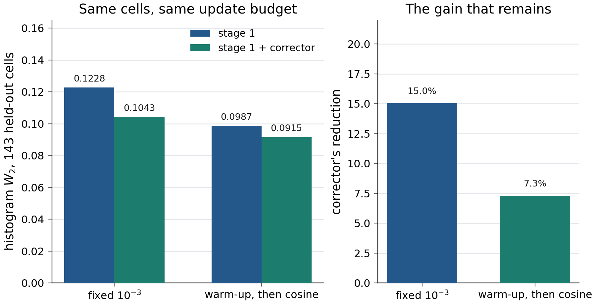

# 调度之后的修正器

**11 月 18 日笔记的后续**

杨振宇 · 2026 年 11 月 20 日

英文原文见 [`REPORT_TO_HARRY.md`](REPORT_TO_HARRY.md)。两份的数字、图号和结论一致。

热身再接余弦，格子还是那 40 个，每格还是 32,000 次更新，把修正器的降幅从 15.0% 收到 **7.3%**。调度后的第一步在 143 个留出格上到 0.09874。这已经比 0.10429 低 5.3%，而 0.10429 是旧修正器停下的地方。调度拿走的误差是 0.0240，第二张网络拿走的是 0.0185，而且调度在使用时不增加计算。修正器加在调度后的映射上仍然有用，从 0.09874 到 0.09153，143 格里 128 格更低。

下面四项核对说明旧的 15% 从哪里来。本笔记里的 \(W_2\) 都是 16 箱直方图。

---

## 1. 少掉的那一半在学习率上

修正器的收益变小，是因为第一步离参考更近，它只能拿走剩下的那一部分。学习率在前 2% 的更新里线性升到 \(10^{-3}\)，再按余弦降到 \(10^{-5}\)。修正器是在这张新的第一步上重新训练的：\(\alpha=1\)，每格 2,000 次更新。不是把旧修正器套到新映射上。

*图 1. 种子 88、143 个留出格上的直方图 \(W_2\)。左：第一步，以及接上它自己的修正器。右：修正器的降幅。*

主设计和三个宽度 112 的设计都留出的 112 个格子上，同一套调度给出四行。

| 行 | 求值内容 | 前向 | \(W_2\) | 相对 (a) |
|---|---|---:|---:|---:|
| (a) | 调度后的第一步，一步，种子 88 | 1 | 0.09859 | — |
| (b) | (a) 再接它的修正器 | 1 + 修正器 | 0.09150 | −7.2%，112 格里 99 格 |
| (c) | 宽度 112，同一套调度，种子 88 / 89 / 90 | 1 | 0.10287 / 0.10062 / 0.10297 | 都高于 (a) |
| (c) | 这三个种子的均值 | 1 | 0.10215 ± 0.00133 | +3.6% |
| (d) | (a) 的同一组权重，分成两段 | 2 | 0.08358 | −15.2% |

两段求值是最低的一行，代价是一次前向的 2.0 倍。修正器是 2.97 倍，拿走的更少。固定学习率的映射上，同一种切分曾经把误差抬高 1.3%，那是上一份笔记自己的 112 格。宽度代替不了这两行：三个宽网络的种子都高于窄网络的一步。上一份笔记里的 15% 是修正器面对固定学习率时的降幅。面对调度后的第一步，降幅是 7.3%。

## 2. 多出来的更新大约收回五分之一

把修正器多出来的 80,000 次更新花在同一张网络上，复现不了它的下降。这两项对照做在固定学习率的网络上，因为要解释的是那张网络上的 15%。

| 这 80,000 次更新花在哪里 | \(W_2\) | 相对第一步（0.12277） |
|---|---:|---:|
| 第一步，不加更新 | 0.12277 | — |
| 在 \(10^{-3}\) 上继续做 MeanFlow 更新 | 0.12465 | +1.5% |
| 同样的次数，对准小批量 OT 目标 | 0.11911 | −3.0% |
| 第二张网络，配对的修正器 | 0.10429 | −15.0% |

传输目标收回了修正器那段下降 0.01848 里面的 0.00366，即 19.8%。不是大部分。那 15% 在第二张网络上。这个平均把 \(\mu\) 上相反的变化抵消掉了。

| \(\mu\) | 格数 | 再做 MeanFlow | 同一张网络，OT | 修正器 | OT 收回的比例 |
|---|---:|---:|---:|---:|---:|
| 0.10 | 15 | −10.6% | +6.2% | −19.1% | 方向反了 |
| 0.63 | 16 | −15.0% | −8.5% | −16.9% | 50% |
| 2.51 | 17 | +5.0% | −10.4% | −13.9% | 74% |
| 3.98 | 17 | +14.3% | −11.3% | −14.4% | 79% |
| 10 | 15 | +20.6% | +8.2% | −11.6% | 方向反了 |

负号表示误差更低。\(\mu=2.51\) 和 \(3.98\) 上，OT 微调收回了修正器下降的大部分。\(\mu=10\) 上它把误差抬高，修正器仍然在降。调度后的网络上，修正器剩下的降幅是 7.3%，同一组权重走两遍，比修正器更低。

## 3. 长度为 0.5 的区间很少被抽到，把它们加重之后映射变差了

两步求值先走 \([1,0.5]\)，再走 \([0.5,0]\)。单参数模型和双参数模型用的是同一个抽样器：从均值 \(-0.4\)、标准差 \(1\) 的正态里抽两个数，过 sigmoid，大的作为 \(t\)，小的作为 \(r\)，每一批再把一半改成 \(r=t\)。一百万次抽取里，50.0% 落在 \(r=t\) 上，95.8% 短于 0.5，所以只有 4.2% 至少有一个子步那么长。这个步长不是搜出来的。

*图 2. 训练抽样器的一百万次抽取。左：\((r,t)\) 的密度。虚线长度是 0.5。星号是一步 \((0,1)\)，方块是两个子步。右：区间长度的累积比例。*

固定学习率的双参数映射上，一步和两步得不到同一朵云。143 个留出格上，两朵云之间的直方图 \(W_2\) 是 0.0814；来自同一颗源粒子的点，平均分开 0.0303。相对参考云，两步把误差从 0.12277 抬到 0.12418。同一种切分用在单参数 KS3D 上，20 个 \(\sigma\) 里有 18 个误差下降，大约低 2% 到 9%；\(\sigma=10\) 和 \(\sigma=20\) 上升。两个模型的抽样器是同一套。

我把固定学习率上的升高看成这些半区间在训练里太少。种子 88 重训了一次来试这一点。学习率仍是 \(10^{-3}\)，40 格不变，每格仍是 32,000 次更新。只改了 \((r,t)\) 怎么抽。每一批是 40% 原来的抽样器、20% 对角线、20% 整段 \((0,1)\)、10% \((0,0.5)\)、10% \((0.5,1)\)。长度至少为 0.5 的区间从 4.2% 变成 43.4%。然后按原协议训修正器。只有一个种子。

| | 原来的抽样器 | 加重半区间 |
|---|---:|---:|
| 一步 | 0.12277 | 0.13980 |
| 两步 | 0.12418 | 0.12327 |
| 一步再接修正器 | 0.10429 | 0.11465 |

一步高了 13.9%。两步比旧的两步数字低 0.7%，比新的一步低 11.8%。校正后的值高于 0.10429。把 \([0,0.5]\) 和 \([0.5,1]\) 的权重加大，映射变差了。它没有去掉「一步已经较好」和「再切成两段」之间的差距。

这样一次大约三个小时，所以没有再跑一个种子，也没有去扫这个混合比例。MeanFlow 报告，训练样本里 \(r\neq t\) 的比例会改变 ImageNet 上一步生成的 FID：0% 是 328.91，25% 是 61.06，50% 是 63.14，100% 是 67.32。我们的两个模型都用 50%。那张比较是图像上的一步生成。它说明抽样规则会搬动结果。混合比例的搜索，以及第二个种子，如果需要可以再跑。

调度后的映射没有改抽样器。第 1 节里两步是最低的一行，比一步低 15.2%。固定学习率上的升高，和这次下降，学习率不是同一套。抽样器是同一套。

## 4. \(\alpha=2\) 在另两个种子上符号还在

\(\alpha=2\) 是在种子 88 的开发集上选定的，没有重选。种子 89 和 90 各自 93 个测试格上，它仍然低于 \(\alpha=0\)。

| 种子 | \(\alpha=0\) | \(\alpha=1\) | \(\alpha=2\) | \(\alpha=2\) 相对 \(\alpha=0\) |
|---|---:|---:|---:|---:|
| 88，在这里选中 | 0.12353 | 0.10477 | 0.09558 | −22.6% |
| 89 | 0.12967 | 0.10619 | 0.10301 | −20.6% |
| 90 | 0.11294 | 0.10180 | 0.10417 | −7.8% |

种子 89 上，下降的大部分在 \(\alpha=1\) 时已经出现。种子 90 上，\(\alpha=1\) 比 \(\alpha=2\) 更低。选定的值相对不用修正器是下降。它不是每个种子上两个正值里更低的那个。

物理量现在用固定学习率那一对的全部 143 个留出格，不是六个。这里的度量是平均绝对相对误差。

| 量 | 第一步 | 第一步 + 修正器 |
|---|---:|---:|
| 质心，\(x\) | 0.0275 | 0.0186 |
| 均方半径 | 0.00756 | 0.00590 |
| 各向异性 | 0.0115 | 0.00735 |

质心动得最多。残差是朝参考云训练的，应当如此。

## 5. 三个种子共用一个修正器

这是你让排在门控修正器前面的那一项。一个修正器，\(\alpha=1\)，在种子 88、89、90 的第一步残差上训练。每个种子保留自己的 40 格。预算是每格每种子 2,000 次更新。第一步是固定学习率的 checkpoint。每个种子在自己的 143 个留出格上计分。

| 种子 | 第一步 | 共用修正器 | 只拟合该种子 | 共用 / 单独 | 更低的格子 |
|---|---:|---:|---:|---:|---:|
| 88 | 0.12277 | 0.12058 | 0.10429 | 1.8% / 15.0% | 74 / 143 |
| 89 | 0.12975 | 0.11527 | 0.10607 | 11.2% / 18.2% | 143 / 143 |
| 90 | 0.11203 | 0.10551 | 0.10082 | 5.8% / 10.0% | 110 / 143 |

三次共用下降的平均是 6.3%，三个各自拟合的是 14.4%。共用修正器在 429 次比较里 327 次更低，各自拟合的是 415 次。把种子 88 的修正器原样用到种子 89 和 90 上，误差变化是 −1.4% 和 −3.2%。共用修正器没有重复那个结果。它的做法是放弃种子 88 上的大部分收益，而单独拟合的修正器在那张映射上曾经降 15.0%。

## 四项核对之后

在训练盒子内部、在它拟合的那张映射上、第一步按这套调度训练之后，修正器把一步直方图 \(W_2\) 降低 7.3%，代价是一次前向的 2.97 倍。同一张调度后的网络再走一遍，用 2.0 倍代价降低 15.2%。十一月报告的 15%，是修正器面对固定学习率时的降幅。调度在使用时不花钱，占了那份降幅里更大的一块。

换一个种子，收益仍然停住。三个种子共用的一个修正器，改善了被迁移修正器弄差的那两个种子，在它拟合得最好的那个种子上几乎留不下收益。种子 89 和 90 的配对修正器没有在调度下重训，所以第 5 节是固定学习率的映射。映射没有再迭代。它仍是固定时间跨度上的一张映射。
