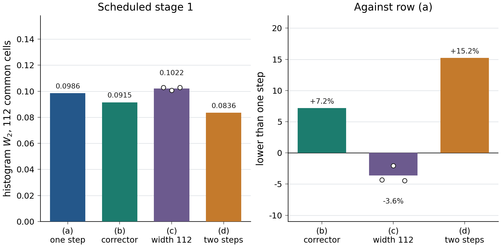
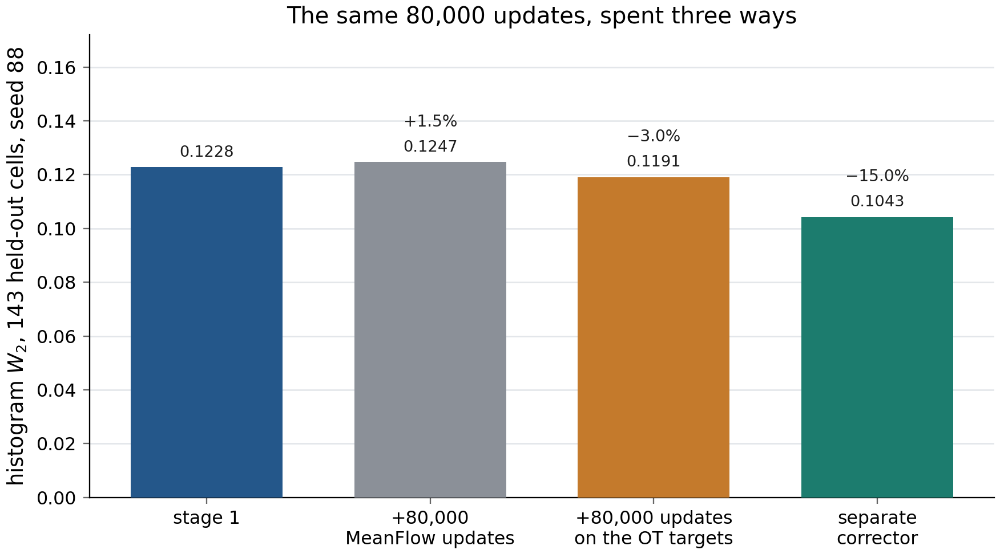
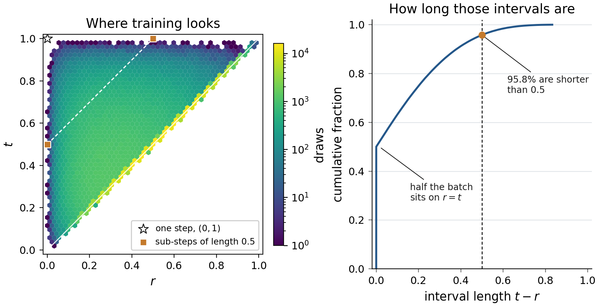
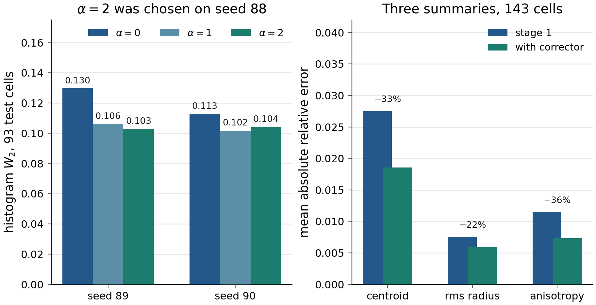
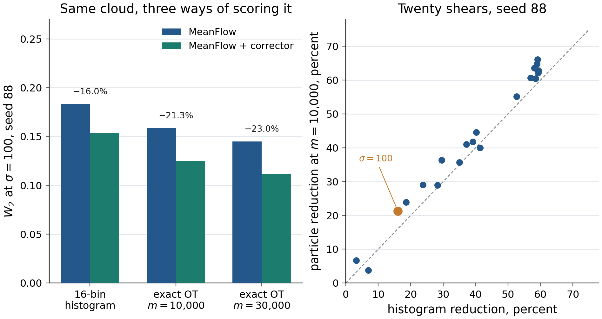
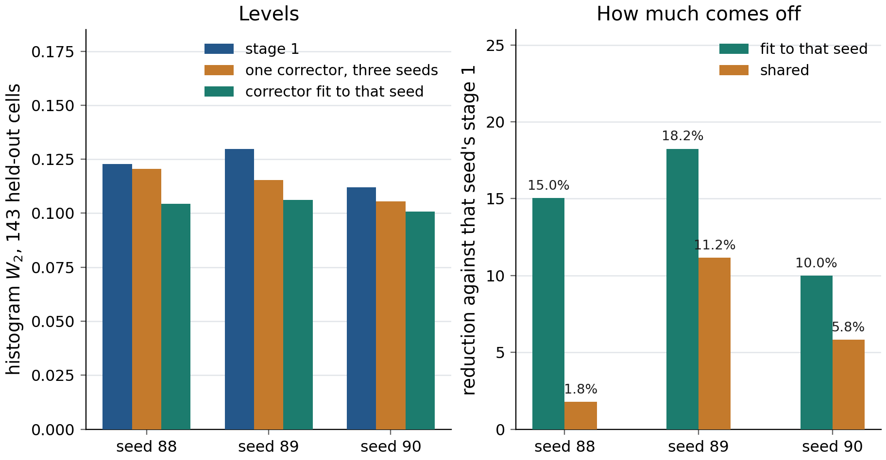

# 换过学习率之后，修正器还剩下多少

**对 11 月 18 日来信里四个问题的回答**

杨振宇 · 2026 年 11 月 20 日

英文原文见 [`REPORT_TO_HARRY.md`](REPORT_TO_HARRY.md)。两份文字的数字、图号与结论一一对应。

头条数字现在是 7.3%，不再是 15.0%。变的是你问的第一件事：第一步换成热身加余弦、格子还是那 40 个、更新预算也一样之后，修正器的降幅大约减半。调度后的第一步还落在旧修正器停下的位置之前，也就是说，一项在推理时不花钱的改动，买到的比第二张网络买到的还略多一点。

这个结果定了后面几节的调子。多出来的更新不是解释，传输目标只占其中大约五分之一。子步在抽样器很少去的地方求值。选定的 \(\alpha\) 在另外两个种子上符号不变，幅度缩了。一个在三个种子上训练过的修正器，修好了种子 88 的修正器曾经弄差的那两个，代价是在种子 88 上让出大部分收益。下面的百分比都是先前那个 16 箱直方图距离，所以能和上一份笔记直接比。第 4 节末尾写了这个度量盖住了什么，你问过是不是箱子在起作用。

| 你的问题 | 我做了什么 | 回来的是什么 |
|---|---|---|
| 1. 用调度后的第一阶段重跑 | 同 40 格、同预算重训第一步，热身加余弦；重记主结果和四行表 | 修正器降幅 15.0% → **7.3%**；调度后的第一步单独就比旧的校正值低 5.3% |
| 2. 把第二张网络和 OT 目标分开 | 网络不动，同样 80,000 次更新，先做 MeanFlow 再对准传输目标 | 先高 1.5%，再低 3.0%；约占降幅五分之一，其余需要另一张映射 |
| 3. 量清楚子步为什么变差 | 记下抽到的 \((r,t)\)，并在 143 格上比较一次求值与两次 | 只有 4.2% 的抽取那么长；两种做法相差 0.0814，调度后子步反而最好 |
| 4. 另外种子上的 \(\alpha\)，以及度量 | 种子 89、90 上记 \(\alpha=0,1,2\)；\(m=10^4\) 与 \(3\times10^4\) 的精确配对 | −20.6% 与 −7.8%；一个格子上 16.0% 变 23.0%，其中约五点在一万粒子时已有 |
| 你放在前面的那一次 | 一个修正器，三个种子，各自保留 40 格 | 三个都改善，平均 6.3%；种子 88 从 15.0% 落到 1.8% |

---

## 1. 学习率把一大半收益吃掉了

你要的是用调度之后的第一个阶段重做头条数字和四行表。格子还是那 40 个，预算还是每格 32,000 次更新。改的只有学习率：前 2% 的更新线性升到 \(10^{-3}\)，然后按余弦降到 \(10^{-5}\)。修正器没动，\(\alpha=1\)，每格 2,000 次更新。

*图 1. 种子 88、143 个留出格上的直方图 \(W_2\)。左：第一步，以及接上它自己的修正器，一次是固定学习率，一次是热身。右：修正器自己的降幅。纵轴从 0 起。*

两个数字要紧。调度后的第一步到 **0.09874**，比固定学习率的第一步低 19.6%，更关键的是比 **0.10429** 低 5.3%，那是旧修正器停下的地方。也就是说，这套调度在推理时不花任何代价，买到的降幅比第二张网络买到的还略大一点：0.0240 对 0.0185。修正器加在它上面仍然有用，把 0.09874 带到 **0.09153**，143 格里 128 格更低，但降幅是 **7.3%**，不再是 15.0%。

四行表记在主设计和三个宽度 112 设计都留出的 112 个格子上：

| 行 | 求值内容 | \(W_2\) | 相对 (a) |
|---|---|---:|---:|
| (a) | 调度后的第一步，一步求值，种子 88 | 0.09859 | — |
| (b) | (a) 再加它的修正器 | 0.09150 | −7.2%，112 格里 99 格 |
| (c) | 宽度 112，同一套调度，种子 88/89/90 | 0.10215 ± 0.00133 | +3.6% |
| (d) | (a) 的同一组权重，分成两段 | 0.08358 | −15.2% |

*图 2. 112 个共同留出格。左：四行。(c) 上的空心点是三个宽度 112 的种子。右：相对一步的变化。负的柱表示误差更高。*

(d) 这一行是我没想到的。在固定学习率那张映射上，两段求值让误差升高 1.3%，我当时把它写成一条限制。换到调度后的映射上，同样的两段是表里最好的一行，代价 2.0×，而修正器是 2.97×。如果问题是第二次前向该花在哪里，在这张映射上，把第一步再走一遍比加修正器买得多。(c) 也在调度下重复了先前的结论：更宽的单张网络不如窄的，所以修正器的收益仍然不是容量带来的。

现在我愿意把 7.3% 当头条，把 15.0% 标注成"修正器面对一个用固定学习率训练出来的第一步时"的降幅。这两个数字的差，就是这个人为误差的大小。

## 2. 多出来的更新不是解释，但目标函数占了一部分

多出来的更新不是解释。把同样这 80,000 次更新花在同一张网络上、对准修正器所用的那些传输目标，只收回大约五分之一。剩下的部分，需要修正是另一张映射才行。

旧表的 (c) 行只对齐了参数量和单次前向的 FLOPs，而两阶段模型还多拿了每格 2,000 次更新和 8,000 次精确 OT 求解。你提的两个对照，网络不动，把这些更新照花掉。两个都做在固定学习率的第一步上，因为那个 15% 出自这张映射。

| 同样的 80,000 次更新花在哪里 | \(W_2\) | 相对第一步 |
|---|---:|---:|
| 不再更新 | 0.12277 | — |
| 继续做 MeanFlow 更新 | 0.12465 | +1.5%，更差 |
| 对准小批量 OT 的目标 | 0.11911 | −3.0% |
| 单独的修正器 | 0.10429 | −15.0% |

*图 3. 种子 88，固定学习率，143 个留出格。百分数相对第一步。正号表示误差更高。纵轴从 0 起。*

在 \(10^{-3}\) 上继续做 MeanFlow 更新会略微变差，这和一张已经走平的映射是相符的。同样的次数对准传输目标，收回 15.0% 里的 3.0%，大约五分之一。你先前的判断是，如果对照 (ii) 能收回大部分，功劳就在耦合上而不是第二阶段上。它没有收回大部分。大约五分之四的下降，需要修正是另一张映射才行——从恒等出发，并且因为离开所修正的那团粒子而受罚。耦合有贡献，是较小的那一份。

这两份对照我没有在余弦调度下重做。那张映射上修正器剩下的降幅是 7.3%，而 (d) 行已经显示，同一组权重走两遍比修正器降得更多，所以那里值得比较的东西，已经从"修正器为什么有用"变成了"第二遍为什么更有用"。

## 3. 子步在模型几乎没被训练过的地方求值

抽样器就是训练时用的那个，为了这个测试没有改动：从均值 \(-0.4\)、方差为 1 的正态里抽两个数，过 sigmoid，大的做 \(t\)，小的做 \(r\)，然后把每个批量的一半改成 \(r=t\)。

*图 4. 从训练抽样器抽一百万次。左：\((r,t)\) 的密度。虚线是长度 0.5，星号是一步，方块是两个子步。右：区间长度的累积比例。一半的抽取落在 \(r=t\) 上。*

一百万次里，50.0% 正好落在对角线上，95.8% 的区间短于 0.5，于是和每个子步一样长的抽取只占 4.2%。一步求值的 \((0,1)\) 也落在密度很低的一角，但它至少是网络见过端点的一个区间。子步连这一点也没有。

一致性诊断用的是固定学习率那张映射的全部 143 个留出格。一步是从 1 到 0 求值一次。两步是先 \([1,0.5]\)、再 \([0.5,0]\)，各自乘以自己的长度。两团输出之间的平均直方图 \(W_2\) 是 **0.0814**，从同一个源粒子出发，两种做法最后平均相距 **0.0303**。这两个数比较的是两种做法彼此，不是和参考云比。

这个分歧很大，而且是在"子步让误差相对参考升高"的那张映射上量出来的。所以先前那次退化，正好落在你预判的位置：复合求值发生在抽样器很少去的地方，它的符号不是参数化族本身的性质。调度后的映射让这一点更清楚：在那里，同样的两个子步把误差降下来，并且是第 1 节里最好的一行。两张映射上的分歧我都能量；符号为什么会翻，我还说不清，在弄清之前，我不会把子步的表现当成一参数化一步映射的普遍性质。

## 4. \(\alpha\) 离开它被选中的种子，以及箱子盖住了什么

\(\alpha=2\) 是在种子 88 的开发划分上选定的，我没有重选。把同样三个值放到每个种子自己的 93 个测试格上：

| 种子 | \(\alpha=0\) | \(\alpha=1\) | \(\alpha=2\) | \(\alpha=2\) 相对 \(\alpha=0\) |
|---|---:|---:|---:|---:|
| 88（在这里选中） | 0.12353 | 0.10477 | 0.09558 | −22.6% |
| 89 | 0.12967 | 0.10619 | 0.10301 | −20.6% |
| 90 | 0.11294 | 0.10180 | 0.10417 | −7.8% |

选定的这个值在两个留出种子上仍然低于第一步，所以符号不是种子 88 的偶然。大小上是。种子 89 上大部分下降在 \(\alpha=1\) 时已经出现，种子 90 上 \(\alpha=1\) 反而更好。我会把 \(\alpha=2\) 说成"在一个种子上选定、在别的种子上略微乐观"，而不是一个可以迁移的设置。

物理量用的是固定学习率那一对的 143 个留出格，不是六个格子：

| 量 | 第一步 | 接上修正器 | 变化 |
|---|---:|---:|---:|
| 质心，\(x\) | 0.0275 | 0.0186 | −33% |
| 均方根半径 | 0.00756 | 0.00590 | −22% |
| 各向异性 | 0.0115 | 0.00735 | −36% |

三个量同向，质心改善最多，这正是"把粒子往参考搬"的残差修正该有的样子。

*图 5. 左：种子 89 和 90 各自 93 个测试格上的平均直方图 \(W_2\)。\(\alpha=2\) 只在种子 88 上选过，没有重选。右：固定学习率那一对的 143 个留出格上，三个量的平均绝对相对误差。*

关于度量本身，我有三条证据，方向一致。同一对固定学习率结果上，沿 64 个方向、143 个格子全部计入的切片 \(W_2\)，从 0.02226 降到 0.01545，降幅 **30.6%**，而直方图是 15.0%。切片 \(W_2\) 是另一种估计量，只有相对降幅可比。

原来维度上的精确粒子级配对，我在更早那次单参数实验里有一个 \(m=30{,}000\) 的格子，\(\sigma=100\)、种子 88，两种方法用同一批 30,000 个粒子。

| 同一个格子的算法 | MeanFlow | 接上修正 | 降幅 |
|---|---:|---:|---:|
| 16 箱直方图 | 0.18311 | 0.15374 | 16.0% |
| 精确 OT，\(m=10{,}000\) | 0.15849 | 0.12470 | 21.3% |
| 精确 OT，\(m=30{,}000\) | 0.14503 | 0.11164 | 23.0% |

*图 6. 左：更早的单参数云里 \(\sigma=100\)、种子 88 的一个格子。MeanFlow 和接上修正，分别用 16 箱直方图和两个子样本量的精确配对记分。右：二十个剪切，\(m=10{,}000\)。虚线以上的点，粒子上的降幅更大。标出的是 \(\sigma=100\)。*

离开箱子把降幅从 16.0% 抬到 23.0%，其中大部分在一万个粒子时已经在了。从一万到三万只再加 1.7 个点。所以这里箱子大约盖住七个点，子样本量不是瓶颈。

那个格子是单参数的云配单参数的修正器，不是上面那些表的重新记分，我一直小心没把它当那样的用途。它给我的是另一种东西：一个有确定大小的增益，在直方图上会被读低多少。二十个剪切、\(m=10{,}000\) 上，平均从直方图的 39.1% 到粒子的 42.5%，20 个里有 18 个同向。穿过它们的直线斜率 1.03、截距 2.1，残差散布 2.5 个点。按调度后的降幅 7.3% 去读，它给出 **9.6%**，对剪切做自助抽样得到的 90% 区间是 **7.1 到 11.9**。

这个数字的地位我想说清楚。它是从另一套参数化投影过来的，中间隔着二十个剪切的面板，调度那一对我并没有在粒子级上量。如果改成按 \(\sigma=100\) 上的比例放大，23.0 比 16.0，大约得到 10%；如果直接把七个点加上去，大约 14%。三条路给出同一个范围，而诚实的说法是：调度后的增益比 7.3% 大几个点，大多少还没定住。

## 5. 三个种子共用一个修正器

这是你放在前面那一个。一个修正器，\(\alpha=1\)，同时在三个第一步的残差上训练，每个种子保留自己的 40 格，每格每种子 2,000 次更新。三张映射都是固定学习率的 checkpoint，第 1 节里调度后那张没有作为输入。

| 种子 | 第一步 | 共用修正器 | 只拟合该种子 | 降幅，共用 / 单独 |
|---|---:|---:|---:|---:|
| 88 | 0.12277 | 0.12058 | 0.10429 | 1.8% / 15.0% |
| 89 | 0.12975 | 0.11527 | 0.10607 | 11.2% / 18.2% |
| 90 | 0.11203 | 0.10551 | 0.10082 | 5.8% / 10.0% |

*图 7. 固定学习率。左：每个种子自己的 143 个留出格上的直方图 \(W_2\)。右：相对该种子自己的第一步的降幅。*

共用修正器把三个都降下来了，429 次格子比较里 327 次更低，平均降幅 6.3%，三个各自拟合的是 14.4%。你称为最尖锐的那个失败，在最要紧的方向上被修好了：种子 88 的修正器原样套到种子 89 和 90 上，把误差弄差 −1.4% 和 −3.2%；共用的一个把两个都改善，种子 89 的 143 格全部更低。

代价付在种子 88：降幅从 15.0% 塌到 1.8%。我的理解是，修正器学的是它拟合的那张映射的残差；让它同时服务三张映射，它只能抓住三者共有的那一部分。共有部分在训练最差那张映射上最大，种子 89，在最好那张上最小，种子 88。这类负结果恰恰决定下一个设计问题，所以我愿意把它摆在这里，而不是平均掉。

## 现在我会怎么说

在训练盒子内部、在它拟合的那张映射上、并且第一步按应有的方式训练之后，修正器把一步直方图 \(W_2\) 降低 **7.3%**，推理 FLOPs 是 2.97 倍。同样这些格子上，让同一张第一步网络再走一遍，用 2.0 倍代价降低 15.2%。旧的 15.0% 是对着一个固定学习率训练出来的第一步量的，而那套调度本身，已经收回了比修正器加进去更多的量。

收益离开盒子就不成立，换一个种子也不成立，这一点和上一份笔记相同。一个在三个种子上训练过的修正器把三个都改善了，代价是在它原本收益最大的那个种子上几乎全部失去。直方图把增益读低了几个点；在唯一解过三万粒子精确配对的那个格子上，16.0% 变成 23.0%，其中大约五个点在一万粒子时就已存在。

有两件事我没有做。种子 89 和 90 的配对修正器没有在调度下重训，所以第 5 节的三种子结果是在固定学习率的映射上。映射也没有再迭代：上一份笔记的 6.2 节已经说明它是固定时间跨度上的映射，不是时间步进器，让修正器依赖于 \(t\) 是另一个项目。预算对照、切片距离、物理量和一致性诊断，同样都在固定学习率的映射上。如果调度后的数字要成为头条，这四项应该在调度后的映射上重做一遍，其中我会先做粒子级的重新记分。
