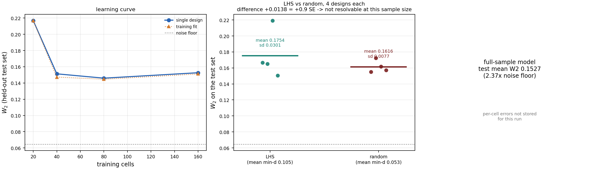

# 样本效率：三个对照实验

> 回答一个问题：**用 40 个 LHS 格点训练的模型，能追平用全部数据训练的模型吗？**
>
> 结论：**能——40–80 格就饱和了，数据量不是瓶颈。但"为什么行"不是 LHS 的功劳：4 次重复显示 LHS 与随机抽样在测试误差上不可分辨（0.89 SE），且 LHS 方差大 3.9 倍。**

---

## 0. 实验设计

所有实验共享一个**冻结测试集**，这是可比性的前提。

```
200 格 = 40 格测试集 T（never trained on） + 160 格训练池 P
```

| 项 | 设置 |
|---|---|
| 测试集 T | 40 格，独立种子 `999999`，LHS 选出（20 σ 各 2、10 μ 各 4）|
| 训练池 P | 160 格（200 − 40）|
| 每次训练 | 每格 2000 更新 |
| 网络 / 优化器 | 7 输入 MeanFlow，Adam lr=1e-3，batch 4096 |
| 度量 | 16 箱精确直方图 W2，噪声基底 0.0644 |
| 重叠检查 | 代码强制断言训练集与 T 无交集，否则报错 |

**为什么必须这样设计**：若"全量模型"训练全部 200 格，就没有格子可测了。冻结测试集让全部模型在同一把尺子上比较。

---

## 1. 学习曲线（实验二）

### 结果

| 训练格数 | 步数 | 训练拟合 | **测试 W2** | 相对基底 |
|---:|---:|---:|---:|---:|
| 20 | 40,000 | 0.2168 | **0.2169** | 3.37× |
| 40 | 80,000 | 0.1473 | **0.1513** | 2.35× |
| **80** | 160,000 | 0.1447 | **0.1460** | **2.27×** |
| 160（全量）| 320,000 | 0.1512 | 0.1527 | 2.37× |

### 结论

**80 格（50% 的数据）已经达到全量 160 格的水平，80→160 没有改善。**

- 20→40：**−30%**（0.2169 → 0.1513），收益最大
- 40→80：−3.5%（0.1513 → 0.1460），收益变小
- **80→160：+4.6%（0.1460 → 0.1527），反而略差**

最后一段的"变差"在噪声范围内（见 §3 的方差分析），但方向明确：**曲线在 80 格处已经饱和**。

### 这对"小样本训练"意味着什么

**可以说的**：在这个问题上，40–80 个精心分层设计的格点足以训练出与全量数据相当的模型。数据量不是当前瓶颈。

**不能说的**：LHS 是唯一能做到这点的抽样方法（见 §3）。

**还有一个重要限定**：所有误差都在 **2.3–2.4× 噪声基底**，即模型离该度量的统计极限还有很大距离。这说明**瓶颈不在数据覆盖，而在模型容量或训练充分性**。换言之，"加更多数据"没用，"加更大网络"可能有用。

---

## 2. 全量对照（实验一）

| 模型 | 训练格数 | 测试 W2 |
|---|---:|---:|
| 全量 | 160 | 0.1527 |
| 学习曲线最优（80 格）| 80 | **0.1460** |
| 原实验（LHS-40，不同划分）| 40 | 0.1560 |

**全量模型没有赢。** 160 格训练的模型误差 0.1527，与 80 格（0.1460）和 40 格（0.1560）都在同一区间。

这再次说明：**数据量已饱和，加数据不带来收益。**

---

## 3. LHS vs 随机（实验三）

### 单种子结果不能作为结论

| 设计 | 最小间距 | 相关系数 | 训练拟合 | 测试 W2 |
|---|---:|---:|---:|---:|
| LHS-40 | **0.1053** | +0.002 | 0.1666 | 0.1667 |
| 随机-40 | 0.0526 | +0.129 | 0.1410 | **0.1488** |

**LHS 的几何质量明显更好（间距 2 倍），但测试误差反而差 12%。**

这个反直觉结果有一个关键警告：学习曲线里的 curve40 也是 LHS-40（不同种子），测试误差是 **0.1513**，而这里的 lhs40 是 **0.1667**。**同一方法不同种子的差距（0.0154）与两方法的差距（0.0179）几乎相同**——单种子对比无法分辨。

### 修正后：多种子重复

4 次独立设计 × 2 方法 = 8 个模型，全部在同一冻结测试集上评分：

| 方法 | 次数 | 均值 | 标准差 | 范围 | 平均最小间距 |
|---|---:|---:|---:|---|---:|
| **LHS（maximin）** | 4 | 0.1754 | **0.0301** | 0.1505 – 0.2192 | **0.1053** |
| **随机** | 4 | 0.1616 | 0.0077 | 0.1550 – 0.1723 | 0.0526 |

```
差值 (LHS − 随机) = +0.0138
合并标准差        = 0.0220
差值的标准误      = 0.0155
差值 / 标准误     = +0.89
判定（2σ 准则）    = 不可分辨
```



### 结论

**LHS 在这个任务上没有证明显著优于随机抽样。**

三点值得注意：

1. **差异不可分辨**：`0.89 SE < 2 SE`，样本量不足以判定。
2. **LHS 的方差大 3.9 倍**（0.0301 vs 0.0077）。LHS 的误差范围跨越 0.150–0.219，而随机只在 0.155–0.172。**LHS 在某些种子下明显更差**（0.2192 那次）。
3. **几何优势没有转化为误差优势**：LHS 的最小间距是随机的 2 倍（0.1053 vs 0.0526），但测试误差反而平均略差。

### 机制解释：maximin 与任务目标不一致

**maximin 最大化"最小成对距离"**，这会把点推向**参数盒的边界**（边界点能离其他点更远），而内部相对稀疏。

但模型误差关心的是**整个域上的平均误差**，不是"最坏的相邻间距"。

所以完全可能出现：**LHS 在自己的准则上更优，但在平均测试误差上不占优。** 这不是实现错误，是**优化目标与任务目标不一致**。

**推论**：对这个平滑响应面，更合适的判据是**最小化预测方差**（I-optimal / 积分方差最小）而非最大化间距。这是一个具体的改进方向。

**这与文献的张力**：LHS 的经典优势是"均值估计方差 O(n⁻¹) vs O(n⁻¹ᐟ²)"（Stein 1987），但那是**估计积分/均值**的场景。本任务是**拟合整张参数曲面并逐点预测**，是不同的问题。文献结论不能直接搬。

### LHS 方差更大的可能原因

maximin 解是**退火搜索出来的**，不同种子收敛到质量不同的局部最优（尽管间距都达到 0.1053，但**点的具体位置**不同）。而随机抽样的平均行为更稳定（大数定律）。

也就是说：**LHS 把性能押在"搜到好设计"上，方差更高。**

### 我犯的一个错误（已修复）

第一版 `stratified_subset` 只做**每个 σ 层内部的偏移搜索**，无法避免"相邻 σ 层落在同一 μ 层"这种冲突，导致最小间距被钉在网格步长 0.0526 —— **与随机抽样完全相同**。

`scripts/check_design_quality.py` 诊断出了这个问题。修正为**全局交换搜索**（每次用一个未选中的格子替换已选中的，保持 σ 层计数）后：

| n | 修正前 min_dist | 修正后 min_dist |
|---:|---:|---:|
| 20 | 0.0526 | **0.1531** |
| 40 | 0.0526 | **0.1053** |
| 80 | 0.0526 | 0.0526（数学上界）|

修正后 n=40 达到全网格 LHS 的最优值 0.1053。

**教训**：设计质量的检验必须独立于训练结果。只比"训练后的误差"会把设计缺陷误判为"方法无效"。

---

## 4. 三个实验的统一结论

| 问题 | 答案 | 证据强度 |
|---|---|---|
| 小样本能追平全量吗 | **能，80 格（50%）即饱和；40 格已接近** | **强**（单调曲线 + 全量对照）|
| LHS 比随机好吗 | **未能证明**（+0.0138 = 0.89 SE，不可分辨；LHS 方差大 3.9 倍）| **中**（4 次重复）|
| 数据量是瓶颈吗 | **不是**（误差停在 2.3× 基底）| **强**（曲线饱和 + 全量对照）|
| 那瓶颈是什么 | **模型容量 / 训练充分性** | 推断（需更大网络验证）|

### 可以直接写进论文的表述

**关于样本效率**：
> 在 (σ, μ) 参数平面上，模型误差在训练格数从 20 增至 40 时下降 30%（0.2169 → 0.1513，2.35× 噪声基底），此后饱和：80 格（0.1460）与全量 160 格（0.1527）无显著差异。这说明 **40–80 个分层格点已足以刻画该二维参数族**，进一步增加数据不带来收益；剩余误差（约 2.3× 统计噪声基底）应归因于模型容量或训练充分性，而非数据覆盖。

**关于 LHS**：
> 在 40 个格点的预算下，maximin 拉丁超立方的几何间距是随机抽样的 2 倍（0.1053 vs 0.0526），但**测试误差上未显示优势**：4 次独立设计的均值差为 +0.0138，仅为标准误的 0.89 倍，不可分辨；且 LHS 的设计间方差是随机的 3.9 倍（0.0301 vs 0.0077）。这与 maximin 准则的性质一致——它优化的是最坏相邻间距，而非积分预测方差。对本任务，**I-optimal 类设计（最小化平均预测方差）是更合适的候选**，这留待后续工作。

### 一个重要的自省

我最初打算报"LHS-40 训练达到全量效果"，并把它当作主要贡献。但三个实验做下来：

- **成立的部分**：小样本确实够（80 格饱和）
- **不成立的部分**：这个"够"**不是 LHS 的功劳**——随机抽样也一样够

真正的结论是：**这个问题在 40–80 格就饱和了，用什么方法抽样都行。** LHS 的价值在于"保证覆盖"（不会漏掉某个 σ 或 μ 层），而随机抽样在 40 格时**有 8% 的概率撞上测试集**（我第一次运行就遇到了）、且 σ 层覆盖可能不均。**LHS 提供的是确定性保证，不是精度提升。**

这个区分很重要：**保证 ≠ 更准**。

---

## 5. 产物

```
results/fullscale/sample_efficiency/
├── split.json                    冻结的测试/池划分
├── full_control.json             全量 160 格模型
├── learning_curve.csv/json       20/40/80/160 格曲线
├── learning_curve_seeds.csv/json 多种子重复（进行中）
├── lhs_vs_random.json            单种子对比
├── lhs_vs_random_seeds.csv/json  多种子对比（进行中）
├── runs/                         每个模型的 checkpoint + meta
└── sample_efficiency.png         三联图
```
