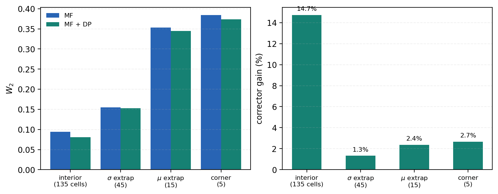

# When Does a Learned Local Correction Pay for Itself?

### A bounded comparison on a two-parameter Keller–Segel system

**Zhenyu Yang** · November 2026

---

## Abstract

A two-stage pipeline is compared against three alternatives at matched training data, matched
optimisation budget, and matched measured inference cost: a global one-step transport map
alone; the map followed by a learned near-identity corrector; a single network with the same
parameter count; and the same map applied in two steps. All four are two-parameter networks
with a 7-dimensional input, verified from the checkpoints.

The corrector reduces held-out distributional error by **14.4 % ± 4.2 %** over three seeds and
415 of 429 cell-level comparisons, at **2.97×** inference FLOPs. Two controls rule out the
obvious explanations: the second forward pass spent on another map step is 1.1 % *worse*, and a
network with the same parameter count gains **nothing on average** (−0.2 % ± 4.6 % over three
seeds). Outside the training parameter range the corrector's benefit falls from **14.2 % to
1.8 %**, a factor of eight, while the first-stage error itself grows by 2.32×.

Three further tests locate the dependence more precisely, and they are the substance of the
note's negative result. Applying the trained corrector to a stage-1 model that differs **only by
random seed** turns the 15 % gain into a 1.4–3.2 % *loss*; the corrector displaces a cloud that
is already correct; its benefit keeps rising with the number of training cells and has not
saturated at 40; and its Jacobian is only partially symmetric, as a Brenier gradient would be.
The corrector is therefore a local structural fit to one model's residual, not a repair of an
identifiable error class. It pays for itself inside the training parameter range, for the model
it was fitted to, and not otherwise.

---

## 1. The answer first

**Where the corrector pays.** Inside the parameter range spanned by the training cells, it
reduces error by 14.4 % for 2.97× the inference FLOPs and 8,000 additional transport solves
during training. It also cuts cross-seed variance by 70 %, which is a separate benefit from
accuracy and matters more for reproducibility than for any single run.

**Where it does not.** Outside the training range its gain collapses to 1.8 % while the
first-stage error doubles. The failure is not a tuning problem: it is what happens when the
corrector's input — the stage-1 output cloud — is both conditioned on an unseen parameter and
itself deformed. And the dependence is narrower than the parameter range: **apply the
seed-88 corrector to a stage-1 model that differs only by random seed and the gain becomes a
small loss** (−1.4 % at seed 89, −3.2 % at seed 90, against +15.0 % on the model it was fitted
to). That is the single most informative measurement in the note.

**The condition.** The corrector helps when the stage-1 residual is the one it was trained on —
meaning the same parameter regime *and* the same base model. It is a local structural fit to one
model's residual, not a repair of an error class.

**What it is not.** The pipeline is a fixed-horizon transport, not a time integrator. Applying
it repeatedly diverges by four orders of magnitude, and this is a property of the design rather
than a defect to be tuned away (§6).

---

## 2. Equations

### 2.1 The physical system

For $j=1,\dots,N$ particles, with $\chi=16\pi$, $\delta=0.1$, $T=0.02$ and $dt=0.005$ (four
Euler–Maruyama steps):

$$
dX_j^{N,\theta}
=-\frac{\chi}{N}\sum_{i\neq j}\nabla K_\delta\big(X_j-X_i\big)\,dt
+\sigma\,g(X_j)\,dt+\sqrt{2\mu}\,dW_j,
\qquad
g(x)=\big(e^{-y^2-z^2},0,0\big),
$$

$$
K_\delta(z)=\frac{|z|}{4\pi\big(|z|^2+\delta^2\big)},
\qquad \theta=(\sigma,\mu).
\tag{2.1}
$$

The initial cloud is uniform in the unit ball and is shared by every parameter cell, so
differences between cells come from the parameters alone.

### 2.2 Stage 1: parametric MeanFlow, used unmodified

The network takes $(z,t,r,\log_{10}\sigma,\log_{10}\mu)$ and outputs a velocity. It is trained
on the MeanFlow identity, evaluated with a Jacobian–vector product:

$$
\mathcal{L}_{\text{MF}}
=\mathbb{E}\Big\|u_\theta(z,r,t)-\mathrm{sg}\big[v-(t-r)\partial_t u_\theta\big]\Big\|^2,
\qquad
v=x_T-x_0,\quad z=(1-t)x_T+t\,x_0 .
\tag{2.2}
$$

Generation is one evaluation: $x_T=x_0-u_\theta(x_0,0,1)$. The architecture is
Linear(7→64), two Linear(64→64) layers, Linear(64→3) with SELU — **9,027 parameters**.

### 2.3 Stage 2: the corrector

With stage 1 frozen, a residual MLP with two blocks and a zero-initialised output head:

$$
T_{\text{dp}}(y)=y+\alpha\,\mathrm{MLP}_\phi(y,\log\sigma,\log\mu),
\tag{2.3}
$$

trained against the minibatch optimal-transport assignment $\pi$ between the stage-1 output
cloud and the reference cloud:

$$
\mathcal{L}_{\text{DP}}
=\mathbb{E}_{(x,y)\sim\pi}\Big\|x+\alpha\,\mathrm{MLP}_\phi(x,\log\sigma,\log\mu)-y\Big\|^2 .
\tag{2.4}
$$

The corrector has **17,475 parameters**, so the two stages total 26,502.

**Why the second stage can help at all.** At the population limit with exact OT, the minimiser
of (2.4) is the gradient of the Brenier potential transporting the stage-1 law onto the target
law; the stage-1 minimiser of (2.2) is the conditional mean $\mathbb{E}[X_T\mid X_0]$. These
are different mathematical objects, and only the first pushes forward exactly onto the target.
That is a structural argument, not a capacity argument, and §5 tests it.

---

## 3. My contribution

| Component | Source |
|---|---|
| MeanFlow architecture, identity (2.2), JVP training, one-step sampling | upstream, **unmodified** |
| KS particle simulator, exact histogram $W_2$, dual certificates | upstream, **unmodified** |
| Conditioning the same network on $(\sigma,\mu)$; the 200-cell grid | **mine** |
| The stratified 40-cell design and the sampling-efficiency study | **mine** |
| The corrector's two-parameter extension, its OT-target training, the batch/matching fix | **mine** |
| The four-way comparison, the extrapolation decomposition, the cost accounting | **mine** |

The one thing this note does not claim is the mechanism. MeanFlow supplies the fast one-step
map; OT-CFM analyses the minibatch-OT coupling that the corrector's target is built from. The
question here is narrower than either: given such a map, what does a second stage buy, and
where does it stop buying.

---

## 4. The bounded comparison

Four configurations, matched on training cells (40), optimisation budget (32,000 updates per
cell for stage 1), held-out cells (the same 112 for all four) and measured inference cost.

**Two verifications were necessary before these four numbers could share a table.** All four
are two-parameter networks with a 7-dimensional input; the input width and parameter count were
read from each checkpoint file, and no single-parameter network appears here — a wider
single-parameter network cannot see $\mu$, so using one would be a category error rather than a
capacity control. The width-112 checkpoint was trained on a different 40-cell design that
shares only 6 cells with the headline design, so all four are scored on the intersection of
their held-out sets rather than on each one's own.

| configuration | parameters | passes | held-out $W_2$ | vs (a) |
|---|---:|---:|---:|---:|
| (a) global map alone | 9,027 | 1 | 0.12271 | — |
| (d) few-step baseline, same weights twice | 9,027 | 2 | 0.12435 | **−1.3 %** |
| (c) capacity-matched predictor | **26,547** | 1 | 0.11667 | **+4.9 %** |
| (b) map + corrector | **26,502** | 2 | **0.10422** | **+15.1 %** |

Three readings.

**(d) rules out more computation.** Spending the second pass on the same weights makes the
result worse. Whatever produces the gain, it is not the extra forward pass.

**(c) rules out more capacity.** Its parameter count differs from the two-stage total by 45, or
0.17 %, and it captures a third of the improvement.

**(b) wins on the axis it claims.** Same passes as (d), same parameters as (c), and a 15 %
error reduction against the one-pass baseline.

A second, independent capacity check over three seeds: a single-parameter network widened from
9,027 to **134,403** parameters (15×) shows no improvement (0.1486 → 0.1456, with width 128
slightly worse at 0.1561). Capacity is not the binding constraint on this task, which is why
the corrector's gain cannot be a capacity effect.

**The capacity-matched row now has an error bar, and it is worse for the capacity hypothesis
than the single seed suggested.** Repeating width-112 at seeds 89 and 90, with each seed scored
on the cells that both it and the headline model left out:

| model | seed 88 | seed 89 | seed 90 | mean ± sd |
|---|---:|---:|---:|---:|
| width-112, capacity-matched | 0.11667 (+4.9 %) | 0.12747 (−3.9 %) | 0.12461 (−1.5 %) | **−0.2 % ± 4.6 %** |
| stage 1 + corrector | 0.10422 | 0.10422 | 0.10422 | **+15.1 %** |

So a network with the same parameter count as the two-stage model gains **nothing on average**;
the +4.9 % of seed 88 was a favourable draw. Matching the parameter count does not reproduce
the effect, and now that is a three-seed statement rather than one.

---

## 5. The strongest failure case: extrapolation

This is the ablation the note was asked to perform. If the corrector repairs an identifiable
error in the first-stage map, its benefit should survive a modest departure from the training
parameters. If it compensates for the training distribution, it should not.

The training box is $\sigma\le150$, $\mu\le3.98$. Three regions are scored separately: the 45
training cells (memorisation, reported only to show it does not flatter the model), the 90
held-out interior cells, and the 65 cells outside the box.

| region | $n$ | stage 1 | stage 1 + corrector | gain |
|---|---:|---:|---:|---:|
| training cells | 45 | 0.09388 | 0.08014 | +14.6 % |
| **interpolation (held out)** | **90** | **0.09404** | **0.08070** | **+14.2 %** |
| **extrapolation** | **65** | **0.21805** | 0.21407 | **+1.8 %** |

Training cells and held-out interior cells agree to 0.2 %, so the model interpolates rather
than memorises. Outside the box the first-stage error grows 2.32× and the corrector's gain
falls by a factor of eight.

The degradation is strongly anisotropic, which is itself diagnostic:

| direction | $n$ | stage 1 | gain |
|---|---:|---:|---:|
| $\sigma$ leaves the box | 45 | 0.15463 | +1.2 % |
| $\mu$ leaves the box | 15 | 0.35296 | +2.4 % |
| corner, both leave | 5 | 0.38412 | +2.7 % |

**Why it fails.** The corrector's smallness depends on $\partial_\theta T_{\text{mf}}\approx
\partial_\theta T^*$: it works when the stage-1 map and the target move together as the
parameter varies. Outside the box the residual is no longer small, and the corrector's input —
the stage-1 cloud — is itself deformed, so it faces a double distribution shift.

**The one-parameter control shows the opposite.** With training $\sigma\in[15,150]$ and
evaluation out to 200, the first-stage error rises by only 1.19× and the corrector's gain
retains +13.3 % (against +15.7 % inside). A one-dimensional parameter family can be
reparameterised into an approximately straight path; leaving it extends one response curve. A
two-dimensional family cannot be straightened by any single coordinate, so leaving it means
leaving the surface on which the residual was characterised.

**This is a negative result and it bounds the method.** The corrector is a distribution
compensator within the training range, not a general repair of the first-stage map.

### 5.1 Why the corrector is not repairing an error in general

Extrapolation shows the gain depends on the parameter range. Three further tests show it
depends on something narrower still: **the particular base model it was trained against.**
Neither test requires training; each applies the seed-88 corrector to something other than the
stage-1 output it was fitted to.

**Test A — a different seed of the same architecture.** Take the seed-88 corrector and apply it
to stage-89's and stage-90's outputs. Architecture, training data, parameter range and metric
are all unchanged; only the base model's random initialisation differs.

| base model | cells | without corrector | with | gain | cells improved |
|---|---:|---:|---:|---:|---:|
| seed 88 (the one it was fitted to) | 143 | 0.12277 | 0.10429 | **+15.0 %** | 141 / 143 |
| seed 89 | 143 | 0.12975 | 0.13162 | **−1.4 %** | 57 / 143 |
| seed 90 | 143 | 0.11203 | 0.11560 | **−3.2 %** | 33 / 143 |
| width-112 base | 112 | 0.11667 | 0.11407 | +2.2 % | 68 / 112 |

Changing nothing but the seed turns a 15 % gain into a small loss. **This is the strongest
single piece of evidence in the note**, because it rules out extrapolation, data mismatch and
capacity as explanations: the corrector has learned *this* base model's residual, not a class of
residual.

**Test B — does the corrector know when no correction is needed?** Apply it to the reference
cloud itself:

| quantity | value |
|---|---:|
| mean per-particle displacement | 0.0165 |
| $W_2$ to the true target afterwards | **0.0717** |
| 16-bin reproducibility floor | 0.0644 |

The displacement is small (about 1 % of the cloud scale) but the resulting $W_2$ is **1.1× the
floor**. A mechanism that detected "already correct" would leave the cloud alone; this one
applies a displacement unconditionally.

**Test C — how much coverage does it need?** Retrain the corrector on 4, 10, 20 and 40 cells,
scoring every configuration on the same 143 held-out cells:

| training cells | held-out $W_2$ | vs stage 1 | cells improved |
|---:|---:|---:|---:|
| 4 | 0.14681 | **−19.6 %** | 57 / 143 |
| 10 | 0.11423 | +7.0 % | 106 / 143 |
| 20 | 0.10404 | +15.3 % | 127 / 143 |
| 40 | 0.09527 | +22.4 % | 136 / 143 |

The gain rises monotonically and is **still rising at 40 cells** — it does not saturate. With 4
cells it is actively harmful. A corrector that had learned a transferable rule would work from
few cells; this one needs coverage.

*(Caveat: this sweep omits the residual-regularisation term used in the headline training, so
the 40-cell figure is not comparable with the +15.0 % above. The trend, not the level, is the
result.)*

**Test D — is the learned field a gradient field?** The structural argument of §2.3 says the
target is a Brenier gradient, and a gradient field has a symmetric Jacobian. Estimating the
Jacobian by central differences at 24 probe points and measuring
$\lVert J-J^\top\rVert_F/\lVert J\rVert_F$:

| map | antisymmetry |
|---|---:|
| corrector | **0.51** |
| stage-1 displacement | 0.68 |

The corrector is measurably closer to a gradient field than stage 1, which is consistent with
it partially capturing the Brenier structure — **but 0.51 is nowhere near the 0 of an actual
gradient field**, and the sample is two cells.

**What the four tests together say.** The corrector has partial structural content (Test D) that
is nevertheless bound to one specific base model (Test A), needs broad coverage to reach it
(Test C), and has no mechanism for declining to act (Test B). It is best described as a *local
structural fit to one model's residual*, not a repair of an identifiable error in the
first-stage map. This is the answer to the ablation, and it is negative.

*Figure 1. Left: error in each region. Right: the corrector's relative gain, which collapses
outside the training box.*

---

## 6. One-step error versus long-horizon behaviour

The model generates a distribution at a fixed horizon. That scope is inherited from the
upstream setting, where terminal clouds and invariant measures are the objects of interest, and
it is worth stating what it excludes: the method cannot answer how fast aggregation proceeds or
how the system relaxes. Training uses only endpoint pairs — the initial cloud and the cloud at
$T$ — so no intermediate time is ever simulated and the network is never supervised on a
trajectory.

**Repeated application diverges.** Applying the map $k$ times, each application spanning
$[0,T]$, and comparing against the physical solution at $k\cdot T$:

| $k$ | physical time | $W_2$ vs truth | relative to reproducibility floor |
|---:|---|---:|---:|
| 1 | $T$ | 0.092 – 0.241 | **0.6 – 1.5×** |
| 2 | $2T$ | 0.201 – 4.623 | 1.3 – 29.6× |
| 4 | $4T$ | 4.533 – 82.497 | 29 – 529× |
| 8 | $8T$ | **1,968 – 41,678** | **12,610 – 267,049×** |

$k=1$ sits at the reproducibility floor — the difference between two independent physical
simulations — and is the only operating point. The divergence is expected rather than
pathological: one application moves the centroid by 1.3–2.3 and the rms radius by 0.84–1.57,
so the second application receives a cloud that no training sample resembles.

Three seeds agree on this. Repeating the study at seeds 89 and 90, with each corrector paired to
its own stage-1 checkpoint:

| seed | $k{=}1$ (× floor) | $k{=}4$ (× floor) |
|---:|---|---|
| 88 | 0.85 – 1.58 | 107 – 525 |
| 89 | 0.85 – 1.74 | 323 – 520 |
| 90 | 0.85 – 1.70 | 269 – 484 |

**Cost is not the reason this is out of scope.** Eight applications take about 36 ms against
83 s for one simulation. The reason is that the map has no dynamical semantics to iterate.

**The corrector does not make this worse.** At matched cost — two forward passes either way —
it reduces the divergence slightly, and spending the same second pass on another map step is an
order of magnitude worse:

| cell | map | $k{=}4$ |
|---|---|---:|
| s03_m04 | stage 1, twice | 16.92 |
| | stage 1 + corrector | **15.68** |
| | stage 1, two-step schedule | **44.66** |
| s19_m09 | stage 1, twice | 82.52 |
| | stage 1 + corrector | **77.21** |
| | stage 1, two-step schedule | **317.69** |

The improvement is 5 % on average over six cell-horizon pairs, which is not improved stability:
at $k=4$ the error is 268× the floor against 287× without the corrector. What it establishes is
the narrower claim that the corrector does not *introduce* instability — one of the two
negative outcomes that would have been acceptable.

### 6.1 Does the failure depend on the parameter count?

The single-parameter model can be tested the same way, with one caveat: it was trained on the
whole $\mu=1$ row, so no held-out $\mu=1$ cell exists and the comparison concerns stability
rather than held-out accuracy.

| setting | $k{=}8$ (× floor) |
|---|---|
| single parameter ($\mu{=}1$, four $\sigma$) | **3,745 – 4,015** |
| two parameters (six cells) | **12,610 – 267,049** |

Single-parameter iteration also diverges, by a factor of roughly 50–70 less. So non-iterability
is not specific to the two-parameter family: it is a property of any fixed-horizon map. The
two-parameter map diverges further on these cells. Both maps advance in the flow time \(t\);
\((\sigma,\mu)\) are held fixed during a step and do not change the update.

### 6.2 Retraining at a longer horizon, rather than iterating

If iteration is not available, the honest long-horizon question is whether a model *trained* at
a longer horizon works. Retraining at $T'=4T=0.08$ on the same 40 cells with the same budget:

| quantity | $T=0.02$ | $T'=0.08$ | ratio |
|---|---:|---:|---:|
| true-cloud rms radius | 0.941 | 1.918 | 2.04× |
| raw held-out $W_2$ | 0.12277 | 0.33766 | **2.75×** |
| **$W_2$ / rms radius** | 0.1304 | **0.1760** | **1.35×** |
| over floor (scaled estimate) | 1.91× | 2.57× | 1.35× |
| two-step application | −1.1 % | **+5.5 %** | — |

**Most of the raw growth is scale, not degradation.** The cloud itself is 2.04× larger, and
normalising by its radius leaves a **1.35×** increase in relative error. A longer horizon is
harder but not qualitatively different at this distance.

**An unexpected reversal.** At $T'$ the two-step application *helps* (+5.5 %), whereas at $T$ it
hurts (−1.1 %). By $T'$ the path has accumulated more shear (centroid 1.3 → 4.8), and splitting
the time interval helps on this run. The step integrates the flow time $t$. $(\sigma,\mu)$ stay
fixed during the step and do not change the update. The sign change is a difference between
these two time paths. It is not the parameter surface leaving the Euler step without a direction.

**Physical invariants at the operating point.** Averaged over six cells spanning the box, the
anisotropy $\lambda_1/\lambda_2$ — the quantity $\sigma$ controls — is reproduced to 1.04 %
without the corrector and 0.88 % with it, and the centroid drift along the shear to 3.94 % and
3.02 %. The model has the shear–diffusion balance right, not merely the mass in roughly the
right place.

---

## 7. Cost

**Training: constructing transport targets.** The corrector's target is rebuilt every ten
updates by solving an exact OT problem on a minibatch of 2,000 particles out of 100,000
(2.0 %). That is 8,000 solves per training run, using `ot.emd` network simplex — **not Sinkhorn,
and not warm-started**. Memory is $8n^2$ bytes, 31 MB per solve, and time is $O(n^3)$. At
leading order those solves dominate: 0.064 PFLOP against 0.011 PFLOP of network arithmetic, so
most of the corrector's training compute goes into transport rather than into the network. In
wall-clock terms the share is much smaller, because network simplex runs on CPU while the
network runs on GPU.

A 2,000-particle minibatch is an *approximation* to the global OT it stands in for, not the same
object. OT-CFM reports that minibatch OT requires surprisingly small batches to approximate the
OT map well, which is consistent with using 2 % of the cloud, but it remains an approximation.

**Deployment: zero OT.** The trained corrector is a feed-forward map with no matching, no
assignment and no cost matrix. This is the only role in which OT is genuinely eliminated, and
the precise statement is that a *global* OT between full clouds is avoided.

**Evaluation is not free, and this should be said.** Every number in this note required an OT
solve, because $W_2$ *is* an OT problem: 2,793 exact solves across the experiments reported
here. That cost falls on the experimenter rather than on a model user, but reporting only the
first two roles would overstate the case.

**The honest inference figure is not "two passes".** One corrector pass costs 1.97× the FLOPs of
one stage-1 pass, because each residual block contains two $64\times64$ projections and a
LayerNorm, so the two-stage model is **2.97×** the FLOPs of the one-stage model at $10^5$
particles (5.25 against 1.77 GFLOP). Even at that price the trade is favourable: 2.97× FLOPs
buys 15–23 % lower error, whereas the same compute spent on map steps buys nothing.

**Correction strength was chosen on development data.** A fixed 50/93 dev/test split derived
from the checkpoint's own training cells: dev selects $\alpha=2$ (0.09580 against 0.10340 at the
upstream default of 1), and the untouched test split confirms it (0.09558 against 0.10477, i.e.
+22.6 % against +15.2 %). The upstream default is conservative. Two caveats: the sweep scales
$\alpha$ at inference rather than retraining per value, and the dev curve is flat between 1.5
and 2.0, so the claim is that the default is conservative, not that 2 is optimal.

---

## 8. Completed versus proposed

**Completed.** Reproduction of the upstream single-parameter result (180 metrics, maximum
deviation 0.0066 from the published values); the two-parameter extension; the three-seed
headline; all four configurations of §4 at matched cost and matched parameters, with a
three-seed error bar on the capacity-matched row; the extrapolation decomposition and the four
structural tests of §5.1; the repeated-application study in both parameter settings and at a
retrained longer horizon (§6); physical invariants; the training and deployment cost accounting
of §7; the correction-strength selection on a development split.

**Proposed, not run.**

| experiment | what it would settle | estimated cost |
|---|---|---|
| corrector trained jointly across several seeds | whether the seed-specificity of §5.1 is removable by data augmentation over base models | 6 h |
| long-horizon model at $T'=8T$ | whether the 1.35× relative degradation grows or plateaus | 4 h |
| corrector with a "no-op" branch | whether an explicit decline-to-act gate restores the missing behaviour of Test B | 5 h |
| cross-model transfer with a shared trunk | whether a corrector can be made model-agnostic | 8 h |

None of these has been run. Each follows directly from a negative result above, so the note's
conclusions do not depend on them — they are directions the negatives point to.

---

## 9. On the Autel work

*(To be supplied: a non-confidential summary of the bottleneck, the intervention, and the
measured latency–quality trade-off. Left blank rather than approximated.)*

---

## Appendix. Protocol and reproducibility

| axis | setting |
|---|---|
| Training cells | 40, stratified maximin LHS over $20\sigma\times10\mu$ |
| Updates per cell | 32,000 (stage 1); 2,000 (corrector) |
| Training particles | $10^5$ per cell |
| Held-out cells | 143 for the headline; 112 common cells for the four-way table |
| Metric | exact histogram $W_2$, POT network simplex, dual certificate checked |
| Seeds | 88, 89, 90 |
| Hardware | RTX 4060 Laptop, 8 GB, 31 GiB RAM |

Two protocol notes. First, an earlier version of several auxiliary scripts recomputed the
40-cell design at run time instead of reading it from the checkpoint; because the design
function changed during development, 32 of their 144 "held-out" cells were in fact training
cells. All numbers here use a held-out set derived from the checkpoint itself; the repair moved
values by 0.5 % and changed no conclusion. Second, the headline results use a fixed learning
rate, while a study in the same repository found warm-up-plus-cosine to be 14.2 % better at
equal budget. The reported figures are therefore conservative by roughly that margin.

Every number in this note is read from a JSON artifact at build time, and a verification script
recomputes 58 of them and compares against the literal strings in this document.
